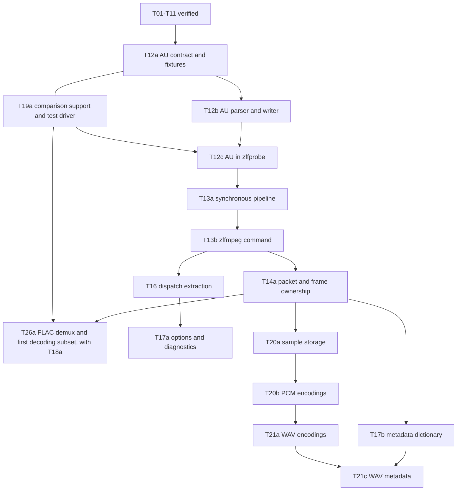

# Native Zig port: implementation checklist

This is the execution checklist for [port.md](port.md). The plan explains the
architecture and compatibility rules; this file records the work to do, from
the finished first path to a port that covers most of what FFmpeg's users
need. The repository tracks project documentation, the minimal Zig package and
build (the `av` module, documented in [zig/README.md](zig/README.md)), the WAV
and AU fixture contracts ([zig/testing/fixtures](zig/testing/fixtures/README.md))
and two complete paths: PCM s16 kernels, audio/time types, bounded WAV and AU
parsers and known-length writers, file and pipe adapters, content detection,
a WAV/AU conversion pipeline and the `zffprobe` and `zffmpeg` tools. Linux CI builds and tests it in every mode and compares it with a pinned
FFmpeg build ([zig/testing/reference](zig/testing/reference/README.md)).
Development is verified on Linux only; see the
[platform policy](#platform-policy-linux-only-during-development). FFmpeg and
zigimg are independent clones in ignored `.references/`; see
[README.md](README.md#clone-the-reference-repositories) for setup.

T12 is verified: the AU contract and 29 fixtures (T12a), the AU parser and
writer (T12b) and AU in `zffprobe` with content detection (T12c). T13 is verified too: the
synchronous conversion pipeline (`av.convert`, T13a) and the `zffmpeg`
command (T13b). T14a, packets, frames and send/receive stages, T20a, decoded sample storage,
T20b, the PCM encodings, and T21, complete WAV (T21a, extensible headers and
encodings; T21b, RF64/BW64, Sony Wave64 and unknown-length input; T21c, tags,
with T17b's metadata dictionary), T22a, every AU PCM encoding and
unknown-length AU, T16, the codec and format registries with FFmpeg's scored
content probing, and T22, the remaining audio containers (T22a AU encodings,
T22b AIFF and AIFF-C, T22c raw PCM with FFmpeg's extension fallback, T22d
CAF demux), are verified, and so is T23a, sample format conversion with
libswresample's dither. **Next: T23b (channel layouts). See
[Near-term order](#near-term-order).**

Pick the next ready subtask from the dependency graph, as
[How tasks are completed](#how-tasks-are-completed) describes. Tasks and
subtasks have stable IDs for references. Check an item only when its gates are
met, and append a short evidence note with the relevant files, the checks run
and the commit. Keep unfinished or blocked items unchecked and record what
remains. Update the feature ledger in port.md when an entire capability becomes
implemented or verified; do not duplicate this detailed checklist there.
Implementation decisions and fixture expectations must agree with the
subtask's written contract; for WAV, the
[first WAV contract](port.md#first-wav-contract).

Follow [document authority](port.md#document-authority) and
[supported-scope policy](port.md#supported-scope-and-policy) when changing the
plan. This file owns task status and evidence; port.md owns architecture and
behavior. Revise a scope, limit, error policy or required check in the affected
contract, task, fixtures and notes.md together. FFmpeg accepting a sample does
not by itself widen the supported subset. A second algorithm implementation
needs a recorded purpose, comparison oracle and retention or retirement
condition; T58 always retains its scalar oracle.

## Platform policy: Linux only during development

Decided on 2026-11-03 and recorded in [notes.md](notes.md#ci): until the
platform milestone (T62–T63), every task is built, tested and compared on
Linux x86-64 only.

- A task's "Done when" criteria are met by native Linux runs in Debug,
  ReleaseSafe and ReleaseFast in the [CI workflow](.github/workflows/ci.yml),
  plus the `reference` job's FFmpeg comparison where the task has one. Windows,
  ARM (AArch64 Linux and macOS) and big-endian runs are neither required nor
  claimed. They wait for T62 and T63, when the code is more complete.
- New Zig code must still be portable, so that those later runs find little to
  fix. Follow [Portable Zig code](CLAUDE.md#portable-zig-code) in CLAUDE.md: in
  short, reach the OS only through `std.Io` and `std.process.Init`, keep byte
  order and integer widths explicit, and keep architecture-specific code behind
  a scalar reference.
- CI's compile-only step builds the library and tools for x86_64-windows-gnu,
  aarch64-linux-musl and aarch64-macos. It catches Linux-only APIs at compile
  time; it is a portability guard, not test evidence for those platforms.
- The FFmpeg reference build stays Linux-only, also after T62/T63; other
  platforms compare against results recorded on Linux.

## How tasks are completed

### Task structure and dependency words

Parent tasks keep their stable IDs. Most are split into subtasks (T12a, T12b,
...) that are reviewed, verified and checked on their own. A parent is checked
when all of its subtasks are, or after a recorded decision revises its scope.
Subtasks name their relationships with three phrases:

- **Needs**: must already be verified before the work starts.
- **Lands with**: built in the same change, because neither can be tested
  without the other.
- **Verified after**: a completion gate. The work can be implemented first, but
  stays unchecked until the named gate passes.

Shared infrastructure has self-contained gates and a **Start with** note naming
its first consumer. That note schedules the work; it is not a dependency. T01–T11
use "Depends on", which means **Needs**. Pick the next subtask whose needs are
verified; milestone order is a guide, not a gate. Keep one active
implementation slice unless two slices have independent prerequisites.

Splitting a task keeps every existing ID's meaning and appends new IDs; IDs do
not need to follow execution order. One exception happened before any of the
affected work started: commit `8b1652a` re-split T43 and T47 and moved these
subtask IDs to new meanings. Earlier reviews and references keep their original
IDs and commits; read them with this mapping:

| Meaning at `4fe1beb` | ID there | ID from `8b1652a` |
| --- | --- | --- |
| H.264 parameter sets and slice syntax | T43a | T43b (packet assembly is the new T43a) |
| H.264 intra decoding | T43b | T43c |
| HEVC syntax | T47a | T47b (packet assembly is the new T47a) |
| HEVC Main intra | T47b | T47c |
| HEVC Main inter | T47c | T47d |
| HEVC Main 10, tiles and WPP | T47d | T47e |

### Gates

| Gate | Artifact or behavior | Exit condition |
| --- | --- | --- |
| G0 ready | The subtask's progress card: exact subset and exclusions, prerequisites, upstream source map, limits, errors and ownership; any policy revision is recorded in notes.md. | Every need is verified or lands in the same change; affected contracts agree with the scope. |
| G1 oracle | Independent vectors, reference commands and results, fixture hashes, the declared comparison rule. | Expected outputs exist before implementation; required and optional coverage are listed separately. |
| G2 scalar implementation | Small concrete Zig types, local state, checked parsing, explicit allocator and I/O. | Unit vectors pass; new test files are reachable from `zig/root.zig`; new examples are registered in `build.zig`. |
| G3 failure behavior | Truncation, malformed input, limit boundaries, one-byte input, output and flush failures, cancellation, allocation-failure injection, a bounded fuzz smoke run. | Each relevant case has an assertion and passes in ReleaseFast. Buffering stages also pass drain, reset and backpressure tests. |
| G4 integration | Library path, CLI process cases where applicable, FFmpeg reading Zig-generated output, metadata and timestamp checks. | The supported operation or profile matrix passes; unsupported combinations fail as specified. |
| G5 verified | Linux CI, the reference report, the port.md ledger and limitations. | All required checks pass for the implementation commit, and the evidence links the commit, the run and the coverage counts. Only now check the subtask. |

Work at G2–G4 is **implemented** in the port.md ledger. It becomes **verified**
only at G5, and **optimized** only with a retained scalar oracle and a measured
gain. Evidence belongs to a commit: a later refactor re-runs the gates rather
than inheriting the claim.

### Coverage and comparison rules

- Required fixtures are named in the subtask's contract and fail when missing
  or altered; that list is the coverage denominator. Generate them with
  standard-library Python, or commit small reference-made or conformance files
  with recorded commands, hashes and licenses. A file that is too large or not
  redistributable is fetched by pinned hash and still fails when missing.
- Optional corpora (FATE samples and the like) are reported separately with
  their skips. A missing optional sample never removes a required gate.
- A check whose code has not landed yet is reported as **not implemented**,
  apart from passes and skips, and becomes mandatory in the subtask that owns
  it. It never disappears into a passing skip count.
- Extend [build-ffmpeg.sh](zig/testing/reference/build-ffmpeg.sh) only with the
  LGPL components the subtask compares against. Record the FFmpeg revision,
  configuration, binary and fixture hashes and commands with each report; a
  cached build counts when its recorded identity matches.
- Integer and lossless decoding compares canonical samples or planes exactly,
  together with format and timing. Remuxing compares packet payloads, codec
  configuration, stream parameters and normalized timestamps: container bytes
  may differ, and packet-boundary normalization is stated where demuxers split
  payloads differently. Lossy encoders are checked for decodability, duration,
  bitrate and a declared quality metric. Floating-point output declares its
  error metric, threshold and alignment before the run; never widen a tolerance
  just to pass. Normalization keeps negative timestamps, missing values and
  side data.
- Every allocating or buffering feature passes allocation-failure injection,
  limit-boundary tests and chunking tests before G5, so port.md's
  [resource rules](port.md#core-api-and-resource-rules) are enforced at first
  use. Every parser of untrusted bytes gets a bounded `std.testing.fuzz` entry
  with seeds and a recorded smoke budget; T60 adds sustained campaigns. A
  passing test suite is not evidence of a fuzz campaign.
- Generated media is validated by FFmpeg reading the actual Zig output, not
  only by self round trips or by fixtures the writer is tested to reproduce.
- Keep three things apart: codec identity (the encoding), decoded storage
  (sample format, layout, planes) and what a container can carry. Each
  container subtask lists the encodings it demuxes and muxes, taken from the
  upstream codec tag tables. Stream copy into a container that cannot carry an
  encoding fails before any output is created.
- Record revisable decisions in [notes.md](notes.md), provenance in each new
  file's header and [zig/README.md](zig/README.md), and capability status in
  the [port.md ledger](port.md#provenance-and-feature-tracking).

### Progress card

Copy this under the active subtask at G0 and keep it current. It is the one
authoritative record of the slice; its states do not replace port.md's ledger
words.

```text
ID / parent:
State: planned | ready | implementing | validating | verified | blocked
Supported behavior and explicit exclusions:
Needs (verified) / lands with / verified after:
Contract and source provenance:
Required fixtures / optional corpus:
Ownership, state transitions and limits:
Comparison rule and intentional differences:
Implementation files and test entry points:
Evidence commit / Linux CI run / reference report:
Required cases: passed __ / failed __ / missing __
Optional cases: passed __ / failed __ / skipped __ (reasons)
Fuzz seeds, budget and result:
Remaining work or blocker / next action:
```

Do not report a percentage of FFmpeg implemented from checked task counts.

## Completed preparation

- [x] Inspect the FFmpeg source layout and record the reference revision.
  Evidence: [inspected baseline](port.md#inspected-baseline) and source map.
- [x] Establish project guidance and a Zig design with phased acceptance criteria.
  Evidence: [CLAUDE.md](CLAUDE.md) (formerly AGENTS.md) and [port.md](port.md).
- [x] Validate the illustrative PCM kernel with Zig 0.17.0.
  Evidence: both documentation-example tests and formatting passed; this is not
  an implemented codec. T04 later promoted it to [zig/codec/pcm.zig](zig/codec/pcm.zig). See [the example](port.md#example-one-pcm-kernel-two-byte-orders).
- [x] Clone and inspect zigimg as a Zig implementation reference.
  Evidence: [pinned analysis](doc/zigimg-reference.md), commit `083d0304840a3f5fd547c2e2005148a18886c401`;
  its focused I/O suite passed 15/15 tests with Zig 0.17.0.
- [x] Make the adopted I/O patterns runnable in an original example.
  Evidence: [io_patterns.zig](zig/examples/io_patterns.zig), formatting and 6/6
  tests passed in each of Debug, ReleaseSafe and ReleaseFast on native Windows.
  Covers memory, fragmented input, file buffers, truncation, read failure and
  fixed output capacity. A seventh test for the file adapter's retained `.err`
  was added later; all 7 tests pass in Linux CI (see the CI entry below) but
  have not been rerun on Windows. This does not complete T01 or implement WAV.
- [x] Separate zffmpeg into its own repository with reproducible reference setup.
  Evidence: [README.md](README.md) records both pinned clone commands;
  [.gitignore](.gitignore) excludes references and Zig build output. Only project
  documentation and the original Zig example belong in the initial commit.
- [x] Add Linux CI for the standalone examples.
  Evidence: [ci.yml](.github/workflows/ci.yml);
  [run 41544372319](https://github.com/zxc-f/zffmpeg/actions/runs/41544372319)
  on `ubuntu-24.04` at commit `d701a20` confirmed `zig version` 0.17.0, passed
  `zig fmt --check zig/`, and passed 7/7 `io_patterns.zig` and 2/2
  `pcm_s16.zig` tests in each of Debug, ReleaseSafe and ReleaseFast. Native
  Windows CI is deferred (T11).

## First milestone: build and a tested PCM kernel

- [x] **T01 — Add the minimal Zig package and build.** One package, one named
  library module `av` at `zig/root.zig`; internal files use ordinary imports.
  Preserve target/optimization options. Default install must compile an artifact,
  and `test` must execute its test artifact. Explicitly aggregate the existing
  example tests (`zig/examples/*.zig`) through a test root or separate run
  artifact; no new media helpers are required for this build task. Extend the
  Linux CI workflow to run `zig build` and `zig build test` in Debug and
  ReleaseSafe with the build's exact-version check. Verify failure propagation with a
  temporary failing test, then remove it. Use `.zig-version`
  as a hint, `.minimum_zig_version = "0.17.0"` as metadata, and an explicit
  tested-version check. Generate a package fingerprint with the toolchain and
  use a `.paths` allowlist excluding the C tree; start with no dependencies.
  Record applicable license/attribution for each new file; preserve derived
  notices. Done when build/test smoke checks pass in Debug and ReleaseSafe,
  `zig fmt --check build.zig build.zig.zon zig/` passes, and build-graph inspection
  or an isolated build confirms no reference C build/compiler dependency.
  Document library setup in `zig/README.md`, update the root README's runnable
  commands and keep outputs ignored. Update the README, plan, checklist and
  agent guidance current-state statements in the same change.
  Evidence: [build.zig](build.zig), [build.zig.zon](build.zig.zon),
  [.zig-version](.zig-version), [zig/root.zig](zig/root.zig),
  [zig/README.md](zig/README.md) and [ci.yml](.github/workflows/ci.yml), merged in
  zxc-f/zffmpeg#4. The fingerprint `0x4b4a1226947194f5` is the value `zig build`
  suggested for the manifest without one ([run 41548322449](https://github.com/zxc-f/zffmpeg/actions/runs/41548322449)). A temporary
  failing test made `zig build test` report `av 0 pass, 1 fail` and exit with
  status 1 ([run 41548611661](https://github.com/zxc-f/zffmpeg/actions/runs/41548611661)); it was then reverted. On the PR head,
  [run 41548960006](https://github.com/zxc-f/zffmpeg/actions/runs/41548960006) passed the exact-version check,
  `zig fmt --check build.zig build.zig.zon zig/`, the example-registration check,
  `zig build` in Debug and ReleaseSafe, and `zig build test` with 9/9 tests
  (`av` 0, `io_patterns` 7, `pcm_s16` 2) in Debug, ReleaseSafe and ReleaseFast
  on `ubuntu-24.04`. No C dependency: `build.zig` has no C sources, libc, system
  libraries or package dependencies, and CI builds from a checkout without
  `.references/`. Native Windows was not run (T11).

- [x] **T02 — Materialize the WAV contract and fixtures.** Create the canonical
  `zig/testing/fixtures/README.md` with a named fixture for each rule in port.md:
  `fmt ` sizes/extensions, mono/stereo, rate/alignment, chunk order/duplicates,
  empty data versus unknown size, padding, truncation, limits and trailing data.
  Record expected samples, metadata, errors/precedence, hashes or deterministic
  generation commands, and fixture provenance. Include high-rate plain tag-1
  output as an intentional header difference from FFmpeg. Also decide and
  fixture the open boundary cases listed under the contract's Bounds row: a
  final odd-sized chunk whose padding byte is missing at EOF, a chunk (including
  `data`) whose declared size exceeds the RIFF extent, and a `riff_size` that
  disagrees with a known input length. Keep a fixture for an inconsistent
  `byte_rate`, which is accepted and ignored. Keep required tiny
  fixtures local and fail if any are missing. Done when small independent
  vectors make every accepted/rejected case reproducible.
  Evidence: [fixture README](zig/testing/fixtures/README.md),
  [generate.py](zig/testing/fixtures/generate.py),
  [manifest.zon](zig/testing/fixtures/manifest.zon) and
  [fixtures.zig](zig/testing/fixtures.zig). 52 committed fixtures (12 accepted,
  5 of them exact writer output, and 40 rejected) plus one synthesized 2 MiB
  vector, each with its expected result and SHA-256. The README records the
  boundary decisions, the error precedence and a byte-by-byte check of
  `mono_8k`. [run 41550661260](https://github.com/zxc-f/zffmpeg/actions/runs/41550661260): `generate.py --check` passed, and `zig build test`
  passed 12/12 in Debug, ReleaseSafe and ReleaseFast, including the `av`
  fixture tests (manifest consistency, every file embedded and matching its
  SHA-256). Remaining at the time: no parser consumed the fixtures and FFmpeg
  had not compared them; T06 and T10 have since done both.

- [x] **T03 — Establish the C reference comparison setup.** Use Linux x86-64 in
  a pinned container or WSL environment. Build `.references/ffmpeg` at the
  recorded upstream revision with Clang. Record environment/tool versions,
  tested configure command,
  `config.log`/binary/fixture hashes and comparisons in
  `zig/testing/reference/README.md`. Enable the WAV/PCM, raw sample output, I/O
  and CLI/filter prerequisites actually needed; disable unrelated autodetection.
  Do not inherit the broad GPL/nonfree FATE configuration. Done when exact PCM
  output and normalized metadata comparisons are reproducible. This is an
  explicit Linux reference-test dependency, independent of native Windows Zig
  tests; work can proceed alongside T01/T02/T04/T05.
  Evidence: [build-ffmpeg.sh](zig/testing/reference/build-ffmpeg.sh) builds the
  pinned commit out of tree with Clang and a minimal LGPL configuration (file
  and pipe protocols, WAV demuxer, s16le decoder, encoder and raw muxer,
  `aresample`; autodetection, asm, network, ffplay and avdevice off), and
  [compare.py](zig/testing/reference/compare.py) runs the comparisons. CI's
  `reference` job runs both on GitHub's `ubuntu-24.04` image, prints the image
  and tool versions, and caches the build under a key from the Clang version
  and the script. [zig/testing/reference/README.md](zig/testing/reference/README.md)
  records the environment (Ubuntu clang 18.1.3, GNU Make 4.3, Python 3.12.3,
  Zig 0.17.0), the configure command, the `ffmpeg`, `ffprobe`, `config.log` and
  fixture SHA-256 values and the full results. Two separate from-scratch builds,
  in [run 41557433205](https://github.com/zxc-f/zffmpeg/actions/runs/41557433205)
  and [run 41557971301](https://github.com/zxc-f/zffmpeg/actions/runs/41557971301),
  gave the same exact-sample and normalized-metadata results. The environment is
  GitHub's versioned runner image (`ubuntu24` 20261026.354.1 in
  [run 41559086382](https://github.com/zxc-f/zffmpeg/actions/runs/41559086382), which restored the cached build with identical
  hashes and results) rather than a container digest; the job prints the image
  version on every run.

- [x] **T04 — Implement the PCM sample conversion kernels.** Depends on T01 and
  T02. Add typed slice-based signed 16-bit decoding and encoding with explicit
  byte order and destination capacity. Start with the needed specialization;
  retain a scalar implementation and document ownership/overlap rules. Done
  when independent vectors cover signed extrema, empty input, incomplete
  samples, insufficient output and the documented failure-mutation behavior.
  Promote the kernel/tests from `zig/examples/pcm_s16.zig` into
  `zig/codec/pcm.zig` and update the port.md source link; record applicable
  per-file license/provenance.
  Evidence: [zig/codec/pcm.zig](zig/codec/pcm.zig) (`decodeS16`/`encodeS16`, both
  byte orders; the example file is removed). Its 7 tests cover signed extrema,
  empty and odd-length input, short outputs with unchanged contents on failure,
  an exhaustive round trip of all 65,536 values checked against independently
  computed bytes, and the 5 writer-output fixtures from `generate.py`.
  [run 41553566007](https://github.com/zxc-f/zffmpeg/actions/runs/41553566007) passed `zig build test` with 28/28 tests in Debug, ReleaseSafe and
  ReleaseFast. Scalar only; no SIMD.

- [x] **T05 — Add only the audio/time types needed by this path.** Depends on T01
  and T02. Represent sample rate, channel count/order, interleaving and borrowed
  samples clearly. Derive timing from integer sample-frame counts; define the
  required time-base/rescaling behavior. Done when zero/invalid rates, channel
  alignment, rounding and overflow boundaries are covered. Defer general frame
  ownership, reference counting and compressed bit readers until needed.
  Evidence: [zig/core/audio.zig](zig/core/audio.zig) (`ChannelLayout`,
  `SampleFormat`, validated `Format` with checked frame/byte arithmetic, borrowed
  `S16Frames`) and [zig/core/time.zig](zig/core/time.zig) (`TimeBase`, `rescale`
  with FFmpeg's five rounding modes, `?i64` timestamps). Tests cover zero rates
  and channel counts, unsupported layouts, incomplete frames, `u64` overflow at
  the boundary, every rounding mode on positive, negative and halfway values,
  and `i64`/`u32` extremes. The rescale vectors come from an exact rational
  oracle that agrees with a transcription of `av_rescale_rnd` except for the
  two documented differences (overflow error, exact INT64_MIN). Passed in
  [run 41553566007](https://github.com/zxc-f/zffmpeg/actions/runs/41553566007). T10 later compared the WAV path's
  `time_base` and `duration_ts` with FFmpeg; `rescale` itself has no direct
  differential run against `av_rescale_rnd`.

## Second milestone: a complete WAV/PCM path

- [x] **T06 — Implement one bounded WAV parser.** Depends on T02 and T05. Accept
  `*std.Io.Reader`, initially tested with `Reader.fixed`; read exact fields into
  local arrays instead of casting structs. Implement T02's complete contract,
  including validation after data and contextual EOF/error mapping; test every
  fixture through `zig/testing/fixtures.zig`, matching its error precedence. Use checked
  size arithmetic in every optimization mode. Add a bounded `std.testing.fuzz`
  entry using `Smith`, plus deterministic fixture regressions; sustained fuzzing
  remains later work. Done when all contract cases pass in Debug, ReleaseSafe
  and ReleaseFast, including empty/short buffers, and the fuzz entry runs.
  Evidence: [zig/format/wav.zig](zig/format/wav.zig) (`Parser` with
  `readHeader`, `readSamples` and `finish`; `probe`; `decodeToRaw`; `Limits`).
  Fields are read with `readSliceAll` into local arrays and every size is
  checked with explicit arithmetic. Tests check all 52 fixtures against their
  contract result from `Reader.fixed` and again through `std.testing.Reader`
  with `artificial_limit = .limited(1)`, probing against decoding, an error
  found after frames were delivered (`duplicate_data`), configurable limits and
  the synthesized 2 MiB skip vector (its SHA-256 checked against generate.py).
  The `std.testing.fuzz` entry builds its input with `Smith` and runs its
  four-fixture corpus plus the empty input under `zig build test`. First pass:
  [run 41555852449](https://github.com/zxc-f/zffmpeg/actions/runs/41555852449); in [run 41557971301](https://github.com/zxc-f/zffmpeg/actions/runs/41557971301) the `av` tests passed 40/40 in
  Debug, ReleaseSafe and ReleaseFast. Sustained fuzzing has not been run.

- [x] **T07 — Connect the same parser/kernel to file and sequential I/O.** Depends
  on T04 and T06. Use standard-library adapters; include non-seekable readers with
  known chunk sizes and `fmt ` before data. Add file/stream writer adapters for
  T08. Follow the [I/O example](zig/examples/io_patterns.zig): borrow `.interface`
  from stable adapters, retain their scratch buffers and reuse readers across
  calls to preserve read-ahead. Keep `std.Io` at OS boundaries and recover file
  `.err` diagnostics, including cancellation. Separate path helpers that own
  handles from borrowed-handle operations. Define bounded work storage and
  flush behavior. Test file readers with empty, one-byte and larger buffers,
  plus one-byte source fragments using `std.testing.Reader.artificial_limit`.
  Done when memory, files and sequential input agree, large data streams without
  whole-file allocation, and cleanup/error paths pass. Unknown-length WAV and
  resumable nonblocking parsing remain unsupported; no new scheduler is required.
  Evidence: [zig/io/file.zig](zig/io/file.zig): borrowed-handle
  `probeFile`, `decodeFile` and `writeFile`, and path helpers `probePath` and
  `writePath` that own and close their handle. Readers use `readerStreaming`
  over the caller's buffer, one adapter per stream, so pipes take the same path
  and read-ahead is kept. Memory is that buffer plus the parser's fixed 4 KiB,
  with no allocation. A generic failure is replaced by the adapter's `.err`
  (for example `NotOpenForReading`, `Canceled`). Tests: every fixture agrees
  with memory through files with 0-, 1-, 64- and 64 KiB-byte buffers; file
  decoding equals memory decoding; a 4 MiB stream is written in 4096-sample
  pieces and read back in 1000-sample pieces; read and write failures report
  the file's own error; a path helper closes its handle after a parse failure,
  so the file can be deleted. Pipe input is covered by the `zffprobe` process runs (T09). First
  pass: [run 41556196435](https://github.com/zxc-f/zffmpeg/actions/runs/41556196435); also [run 41557971301](https://github.com/zxc-f/zffmpeg/actions/runs/41557971301).

- [x] **T08 — Implement known-length WAV writing.** Code prerequisites: T04,
  T05 and T07; T03 is a completion gate. Accept `*std.Io.Writer` plus the expected
  frame count for memory and file/stream output. Emit exact sizes up front with
  a 16-byte tag-1 `fmt `; no seeking or placeholders. Check all sizes with
  `std.math.add/sub/mul` or overflow builtins, including the total RIFF extent.
  `finish` validates the frame count and flushes output. Done when under/overrun,
  overflow and write/flush failures are tested and the reference decodes generated
  files to the expected samples/metadata, including empty and high-rate cases.
  Evidence: `wav.Writer` in [zig/format/wav.zig](zig/format/wav.zig):
  `begin` checks the rate limit and every 32-bit size, including the RIFF
  extent, before writing a 44-byte header; `writeFrames` and `finish` enforce
  the frame count, and `finish` flushes. Tests reproduce the five writer-output
  fixtures byte for byte (also through files with a 1-byte buffer in
  `zig/io/file.zig`), and cover too many, too few and incomplete frames, size
  overflow at the largest frame count, and write and flush failures. FFmpeg
  decodes those same five files, including `empty_data`, `stereo_96k_tag1` and
  `mono_192k_rate_limit`, to the expected samples and metadata
  ([reference results](zig/testing/reference/README.md#writer-output-checked-by-ffmpeg)).
  FFmpeg has not read writer output produced at run time; that needs a writing
  tool (T13). First pass: [run 41555852449](https://github.com/zxc-f/zffmpeg/actions/runs/41555852449); reference: [run 41557971301](https://github.com/zxc-f/zffmpeg/actions/runs/41557971301).

- [x] **T09 — Add the minimal `zffprobe` tool.** Depends on T06 and T07. Use
  `main(init: std.process.Init)` and the output schema/status codes in port.md.
  Keep parsing in the library; produce stdout only after complete validation,
  with diagnostics on stderr. Cleanup/flush must precede explicit process exit.
  Done when separate executable runs capture/test both streams and status for
  valid, empty, malformed, unsupported, I/O and resource-limit cases. Do not
  print CLI output inside the unit-test runner.
  Evidence: [zig/cli/probe.zig](zig/cli/probe.zig) (`main(init:
  std.process.Init) u8`; parsing stays in `av`; the report is formatted into a
  fixed buffer and written only after `probe` succeeds; diagnostics are one
  stderr line with the error name). `build.zig` runs 15 `probe_cases` as
  separate processes that check stdout, stderr and the exit status: valid mono
  and stereo (stereo from a pipe), empty data, empty input, a malformed header,
  an error after the data, a truncated pipe, an unsupported container, an
  unknown size, the chunk limit, a missing file and a directory (I/O, exit 4),
  no arguments, too many arguments and help. All passed in Debug, ReleaseSafe
  and ReleaseFast in [run 41556590842](https://github.com/zxc-f/zffmpeg/actions/runs/41556590842) and [run 41557971301](https://github.com/zxc-f/zffmpeg/actions/runs/41557971301). There is no
  allocating path, so the out-of-memory status is mapped but not exercised.

- [x] **T10 — Verify the whole first path.** Depends on T03 and T07–T09. Compare
  decoded samples, metadata and timing with the recorded reference; validate
  generated WAV externally as well as by self round trips. Exercise truncated
  headers/data, malformed lengths, partial I/O, resource limits and cleanup on
  failure for allocating paths. Report optional external corpus skips separately;
  missing required fixtures fail the run. Done when results and intentional
  differences are recorded and every supported operation has reproducible evidence.
  Evidence: [compare.py](zig/testing/reference/compare.py) and the
  [recorded results](zig/testing/reference/README.md#results). In
  [run 41557971301](https://github.com/zxc-f/zffmpeg/actions/runs/41557971301) all 12 accepted fixtures decoded to exactly the expected
  samples in FFmpeg, `ffprobe` agreed on format, codec, sample format, channels,
  rate, time base and duration, and `zffprobe` printed the expected report. All
  40 rejected fixtures gave the contract's `zffprobe` status and error name.
  FFmpeg accepts 24 of them; these and two metadata differences
  (`channel_layout=unknown`, and no duration for `empty_data`) are recorded as
  intentional. The writer is validated through the writer-output fixtures
  (T08). Truncated headers and data, malformed lengths and limits are fixtures;
  partial I/O is covered by one-byte reads and small file buffers (T06, T07).
  The WAV path allocates nothing; handle cleanup on failure is tested in T07.
  No optional external corpus is used, so nothing is skipped; a missing or
  changed fixture fails both `zig build test` (fixtures are embedded and
  hash-checked) and `compare.py`.

- [x] **T11 — Establish the Linux platform and build-mode baseline.** Rescoped
  on 2026-11-03 by the [platform policy](#platform-policy-linux-only-during-development):
  native Windows and ARM checks moved to T62 and T63. Once T07–T09 exist, run
  native Linux x86-64 checks in Debug, ReleaseSafe and `-Doptimize=ReleaseFast`
  (the safety-off check) in the GitHub Actions
  [Linux workflow](.github/workflows/ci.yml), covering the build, parser and CLI
  checks without FATE sample sync. Keep cross-compilation separate from test
  execution; upstream FFmpeg's Wine jobs supply no evidence. Done when the
  native runs and reference results are recorded and the exact toolchain is
  verified in each run.
  Evidence: the `linux` CI job checks `zig version` is 0.17.0, then runs
  `zig build` in Debug and ReleaseSafe and `zig build test` in Debug,
  ReleaseSafe and ReleaseFast: 47/47 tests (`av` 40, `io_patterns` 7) and the
  15 `zffprobe` process runs in each mode in [run 41557971301](https://github.com/zxc-f/zffmpeg/actions/runs/41557971301), and again on
  the final head of zxc-f/zffmpeg#7 in [run 41559356966](https://github.com/zxc-f/zffmpeg/actions/runs/41559356966). A separate,
  compile-only step builds the library and `zffprobe` for x86_64-windows-gnu,
  aarch64-linux-musl and aarch64-macos without running them. Reference results
  are recorded under T03/T10.

The first milestone is useful when kernels work; the second is complete when
T06–T11 meet their criteria, as they now do on Linux. port.md records the
supported subset, provenance, verification evidence and remaining limitations.

## Third milestone: prove reuse before generalizing

T12 adds a second container through the existing PCM kernels; T13 turns the two
paths into a first conversion tool. T12's container is Sun AU with signed
16-bit big-endian PCM, recorded as a revisable decision in [notes.md](notes.md).
It exercises container dispatch, big-endian fields and sequential I/O with the
existing `pcm.decodeS16(.big)` and `encodeS16(.big)` kernels while keeping the
decoded audio model unchanged; the pinned `libavformat/au.c` maps AU encoding 3
to `PCM_S16BE`. Remaining AU encodings, AIFF and raw PCM stay in T22; more
sample formats stay in T20.

- [x] **T12 — Known-length AU with signed 16-bit big-endian PCM.** Checked when
  T12a–T12c are. Reference: `libavformat/au.c`, `pcmdec.c`, `rawenc.c`. Keep
  the three subtasks' evidence distinct, so a passing reference-only run is
  never mistaken for a verified AU implementation.
  Evidence: T12a at `d41c5a4` ([run 41579247329](https://github.com/zxc-f/zffmpeg/actions/runs/41579247329)), T12b at `043c3c3`
  ([run 41580174746](https://github.com/zxc-f/zffmpeg/actions/runs/41580174746)) and T12c at `3bbdcf9` ([run 41660265753](https://github.com/zxc-f/zffmpeg/actions/runs/41660265753)), each
  recorded below.
  - [x] **T12a — AU contract and fixtures.** Needs T10. Lands with T19a.
    Write the contract (port.md, plus a fixture README) before parser code:
    `.snd` magic; encoding 3 only; mono or stereo; the sample-rate limit; a
    data offset of at least 24 bytes, a cap on skipped annotation bytes and
    whether they are ignored; the largest supported payload size, decided
    explicitly rather than assuming every `u32` works; bytes after the declared
    payload and a partial final frame; zero-length data versus the unknown-size
    sentinel `0xffffffff` (unknown length is deferred to T22a); one canonical
    known-length header for output; error names and precedence. FFmpeg's
    `au_probe` rejects a header with any zero field, including the data size,
    so an empty AU is not detected by content: give it its own fixture and
    record the difference. Generate mono and stereo, extrema, zero and one
    frame, offset and annotation, unsupported encoding, truncated header and
    payload, invalid rate and channel count, and size-limit fixtures with
    standard-library Python; large logical sizes use synthetic readers, not
    large files. Keep parser acceptance and automatic format detection
    separately observable. The progress card names the reference commands and
    outputs, and which subtask activates each Zig parser, writer and probe
    check.
    Done when the fixtures are generated and hash-checked, every case has an
    expected result and error, and FFmpeg's verdict on each is recorded through
    T19a's oracle phase. T12a reaches G5 in a checkout without any AU Zig
    code.
    Evidence: the contract is [port.md](port.md#au-contract) and
    [zig/testing/fixtures/au/README.md](zig/testing/fixtures/au/README.md);
    `generate.py` builds 29 AU fixtures (9 accepted, 4 of them writer output,
    and 20 rejected) into `fixtures/au/` with their manifest, and
    `fixtures.zig` exposes them as `fixtures.au` with the same manifest and
    SHA-256 checks as the WAV contract. In [run 41579247329](https://github.com/zxc-f/zffmpeg/actions/runs/41579247329) at `d41c5a4`,
    with no AU Zig code, `generate.py --check` passed, `zig build test`
    passed 48/48 in Debug, ReleaseSafe and ReleaseFast, and the reference
    report recorded FFmpeg reading all 9 accepted fixtures with `-f au` as
    expected. The recorded differences are `channel_layout=unknown`,
    `au_trailing_bytes_after_data` decoding 2 more samples, and
    `au_empty_data` not being detected by content. FFmpeg accepts 7 of the 20
    rejected fixtures. The AU writer and probe checks were listed as not
    implemented. The first run, [run 41579021646](https://github.com/zxc-f/zffmpeg/actions/runs/41579021646), failed to compile
    `fixtures.zig` (an ambiguous reference inside the `au` namespace), fixed
    in `d41c5a4`.
  - [x] **T12b — AU parser and writer.** Needs T12a. An allocation-free
    `zig/format/au.zig` over `*std.Io.Reader` and `*std.Io.Writer`, reusing the
    PCM, audio and time code, plus the AU output path of T19a's test driver.
    Size overflow is detected before any output; read and write finalization,
    and what stays valid after an I/O failure, are specified.
    Done when memory input, one-byte input, empty and tiny adapter buffers,
    truncation, generic I/O and flush failures and the fuzz seeds pass, decoded
    samples are exact, writer bytes equal the expected fixtures, and FFmpeg
    decodes the driver's actual AU output to the expected samples and timing.
    That direct reference check becomes mandatory here; T12b cannot reach G5
    without it.
    Evidence (G5): [zig/format/au.zig](zig/format/au.zig), exported as
    `av.au`, and the AU output of [write_driver.zig](zig/testing/write_driver.zig),
    implemented at `a226665`; `043c3c3` adds the file-adapter tests. Required
    cases: all 29 AU fixtures give their contract result from memory, from
    one-byte reads and from real files with reader buffers of 0, 1 and 64
    bytes and 64 KiB, including the samples delivered before a failure; the
    writer reproduces the 4 writer-output fixtures in memory and through file
    writers with 0-, 1- and 64-byte buffers; FFmpeg reads all 4 AU files the
    driver wrote, byte-identical to those fixtures, with the expected samples
    and stream. Other `au.zig` tests cover probing, raw decoding, configurable
    limits, an annotation at the 1 MiB limit, the largest data size from a
    header alone, frame-count and size errors before any output, write and
    flush failures and a failing reader. Neither the parser nor the writer
    allocates, so allocation-failure injection does not apply; cancellation
    reaches them only as a reader or writer failure. In [run 41580174746](https://github.com/zxc-f/zffmpeg/actions/runs/41580174746) at
    `043c3c3`, `zig build test` passed 64/64 in Debug, ReleaseSafe and
    ReleaseFast (`av` 57) and the reference report listed 9/9 Zig-written
    files as read correctly; [run 41579516649](https://github.com/zxc-f/zffmpeg/actions/runs/41579516649) at `a226665` passed the
    same before the file-adapter tests. Fuzz: the `std.testing.fuzz` entry
    runs its four-fixture corpus under `zig build test`; sustained fuzzing
    has not been run. The `zffprobe` AU check stayed listed as not
    implemented, for T12c.
  - [x] **T12c — AU in zffprobe with a bounded probe prefix.** Needs T12b.
    Content detection of WAV and AU over a bounded prefix that is retained and
    replayed, so non-seekable input loses no bytes. Extract only the adapter
    pieces that AU proves common.
    Done when file and standard-input process cases pass for both formats,
    the replayed prefix loses no bytes, existing WAV reports are unchanged,
    and T19a's full WAV and AU probe comparison, over files and pipes, is
    mandatory and passes.

    ```text
    ID / parent: T12c / T12
    State: verified
    Supported behavior and explicit exclusions: zffprobe and av.detect choose
      the container from the first 4 bytes: `.snd` is AU, anything else goes
      to the WAV parser. AU reports format=au, codec=pcm_s16be. Excluded:
      file-name hints, scored probing and a third format (T16, T26a).
    Needs (verified) / lands with / verified after: T12b (verified); alone.
    Contract and source provenance: port.md "Initial probe output", the AU
      fixture README's "Content detection", notes.md "Content detection" and
      "Detection prefix". Original code; FFmpeg's au_probe read only to
      record the difference.
    Required fixtures / optional corpus: the 52 WAV and 29 AU fixtures,
      through detection, as files and through pipes. No optional corpus.
    Ownership, state transitions and limits: detection reads at most 4 bytes
      into a Prefix the chosen parser owns; its first header read consumes
      them. No allocation; each parser keeps its own limits.
    Comparison rule and intentional differences: zffprobe's report, status
      and error per fixture; a pipe gives the file's result. au_bad_magic
      reports InvalidRiff (not AU by content); au_empty_data is detected,
      unlike FFmpeg's content probe.
    Implementation files and test entry points: zig/format/detect.zig,
      zig/format/prefix.zig, Parser.initPrefixed in wav.zig and au.zig,
      zig/io/file.zig, zig/cli/probe.zig; tests in those files; 9 AU
      probe_cases in build.zig; check_zffprobe_au and compare_pipes in
      compare.py.
    Evidence commit / Linux CI run / reference report: 3bbdcf9 / run
      41660265753 / that run's reference job (below).
    Required cases: passed 162 (81 fixtures as files, 81 through pipes) /
      failed 0 / missing 0.
    Optional cases: none.
    Fuzz seeds, budget and result: detect.zig's differential entry, 4 seeds,
      run under `zig build test` in every mode; passed. No sustained run.
    Remaining work or blocker / next action: none; T13a is next.
    ```

    Evidence (G5): implementation commit `3bbdcf9`, [run 41660265753](https://github.com/zxc-f/zffmpeg/actions/runs/41660265753).
    [zig/format/detect.zig](zig/format/detect.zig) chooses the container and
    [zig/format/prefix.zig](zig/format/prefix.zig) replays the bytes it read;
    the file adapters' `probeFile` and `probePath` and `zffprobe` use them.
    `zig build test` passed 74/74 in Debug, ReleaseSafe and ReleaseFast (`av`
    67, `io_patterns` 7) together with all 24 `zffprobe` process runs: the 15
    WAV cases, with the WAV reports unchanged, and 9 AU cases, 2 of them
    through a pipe. The replayed prefix loses no bytes: `detect.zig` checks
    every WAV and AU fixture through detection against the direct parser from
    one-byte reads, `file.zig` checks every AU fixture through `probePath` with
    buffers of 0, 1 and 64 bytes and 64 KiB, and the fuzz entry checks the same
    agreement on generated input. In the reference job `zffprobe` matched the
    contract for all 52 WAV fixtures (12 accepted, 40 rejected) and all 29 AU
    fixtures (9 accepted, 20 rejected, `au_bad_magic` reporting `InvalidRiff`
    through detection), its pipe result equalled its file result for 81/81,
    FFmpeg read 9/9 Zig-written files, and no check was listed as not
    implemented ([reference results](zig/testing/reference/README.md#results)).

- [x] **T13 — A minimal `zffmpeg` for conversion and stream copy.** Checked
  when T13a and T13b are. Evidence: T13a at `988e826` and T13b at `4433337`,
  both on local Windows runs, recorded below. The operation matrix:

  | Input → output | Decode and encode | Stream copy |
  | --- | --- | --- |
  | WAV s16le → WAV s16le | Supported | Supported |
  | AU s16be → AU s16be | Supported | Supported |
  | WAV s16le → AU s16be | Supported through the PCM kernels | Unsupported: the samples need byte swapping |
  | AU s16be → WAV s16le | Supported through the PCM kernels | Unsupported, for the same reason |
  | Rate or channel-layout change | Deferred to T23/T24 | Unsupported |

  Stream copy preserves encoded media and timing, not container headers or
  unsupported metadata chunks; test that distinction. Apply
  [CLI policy](port.md#cli-policy): a cross-endian copy request is rejected,
  never silently changed into decode/encode, and rate/layout changes need
  explicit supported options when T23/T24 land.

  - [x] **T13a — Synchronous conversion and copy pipeline in `av`.** Needs
    T12c. A concrete, synchronous library pipeline for the matrix, with no
    general framework. It enforces a minimum output capacity, because
    `wav.Parser.readSamples` returns an empty slice both at the end of data and
    when the output cannot hold one frame. It calls the parser's `finish` after
    the last sample, so errors after `data` still fail the operation, and
    writer success includes the final flush. The output length is known before
    the header is written (the WAV writer needs the frame count up front), and
    rejected operations fail before any output exists.
    Done when long input runs in bounded memory, frame counts and timing are
    exact, both ends finish, and a failure found after samples were written is
    reported as a failure, never a success.

    ```text
    ID / parent: T13a / T13
    State: verified
    Supported behavior and explicit exclusions: av.convert runs the T13
      matrix: transcode in all four WAV/AU cells, copy within one codec;
      copy across codecs is UnsupportedOperation. Excluded: rate and layout
      changes (T23/T24), metadata (T17b), file adapters and the command
      (T13b), unknown-length input (T22a).
    Needs (verified) / lands with / verified after: T12c (verified); alone.
    Contract and source provenance: TODO.md T13's matrix, port.md "CLI
      policy" and "Conversion pipeline", notes.md "Conversion pipeline".
      Original code; no FFmpeg source maps to it directly.
    Required fixtures / optional corpus: the 52 WAV and 29 AU fixtures (21
      accepted in 4 cells, 60 rejected in 2 same-codec cells), a synthesized
      2 GiB header and a 4 MiB generated stream. No optional corpus.
    Ownership, state transitions and limits: Conversion borrows the reader
      and writer; init reads up to the first sample and writes nothing, run
      is called once. No allocation: a 4 KiB transfer buffer plus the
      parsers' and writers' fixed scratch. Parser and writer limits come
      from detect.Limits per container.
    Comparison rule and intentional differences: the output's own parser
      must decode the fixture's samples, format and frame count; canonical
      inputs convert to identical bytes; copy drops WAV chunks other than
      fmt/data and AU annotations. Rejected inputs fail like detect.probe.
      FFmpeg reads converted output in T13b, through the command.
    Implementation files and test entry points: zig/format/convert.zig;
      readData/writeData/Writer.check in wav.zig and au.zig; tests in
      convert.zig.
    Evidence commit / Linux CI run / reference report: 988e826 / local
      Windows runs instead (below) / not applicable (FFmpeg reads zffmpeg
      output in T13b).
    Required cases: passed 9 convert.zig tests, covering 21 x 4 accepted
      cells and 60 x 2 rejected cells / failed 0 / missing 0 (local Windows).
    Optional cases: none.
    Fuzz seeds, budget and result: convert.zig's differential entry against
      detect.probe, 4 seeds, run under zig build test; passed. No sustained run.
    Remaining work or blocker / next action: none; T13b is next.
    ```

    Evidence (G5, local Windows runs with Zig 0.17.0 count as completion
    evidence, by the project owner's decision): implementation commit
    `988e826`. `zig build test` passed 31/31 steps in Debug,
    ReleaseSafe and ReleaseFast (`av` 76 tests, `io_patterns` 7, 24
    `zffprobe` runs); `zig fmt --check` passed; the compile-only cross
    builds and a compile-only test build for x86_64-linux-musl passed.
    Mutation checks: skipping the input's `finish` and dropping the matrix
    check each fail the new tests. Bounded memory: the API takes no
    allocator, and a 4 MiB stream converts to AU and copies to WAV through
    64 KiB file buffers, exact in frame count and samples, the copy
    byte-identical to its canonical input.
  - [x] **T13b — The `zffmpeg` command.** Needs T13a. A thin `zig/cli/`
    command: arguments, files, standard input and output, the policy for an
    existing output and for input and output being the same file, cleanup of
    partial output, and exit codes. Reject contradictory options and unsupported
    matrix cells before creating an output file or emitting media.
    Done when process cases cover the whole matrix, read, write and flush
    errors, late parse errors, cancellation and the overwrite policy, and
    FFmpeg reads every actual `zffmpeg` output through T19a with matching
    samples, parameters and timing. Commands rejected during preflight leave
    an existing output untouched and create no new output.
    Revised at G5 (notes.md "zffmpeg command"): the synchronous command has
    no source of `Canceled`, so no process case can produce it; status 6 stays
    mapped, and its process case is due with the first cancellation source.

    ```text
    ID / parent: T13b / T13
    State: verified
    Supported behavior and explicit exclusions: port.md "zffmpeg command":
      zffmpeg [-y | -n] -i <input | -> [-c copy] [-f wav|au] <output | ->
      over av.convert. Excluded: other options (T17a, T53a), input options,
      several inputs or outputs, prompting before overwriting, cancellation
      (no source yet).
    Needs (verified) / lands with / verified after: T13a (verified); alone.
    Contract and source provenance: port.md "zffmpeg command" and "CLI
      policy", notes.md "zffmpeg command". Original; fftools/ffmpeg_opt.c
      (assert_file_overwrite) read for -y/-n and the same-file check.
    Required fixtures / optional corpus: the 21 accepted WAV and AU fixtures
      in every supported cell and their 21 cross-codec copies; process cases
      over fixtures and prepared files. No optional corpus.
    Ownership, state transitions and limits: input and output files are
      opened and closed by the command; the output is created exclusively
      unless -y and removed after a failure; 64 KiB I/O buffers each, no
      allocation besides the argument list.
    Comparison rule and intentional differences: exact output bytes for
      the paired fixtures; FFmpeg must probe and decode every output to the
      fixture's samples and stream, with the known channel_layout and
      empty-WAV duration_ts differences. Differences from FFmpeg: no prompt,
      same file by identity, partial output removed.
    Implementation files and test entry points: zig/cli/ffmpeg.zig,
      zig/cli/status.zig; convert_cases in build.zig;
      zig/testing/zffmpeg_cases.zig; compare_zffmpeg in compare.py.
    Evidence commit / Linux CI run / reference report: 4433337 / local
      Windows runs instead (below) / local compare.py run (below).
    Required cases: passed 36 convert_cases, every prepared-file case, 63
      FFmpeg reads and 21 rejected copies / failed 0 / missing 0; not run on
      Windows: the write-only standard input case (POSIX only).
    Optional cases: none.
    Fuzz seeds, budget and result: none new; the command parses no media
      itself (av.convert's fuzz entry covers the pipeline).
    Remaining work or blocker / next action: a cancellation process case
      with the first cancellation source; next T14a and T16.
    ```

    Evidence (G5, local Windows runs with Zig 0.17.0 count as completion
    evidence, by the project owner's decision): implementation commit
    `4433337`. `zig build test` passed 73/73 steps in Debug, ReleaseSafe and
    ReleaseFast: `av` 76 and `io_patterns` 7 tests, 24 `zffprobe` and 36
    `zffmpeg` process runs with their output-file checks, and the
    prepared-file cases. `zig fmt --check`, `generate.py --check`, the
    compile-only cross builds and POSIX type checks of both tools and the case
    tool passed. The process cases cover all six matrix cells through files
    and pipes with exact expected bytes, the output format from `-f` and from
    the extension, late (`duplicate_data`, a truncated pipe) and early media
    errors, open failures of the input and the output, a read failure from a
    write-only standard input (POSIX only: Windows' spawn reopens stdio files
    with the access each stream needs), write failures at the final flush and
    during the transfer (a closed standard output pipe), the command line, the
    overwrite policy (`-y`, `-n`, neither, both), same-file refusal by name, by
    another spelling and by redirected standard input, preflight leaving
    existing outputs untouched and creating none, and removal of a partial
    output. Mutations removing the removal, the same-file check or exclusive
    creation each fail the cases. Reference: `compare.py` against the pinned
    FFmpeg built locally by the unchanged `build-ffmpeg.sh` with MSYS2 clang
    23.1.4 passed every section; FFmpeg read 63/63 `zffmpeg` outputs with the
    expected samples and stream, each equal through pipes, and 21/21
    cross-codec copies failed with status 3 before creating output.

### Near-term order



Arrows point from a prerequisite to the work it enables; the plain line joins
work that lands together. PCM paths keep using `time.TimeBase` and `rescale`;
T15 brings only the extensions a consumer needs. T14a does not imply a frame
pool, reference counting or every kind of side data. An early FLAC slice can
follow the verified pipeline without waiting for the audio filters.

## Roadmap to a nearly complete port

The milestones below take the port from one audio path to the codecs,
containers, filters and tools most FFmpeg users rely on. They refine phases 3–6
of [port.md](port.md#porting-order-and-acceptance-criteria). Each subtask is
one reviewable change. "Reference" lists the upstream sources to read first,
relative to `.references/ffmpeg/`, and the FATE definitions that map their
coverage. Scope wording is the intended subset; G0 turns it into a written
contract with named required fixtures.

## Milestone 4: core media framework

Shared types the next formats need. Each one starts with the first consumer it
names, not as an empty framework.

- [ ] **T14 — Packets, frames and shared buffers.** Reference:
  `libavcodec/packet.c`, `libavutil/frame.c`, `libavutil/buffer.c`,
  `libavcodec/avcodec.h` (the send/receive contract).
  - [x] **T14a — Packet and frame ownership with a real consumer.** Needs T13b.
    Move the T13 pipeline onto a `Packet` (payload, pts, dts, duration, stream
    index, key and discard flags, owned or borrowed data) and an audio `Frame`
    (format, layout, sample count, planes, pts), with decoder and encoder
    adapters that expose need-input, have-output, drained and reset states.
    Direct APIs stay usable. A small controlled buffered test stage exercises
    multiple and delayed outputs and backpressure, which PCM alone cannot.
    Done when each of these holds and has a test, and every allocating path
    passes leak checks and allocation-failure injection at each site:

    | Situation | Required behavior |
    | --- | --- |
    | Input rejected by backpressure | The caller keeps ownership; a retry does not consume twice. |
    | Input accepted | Copy, retain or transfer is explicit; consumed input is never submitted again. |
    | Output received | Its lifetime and release are explicit; it is retained only through the supported mechanism. |
    | End of input | Draining starts once, delayed output is emitted, a defined drained state follows, and repeated drain or receive calls behave as specified. |
    | Seek or reset | Buffered output and timing state are dropped and the stage restarts cleanly; reset is not drain. |
    | No progress | Queues are bounded; each synchronous iteration consumes input, emits output or changes state, or returns a defined wait or error. |
    | Cancellation, limit or I/O failure | Owned resources and retained references are released, the failure is reported, and whether the instance can be reset or must be destroyed is defined. |

    ```text
    ID / parent: T14a / T14
    State: verified
    Supported behavior and explicit exclusions: port.md "Packets, frames and
      stages": Packet and audio Frame views with clone-to-Owned retention,
      the send/receive stage contract, pcm.Decoder and pcm.Encoder, and
      av.convert on timestamped packets. Excluded: planar and other sample
      storage (T20a), reference counting and pools (T14b), side data,
      threads.
    Needs (verified) / lands with / verified after: T13b (verified); alone.
    Contract and source provenance: port.md "Packets, frames and stages",
      notes.md "Packets, frames and stages"; the send/receive rules of
      libavcodec/avcodec.h, the fields of packet.h and frame.h. Original.
    Required fixtures / optional corpus: the table above, row by row, plus
      the existing conversion fixtures and the FFmpeg comparison.
    Ownership, state transitions and limits: views never own; Owned values
      hold a copy and their allocator; PCM stages hold one item in caller
      storage; DelayStage's queue is bounded at init (capacity > delay).
    Comparison rule and intentional differences: contract tests per row;
      conversion output unchanged (process cases' exact bytes, FFmpeg
      63/63). finishInput is idempotent, unlike a decoder's second flush.
    Implementation files and test entry points: zig/core/packet.zig,
      frame.zig, stage.zig; Decoder/Encoder in zig/codec/pcm.zig;
      zig/testing/delay_stage.zig; Transcoder and readPacket in
      zig/format/convert.zig.
    Evidence commit / Linux CI run / reference report: bc8d19e / local
      Windows runs instead (below) / local compare.py run (below).
    Required cases: passed every row / failed 0 / missing 0.
    Optional cases: none.
    Fuzz seeds, budget and result: no new parser; convert.zig's differential
      fuzz entry runs over the packet pipeline under zig build test.
    Remaining work or blocker / next action: none; T20a is next.
    ```

    Evidence (G5, local Windows runs with Zig 0.17.0 count as completion
    evidence, by the project owner's decision): implementation commit
    `bc8d19e`. `zig build test` passed 73/73 steps in Debug, ReleaseSafe and
    ReleaseFast (`av` 96 tests, every `zffprobe` and `zffmpeg` process case);
    `zig fmt --check`, the cross builds and a Linux type check of the tests
    passed; `compare.py` passed every section, FFmpeg reading 63/63 `zffmpeg`
    outputs. Rows: backpressure and retry in `DelayStage`'s "rejected input
    stays with the caller" and the PCM decoder and encoder backpressure tests;
    accepted input in "accepted input is copied" (copy) and the PCM stages
    (read during `send`, not retained); output lifetime and retention in "an
    output is valid until the next call, and a clone keeps it longer" and the
    `Packet`/`Frame` clone tests; end of input in "draining emits delayed
    output once" and the decoder's drain test; reset in "reset drops buffered
    input and timing" and the decoder's reset; progress in the randomized
    "every call makes progress" test (200 configurations, each finishing in
    bounded steps with nothing lost); failure in "allocation failure at every
    site leaks nothing" (`checkAllAllocationFailures` over the test stage, and
    over both clones), "a failed send consumes nothing and leaves the stage
    usable" and the PCM stages' failure tests. A conversion's I/O failure
    releases nothing it owns because the stages own nothing; any stage can be
    `reset` after a failed send, and `DelayStage.deinit` releases every
    retained copy. A mutation wiring the encoder to the input byte order fails
    9 steps and 2 tests.

  - [ ] **T14b — Shared storage and pools.** Needs T14a. Start with the first
    stage that shares data or emits many frames (T25c, T26a or T33a).
    Reference-counted buffers and a frame pool, added only where sharing or a
    measured cost requires them.
    Done when sharing, release and pool reuse are tested under allocation
    failure and cancellation, and copying an owning value never clones it
    implicitly.

- [ ] **T15 — Rational arithmetic and timestamps.** Needs T05. Start with the
  first consumer that needs more than `TimeBase` and `rescale` (T52a, T27a,
  T33a or T36a).
  Reference: `libavutil/rational.c`, `libavutil/mathematics.c`
  (`av_rescale_q_rnd`, `av_compare_ts`, `av_rescale_delta`, `av_add_stable`).
  A general signed `Rational` with reduction and float-to-rational conversion
  for CLI input; comparisons across time bases; wrap-around helpers for 33-bit
  MPEG timestamps; audio timestamp smoothing as `av_rescale_delta` does it.
  Derive time only from supported container/codec rules and known inputs;
  preserve negative timestamps and keep unavailable values `null`. Smoothing
  and wrap handling do not authorize guessing durations for malformed streams.
  Done when vectors from an exact rational oracle, including `i64` extremes,
  missing values and negative timestamps, pass in every build mode.

- [x] **T16 — Codec and format descriptors, registries and probing.** Needs
  T13b. Start with the first subtask that adds a third format (T22b, T22d or
  T26a), replacing T12c's two-format detection.
  Reference: `libavcodec/codec_desc.c`, `allcodecs.c`,
  `libavformat/allformats.c`, `format.c` (`av_probe_input_format3`),
  `demux.c` (the probe buffer).
  Codec IDs, media types and descriptor tables; compile-time validated
  registries of demuxers, muxers, decoders and encoders (duplicate names,
  signatures); scored content probing over the bounded, replayed prefix;
  extensions and MIME types only as hints.
  Done when every implemented format is detected from content with the same
  winner as FFmpeg on the fixtures, including short and ambiguous inputs, and
  formats without a content signature (raw PCM) are never chosen by probing.

  ```text
  ID / parent: T16 / Milestone 4
  State: verified
  Supported behavior and explicit exclusions: codec descriptors (media type,
    FFmpeg's name and long name, intra-only/lossy/lossless) for the 16 PCM
    codecs; decoder and encoder registries with compile-time stage-signature
    checks; the format registry (names, long names, demuxer probes, muxer
    extensions, MIME types, default and carried codecs); FFmpeg's scored
    content probing over the first 2048 bytes, replayed to the parser, with
    its winner and tie rule; -f in both tools; probe-less demuxers never
    chosen. Excluded until a consumer needs them: FFmpeg's larger-buffer
    retry (no registered probe scores at most 25; the first, MP3, adds it),
    extension and MIME hints (no registered demuxer declares one), a general
    codec identifier beyond pcm.Codec (the first non-PCM codec), vtable
    dispatch.
  Needs (verified) / lands with / verified after: T13b (verified); lands with
    T22b (AIFF, the third format).
  Contract and source provenance: port.md "Initial probe output" and
    "Dispatch and registration should grow with the implementation", notes.md
    "Registries (T16)" and "Content detection"; codec_desc.c, allcodecs.c,
    allformats.c, format.c and the demuxer probes read for behavior. Original
    code.
  Required fixtures / optional corpus: every fixture's `detected` field (203:
    121 WAV, 38 AU, 44 AIFF), computed independently by generate.py. No
    optional corpus.
  Ownership, state transitions and limits: tables are compile-time constants;
    probing reads at most 2048 bytes into the caller's Input, which the parser
    then replays; nothing allocates.
  Comparison rule and intentional differences: FFmpeg's probe winner (its
    debug log) equals each fixture's recorded one; the registry dump equals
    the reference build's ffmpeg -codecs, -formats and -h muxer=..., and
    covers exactly the codecs and formats it enables. No differences.
  Implementation files and test entry points: zig/codec/registry.zig,
    zig/format/registry.zig, detect.zig, replay.zig, the probes in wav.zig,
    au.zig and aiff.zig, stage.check, both CLIs, registry_dump.zig,
    compare.py; tests in those files and the probe and convert cases.
  Evidence commit / Linux CI run / reference report: 42a6cf5 (part 1),
    c829e01 (part 2) / local Windows runs instead (below) / local compare.py
    run (below).
  Required cases: passed 203/203 detection results and the registry check /
    failed 0 / missing 0.
  Optional cases: none.
  Fuzz seeds, budget and result: detect.zig's entry gained AIFF seeds; run
    under zig build test. No sustained run.
  Remaining work or blocker / next action: none; see the introduction.
  ```

  Evidence (G5, local Windows runs with Zig 0.17.0): part 1 at `42a6cf5`
  replaced T12c's 4-byte routing with FFmpeg's scored probing, as the project
  owner chose; part 2 at `c829e01` added the codec and format registries. At
  `c829e01`, `zig build test` passed 122/122 steps in Debug, ReleaseSafe and
  ReleaseFast (`av` 165 tests, 47 `zffprobe` and 58 `zffmpeg` process runs);
  fmt, `generate.py --check`, the four cross builds and a Linux type check
  passed. `compare.py` with no failures: FFmpeg's probe winner equals the
  recorded one on 203/203 fixtures (24 detected by no demuxer), and the
  registry dump equals FFmpeg's listings for 16 codecs, 4 formats and 4
  muxers. Mutations each failed: a stage registered with the wrong signature
  and an extension shared by two muxers stop compilation, and a dump with a
  wrong long name or a missing extension fails `compare.py`. The
  never-chosen rule is tested with a probe-less demuxer. Since T22c (the
  project owner's choice), FFmpeg's extension hint is ported too: a
  probe-less demuxer whose extension matches the file name scores 50.

- [ ] **T17 — Options, metadata and diagnostics.** Checked when T17a and T17b
  are.
  - [ ] **T17a — Typed options and diagnostics.** Needs T16. Start with the
    first component that has options (T24).
    Reference: `libavutil/opt.c`, `log.c`, `parseutils.c`.
    Per-component options with range, default, unit and help metadata derived
    at compile time; string parsing for the CLI (SI suffixes such as `128k`,
    `hh:mm:ss.ms` durations, sizes and rates); a diagnostic sink passed
    explicitly, with levels, instead of a global `av_log`. Expression
    evaluation arrives with T25b.
    Done when parsing matches FFmpeg's accepted and rejected forms for the
    supported options (vectors from `parseutils.c`).
  - [x] **T17b — Metadata dictionary.** Needs T14a. Start with T21c.
    Reference: `libavutil/dict.c`.
    Container and stream tags with ordered, case-insensitive keys, an explicit
    duplicate-key policy and owned storage.
    Done when ownership, duplicate keys, ordering and allocation failure are
    tested on their own. The container round trip is T21c's gate.

    Evidence (G5, local Windows runs with Zig 0.17.0): commit `205e13b`,
    [zig/core/metadata.zig](zig/core/metadata.zig), exported as
    `av.metadata`. `Dictionary` is unmanaged and owns copies of its keys and
    values; keys match ASCII case-insensitively; NUL is `InvalidTag`; the
    `Duplicates` policies `replace`, `keep` and `keep_distinct` are
    `av_dict_set` without flags, with `AV_DICT_MULTIKEY` and with
    `AV_DICT_MULTIKEY | AV_DICT_DEDUP`. Its 7 tests cover ownership (inputs
    changed after `put`, independent `clone`), duplicate keys, the entry
    order on replace and remove, and every allocation failure
    (`checkAllAllocationFailures`: no leak, the failed `put` changes
    nothing); they pass in Debug, ReleaseSafe and ReleaseFast. A one-off C
    program against the reference `libavutil` printed exactly the orders the
    tests expect for replace, first-match replace, dedup and remove. A
    mutation to order-preserving removal failed the order test. The
    container round trip is T21c's evidence.

- [ ] **T18 — Bit readers, writers and checksums.** Checked when T18a–T18d
  are. Each piece lands with its first consumer. Reference: `libavcodec/get_bits.h`, `put_bits.h`, `golomb.h`, `vlc.c`,
  `libavutil/crc.c`.
  - [ ] **T18a — FLAC bit reading and checksums.** Lands with T26a.
    An MSB-first reader over slices with checked over-read and explicit padding
    rules, unary and Rice codes, and the CRC-8 and CRC-16 FLAC uses
    (`std.hash.crc` where its parameters match).
    Done when exhaustive and round-trip vectors pass, over-reads are rejected
    in ReleaseFast, and checksums equal reference values.
  - [ ] **T18b — Bit writer.** Lands with T26c.
    Done when round-trip vectors against T18a pass, including flush and
    padding rules.
  - [ ] **T18c — LSB-first reader and VLC tables.** Lands with T27d. An
    LSB-first reader and VLC/Huffman tables built at compile time; later
    consumers (T29b, T30b, T42a, T49b) need it.
    Done when exhaustive table vectors pass and over-reads are rejected in
    ReleaseFast.
  - [ ] **T18d — Exp-Golomb codes.** Lands with T43a.
    Done when exhaustive vectors over the supported range pass. Frame hashes
    need none of T18: they use the standard library's Adler-32 and MD5 (T19b).

- [ ] **T19 — Differential harness.** Checked when T19a–T19c are. Reference:
  `libavformat/framecrcenc.c`, `framehash.c`, `hashenc.c`,
  `tests/fate-run.sh`, `tests/Makefile`.
  - [x] **T19a — Comparison runner: oracle phase and WAV writer driver.** Lands
    with T12a. Extend `compare.py` to AU on the reference side: the contract's
    expected results, fixture integrity and FFmpeg's verdict on each AU
    fixture, with intentional differences documented narrowly. Add a small Zig
    test driver, built by `zig build`, that writes the WAV writer-output
    streams; `compare.py` feeds those actual files to FFmpeg, which replaces
    T08's indirect writer check. Checks that need AU code report **not
    implemented** until their owners land: the driver's AU output in T12b, the
    `zffprobe` AU and pipe comparisons in T12c.
    Done when, in a checkout without `zig/format/au.zig`, FFmpeg's verdict on
    every AU fixture is recorded, the driver's WAV output decodes in FFmpeg to
    the expected samples and timing, the not-implemented AU checks are listed
    in the report, and a missing or altered required fixture fails the run.
    Evidence: [compare.py](zig/testing/reference/compare.py) reads every AU
    fixture with FFmpeg forced (`-f au`) and by content detection, recorded
    separately, and its `NOT_IMPLEMENTED` list reports pending checks apart
    from passes. [write_driver.zig](zig/testing/write_driver.zig), installed by
    `zig build test-tools` and compiled by `zig build test`, writes the WAV
    writer-output streams. In [run 41579247329](https://github.com/zxc-f/zffmpeg/actions/runs/41579247329) all 5 were byte-identical to
    their fixtures and FFmpeg decoded them to the expected samples and
    parameters, the `au-writer` and `au-probe` checks were listed as not
    implemented, and `compare.py` fails on a missing fixture or one that
    differs from `generate.py`. The reference build now enables the AU demuxer
    and the `pcm_s16be` decoder.
  - [ ] **T19b — Frame and packet hashes.** Needs T19a. Lands with T26a.
    FFmpeg's `framecrc` (Adler-32), `framemd5` and `streamhash` output compared
    with the same hashes from Zig (the test driver, later
    `zffmpeg -f framecrc`), plus normalized `ffprobe -of json` metadata.
    `framecrcenc.c` starts each packet's Adler-32 from 0
    (`av_adler32_update(0, ...)`), not the usual 1, so the Zig side uses
    `std.hash.Adler32.permute(0, bytes)` per packet: `abc` gives `0x024a0126`
    from 0 and `0x024d0127` from 1. The hashed bytes, packet and frame
    boundaries, time bases and metadata are defined separately, because equal
    checksums alone do not prove equal media.
    Done when the seed vectors (empty input, `abc`, a split update and separate
    packets) pass and FLAC and the PCM paths compare through it in CI.
  - [ ] **T19c — Optional corpus and coverage report.** Needs T19b. Start with
    the first optional sample. An optional FATE sample sync on Linux with
    recorded provenance, and a report of required cases (passed, failed,
    missing) and optional cases (passed, failed, skipped, with reasons).
    Done when CI publishes the report and a missing optional sample is
    reported rather than failed.

## Milestone 5: audio formats and processing

- [ ] **T20 — Sample storage and PCM encodings.** Checked when T20a and T20b
  are. Reference: `libavutil/samplefmt.c`, `libavcodec/pcm.c`,
  `pcm_tablegen.h`; `tests/fate/pcm.mak`.
  - [x] **T20a — Decoded sample storage.** Needs T14a. Sample formats as
    storage (u8, s16, s32, s64, f32 and f64; packed and planar), separate from
    codec identity and from what containers carry.
    Done when buffer sizes, alignment and plane math equal
    `av_samples_get_buffer_size` and related functions on vectors for every
    format.

    ```text
    ID / parent: T20a / T20
    State: verified
    Supported behavior and explicit exclusions: port.md "Decoded sample
      storage": twelve formats, Layout (get_buffer_size), Buffer
      (fill_arrays, set_silence, copy, alloc). Excluded: dsd, decoding into
      the new formats (T20b), conversion between them (T23a).
    Needs (verified) / lands with / verified after: T14a (verified); alone.
    Contract and source provenance: port.md "Decoded sample storage",
      notes.md "Decoded sample storage"; libavutil/samplefmt.c rules.
      Original.
    Required fixtures / optional corpus: zig/testing/vectors/samplefmt.txt,
      12 format and 3516 buffer vectors (76 of them errors) printed by the
      pinned libavutil through zig/testing/reference/samplefmt_vectors.c;
      the counts are checked, so a missing or truncated file fails. The
      FATE samplefmt test's cases are a subset. No optional corpus.
    Ownership, state transitions and limits: Buffer is a view; Owned holds
      64-byte aligned bytes and its allocator; buffers below 2^31 bytes.
    Comparison rule and intentional differences: exact size, linesize and
      last-plane offset per vector; FFmpeg's EINVAL cases must fail. Line
      alignments that are not powers of two are rejected (FFmpeg computes
      them without meaning); negative counts cannot be expressed.
    Implementation files and test entry points: zig/core/samples.zig,
      audio.SampleFormat in zig/core/audio.zig; tests in samples.zig.
    Evidence commit / Linux CI run / reference report: 38020b8 / local
      Windows runs instead (below) / the generator reproduced the vectors.
    Required cases: passed 3528 vectors and the unit tests / failed 0 /
      missing 0.
    Optional cases: none.
    Fuzz seeds, budget and result: no parser of untrusted bytes.
    Remaining work or blocker / next action: none; T20b is next.
    ```

    Evidence (G5, local Windows runs with Zig 0.17.0 count as completion
    evidence, by the project owner's decision): implementation commit
    `38020b8`. `zig build test` passed 73/73 steps in Debug, ReleaseSafe and
    ReleaseFast (`av` 104 tests); fmt, the cross builds, a Linux type check
    and `compare.py` (every section) passed. The generator, built with MSYS2
    clang 23.1.4 against the reference's `libavutil.a`, reproduced the
    committed vectors byte for byte; CI's reference job repeats that on
    Linux. Silence, overlapping copies (forward and backward, packed and
    planar), aligned allocation and `checkAllAllocationFailures` have unit
    tests. Padding samples to 16 instead of 32, or dropping one vector line,
    fails the tests. The WAV and AU writers now reject a non-s16 format with
    `UnsupportedFormat` before writing, with tests.
  - [x] **T20b — PCM encodings.** Needs T20a. Codec identities and kernels for
    u8, s8, s16/s24/s32/s64 in both byte orders, f32/f64 in both byte orders,
    A-law and µ-law, specialized at compile time over the real formats. Planar
    PCM codecs only when a container needs them.
    Done when each encoding decodes into and encodes from T20a storage
    bit-exactly against the reference, exhaustively for 8- and 16-bit
    encodings and by vectors for wider ones, with short and misaligned input
    covered.

    ```text
    ID / parent: T20b / T20
    State: verified
    Supported behavior and explicit exclusions: port.md "PCM encodings": the
      sixteen codecs above over packed T20a storage. Excluded: planar PCM
      codecs, u16/u24/u32, DAUD, LXF, VIDC; container support (T21a, T22a,
      T22c).
    Needs (verified) / lands with / verified after: T20a (verified); alone.
    Contract and source provenance: port.md "PCM encodings", notes.md "PCM
      encodings"; libavcodec/pcm.c behavior; g711.zig derived from
      libavcodec/pcm_tablegen.h (attribution in its header).
    Required fixtures / optional corpus: zig/testing/vectors/pcm.txt, 32
      SHA-256 digests from the pinned libavcodec (pcm_vectors.c): decode all
      256 bytes (u8, s8, A-law, mu-law) and all 65536 16-bit inputs (s16le,
      s16be); encode all 256 u8 values (u8, s8) and all 65536 s16 values
      (s16le, s16be, A-law, mu-law); a 65536-sample LCG stream both ways for
      s24, s32, s64, f32 and f64 in both orders. The count is checked.
    Ownership, state transitions and limits: stateless kernels over caller
      memory; no allocation.
    Comparison rule and intentional differences: exact digests of decoded
      storage (little-endian) and encoded bytes; none.
    Implementation files and test entry points: zig/codec/pcm.zig,
      zig/codec/g711.zig; tests in both.
    Evidence commit / Linux CI run / reference report: 464de03 / local
      Windows runs instead (below) / local compare.py and generator runs.
    Required cases: passed 32 digests and the unit tests / failed 0 /
      missing 0.
    Optional cases: none.
    Fuzz seeds, budget and result: none: no parser; every byte value is an
      input of the exhaustive vectors.
    Remaining work or blocker / next action: none; T21a is next.
    ```

    Evidence (G5, local Windows runs with Zig 0.17.0 count as completion
    evidence, by the project owner's decision): implementation commit
    `464de03`. `zig build test` passed 73/73 steps in Debug, ReleaseSafe and
    ReleaseFast (`av` 111 tests); fmt, the cross builds and a Linux type
    check passed. The reference was rebuilt with every PCM decoder and
    encoder (`build-ffmpeg.sh`, MSYS2 clang 23.1.4); `pcm_vectors.c` built
    against it reproduced `pcm.txt`, `samplefmt_vectors.c` still reproduced
    `samplefmt.txt`, and `compare.py` passed every check (FFmpeg's recorded
    verdicts changed for four fixtures that only lacked a decoder). Short
    input, a wrong storage format, a small destination (nothing written),
    offsets, stereo interleaving and input and output at odd addresses have
    unit tests. A wrong A-law mask or s24 shift fails the digests.

- [x] **T21 — Complete WAV.** Checked when T21a–T21c are; WAV seeking is
  T52a's first container. Checked with T21c at `f494ee7`. Reference:
  `libavformat/wavdec.c`, `wavenc.c`, `riff.c` (`ff_codec_wav_tags`),
  `riffdec.c`, `riffenc.c`, `w64.c`.
  WAV carries only the encodings its tag table maps: tag 1 by bit depth to u8,
  s16le, s24le, s32le or s64le; tag 3 to f32le or f64le; tag 6 A-law; tag 7
  µ-law; and the same as extensible subformats. Big-endian and planar PCM are
  not WAV encodings; RIFX stays rejected unless a decision adds it.
  - [x] **T21a — Extensible headers and the WAV encodings.** Needs T20b.
    WAVE_FORMAT_EXTENSIBLE (channel masks, subformat GUIDs) and the encodings
    above; the writer chooses extensible where `riffenc.c` does. Revise the
    [first WAV contract](port.md#first-wav-contract) and its fixtures through
    `generate.py`: fixtures that become supported move from rejected to
    accepted, and remaining intentional differences stay.
    Done when every encoding in the table demuxes and muxes against the
    reference, and the formerly rejected fixtures match FFmpeg's output.

    ```text
    ID / parent: T21a / T21
    State: verified
    Supported behavior and explicit exclusions: the WAV encodings (tag 1 at
      8/16/24/32/64 bits, tag 3 at 32/64, A-law, mu-law), plain or extensible,
      mono or stereo, read and written; zffprobe reports them; zffmpeg copies
      them within WAV. Excluded: odd bit depths, partial valid bits, other
      channel masks (T23b), RF64/W64/unknown length (T21b), metadata (T21c),
      transcoding samples not stored as s16 (T23a).
    Needs (verified) / lands with / verified after: T20b (verified); alone.
    Contract and source provenance: port.md "First WAV contract" (revised),
      zig/testing/fixtures/README.md (encodings, decisions, precedence),
      notes.md "WAV contract" and "Writer"; riffdec.c, riffenc.c, wavenc.c
      read for behavior. Original code.
    Required fixtures / optional corpus: the 76 WAV fixtures (27 accepted,
      13 writer outputs, 49 rejected); the three formerly rejected ones are
      now accepted. No optional corpus.
    Ownership, state transitions and limits: unchanged: no allocation,
      sequential, the same chunk and rate limits.
    Comparison rule and intentional differences: FFmpeg decodes every
      accepted fixture and every Zig-written file to the same storage-format
      samples (bit for bit, floats included) and stream fields, with
      channel_layout=unknown only for plain headers; FFmpeg's verdicts on
      rejected fixtures are recorded.
    Implementation files and test entry points: zig/format/wav.zig (parser,
      writer, headerLen), detect.zig (codec), convert.zig (matrix),
      probe.zig, write_driver.zig, generate.py, compare.py; tests in wav.zig,
      convert.zig, file.zig; probe and convert cases in build.zig.
    Evidence commit / Linux CI run / reference report: 2cf3a3f / local
      Windows runs instead (below) / local compare.py run (below).
    Required cases: passed 76/76 WAV fixtures and 17/17 writer files
      against FFmpeg / failed 0 / missing 0.
    Optional cases: none.
    Fuzz seeds, budget and result: wav.zig's and convert.zig's entries gained
      s24, f64 and A-law seeds; run under zig build test. No sustained run.
    Remaining work or blocker / next action: none; T21b is next.
    ```

    Evidence (G5, local Windows runs with Zig 0.17.0 count as completion
    evidence, by the project owner's decision): implementation commit
    `2cf3a3f`. `zig build test` passed 80/80 steps in Debug, ReleaseSafe and
    ReleaseFast (`av` 113 tests, 28 `zffprobe` and 39 `zffmpeg` process
    runs); fmt, `generate.py --check`, the cross builds and a Linux type
    check passed. The reference, rebuilt with the WAV muxer, ran `compare.py`:
    27/27 accepted WAV fixtures (all nine encodings, plain and extensible)
    decode in FFmpeg to the expected storage-format samples and fields, and
    `zffprobe` reports each; the formerly rejected `fmt_extensible`,
    `fmt_float32` and `fmt_bits24` among them; 49/49 rejected fixtures give
    the contract's status; FFmpeg reads 17/17 files the write driver wrote
    (13 WAV across every encoding, each equal to its writer-output fixture);
    90/90 `zffmpeg` outputs read correctly and 54/54 unsupported cells fail
    before output; 105/105 pipe results equal the file results. Writing the
    µ-law fixture found that its negative zero cannot be writer output; the
    fixture leaves it out, as recorded.
  - [x] **T21b — RF64/BW64, Wave64 and unknown-length input.** Needs T21a.
    `ds64` reading and writing past 4 GiB, Sony Wave64, and unknown-length
    input read to the end of the stream behind an option.
    Done when synthetic readers exercise sizes past 4 GiB, and each layout
    matches the reference.

    ```text
    ID / parent: T21b / T21
    State: verified
    Supported behavior and explicit exclusions: RF64 and BW64 read (a
      28-byte ds64 first, no size table) and written (WriteOptions.rf64:
      auto by default, always, never); Sony Wave64 read and written
      (wav.Variant), detected as w64, in zffprobe and zffmpeg (-f w64,
      .w64); unknown sizes read to the end of the input behind
      wav.Limits.unknown_length (off by default; Info.frame_count null for
      unknown data). Excluded: a ds64 size table, unknown-length output (the
      writers need the length), the option in the CLIs, unknown sizes of AU
      (T22a).
    Needs (verified) / lands with / verified after: T21a (verified); alone.
    Contract and source provenance: port.md "First WAV contract" (revised),
      zig/testing/fixtures/README.md (decisions and precedence for RF64,
      unknown length and Wave64), notes.md "WAV contract" and "Writer";
      wavdec.c, wavenc.c, w64.c and riffenc.c read for behavior. Original
      code.
    Required fixtures / optional corpus: the 109 WAV fixtures (37 accepted,
      18 writer outputs, 72 rejected): 8 RF64/BW64, 9 unknown-length plus the
      3 earlier sentinel fixtures, now with a result under the option, and 18
      Wave64; the earlier w64 rejection became w64_no_chunks. No optional
      corpus.
    Ownership, state transitions and limits: unchanged: no allocation,
      sequential, the same chunk and rate limits; Wave64 files stay below
      2^63 bytes.
    Comparison rule and intentional differences: FFmpeg decodes every
      accepted fixture (RIFF, RF64, BW64, Wave64), every fixture the option
      accepts, every Zig-written file and every zffmpeg output to the same
      samples and fields; zffprobe and zffmpeg read FFmpeg-written Wave64,
      whose sizes count the padding. Recorded and checked: FFmpeg's Wave64
      duration is an estimate over the bytes after the data start; it
      rejects an empty Wave64 data chunk and Wave64 unknown sizes; RF64
      verdicts on rejected fixtures are recorded.
    Implementation files and test entry points: zig/format/wav.zig (Variant,
      Limits.unknown_length, parser, writer, headerLen), detect.zig
      (Container.w64), convert.zig, zig/cli/probe.zig and ffmpeg.zig,
      write_driver.zig, synthetic.zig, fixtures.zig, generate.py, compare.py,
      build-ffmpeg.sh; tests in wav.zig, convert.zig, detect.zig; probe and
      convert cases in build.zig.
    Evidence commit / Linux CI run / reference report: 6334d0b, c997870,
      8373e6b / local Windows runs instead (below) / local compare.py run
      (below).
    Required cases: passed 37/37 accepted and 72/72 rejected WAV fixtures,
      10/10 under the option, 22/22 writer files, 185/185 zffmpeg outputs,
      12/12 FFmpeg-written Wave64 files / failed 0 / missing 0.
    Optional cases: none.
    Fuzz seeds, budget and result: detect.zig's entry gained a Wave64 seed;
      run under zig build test. No sustained run.
    Remaining work or blocker / next action: none; T17b with T21c is next.
    ```

    Evidence (G5, local Windows runs with Zig 0.17.0): implementation
    commits `6334d0b` (RF64/BW64), `c997870` (unknown length) and `8373e6b`
    (Wave64). `zig build test` passed 89/89 steps in Debug, ReleaseSafe and
    ReleaseFast (`av` 123 tests, 32 `zffprobe` and 43 `zffmpeg` process
    runs, the prepared-file cases); fmt, `generate.py --check`, the four
    cross builds and a Linux type check passed. Synthetic streams carry 5 GiB
    through RF64 (written and read), Wave64 (written and read, with odd
    data padding) and unknown-length data (read to the end; a partial final
    frame is `Truncated`). The reference, rebuilt with the w64 demuxer and
    muxer, ran `compare.py` with 0 failures: 37/37 accepted fixtures,
    72/72 rejected ones with the contract's status, 10/10 unknown-length
    results (8 decoded the same, 2 Wave64 ones refused by FFmpeg as
    recorded), 22/22 Zig-written files (4 Wave64), 185/185 `zffmpeg`
    outputs and 91/91 unsupported cells, 12/12 FFmpeg-written Wave64 files
    and 138/138 pipe results. The FFmpeg vectors regenerate unchanged. Mutations of
    the pad, partial-header, padded-`fmt ` and partial-frame rules each
    failed the tests.
  - [x] **T21c — WAV metadata.** Needs T17b and T21a. LIST/INFO and `bext`.
    Done when tags round-trip through WAV and equal FFmpeg's `ffprobe` tags.

    ```text
    ID / parent: T21c / T21
    State: verified
    Supported behavior and explicit exclusions: LIST/INFO and bext read from
      RIFF and RF64 streams, before and after data, as wavdec.c and
      riffdec.c read them, and reported under FFmpeg's names and order
      (wav.genericTags); written as riffenc.c's ff_riff_write_info and
      wavenc.c's -write_bext write them; carried by av.convert and zffmpeg
      as FFmpeg's command carries them; printed by zffprobe as tag: lines
      (both CLI choices the project owner's). Excluded: Wave64 summarylist
      tags, AU annotations, other LIST types (adtl, cue labels), carrying
      tags after data, a zffmpeg option for bext output.
    Needs (verified) / lands with / verified after: T17b and T21a
      (verified); lands with T17b.
    Contract and source provenance: port.md "First WAV contract" (Tags,
      Output), "Conversion pipeline" (Metadata) and "Initial probe output";
      zig/testing/fixtures/README.md (tags, writing and carrying decisions);
      notes.md "Metadata dictionary and WAV tags" and "Probe output";
      wavdec.c, riffdec.c, riffenc.c, wavenc.c, metadata.c and
      fftools/ffmpeg_mux_init.c read for behavior. Original code.
    Required fixtures / optional corpus: 12 tag fixtures (11 with tags, two
      of them writer output); 121 WAV fixtures in all. No optional corpus.
    Ownership, state transitions and limits: tags only on request
      (Parser.collectTags, detect.probeWithTags, Request.tags), so the
      parser, writer and converter stay allocation-free otherwise; tag
      chunks count toward the 1 MiB retained-bytes limit; tag content never
      changes a verdict.
    Comparison rule and intentional differences: ffprobe and zffprobe report
      exactly each fixture's hand-written tags; FFmpeg reads back the Zig
      writer's tags; each zffmpeg WAV output carries the tags FFmpeg's own
      -bitexact conversion carries. Recorded: tags after data are not
      carried; FFmpeg's encoder tag is not added; a value never runs past
      its list; a short bext gives no tags.
    Implementation files and test entry points: zig/core/metadata.zig,
      zig/format/wav.zig (collectTags, parseInfo, parseBext, genericTags,
      infoValue, writeInfoList, writeBext), convert.zig (carriedTags),
      detect.zig (probeWithTags), zig/io/file.zig, zig/cli/probe.zig and
      ffmpeg.zig, write_driver.zig, generate.py, compare.py; tests in
      metadata.zig, wav.zig, convert.zig; probe and convert cases in
      build.zig.
    Evidence commit / Linux CI run / reference report: 205e13b, f494ee7 /
      local Windows runs instead (below) / local compare.py run (below).
    Required cases: passed 49/49 accepted WAV fixtures (11 with tags) and
      2/2 tagged Zig-written files against FFmpeg, 20/20 tagged zffmpeg WAV
      outputs against FFmpeg's own conversion / failed 0 / missing 0.
    Optional cases: none.
    Fuzz seeds, budget and result: wav.zig's and convert.zig's entries cover
      tag chunks only through the default parser, which skips them; no
      sustained run.
    Remaining work or blocker / next action: none; see the introduction for
      the next task.
    ```

    Evidence (G5, local Windows runs with Zig 0.17.0): commits `205e13b`
    (dictionary and reading) and `f494ee7` (writing and carrying).
    `zig build test` passed 93/93 steps in Debug, ReleaseSafe and
    ReleaseFast (`av` 138 tests, 34 `zffprobe` and 45 `zffmpeg` process
    runs); fmt, `generate.py --check`, the four cross builds and a Linux type
    check passed. Round trip: `info_tags` is read, renamed, written and read
    again unchanged by the writer, `av.convert` and `zffmpeg` in both modes,
    and FFmpeg's `-bitexact` copy of it is byte-identical. `compare.py`
    reported no failures: ffprobe and zffprobe gave every fixture's
    hand-written tags (FFmpeg's missing-pad recovery, replace order,
    duplicate renaming, UMIDs and coding histories included); FFmpeg read
    the 2 tagged Zig-written files' tags; the 20 tagged zffmpeg WAV outputs
    carried what FFmpeg's own conversion carries, `encoded_by` dropped on
    transcode, with `info_after_data`'s trailing tags recorded as not
    carried. Mutations of the INFO recovery, the renaming's de-duplication
    and the re-encode rule each failed the tests.

- [x] **T22 — AU encodings, AIFF, raw PCM and CAF.** Checked when T22a–T22d
  are. Reference: `libavformat/au.c`, `aiffdec.c`, `aiffenc.c`, `pcmdec.c`,
  `pcmenc.c`, `rawenc.c`, `cafdec.c`.
  - [x] **T22a — Remaining AU encodings.** Needs T12 and T20b. The other PCM
    encodings in `au.c`'s table (µ-law, s8, s24be, s32be, f32be, f64be, A-law)
    and unknown-length AU. The G.722 and G.726 codes (23–26) stay rejected as
    unsupported, with a fixture, until T31c.
    Done when each encoding demuxes and muxes against the reference.

    ```text
    ID / parent: T22a / T22
    State: verified
    Supported behavior and explicit exclusions: every PCM encoding of au.c's
      table (1 µ-law, 2 s8, 3-5 s16/s24/s32be, 6-7 f32/f64be, 27 A-law)
      read and written, in zffprobe and zffmpeg (A-law and µ-law copy
      between WAV and AU); unknown-length AU behind au.Limits.unknown_length.
      Excluded: G.722/G.726 (T31c, au_encoding_g726), annotation metadata,
      unknown-length output, the option in the CLIs.
    Needs (verified) / lands with / verified after: T12 and T20b (verified);
      alone.
    Contract and source provenance: port.md "AU contract" (revised),
      zig/testing/fixtures/au/README.md (encodings, decisions, precedence),
      notes.md "AU contract and the write driver"; au.c read for behavior.
      Original code.
    Required fixtures / optional corpus: the 38 AU fixtures (16 accepted,
      11 writer outputs, 22 rejected): 7 new encodings, 3 unknown-length and
      a 24-bit alignment fixture; au_encoding_mulaw is gone, and the
      precedence fixtures moved to unsupported encodings. No optional corpus.
    Ownership, state transitions and limits: unchanged: no allocation,
      sequential, the same rate, annotation and data-size limits.
    Comparison rule and intentional differences: FFmpeg decodes every
      accepted AU fixture, and every AU file the write driver and zffmpeg
      write, to the same storage-format samples and fields; FFmpeg's AU
      muxer copies each writer-output fixture to identical bytes; FFmpeg
      decodes the unknown-length fixtures the option accepts the same.
      Rejected-fixture verdicts are recorded.
    Implementation files and test entry points: zig/format/au.zig
      (codecFor, encodingFor, carries, Parser, decodeToRaw, Writer),
      detect.zig (Container.carries), convert.zig, write_driver.zig,
      generate.py, compare.py, build-ffmpeg.sh; tests in au.zig, convert.zig,
      file.zig; probe and convert cases in build.zig.
    Evidence commit / Linux CI run / reference report: 2e68534 / local
      Windows runs instead (below) / local compare.py run (below).
    Required cases: passed 16/16 accepted and 22/22 rejected AU fixtures,
      11/11 FFmpeg AU copies, 2/2 AU unknown-length results / failed 0 /
      missing 0.
    Optional cases: none.
    Fuzz seeds, budget and result: au.zig's entry gained s24 and µ-law
      seeds; run under zig build test. No sustained run.
    Remaining work or blocker / next action: none; see the introduction.
    ```

    Evidence (G5, local Windows runs with Zig 0.17.0): commit `2e68534`.
    `zig build test` passed 94/94 steps in Debug, ReleaseSafe and
    ReleaseFast (`av` 140 tests, 34 `zffprobe` and 46 `zffmpeg` process
    runs); fmt, `generate.py --check`, the four cross builds and a Linux type
    check passed. The reference, rebuilt with the AU muxer, ran `compare.py`
    with no failures: 16/16 accepted AU fixtures decode in FFmpeg to the
    expected samples in their storage formats (µ-law, s8, s16/24/32be,
    f32/64be, A-law); 22/22 rejected ones give the contract's status; 31/31
    Zig-written files (11 AU) read as expected; FFmpeg's `-bitexact` AU copy
    of all 11 AU writer-output fixtures is byte-identical; 12/12
    unknown-length results (2 AU); 265/265 `zffmpeg` outputs, A-law and
    µ-law copies between WAV and AU included, and 125/125 unsupported cells;
    159/159 pipe results. The C vectors regenerate unchanged. A mutation of
    the encoding table failed the tests.
  - [x] **T22b — AIFF and AIFF-C.** Needs T16 and T20b. Big-endian fields, the
    80-bit extended sample rate converted exactly, and the PCM, A-law, µ-law
    and float compression types.
    Done when probing tells AIFF from the other formats, decoding matches, and
    mux output is byte-exact where FFmpeg's is deterministic, with any header
    differences documented.

    ```text
    ID / parent: T22b / T22
    State: verified
    Supported behavior and explicit exclusions: AIFF and AIFF-C read and
      written: s8 and s16/s24/s32 big-endian by sample size (plain AIFF, NONE,
      twos), raw (u8), sowt (s16le), fl32, fl64, alaw, ulaw, in24, in32,
      case-insensitive; the 80-bit rate converted as FFmpeg does; mono and
      stereo; known length; in zffprobe and zffmpeg (-f aiff, .aif/.aiff/
      .afc/.aifc), with copy between containers sharing a codec. Excluded:
      compressed AIFF-C (ima4, MAC3, GSM, G.72x, QDM2, ...), sample sizes
      other than 8/16/24/32, SSND before COMM, more than 2 channels, AIFF tags
      (NAME, AUTH, (c), ANNO, ID3), unknown length.
    Needs (verified) / lands with / verified after: T20b (verified); T16,
      which landed with it and is verified in the same record.
    Contract and source provenance: port.md "AIFF contract",
      zig/testing/fixtures/aiff/README.md (rules, decisions, precedence),
      notes.md "AIFF contract"; aiffdec.c, aiffenc.c and aiff.c read for
      behavior. Original code.
    Required fixtures / optional corpus: 44 AIFF fixtures (21 accepted with
      13 writer outputs, 23 rejected), one per contract rule and decision. No
      optional corpus.
    Ownership, state transitions and limits: no allocation, sequential, the
      FORM size bounds every chunk; 192 kHz and 4096 chunks by default.
    Comparison rule and intentional differences: FFmpeg decodes every accepted
      AIFF fixture (forced and detected) and every AIFF file the write driver
      and zffmpeg write to the same samples and fields; FFmpeg's AIFF muxer
      copies each writer-output fixture to identical bytes; zffmpeg's AU and
      AIFF outputs of untagged writer-output inputs equal FFmpeg's own
      conversion. Rejected-fixture verdicts are recorded (11 of 23 accepted
      by FFmpeg); channel_layout=unknown is the one field difference.
    Implementation files and test entry points: zig/format/aiff.zig
      (probeScore, Parser, probe, decodeToRaw, Writer), detect.zig,
      registry.zig, convert.zig, both CLIs, status.zig, write_driver.zig,
      generate.py, compare.py, build-ffmpeg.sh; tests in aiff.zig, detect.zig,
      convert.zig, fixtures.zig; probe and convert cases in build.zig.
    Evidence commit / Linux CI run / reference report: 791bd7f (and c829e01,
      which moved the probe) / local Windows runs instead (below) / local
      compare.py run (below).
    Required cases: passed 21/21 accepted and 23/23 rejected AIFF fixtures,
      13/13 FFmpeg AIFF copies, 13/13 Zig-written AIFF files / failed 0 /
      missing 0.
    Optional cases: none.
    Fuzz seeds, budget and result: aiff.zig has its own entry (six seeds);
      run under zig build test. No sustained run.
    Remaining work or blocker / next action: none; see the introduction.
    ```

    Evidence (G5, local Windows runs with Zig 0.17.0): commit `791bd7f`, then
    `c829e01`. `zig build test` passed 122/122 steps in Debug, ReleaseSafe
    and ReleaseFast (`av` 165 tests; the AIFF fixtures from memory, one-byte
    reads, probing, readSamples and the writer); fmt, `generate.py --check`,
    the four cross builds and a Linux type check passed. The reference,
    rebuilt with the AIFF demuxer and muxer, ran `compare.py` with no
    failures: 21/21 accepted AIFF fixtures decode in FFmpeg with `-f aiff` to
    the expected samples, and their detection agrees; 23/23 rejected ones give
    the contract's status; 44/44 Zig-written files (13 AIFF) read as
    expected; FFmpeg's `-bitexact` AIFF copy of all 13 writer-output fixtures
    is byte-identical; 456/456 `zffmpeg` outputs and 232/232 unsupported
    cells, with 105/105 AU and AIFF outputs equal to FFmpeg's own conversion
    (s16le WAV into AIFF-C `sowt` among them); 203/203 pipe results. FFmpeg
    cannot read its own pipe-written AIFF (`FORM` size 0) either, as
    recorded.

  - [x] **T22c — Raw PCM demux and mux.** Needs T20b. Explicit parameters only
    (`-f s16le` and the rest); probing never selects it.
    Done when payloads are byte-exact both ways and probing ignores raw input.
    Revised (the project owner's choice): as FFmpeg does, a raw format's file
    extension selects it when no content probe recognizes the stream; content
    alone still never does.

    ```text
    ID / parent: T22c / T22
    State: verified
    Supported behavior and explicit exclusions: FFmpeg's raw PCM formats for
      every PCM codec but s64 (FFmpeg has none), read with -sample_rate and
      -ch_layout (default 44100 Hz mono; zffmpeg also -ar/-ac) and written
      unchanged; the frame count from a regular file's size or counted from a
      pipe; detection by FFmpeg's extension fallback (ub, sb, al, ul, and sw
      for the native byte order). Excluded: layouts beyond mono and stereo,
      the audio/L16 MIME type, placeholder headers for pipe input (only raw
      output from a pipe), partial frames (Truncated).
    Needs (verified) / lands with / verified after: T20b (verified); alone.
    Contract and source provenance: port.md "Raw PCM contract", "Initial probe
      output" and "zffmpeg command", zig/testing/fixtures/raw/README.md,
      notes.md "Raw PCM contract"; pcmdec.c, pcmenc.c, pcm.c and format.c
      read for behavior. Original code.
    Required fixtures / optional corpus: 20 raw fixtures (16 accepted with 15
      writer outputs, 4 rejected), with their parameters. No optional corpus.
    Ownership, state transitions and limits: no allocation; the parameters
      are copied; 192 kHz by default.
    Comparison rule and intentional differences: FFmpeg reads every accepted
      raw fixture forced with its parameters to the same fields and samples;
      named copies are detected as their format by FFmpeg and zffprobe;
      FFmpeg's raw muxers copy the writer outputs unchanged; FFmpeg reads
      zffmpeg's raw outputs, and its own A-law encoding equals zffmpeg's.
      Recorded: an empty file has no duration in FFmpeg, partial frames are
      decoded by it, parameters for other formats only warn in it.
    Implementation files and test entry points: zig/format/raw.zig,
      registry.zig, detect.zig (Source, winner), replay.zig, convert.zig,
      file.zig, both CLIs, status.zig, write_driver.zig, registry_dump.zig,
      generate.py, compare.py, build-ffmpeg.sh; tests in raw.zig, detect.zig,
      convert.zig, registry.zig, replay.zig; probe and convert cases in
      build.zig and zffmpeg_cases.zig (a real pipe, a named file).
    Evidence commit / Linux CI run / reference report: 3b94b6d / local
      Windows runs instead (below) / local compare.py run (below).
    Required cases: passed 16/16 accepted and 4/4 rejected raw fixtures, 7/7
      named copies, 15/15 FFmpeg raw muxer copies / failed 0 / missing 0.
    Optional cases: none.
    Fuzz seeds, budget and result: raw.zig's entry runs every codec with the
      length known and unknown; run under zig build test. No sustained run.
    Remaining work or blocker / next action: none; see the introduction.
    ```

    Evidence (G5, local Windows runs with Zig 0.17.0): commit `3b94b6d`.
    `zig build test` passed 142/142 steps in Debug, ReleaseSafe and
    ReleaseFast (`av` 182 tests, 57 `zffprobe` and 67 `zffmpeg` process runs,
    and the prepared cases, a real pipe and a `.al` file among them); fmt,
    `generate.py --check`, the four cross builds and Linux and big-endian
    (powerpc64) type checks passed. The reference, rebuilt with the raw
    demuxers and muxers, ran `compare.py` with no failures: 16/16 accepted
    and 4/4 rejected raw fixtures (FFmpeg accepts 3, recorded); 7/7 named
    copies detected; 15/15 FFmpeg raw muxer copies byte-identical; the
    registry equal to FFmpeg's 16 codecs, 18 formats, 18 demuxers and 18
    muxers; 223/223 detection results; 59/59 Zig-written files; 694/694
    `zffmpeg` outputs (58 lossy A-law cells equal to FFmpeg's own encoding)
    and 734/734 unsupported cells; 134/134 AU and AIFF outputs equal to
    FFmpeg's conversion; 223/223 pipe results.

  - [x] **T22d — CAF demux.** Needs T16 and T20b.
    Done when PCM in CAF matches the reference; ALAC in CAF waits for T31b.

    ```text
    ID / parent: T22d / T22
    State: verified
    Supported behavior and explicit exclusions: CAF read sequentially:
      lpcm (s8, s16/s24/s32/s64 and f32/f64 in both byte orders), alaw and
      ulaw; mono and stereo; known length, and a data size of -1 behind
      caf.Limits.unknown_length; in zffprobe and as a zffmpeg input.
      Excluded: writing (FFmpeg's CAF muxer is not ported), packet tables
      (pakt), compressed formats (AAC, ALAC until T31b, ...), odd integer
      sizes, tags and channel layouts from info and chan, versions other
      than 1.
    Needs (verified) / lands with / verified after: T16 and T20b (verified);
      alone.
    Contract and source provenance: port.md "CAF contract",
      zig/testing/fixtures/caf/README.md, notes.md "CAF contract"; cafdec.c,
      caf.c and isom.h read for behavior. Original code.
    Required fixtures / optional corpus: 47 CAF fixtures (19 accepted, 28
      rejected, 2 of them unknown-length ones). No optional corpus.
    Ownership, state transitions and limits: no allocation, sequential;
      192 kHz and 4096 chunks by default.
    Comparison rule and intentional differences: FFmpeg reads every accepted
      CAF fixture, forced and detected, to the same samples and fields, and
      the unknown-length one the option accepts the same; zffmpeg converts
      every CAF input FFmpeg then reads. Recorded: FFmpeg's duration estimate
      over the bytes after the data start, no duration for empty data, and
      its verdicts on the 28 rejected fixtures (15 accepted).
    Implementation files and test entry points: zig/format/caf.zig,
      registry.zig, detect.zig, convert.zig, both CLIs, status.zig,
      generate.py, compare.py, build-ffmpeg.sh; tests in caf.zig, detect.zig,
      convert.zig; probe and convert cases in build.zig.
    Evidence commit / Linux CI run / reference report: bbec9d6 / local
      Windows runs instead (below) / local compare.py run (below).
    Required cases: passed 19/19 accepted and 28/28 rejected CAF fixtures,
      1/1 unknown-length acceptance / failed 0 / missing 0.
    Optional cases: none.
    Fuzz seeds, budget and result: caf.zig's entry, both unknown_length
      settings; run under zig build test. No sustained run.
    Remaining work or blocker / next action: none; see the introduction.
    ```

    Evidence (G5, local Windows runs with Zig 0.17.0): commit `bbec9d6`.
    `zig build test` passed 151/151 steps in Debug, ReleaseSafe and
    ReleaseFast (`av` 192 tests, the CAF fixtures from memory, one-byte reads
    and probing with the option off and on); fmt, `generate.py --check`, the
    four cross builds and Linux and big-endian type checks passed. The
    reference, rebuilt with the CAF demuxer, ran `compare.py` with no
    failures: 19/19 accepted and 28/28 rejected CAF fixtures; 13/13
    unknown-length results; 270/270 detection results; the registry equal
    to FFmpeg's 19 formats and demuxers and 18 muxers; 786/786 `zffmpeg`
    outputs (the CAF inputs included) and 908/908 unsupported cells;
    270/270 pipe results; the other sections as for T22c. A first run found
    two fixture issues, both fixed: an empty `chan` chunk FFmpeg rightly
    rejects, and FFmpeg's bit-rate duration estimate, now recorded.


- [ ] **T23 — Sample format conversion, channel layouts and rematrixing.**
  Checked when T23a–T23c are. Reference: `libswresample/audioconvert.c`,
  `rematrix.c`, `swresample.c`, `dither.c`, `libavutil/channel_layout.c`.
  - [ ] **T23a — Sample format conversion.** Needs T20a. Conversions between
    all T20a formats, packed and planar, with FFmpeg's rounding and clipping,
    and dither as an option.
    Done when integer conversions are bit-exact against the reference and
    float conversions stay within a declared ULP tolerance.
  - [ ] **T23b — Channel layouts.** Needs T20a. Layouts beyond mono and
    stereo: native masks, named and custom orders. Ambisonics is excluded.
    Done when layout descriptions and parsing equal FFmpeg's
    (`av_channel_layout_describe` and `from_string` vectors).
  - [ ] **T23c — Rematrixing.** Needs T23a and T23b. The default upmix and
    downmix matrices with center and surround mix levels and normalization.
    Done when generated matrices equal `swr_build_matrix` output for every
    supported layout pair and rematrixed output matches the reference.

- [ ] **T24 — Resampling.** Needs T17a and T23a.
  Reference: `libswresample/resample.c`, `resample_dsp.c` (soxr is external
  and excluded).
  The polyphase windowed-sinc resampler with swresample's defaults (filter
  size, phase count, Kaiser window, cutoff), linear interpolation, exact and
  arbitrary ratios, and streaming with delay, drain and timestamp
  compensation, integrated into the T14a pipeline before T25 adds graph syntax.
  Done when output matches the reference within a measured, declared tolerance
  (bit-exact for s16 if reachable), delay and drain sample counts match, and
  any input chunking gives identical output.

- [ ] **T25 — Audio filter graph.** Checked when T25a–T25c are. Reference:
  `libavfilter/avfilter.c`, `avfiltergraph.c`, `graphparser.c`, `formats.c`,
  `buffersrc.c`, `buffersink.c`, `af_*.c`, `trim.c`, `libavutil/eval.c`;
  `tests/fate/filter-audio.mak`.
  - [ ] **T25a — Graph core and linear chains.** Needs T14a, T17a, T23a and
    T24. Filter descriptors and options, format negotiation that inserts
    conversions where FFmpeg does, buffer source and sink, timestamps and EOF;
    the anull, aformat, aresample and volume (constant gain) filters.
    Done when each filter's output equals the reference's on fixtures
    (bit-exact or within its declared tolerance), negotiation inserts the same
    conversions, and EOF and drain propagate.
  - [ ] **T25b — Filtergraph syntax and expressions.** Needs T25a. The
    filtergraph string syntax, the expression subset volume needs, atrim and
    asetpts.
    Done when parsed graphs and their output match the reference, and syntax
    errors match documented messages.
  - [ ] **T25c — Several inputs and outputs.** Needs T25b. Scheduling with
    several inputs and outputs; amix, pan, channelmap, channelsplit and asplit.
    Done when outputs match the reference and backpressure between branches is
    tested.

## Milestone 6: audio codecs

- [ ] **T26 — FLAC.** Checked when T26a–T26c are. Reference:
  `libavformat/flacdec.c`, `flacenc.c`, `libavcodec/flacdec.c`, `flacenc.c`,
  `flac.c`, `flacdsp.c`, `flac_parser.c`; `tests/fate/flac.mak`.
  Required fixtures are generated with Python (verbatim, constant and fixed
  subframes) or made with the reference build's native FLAC encoder, with
  their commands recorded.
  - [ ] **T26a — FLAC demux and a first decoding subset.** Needs T13b, T14a,
    T16 and T19a. Lands with T18a and T19b. Native FLAC container, STREAMINFO,
    frame headers with CRC-8 and CRC-16, constant, verbatim, fixed and LPC
    subframes at 16 bits, and stereo decorrelation.
    Done when the required fixtures decode bit-exactly and packets match the
    reference.
  - [ ] **T26b — Complete FLAC decoding and seeking.** Needs T17b, T26a and
    T52a. Bit depths 4–32, variable block sizes, SEEKTABLE, VORBIS_COMMENT and
    PICTURE blocks, MD5 verification, and seeking by seek table and frame scan.
    Done when a named required fixture for each depth, block-size mode and
    metadata block decodes bit-exactly; FATE FLAC cases are reported as
    optional coverage.
  - [ ] **T26c — FLAC encoder.** Needs T26b. Lands with T18b.
    FFmpeg's compression levels (LPC with quantized coefficients, Rice
    partitions).
    Done when FFmpeg decodes our output to the original samples at every level,
    and the compressed size at each level is recorded against FFmpeg's.

- [ ] **T27 — Ogg, transforms and Vorbis.** Checked when T27a–T27d are.
  Reference: `libavformat/oggdec.c`, `oggparse*.c`, `oggenc.c`,
  `libavcodec/vorbisdec.c`, `vorbis.c`, `libavutil/tx.c`;
  `tests/fate/vorbis.mak`.
  - [ ] **T27a — Ogg demux.** Needs T14a, T15, T16 and T52a. Pages with CRC,
    packets, chained streams and granule positions to timestamps, parsing only
    the FLAC, Opus and Vorbis headers; bisection seeking on seekable input.
    Done when packets and timestamps equal the reference's
    (`-c copy -f framecrc`), without decoding, and damaged pages are reported
    as the contract says.
  - [ ] **T27b — Ogg mux.** Needs T27a.
    Done when FFmpeg demuxes our output to identical packets and timestamps.
  - [ ] **T27c — FFT and MDCT.** Needs T01. Lands with T27d. A native transform
    module for the sizes the audio codecs need.
    Done when outputs match a float64 DFT oracle within a declared error, for
    every supported size.
  - [ ] **T27d — Vorbis decoder.** Needs T27a. Lands with T27c and T18c.
    Codebooks, floors 0 and 1, residues 0–2 and coupling.
    Done when float output matches the reference within a declared tolerance on
    the required streams.

- [ ] **T28 — Opus decoder.** Checked when T28a–T28c are. Reference:
  `libavcodec/opus/`, `libavformat/oggparseopus.c`; RFC 6716, RFC 7845 and
  RFC 8251 test vectors; `tests/fate/opus.mak`. The RFC's `opus_compare`
  check is ported natively into the harness.
  - [ ] **T28a — Range decoder and CELT.** Needs T27a and T27c.
    Done when the CELT-only test vectors meet `opus_compare` and match the
    reference within tolerance.
  - [ ] **T28b — SILK.** Needs T28a.
    Done when the SILK-only test vectors meet `opus_compare`.
  - [ ] **T28c — Hybrid mode, multistream and trimming.** Needs T28b. Hybrid
    frames, channel mapping families, pre-skip and end trimming at 48 kHz.
    Done when every RFC test vector meets `opus_compare` and Ogg Opus timing
    matches the reference.

- [ ] **T29 — MPEG audio: MP1, MP2 and MP3.** Checked when T29a–T29d are.
  Reference: `libavformat/mp3dec.c`, `mp3enc.c`,
  `libavcodec/mpegaudiodec_template.c`, `mpegaudiodecheader.c`,
  `mpegaudio_parser.c`, `mpegaudiodsp*.c`, `mpegaudioenc*.c`;
  `tests/fate/mp3.mak`. There is no MP3 encoder: FFmpeg relies on external LAME.
  - [ ] **T29a — Demux and parser.** Needs T16 and T17b. Frame sync with
    resynchronization, ID3v1 and ID3v2 tags into metadata, and Xing, Info,
    LAME and VBRI headers for duration and gapless delay and padding.
    Done when packets, duration and gapless parameters equal the reference's,
    without decoding.
  - [ ] **T29b — Layer III decoder.** Needs T18c and T29a. Huffman decoding,
    requantization, stereo modes, IMDCT, alias reduction and polyphase
    synthesis.
    Done when decoding matches the reference's float decoder within the FATE
    conformance tolerance and gapless trimming matches.
  - [ ] **T29c — Layers I and II.** Needs T29b.
    Done when the required Layer I and II streams match within the same
    tolerance.
  - [ ] **T29d — MP2 encoder.** Needs T29c.
    Done when FFmpeg decodes our output, and bitrate and a declared quality
    metric are recorded against FFmpeg's own MP2 encoder at the same settings.

- [ ] **T30 — AAC.** Checked when T30a–T30d are. Reference:
  `libavcodec/aac/`, `aacsbr*.c`, `aacps*.c`, `mpeg4audio.c`,
  `libavformat/aacdec.c`, `adtsenc.c`; `tests/fate/aac.mak`.
  - [ ] **T30a — ADTS and AudioSpecificConfig.** Needs T16. ADTS demux and
    mux, and configuration parsing shared with MP4 (T33a).
    Done when packets and parsed configurations equal the reference's, without
    decoding.
  - [ ] **T30b — AAC-LC decoder.** Needs T18c, T27c and T30a. Sections, scale
    factors, spectral Huffman decoding, M/S, intensity, PNS, TNS, windows and
    the IMDCT, with encoder delay handled.
    Done when the required LC streams match the reference within tolerance.
  - [ ] **T30c — SBR (HE-AAC v1).** Needs T30b.
    Done when the required SBR streams match within tolerance.
  - [ ] **T30d — PS (HE-AAC v2).** Needs T30c.
    Done when the required PS streams match within tolerance. LATM comes later.

- [ ] **T31 — ADPCM, G.72x and ALAC.** Checked when T31a–T31c are. Reference:
  `libavcodec/adpcm.c`, `adpcmenc.c`, `adpcm_data.c`, `g722.c`, `g722dec.c`,
  `g722enc.c`, `g726.c`, `alac.c`, `alacenc.c`; `tests/fate/adpcm.mak`,
  `alac.mak`.
  - [ ] **T31a — IMA and Microsoft ADPCM.** Needs T21a. Decoding and encoding
    in WAV.
    Done when both are bit-exact against the reference.
  - [ ] **T31b — ALAC.** Needs T33a or T22d. Decoding and encoding.
    Done when both are bit-exact against the reference.
  - [ ] **T31c — G.722 and G.726 in AU.** Needs T22a. The AU codes 23, 25 and
    26 (G.726 little-endian at 4, 3 and 5 bits per sample) and 24 (G.722),
    decoding and encoding, each with its own vectors.
    Done when decoding and encoding are bit-exact against the reference for
    every code, and T22a's rejection fixtures become accepted.

- [ ] **T32 — AC-3 and native lossy encoders.** Checked when T32a–T32d are.
  Reference: `libavcodec/ac3dec.c`, `eac3dec.c`, `ac3dsp.c`, `ac3enc*.c`,
  `aacenc*.c`, `libavformat/ac3dec.c`; `tests/fate/ac3.mak`.
  - [ ] **T32a — AC-3 decoder.** Needs T16 and T27c.
    Done when the required streams match the reference within tolerance.
  - [ ] **T32b — E-AC-3 decoder.** Needs T32a.
    Done when the required streams match within tolerance.
  - [ ] **T32c — AC-3 encoder.** Needs T32a.
    Done when FFmpeg decodes our output, with bitrate and a declared quality
    metric recorded against FFmpeg's encoder.
  - [ ] **T32d — AAC-LC encoder.** Needs T30b.
    Done under the same rule as T32c.

## Milestone 7: containers

Each container subtask first compares demuxed packets and timing, then muxing
and remuxing; seeking and fragmentation are explicit subsets. Codec
configuration parsing is exercised without needing a full decoder.

- [ ] **T33 — MP4/MOV demuxer.** Checked when T33a–T33c are. Reference:
  `libavformat/mov.c`, `isom.c`, `mov_chan.c`; `tests/fate/mov.mak`.
  - [ ] **T33a — Boxes, sample tables and codec configuration.** Needs T14a,
    T15, T16, T17b and T30a. Box parsing with nesting and size limits; `stsz`,
    `stco`, `co64`, `stsc`, `stts`, `ctts` and `stss`; metadata and chapters;
    codec configuration boxes (`esds`, `avcC`, `hvcC`, `dOps`, `dfLa`, ALAC).
    A `moov` after `mdat` on non-seekable input is reported as unsupported.
    Done when packet timestamps, durations, sizes, flags and configurations
    equal the reference's (`-c copy -f framecrc`, `ffprobe -show_packets`) on
    audio-only and video fixtures.
  - [ ] **T33b — Edit lists and seeking.** Needs T33a and T52a. Edit lists with
    FFmpeg's semantics and seeking by sync samples.
    Done when edit-list fixtures and seeks match the reference.
  - [ ] **T33c — Fragmented MP4.** Needs T33a. `moof`, `trun`, `sidx` and
    `mfra`.
    Done when fragmented fixtures match the reference's packets.

- [ ] **T34 — MP4/MOV muxer.** Checked when T34a–T34c are. Reference:
  `libavformat/movenc.c`.
  - [ ] **T34a — Progressive output and faststart.** Needs T33a.
    Done when FFmpeg demuxes our output to identical packets, timestamps and
    configurations, with and without `+faststart`.
  - [ ] **T34b — Fragmented output and CMAF.** Needs T33c and T34a.
    Done under the same rule for `frag_keyframe`, `empty_moov` and CMAF.
  - [ ] **T34c — Edit lists for encoder delay.** Needs T33b and T34a.
    Done when FFmpeg reports the same start time and duration as for its own
    output.

- [ ] **T35 — Matroska and WebM.** Checked when T35a–T35c are. Reference:
  `libavformat/matroskadec.c`, `matroskaenc.c`, `matroska.c`;
  `tests/fate/matroska.mak`.
  - [ ] **T35a — Demux core.** Needs T14a, T15, T16 and T17b. EBML with
    element size and depth limits; tracks; SimpleBlock and BlockGroup with
    Xiph, EBML and fixed lacing; chapters, tags and codec private data.
    Done when demuxed packets equal the reference's.
  - [ ] **T35b — Cues, seeking and live streams.** Needs T35a and T52a.
    Unknown-size elements and cue-based seeking.
    Done when seeks and live-stream fixtures match the reference.
  - [ ] **T35c — Matroska and WebM muxing.** Needs T35a. WebM for VP8, VP9,
    Opus and Vorbis, with cues.
    Done when FFmpeg reads our output to identical packets.

- [ ] **T36 — MPEG-TS and MPEG-PS.** Checked when T36a–T36c are. Reference:
  `libavformat/mpegts.c`, `mpegtsenc.c`, `mpeg.c`, `mpegenc.c`;
  `tests/fate/mpegts.mak`.
  - [ ] **T36a — TS demux.** Needs T14a, T15 and T16. Sync and resync,
    PAT/PMT/SDT, PES assembly, PCR, continuity counters, 33-bit timestamp wrap
    and stream type mapping.
    Done when packets equal the reference's, including wrap-around and
    corrupted-packet fixtures.
  - [ ] **T36b — TS mux.** Needs T36a. PCR and PSI repetition.
    Done when FFmpeg demuxes our output identically.
  - [ ] **T36c — PS demux and mux.** Needs T36a.
    Done when packets match both ways.

- [ ] **T37 — Other containers and bitstream filters.** Checked when
  T37a–T37e are. Reference: `libavformat/avidec.c`, `avienc.c`, `flvdec.c`,
  `flvenc.c`, `ivfdec.c`, `ivfenc.c`, `concatdec.c`, `libavcodec/*_bsf.c`.
  Raw elementary streams belong to the parser that splits them, because
  FFmpeg's raw demuxers rely on a full parser (`AVSTREAM_PARSE_FULL_RAW` in
  `rawdec.c`): FLAC in T26a, MP3 in T29a, ADTS in T30a, H.264 in T43a and HEVC
  in T47a.
  - [ ] **T37a — AVI.** Needs T14a and T16. OpenDML past 1 GiB and the index.
    Done when demuxed packets match and FFmpeg reads our output identically.
  - [ ] **T37b — FLV.** Needs T14a and T16.
    Done under the same rule.
  - [ ] **T37c — IVF.** Needs T16.
    Done under the same rule.
  - [ ] **T37d — The concat demuxer and the null muxer.** Needs T52a.
    Done when concatenated timestamps match the reference.
  - [ ] **T37e — Bitstream filters for stream copy.** Needs T30a, T33a, T43a
    and T47a.
    `h264_mp4toannexb`, `hevc_mp4toannexb`, `aac_adtstoasc` and
    `extract_extradata`, using parameter-set parsing only, no decoder.
    Done when filtered packets equal the reference's.

## Milestone 8: video foundations

- [ ] **T38 — Pixel formats, video frames and raw video.** Checked when
  T38a–T38c are. Reference: `libavutil/pixdesc.c`, `pixfmt.h`, `imgutils.c`,
  `frame.c`, `libavcodec/rawdec.c`, `rawenc.c`,
  `libavformat/yuv4mpegdec.c`, `yuv4mpegenc.c`, `rawvideodec.c`.
  - [ ] **T38a — Pixel format descriptors and plane math.** Needs T14a.
    Components, planes, chroma shifts, depth, byte order, alpha; color
    properties and sample aspect ratio.
    Done when plane sizes and line sizes equal `av_image_fill_*` for every
    supported format.
  - [ ] **T38b — Frame storage and rawvideo.** Needs T38a. Alignment,
    arbitrary and negative strides, cropping, copy and fill helpers, and the
    rawvideo codec, with dimension limits enforced.
    Done when rawvideo round-trips bit-exactly against the reference.
  - [ ] **T38c — Y4M.** Needs T38b.
    Done when Y4M demux and mux match the reference both ways.

- [ ] **T39 — Color conversion and scaling.** Checked when T39a–T39c are.
  Reference: `libswscale/` (input and output stages, `yuv2rgb.c`,
  `rgb2rgb.c`, filter initialization, the newer graph code). Outputs are
  compared with swscale run with `+bitexact+accurate_rnd`.
  - [ ] **T39a — YUV↔RGB at equal size.** Needs T38b. BT.601, BT.709 and
    BT.2020 matrices, limited and full range, packed↔planar.
    Done when outputs match exactly where swscale is deterministic, otherwise
    within a declared per-pixel tolerance.
  - [ ] **T39b — Chroma resampling and bit depth.** Needs T39a. 4:2:0, 4:2:2
    and 4:4:4, and bit-depth changes with FFmpeg's dithering.
    Done under the same rule.
  - [ ] **T39c — Scalers.** Needs T39b. Point, fast-bilinear, bilinear,
    bicubic and Lanczos, each a step with its own gate, using swscale's
    coefficient generation and `sws_flags`.
    Done when every listed scaler passes the same rule for every supported
    format pair.

- [ ] **T40 — Image formats and sequences.** Checked when T40a–T40g are.
  Reference: `libavcodec/pnm*.c`, `bmp.c`, `bmpenc.c`, `png*.c`, `apng*`,
  `gifdec.c`, `gif.c`, `libavformat/img2dec.c`, `img2enc.c`, `apngdec.c`,
  `apngenc.c`; `tests/fate/image.mak`. Every encoder is validated by FFmpeg
  decoding our output to identical pixels.
  - [ ] **T40a — PNM.** Needs T38b. Decode and encode.
    Done when decoding is bit-exact, FFmpeg decodes our output identically,
    and output bytes equal FFmpeg's encoder where it is deterministic.
  - [ ] **T40b — BMP.** Needs T38b. Decode and encode.
    Done under the same rule.
  - [ ] **T40c — Image sequences.** Needs T40a. image2 demux and mux with
    numbered patterns; glob patterns are matched natively, not through
    `glob(3)`.
    Done when frame order and timestamps match the reference.
  - [ ] **T40d — PNG decoding.** Needs T38b. Record the compression decision
    in port.md and notes.md first: `std.compress.flate`, which is native Zig,
    or a project inflate and deflate. Filters, interlacing, palettes, 16-bit,
    and gamma and ICC as side data.
    Done when the required images decode bit-exactly.
  - [ ] **T40e — PNG encoding.** Needs T40d.
    Done when FFmpeg decodes our output identically, and sizes per
    compression level are recorded against FFmpeg's.
  - [ ] **T40f — APNG.** Needs T40e. Its own contract for frames, blending and
    timing.
    Done when decoding matches and FFmpeg reads our output identically.
  - [ ] **T40g — GIF.** Needs T38b. Its own contract for palettes, LZW and
    animation; decode and encode.
    Done when decoding matches and FFmpeg reads our output identically.

- [ ] **T41 — Video filters.** Checked when T41a–T41e are. Reference:
  `libavfilter/vf_*.c`, `setpts.c`, `trim.c`, `split.c`, `avf_concat.c`;
  `tests/fate/filter-video.mak`. Each filter's frame hashes (`-f framemd5`)
  must equal the reference's.
  - [ ] **T41a — Video negotiation, null, format and scale.** Needs T25a and
    T39c. Automatic scale insertion.
    Done when negotiation inserts the same conversions and hashes match.
  - [ ] **T41b — Geometry.** Needs T41a. crop, pad, hflip, vflip, transpose
    and setsar/setdar.
    Done when hashes match.
  - [ ] **T41c — Timing.** Needs T41a. fps, setpts and trim.
    Done when hashes and timestamps match.
  - [ ] **T41d — Composition.** Needs T25c and T41a. overlay, split and
    concat.
    Done when hashes match.
  - [ ] **T41e — Deinterlacing.** Needs T41a. yadif.
    Done when hashes match.

## Milestone 9: video codecs

FFmpeg implements these natively, and its integer decoders are deterministic
with `-flags +bitexact` and the default IDCT, so bit-exact decoding is the
target. Each subtask lists its profiles, tools and named conformance streams
at G0, includes every reconstruction step those streams need (deblocking, for
example), and rejects syntax outside its subset with an unsupported-format
error. FFmpeg has no native H.264, HEVC or VP8/VP9 encoder, so these fixtures
cannot come from the reference build. Conformance streams are required
fixtures, committed when small and redistributable or fetched by pinned hash.

- [ ] **T42 — JPEG and MJPEG.** Checked when T42a–T42c are. Reference:
  `libavcodec/mjpegdec.c`, `mjpegenc.c`, `mjpegenc_common.c`,
  `jpegtables.c`, `simple_idct.c`, `jfdctint.c`.
  - [ ] **T42a — Baseline JPEG decoding.** Needs T18c, T38b and T40c.
    Huffman decoding, restart markers, 4:2:0, 4:2:2, 4:4:4 and gray, EXIF
    orientation as side data, and FFmpeg's default IDCT.
    Done when the required images decode bit-exactly.
  - [ ] **T42b — Progressive JPEG.** Needs T42a.
    Done under the same rule.
  - [ ] **T42c — JPEG and MJPEG encoding.** Needs T42a.
    Done when FFmpeg decodes our output to the same frames as our decoder.

- [ ] **T43 — H.264, part 1: parsing and intra.** Checked when T43a–T43c are.
  Reference: `libavcodec/h2645_parse.c`, `h264_parser.c`, `h264_ps.c`,
  `h264_sei.c`, `h264_slice.c`, `h264_cavlc.c`, `h264_mb.c`, `h264pred.c`,
  `h264idct.c`, `h264_loopfilter.c`, `trace_headers_bsf.c`,
  `libavformat/h264dec.c`, `rawdec.c`; `tests/fate/h264.mak` (JVT
  conformance).
  - [ ] **T43a — NAL units, access units and raw H.264.** Needs T16. Lands
    with T18d. NAL splitting for Annex B and length-prefixed input, with start
    codes split across reads; emulation-prevention removal; and the few slice
    header fields that find picture boundaries as `h264_find_frame_end` does.
    This subtask owns access-unit assembly and the raw H.264 demuxer. Parsing
    fixtures can be generated with Python, since no pixels are decoded;
    conformance streams are added by pinned hash. Required cases: several
    slices per picture, no access unit delimiters, parameter sets between
    pictures, start codes and fields split across reads, final-packet drain
    and truncated input.
    Done when packet payloads and picture boundaries equal the reference
    parser's (`-c copy -f framecrc` payload hashes and sizes), fragmented input
    gives the same packets, the final packet drains, malformed input fails as
    the contract says, and storage stays bounded, all without pixel decoding.
    Stream parameters, key flags beyond IDR detection and timing need SPS, PPS
    and SEI interpretation, so T43b owns them: an assembly-only pass is not
    reported as raw-demuxer parity.
  - [ ] **T43b — Parameter sets, SEI and slice headers.** Needs T33a and T43a.
    SPS, PPS and SEI (VUI, color, timing), full slice headers, POC types and
    `avcC` configuration, and the packet metadata FFmpeg's parser derives from
    them after a picture is found (`parse_nal_units` in `h264_parser.c`):
    width, height and cropping from the SPS selected through the slice's PPS,
    key flags from IDR and recovery-point SEI, and timing from picture-timing
    and buffering-period SEI. Required cases include cropping, timing
    information and a non-IDR recovery point; unsupported cases are scoped
    explicitly.
    Done when parsed syntax equals FFmpeg's `trace_headers` output, and the
    full raw-demuxer comparison (payloads, stream parameters, key flags and
    timestamps, via `ffprobe -show_packets -show_streams`) is mandatory and
    passes on the required streams, without pixel decoding.
  - [ ] **T43c — I slices with CAVLC and intra deblocking.** Needs T38b and
    T43b. Constrained Baseline, 8-bit 4:2:0, progressive frames: CAVLC
    residuals, luma Intra_4x4 and Intra_16x16 and chroma prediction, inverse
    transforms, and the deblocking filter on intra edges (boundary strengths 3
    and 4), which FFmpeg applies to intra macroblocks. Luma Intra_8x8 belongs
    to High with 8×8 transforms (T44c): a stream that needs it is rejected as
    unsupported. An earlier step may accept only streams with deblocking
    disabled and reject the rest, but it does not complete T43c.
    Done when the named Baseline I-only streams, including some with active
    deblocking, decode with frame MD5s equal to the reference's.

- [ ] **T44 — H.264, part 2: inter prediction, CABAC, Main and High.** Checked
  when T44a–T44c are. Reference: `h264_cabac.c`, `h264_mvpred.h`,
  `h264_direct.c`, `h264_refs.c`, `h264qpel*.c`, `h264chroma*.c`,
  `h264dsp*.c`, `h264_picture.c`.
  - [ ] **T44a — P slices (Baseline).** Needs T43c. Motion vector prediction,
    quarter-pel luma and eighth-pel chroma motion compensation, reference list
    management (MMCO, long-term), DPB output order and inter deblocking.
    Done when the named progressive Baseline streams decode bit-exactly.
  - [ ] **T44b — CABAC, B slices and Main.** Needs T44a. CABAC, direct modes
    and weighted prediction.
    Done when the named Main streams decode bit-exactly.
  - [ ] **T44c — High.** Needs T44b. 8×8 transforms, luma Intra_8x8 and
    scaling matrices.
    Done when the named 8-bit 4:2:0 High streams decode bit-exactly, including
    one that needs luma Intra_8x8, which T43c rejects.

- [ ] **T45 — H.264, part 3: interlaced and extended formats.** Checked when
  T45a–T45c are. Each subtask names its streams at G0; there is no
  "remaining applicable" set.
  - [ ] **T45a — PAFF and MBAFF.** Needs T44c.
    Done when the named interlaced streams decode bit-exactly.
  - [ ] **T45b — High 10.** Needs T44c.
    Done when the named High 10 streams decode bit-exactly.
  - [ ] **T45c — High 4:2:2 and High 4:4:4.** Needs T45b.
    Done when the named streams decode bit-exactly.

- [ ] **T46 — VP8 and VP9.** Checked when T46a–T46c are. Reference:
  `libavcodec/vp8.c`, `vp8dsp.c`, `vpx_rac.h`, `vp9*.c`, `vp9dsp*.c`,
  `vp9_superframe_split_bsf.c`; `tests/fate/vpx.mak`.
  - [ ] **T46a — VP8.** Needs T37c and T38b. The boolean decoder, intra
    and inter prediction, the loop filter and partitions.
    Done when the named VP8 test vectors decode bit-exactly.
  - [ ] **T46b — VP9 profile 0.** Needs T37c and T38b. Superframes, tiles and
    scaled references.
    Done when the named profile 0 vectors decode bit-exactly.
  - [ ] **T46c — VP9 profile 2.** Needs T46b. 10-bit.
    Done when the named profile 2 vectors decode bit-exactly.

- [ ] **T47 — HEVC.** Checked when T47a–T47e are. Reference:
  `libavcodec/hevc/` (including its `parser.c`), `trace_headers_bsf.c`,
  `libavformat/hevcdec.c`; `tests/fate/hevc.mak`.
  - [ ] **T47a — NAL units, access units and raw HEVC.** Needs T43a (shared
    Annex B code). Access-unit assembly and the raw HEVC demuxer, with the
    same required cases as T43a.
    Done under T43a's rule: payloads and picture boundaries only. FFmpeg's
    `hevc/parser.c` also interprets parameter sets after finding a frame, so
    stream parameters, key flags and timing belong to T47b.
  - [ ] **T47b — HEVC syntax.** Needs T33a and T47a. VPS, SPS, PPS, SEI, slice
    headers and `hvcC` configuration, and the packet metadata the parser
    derives from them.
    Done when parsed syntax equals `trace_headers` output, and the full
    raw-demuxer comparison (payloads, stream parameters, key flags and
    timestamps) is mandatory and passes on the required streams, including
    conformance-window cropping and both IRAP and non-IRAP pictures (FFmpeg's
    HEVC parser marks key frames by IRAP NAL type).
  - [ ] **T47c — Main intra.** Needs T38b and T47b. CABAC, intra prediction,
    transforms, deblocking and SAO.
    Done when the named intra-only Main streams decode bit-exactly.
  - [ ] **T47d — Main inter.** Needs T47c.
    Done when the named Main streams decode bit-exactly.
  - [ ] **T47e — Main 10, tiles and WPP.** Needs T47d. Tiles and WPP as data
    layout; threading waits for T59.
    Done when the named Main 10 streams decode bit-exactly.

- [ ] **T48 — MPEG-1/2 and MPEG-4 Part 2 video.** Checked when T48a–T48e are.
  Reference: `libavcodec/mpeg12dec.c`, `mpeg12.c`, `mpeg12enc.c`,
  `mpegvideo*.c`, `mpeg4videodec.c`, `mpeg4videoenc.c`, `h263dec.c`,
  `idctdsp.c`.
  - [ ] **T48a — MPEG-2 decoding.** Needs T36a and T38b. Progressive, then
    interlaced and field pictures; 4:2:0, then 4:2:2.
    Done when the named streams decode bit-exactly with the default IDCT.
  - [ ] **T48b — MPEG-1 decoding.** Needs T48a.
    Done under the same rule.
  - [ ] **T48c — MPEG-4 ASP decoding.** Needs T37a and T48a. Quarter-pel and
    packed B-frames in AVI.
    Done under the same rule.
  - [ ] **T48d — MPEG-2 encoder.** Needs T48a.
    Done when FFmpeg decodes our output to the same frames as our decoder.
  - [ ] **T48e — MPEG-4 Part 2 encoder.** Needs T48c.
    Done under the same rule.

- [ ] **T49 — Lossless and intermediate video codecs.** Checked when
  T49a–T49d are. Reference: `libavcodec/ffv1*.c`, `huffyuv*.c`, `prores*.c`,
  `dnxhd*.c`; `tests/fate/vcodec.mak`, `prores.mak`.
  - [ ] **T49a — FFV1.** Needs T18a and T38b. Versions 1–3, the range coder,
    slices and CRC; decoding and encoding.
    Done when output round-trips exactly and matches the reference both ways.
  - [ ] **T49b — HuffYUV and FFVHuff.** Needs T18c and T38b.
    Done under the same rule.
  - [ ] **T49c — ProRes.** Needs T38b. Decoding and encoding.
    Done when decoding is bit-exact and FFmpeg decodes our output to the same
    frames as our decoder.
  - [ ] **T49d — DNxHD.** Needs T38b. Decoding and encoding.
    Done under the same rule.

- [ ] **T50 — Subtitles.** Checked when T50a–T50c are. Reference:
  `libavformat/srtdec.c`, `srtenc.c`, `webvttdec.c`, `webvttenc.c`,
  `assdec.c`, `assenc.c`; in `libavcodec/`, the decoders and encoders of the
  same names plus `ass_split.c`, `movtextdec.c` and `movtextenc.c`;
  `tests/fate/subtitles.mak`.
  - [ ] **T50a — Text subtitles.** Needs T14a. SRT, WebVTT and ASS demux and
    mux, and conversion through an ASS-style internal form.
    Done when converted text output equals the reference's.
  - [ ] **T50b — Subtitles in MP4 and Matroska.** Needs T33a, T35a and T50a.
    `mov_text` and Matroska text tracks, with stream copy and timing.
    Done when packets and converted text match.
  - [ ] **T50c — Bitmap subtitles.** Needs T36a and T38b. DVB and PGS.
    Done when decoded bitmaps and timing match.

## Milestone 10: tools and the public API

- [ ] **T51 — zffprobe: full probing and output writers.** Checked when
  T51a–T51c are. Reference: `fftools/ffprobe.c` and its text writers;
  `tests/fate/ffprobe.mak`. This is an FFprobe-compatible mode next to the
  stable output defined in [port.md](port.md#initial-probe-output).
  - [ ] **T51a — Formats and streams.** Needs T16 and T17b. `-show_format`,
    `-show_streams` and `-show_entries` with the default and JSON writers.
    Done when JSON output equals the reference's after documented
    normalization for every supported format.
  - [ ] **T51b — Packets and frames.** Needs T51a and T52a. `-show_packets`,
    `-show_frames`, `-select_streams`, `-count_frames` and `-read_intervals`.
    Done under the same rule.
  - [ ] **T51c — The other writers.** Needs T51a. Compact, CSV, flat, INI and
    XML.
    Done when each writer's output equals the reference's.

- [ ] **T52 — Seeking, stream copy and timestamps.** Checked when T52a–T52c
  are. Reference: `libavformat/seek.c`, `demux.c`, `mux.c`, `mux_utils.c`;
  `tests/fate/seek.mak`.
  - [ ] **T52a — Seek API and WAV seeking.** Needs T14a, T15 and T21a. The
    seek API (keyframe and byte-position seeking) with WAV as its first
    container; other containers add seeking in their own subtasks (T26b, T27a,
    T33b, T35b).
    Done when seek positions and the first decoded samples after each WAV seek
    match the reference.
  - [ ] **T52b — Accurate seeking.** Needs T52a. Decode and discard to the
    exact position.
    Done when the first decoded sample or frame after a seek matches the
    reference.
  - [ ] **T52c — Timestamp rules and the remux matrix.** Needs T52a. Start
    time, negative timestamps (`avoid_negative_ts`), wrap detection and
    edit-list-aware copy, across every supported container pair.
    Done when every pair in the remux matrix demuxes identically in FFmpeg.

- [ ] **T53 — zffmpeg: transcoding pipeline and CLI.** Checked when T53a–T53d
  are. Reference: `fftools/ffmpeg*.c`, `cmdutils.c`, `opt_common.c`;
  `tests/fate/ffmpeg.mak`.
  - [ ] **T53a — Inputs, outputs and stream selection.** Needs T13b, T16 and
    T17a. Several inputs and outputs, `-map` and default stream selection,
    `-c` and `-c copy`, `-f`, and codec and format options.
    Extend T13's preflight rules and port.md's CLI policy. Every default or
    negotiation that changes media has a named option, documented behavior and
    process coverage; contradictory options and unsupported combinations fail
    before any output file is created.
    Done when an extended operation matrix (from T13) produces output the
    reference judges equivalent by frame hashes, and option errors match
    documented messages without creating or modifying outputs.
  - [ ] **T53b — Filters on the command line.** Needs T25b and T53a; `-vf`
    also needs T41a. `-af`, `-vf` and `-filter_complex`.
    Done under the same rule.
  - [ ] **T53c — Time options and interleaving.** Needs T52a and T53a. `-ss`,
    `-t` and `-to` on input and output, interleaving by DTS, and `-copyts`.
    Done when timestamps match the reference's.
  - [ ] **T53d — Progress, cancellation and the scheduler.** Needs T53a.
    Progress output, cancellation through `std.Io`, `-y`/`-n`, exit codes, and
    a scheduler with bounded queues that follows port.md's progress rule.
    Done when cancellation and failure cases are tested in process runs.

- [ ] **T54 — Public Zig API and examples.** Needs T14a, T16, T17a, T17b and
  T53a. Reference: `doc/examples/decode_audio.c`, `decode_video.c`,
  `demux_decode.c`, `encode_audio.c`, `mux.c`, `remux.c`, `transcode.c`.
  Ownership has been documented since T14a; this formalizes stability. A
  stable `av` facade: open input from a path, file or reader; discover streams;
  decoders and encoders with send/receive; filter graphs; muxers. Examples in
  `zig/examples/` mirror `doc/examples`; CI publishes generated API
  documentation (`getEmittedDocs`); the package gets a versioning and
  deprecation policy.
  Done when every example builds and is tested in CI and the API reference is
  generated.

- [ ] **T55 — Build-time component selection.** Needs T16 and T54. Reference:
  `configure` (component lists, `--enable-*`/`--disable-*`, `_select` and
  `_deps`), `allcodecs.c`, `allformats.c`.
  Build options that select codecs, formats and filters through the
  compile-time registries, with dependency checks, leaving disabled components
  out of the binary. This lets consumers limit the parsers exposed to untrusted
  media. Use one component catalog, without a configure-like shell layer or
  automatic host-library discovery; any host probe needs a recorded decision.
  Done when CI builds a minimal and a full configuration and a disabled
  component is absent from both the registry and the binary. Record build time
  and binary size for both configurations and investigate unexplained increases.

- [ ] **T56 — Optional C ABI adapter.** Needs T54. Only when a consumer needs
  it, and not counted in completion totals. A C-callable subset in
  `zig/compat/` with opaque handles and error codes and no libav* struct
  layouts, built as its own library artifact; its tests may use a small C
  program in a separate test step.
  Done when the chosen subset is documented and tested. Leave it unchecked,
  with the reason, if no consumer appears.

## Milestone 11: performance and hardening

Every subtask already records its bounds, failure tests, fuzz seeds and
coverage at its gates. These tasks add measurement infrastructure,
optimization, concurrency, fuzz duration and corpus breadth.

- [ ] **T57 — Benchmarks and performance baselines.** Needs T19b and an
  implemented decoder. Reference: `-benchmark`, `tests/checkasm/`.
  `zig build bench` in ReleaseFast for kernels and end-to-end decoding and
  encoding: throughput, peak memory and allocation counts, measured against the
  C-only reference and an asm-enabled FFmpeg build kept only for benchmarks,
  and recorded per commit with the inputs, target and build configurations.
  Report comparisons with each reference separately; a gain against the C-only
  oracle is not a claim of beating optimized FFmpeg. Performance claims require
  these measurements; optimized kernels also need T58's scalar comparison.
  Done when every implemented codec has a recorded baseline and regressions are
  reported, without failing CI until the numbers are stable.

- [ ] **T58 — SIMD kernels.** Needs T57. Reference: `libavcodec/x86/`,
  `aarch64/` (algorithms only), `tests/checkasm/`.
  Portable `@Vector` versions of measured hot spots (transforms and IDCTs,
  motion compensation, deblocking, PCM conversion, resampler FIR, color
  conversion, CRC), each with a checkasm-style test against the scalar version
  over random inputs, tails and alignments, and a scalar fallback. No inline
  assembly or target intrinsics during the Linux-only phase.
  Done when each kernel is bit-identical to scalar (or within a declared float
  tolerance) and its benchmark shows a measured gain.

- [ ] **T59 — Threading.** Needs T53d and T57, and slice-capable codecs (T44,
  T47 or T49). Reference: `libavcodec/pthread_frame.c`, `pthread_slice.c`,
  `fftools/ffmpeg_sched.c`.
  Slice and frame threading for decoders that support it, slice threading in
  encoders (FFV1) and filters (scale), and parallelism between demux, decode,
  filter, encode and mux. All of it goes through the injected `std.Io`
  (`Io.Group`, `Io.async`, `Io.concurrent`); cancellation and errors propagate
  across workers.
  Done when output is identical for 1 to N threads, throughput scales on the
  benchmark set, and cancellation stress tests pass in ReleaseSafe.

- [ ] **T60 — Sustained fuzzing and global limits.** Needs T19c. Reference:
  `tools/target_dec_fuzzer.c`, `tools/target_dem_fuzzer.c`.
  A scheduled Linux CI job runs `zig build --fuzz` over every fuzz entry for a
  time budget, with corpora seeded from fixtures and FATE samples; every crash
  or timeout becomes a committed regression fixture; global limits (dimensions,
  packet and frame size, allocation, probe size) are enforced in ReleaseFast.
  Done when the scheduled job has run cleanly for a recorded duration over
  every component and every finding has a regression test.

- [ ] **T61 — FATE-equivalent regression suite.** Needs T19c. Reference:
  `tests/fate/*.mak`, `tests/ref/fate/`.
  Map each relevant FATE test to a native equivalent with the same input and
  hashes regenerated from the pinned reference build, run with the optional
  sample sync on Linux, and extend the coverage report with ported, skipped
  (sample missing) and not-applicable tests.
  Done when the report covers every implemented codec and format and CI
  publishes it.

## Milestone 12 (long-term): platforms and release

Start these only when milestones 4–10 are largely verified; until then the
platform policy above applies. Define objective entry criteria (which
subtasks must be verified) when the milestone is selected.

- [ ] **T62 — Native Windows verification.** Needs the end of the Linux-only
  phase. A Windows x86-64 CI job (`windows-latest`) runs the build and every
  test in Debug, ReleaseSafe and ReleaseFast. Fix what the portable-code rules
  did not prevent (paths, console stdio, file sharing, error names). Reference
  comparisons stay on Linux. Neither Wine nor a cross-compile counts.
  Done when the full suite passes natively and platform differences are
  documented.

- [ ] **T63 — ARM, macOS and big-endian verification.** Needs the end of the
  Linux-only phase; can run alongside T62. Native AArch64 Linux (for example
  `ubuntu-24.04-arm`) and AArch64 macOS (`macos-latest`) jobs in all three
  modes, with SIMD kernels checked against scalar on each; a big-endian target
  under QEMU user mode checks byte-order code. Native and emulated results are
  reported separately.
  Done when the suite passes natively on each platform, SIMD fallbacks are
  exercised, and the emulated big-endian run passes.

- [ ] **T64 — Release engineering.** Needs T54, T62 and T63. Define the release
  scope when selected. Versioned releases with a changelog, binaries for the
  verified platforms, the package published for `build.zig.zon` consumers, a
  license and provenance audit of every derived file, and a security policy
  for fuzz findings.
  Done when two independent builds of a tagged release produce identical
  artifacts and the release builds in CI.

## Not planned

These stay out unless a recorded decision adds them. This is a scope boundary,
not an implicit backlog: an implementation dependency does not add an excluded
feature. Revise notes.md, port.md's scope and the affected tasks together before
including one.

- External, GPL or nonfree libraries and wrappers around them (x264, x265,
  libvpx, libdav1d, libaom, LAME, fdk-aac, libopus, OpenSSL and the like).
- Encoders FFmpeg does not implement natively: H.264, HEVC, VP8/VP9 and AV1
  software encoders, and MP3. Software AV1 decoding, which FFmpeg gets from
  libdav1d; a native AV1 decoder would go beyond FFmpeg's own tree, so
  reconsider it after T47.
- Hardware acceleration (VAAPI, VDPAU, NVDEC/NVENC, QSV, VideoToolbox,
  D3D11VA, Vulkan video).
- `libavdevice` capture and playback (ALSA, PulseAudio, V4L2, DirectShow,
  AVFoundation) and ffplay, which needs SDL. They are platform-specific; revisit
  after T62/T63.
- Network protocols and streaming (HTTP(S), RTMP, RTSP, SRT, HLS, DASH).
  `std.http` makes HTTP(S) input feasible later; scope it as its own task.
- Filters that need external libraries (drawtext, subtitles, zscale,
  libplacebo), and the long tail of filters beyond those listed above.
- FFmpeg C API/ABI compatibility beyond T56's optional subset.

For every task, apply the [feature completion workflow](port.md#feature-completion-workflow).
Keep tasks focused on tested behavior and readable native Zig code; completion
is not measured by how many C files have been translated.
