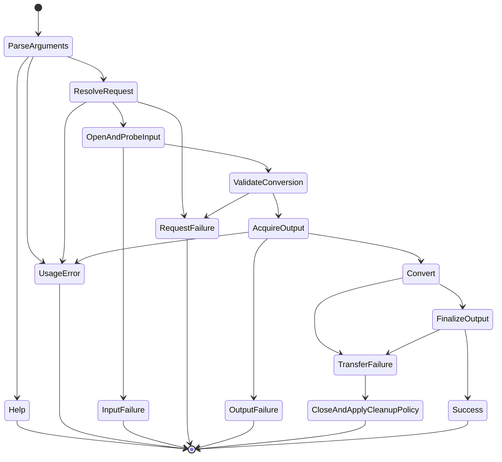

# State machines in zffmpeg

This is a navigation map of the current implementation. Source code and
[port.md](../port.md#document-authority) define behavior; [TODO.md](../TODO.md)
owns task status and verification evidence. The map groups machines by
their owner and protocol, not by every possible combination of variables.

The audit covered the tracked Zig sources under `zig/`, the CLI/build
entry points and the reference/test workflows. It considered stored flags,
optional payloads, numeric sentinels, cursor/count protocols and local
control flow. Configuration flags, immutable tables and ordinary arithmetic
loops are not automatically lifecycle states. Codec history is stateful,
but is usually a numerical recurrence rather than a small finite-state
protocol. Standard-library allocator/I/O internals are outside this map.

## Representation decision

Use a named enum for mutually exclusive protocol states and a tagged union
when a state guarantees a payload. Keep independent facts independent and
keep positions, remaining lengths, predictors and sample history numeric.
Scope a type to its owning protocol; no universal state-machine runtime is
needed. An existing explicit enum does not establish that every transition
or failure path is correct.

Preserve exported field contracts and observable FFmpeg behavior. A public
parser representation change needs the corresponding contract/API work;
it is not an incidental cleanup. A writer's finalization and failure-retry
policy also need an explicit contract before adding a universal terminal
state. Use the existing [media-pipeline skill](../.claude/skills/media-pipeline/SKILL.md)
when changing these boundaries.

This gives users stable output, diagnostics and failure cleanup; developers
can switch exhaustively over meaningful outcomes; agents can find the
owning implementation, its transitions and its validation path.

## Application boundary

The executable's call/return structure implements most of this machine.
Checks that depend only on the request precede output creation. A late
failure closes the output before cleanup; a newly created regular file can
be removed, while an existing output replaced with `-y` retains its partial
contents. Pipes/devices and stdout keep their own semantics. Probe reporting
has a different commit point: stdout is emitted only after validation.

| Owner | State carrier and transitions | Representation / next boundary |
| --- | --- | --- |
| [zffmpeg argument parser](../zig/cli/ffmpeg.zig) | Before input options → accepted input/output options → completed input/output paths; `-i` consumes a value; trailing arguments are refused | `ParsePaths` is a private tagged union. Paths exist only in the phases that accepted them. Duplicate-input and missing-value error precedence is preserved. |
| [zffprobe argument parser](../zig/cli/probe.zig) | Option/value parsing → one accepted path → validation/report, or usage/help | Function-local cursor/options and explicit result variants; keep the one-path grammar. |
| [zffmpeg output ownership](../zig/cli/ffmpeg.zig) | Preflight → exclusive creation or permitted replacement → write → finalize → close → success/cleanup | Call structure plus creation provenance and regular-file capability. These facts are independent; do not combine seekability, overwrite permission and ownership into one boolean. |
| [CLI results](../zig/cli/status.zig) | Argument/parameter validation → typed success/failure → numeric exit status and diagnostics | Already explicit outcome unions and `ExitStatus`; stdout/stderr/status are stable external contracts. |
| [conversion](../zig/format/convert.zig) | Open/prepare → copy or transcode/resample → delayed output → writer finish/header rewrite → deinit | `Mode` and parser union are explicit; counts, optional allocator, deferred header and run-once precondition remain implicit across methods. Keep the documented single-run contract. |

`-y` and `-n` are intentionally accumulated independently: seeing both is
an error, not simply a last-value-wins overwrite state. Likewise, the
presence of an input sample-rate option is configuration, not a lifecycle.

## Input discovery, container parsing and seeking

| Owner | Implicit or explicit machine | Contract-sensitive transitions |
| --- | --- | --- |
| [detect.Input / Rounds](../zig/format/detect.zig) | Forced format, or scored probe rounds growing from 2048 bytes toward a bound; borrowed versus allocated probe storage; opened replay | Winner/tie/retry/end, allocation failure and stable adapter address. Source/options are configuration; acquired buffers are ownership. |
| [leading ID3 tags](../zig/format/detect.zig) | Repeated header/body/skip → merge/discard tags → replay remaining bytes | Preserve tag precedence and what a truncated or oversized declaration consumes. |
| [Replay](../zig/format/replay.zig) | Prefix cursor → source buffer → underlying stream → EOF/error | Position is the natural state carrier. Forwarding must not lose read-ahead bytes or counts. |
| [WAV/Wave64 parser](../zig/format/wav.zig) | Explicit header/data/done phase plus RIFF extent, format/fact/ds64/tag observations, optional data bounds and seek position | Independent chunks can appear in different orders. Phase and nullable format/data fields carry public invariants; retain the contract and error precedence. |
| [AU parser](../zig/format/au.zig) | Explicit header/data/done; PCM or G.72x data; known/unknown length | Header validation → payload → end, and compressed-packet/count handling. |
| [AIFF parser](../zig/format/aiff.zig) | Explicit phase plus FORM extent, COMM/SSND observations, AIFF-C encoding and padding | Format availability, SSND offset/padding and final extent validation. |
| [CAF parser](../zig/format/caf.zig) | Explicit phase plus desc/data/cookie/packet-table/trailing-metadata observations | PCM versus ALAC packet iteration, unknown data length, seek-backed trailing reads and limits. |
| [raw parser](../zig/format/raw.zig) | Explicit phase plus caller parameters and known/unknown byte count | Request validation precedes payload; whole-frame EOF and incomplete-frame behavior remain distinct. |
| [shared PCM data](../zig/format/pcmdata.zig) | Unbound/no data → bounded or unbounded payload → end; misaligned-seek remainder | `reader`, `left`, `misaligned` and counts encode the state. Empty output means EOF; insufficient capacity while data remains is `OutputTooSmall`. |
| [generic demux layer](../zig/format/demux.zig) | Read-ahead → buffered packet/parser queues → current borrowed packet → source/parse drain → EOF; per-stream parser/decoder/timestamp state | Initial parameters, first timestamps, skip/discard side data, replacement ownership and flush/seek reset must be considered together. |
| [seek engine](../zig/format/seek.zig) | Indexed, demuxer-specific or timestamp/binary search → success/fallback/failure | Bounds, flags, current timestamps and source repositioning; a failed seek is not automatically a rollback. |
| [FLAC demuxer](../zig/format/flac.zig) | Metadata/probe → parser/scored headers → packet queues and timestamp derivation → EOF; optional seek | Still has a parallel generic-layer implementation. T65a owns consolidation; do not merge it while renaming states. |
| [MP3 demuxer](../zig/format/mp3.zig) | Leading/trailing tags → VBR/gapless metadata → frame resynchronization → payload | `Check` now returns valid frame-header data, invalid header, or end-of-window as a tagged union. Resync retries differ for first versus second candidate. |
| [ADTS demuxer](../zig/format/aac.zig) | Header/probe → raw full-parser packets → trailing ID3v1/APEv2 metadata | Parser state and generic-layer read-ahead determine timestamps and retry behavior. |
| [AC-3/E-AC-3 demuxer](../zig/format/ac3.zig) | Synchronized raw input → full parser → independent/dependent packet grouping | Preserve codec detection, packet duration and reduced-rate/error policies. |
| [Ogg page/packet assembly](../zig/format/ogg.zig) | Page synchronization → logical-stream selection → header packets → complete/continued data packets → EOS/replacement; buffered pushback | `curidx`, `header`, segment cursors, `incomplete`, page flags and codec optionals overlap. T65c owns the larger state and snapshot redesign. |
| [Ogg mapping state](../zig/format/ogg.zig) | Vorbis identification/comment/setup/data, Opus comments/pre-skip, FLAC headers; metadata/extradata pending delivery | Mapping-specific packet order and one-shot side data must survive the correct reset paths. Independent codec histories are not interchangeable phases. |
| [Ogg start-time scan](../zig/format/ogg.zig) | Unseen, awaiting a start, complete, plus snapshot restoration during end/start scans | `StartTimeScan` replaces the private 0/-1/1 carrier. The C's conditions, stream counter updates and save/restore order stay unchanged. |
| [MOV input and boxes](../zig/format/mov.zig) | Cached/seekable or sequential input; nested atom dispatch; moov/mdat discovery and retry; current track/meta context | Box bounds, unavailable backward seeks, table replacement and metadata ownership are independent dimensions. |
| [MOV track packets](../zig/format/mov.zig) | Sample/chunk/index selection → codec-description change → timestamp/flag/side-data finalization → next sample | `stsc`, `stts`, `ctts`, `tts_index`, current sample, discard window and extradata transitions. Video/edit-list/fragment scopes remain their own tasks. |
| [ID3v2 reader](../zig/format/id3v2.zig) | Version/flags → extended header → tag frames/subframes → decode strings/unsynchronize → consumed length | Function-local grammar and cursor/count state; declared lengths, NUL/BOM/endian state and tag ownership affect recovery. |
| [ID3v1](../zig/format/id3v1.zig), [APEv2](../zig/format/apetag.zig), [Vorbis comments](../zig/format/vorbiscomment.zig), [MOV channel tags](../zig/format/mov_chan.zig), [chapters](../zig/format/chapters.zig) | Bounded record/text parsing and dictionary/list replacement; optional trailer discovery | Mostly per-operation machines, not persistent lifecycle enums. Preserve order, append/replace policy and error precedence. |

The Ogg scan enum intentionally retains the reference algorithm's
save/restore semantics. It does not fix the separately tracked issue where
a duration scan can create streams. Naming states must not silently change
which timestamps the pinned oracle reports.

## Decoding, buffering and output

| Owner | State carrier | Important event sequence |
| --- | --- | --- |
| [PCM stages](../zig/codec/pcm.zig), [sample converter](../zig/resample/audioconvert.zig), [stage contract](../zig/core/stage.zig) | Explicit accepting/draining/drained plus an optional pending output | Send/receive/full/retry/finishInput/reset. Pending data and phase form a product with documented output lifetimes. |
| [FLAC decoded reader](../zig/format/flac.zig), [Ogg decoded reader](../zig/format/oggdecode.zig) | Optional/open demuxer/decoder, pending samples/planes, expected count, ended/counting state | Header/read-ahead → decoder open → partial output delivery → skip/discard → end; destroy on partial initialization failure. |
| [MP3](../zig/format/mp3decode.zig), [AAC](../zig/format/aacdecode.zig), [AC-3](../zig/format/ac3decode.zig) decoded readers | Demuxer/layer/decoder ownership, `opened`, `returned`, `pending`, expected/end/count-ahead flags | Parameter acquisition, first-frame replay, decoder/refused-frame policy, skip/discard and output counting. Similar structure does not justify merging codec policies. |
| [WAV ADPCM](../zig/format/wavadpcm.zig), [CAF ALAC](../zig/format/cafalac.zig), [AU G.72x](../zig/format/aug72x.zig) decoded readers | Container/decoder state, packet scratch, pending output and end/count state | Packet/block decoding → partial delivery → last-block trimming → stable end. |
| [skip/discard and decode error rate](../zig/format/decoded.zig) | Remaining priming, packet end padding and frame/error counters | One-shot skip data and discarded frames are part of the stream timeline, not just output formatting. |
| [WAV](../zig/format/wav.zig), [AU](../zig/format/au.zig), [AIFF](../zig/format/aiff.zig), [raw](../zig/format/raw.zig) writers | Expected/written counts, deferred versus known header and output adapter state | Check → begin → whole-frame writes → finish/flush → optional header rewrite. No new universal retry-after-failure promise. |
| [FLAC writer](../zig/format/flacmux.zig) | Unknown/known first-frame size, optional lazily created encoder/Ogg muxer, pending block, streaminfo offset | First block determines encoder startup; final drain, STREAMINFO rewrite or unseekable output policy. |
| [Ogg muxer](../zig/format/oggmux.zig) | Per-stream page sequence/granule/segment state, current page and queued pages | Headers → lacing/continued pages → interleaved page selection → final EOS/flush. |
| [MP2](../zig/format/mp2mux.zig), [AC-3](../zig/format/ac3mux.zig), [AAC](../zig/format/aacadts.zig) writers | Fixed-frame staging count and encoder history; AAC delay/drain | Full blocks emit immediately; final short input is padded or passed short as the encoder requires, then delayed packets are drained. |
| [CAF writer](../zig/format/cafmux.zig), [ADPCM writer](../zig/format/wavadpcm.zig), [G.72x writer](../zig/format/aug72x.zig) | Codec-selected storage, optional encoder, pending block/count, length rewrite capability | Begin, buffer, emit, finalize counts/cookie or packet table as supported. |
| [ADTS muxer](../zig/format/adtsmux.zig) | Configured/extradata-less, `write_adts`, PCE bytes pending first packet | Initial or side-data configuration → first packet/PCE → ordinary packets; frame-size refusal remains a mux error. |
| [frame hashes](../zig/format/framehash.zig) | Header emitted, rolling hash state and ordered packet/frame accounting | Initial schema → updates → final digest; content and timestamps are both observable. |

## Codec and numerical history

These owners are state machines in the broad sense of state evolving over
input. Replacing their arrays and bit fields with lifecycle tags would lose
the information the algorithm needs. Use protocol tags only around genuine
setup/packet/drain/reset alternatives.

| Owner | Evolving state and boundary |
| --- | --- |
| [bit readers/writer](../zig/codec/bits.zig), [VLC tables](../zig/codec/vlc.zig), [Opus range coder](../zig/codec/opus_rc.zig) | Bit cursor/cache, forward/backward entropy positions, arithmetic range/value, writer accumulator and latched overflow; initialized tables are owned until deinit. |
| [frame combiner](../zig/codec/parser.zig), [AAC/AC-3 parser](../zig/codec/aac_ac3_parser.zig), [MPEG audio parser](../zig/codec/mpegaudio.zig), [FLAC parser](../zig/codec/flac_parser.zig) | Searching sync → partial header/frame → complete output → overread carry → empty-input flush; FLAC header scoring and candidate validity add another state dimension. |
| [Vorbis decoder](../zig/codec/vorbis.zig) | Identification/comment/setup availability, first-frame/one-shot skip and overlap history across packets and flush. |
| [Opus decoder](../zig/codec/opusdec.zig), [CELT](../zig/codec/celt.zig), [SILK](../zig/codec/silk.zig) | Packet mode, per-channel prediction/overlap, SILK/CELT transition and resampler delay, prior voiced/bandwidth/coded flags and flush behavior. |
| [MPEG audio decoder](../zig/codec/mp3dec.zig), [MPEG DSP](../zig/codec/mpadsp.zig) | Bit reservoir, prior granules, MDCT overlap, synthesis positions and frame/error/concealment results. |
| [AAC decoder](../zig/codec/aacdec.zig), [SBR](../zig/codec/aacsbr.zig), [parametric stereo](../zig/codec/aacps.zig) | Output-configuration trial/lock/restore, channel elements, window sequences, SBR setup/reset/dequantization and PS mode/history. |
| [AC-3/E-AC-3 decoder](../zig/codec/ac3dec.zig) | Independent/dependent substream assembly, block history, coupling/rematrix/spectral-extension updates, downmix/concealment and output production. |
| [FLAC decoder](../zig/codec/flacdec.zig), [ALAC](../zig/codec/alac.zig) | Stream configuration, pending compressed input/problem, per-frame channel decorrelation and decoded sample storage. |
| [ADPCM](../zig/codec/adpcm.zig), [G.722](../zig/codec/g722.zig), [G.726](../zig/codec/g726.zig) | Predictor/step adaptation, bit packing and block reset, with optional encoder trellis state. |
| [FLAC encoder](../zig/codec/flacenc.zig), [LPC](../zig/codec/lpc.zig) | Buffered sample count, predictor selection, frame count/MD5 and flushed final streaminfo. |
| [MP2 encoder](../zig/codec/mp2enc.zig) | Analysis filter history, sample offsets, bitrate padding accumulation and floating/fixed coding mode. |
| [AC-3 encoder](../zig/codec/ac3enc.zig), [bit allocation](../zig/codec/ac3_bitalloc.zig) | Prior block/coupling/rematrix decisions, MDCT overlap, rate allocation and first-frame state; allocation kernels consume/update explicit block state. |
| [AAC encoder](../zig/codec/aacenc.zig), [psy model](../zig/codec/aacpsy.zig), [coders](../zig/codec/aaccoder.zig), [NMR coder](../zig/codec/aaccoder_nmr.zig), [TNS](../zig/codec/aacenc_tns.zig) | Lookahead/previous window, queued input, rate-control bootstrapping/history, quantizer iteration, temporal-noise shaping, delayed output and draining. |
| [transforms](../zig/codec/tx.zig), [float DSP](../zig/codec/float_dsp.zig) | Initialized transform plans own scratch/tables; kernels operate on explicit caller/codec history. No new cross-call protocol is implied by a local loop. |
| [header/config parsers](../zig/codec/mpeg4audio.zig), [ADTS](../zig/codec/adts.zig), [AC-3 headers](../zig/codec/ac3.zig), [Opus packet parser](../zig/codec/opus.zig), [Xiph lacing](../zig/codec/xiph.zig), [FLAC headers](../zig/codec/flac.zig) | Per-call bounded grammar and cursor/count progression. Distinguish those from the persistent parser/decoder that consumes their results. |
| Codec `*_tab.zig`/`*_data.zig`, [AAC PCE configurations](../zig/codec/aacenc_pce.zig), [G.711 tables](../zig/codec/g711.zig), [codec registry](../zig/codec/registry.zig) | Primarily immutable configuration/tables or stateless selection, not additional persistent lifecycle machines. |

## Filters, resampling and core helpers

| Owner | State carrier and boundary |
| --- | --- |
| [Graph lifecycle](../zig/filter/graph.zig) | `configure_called`/`configured`: mutable construction → one configuration attempt → ready or failed; failed configuration cannot be retried. Public Graph/Link fields are preserved. |
| [Graph links/activation](../zig/filter/graph.zig) | Negotiated/picked/configured links, FIFO/head, wanted/blocked flags, ready priorities, input/output EOF status and status timestamp; EOF propagates after queued frames. |
| [format sets](../zig/filter/formats.zig), [negotiation](../zig/filter/negotiate.zig) | Shared set ownership, merging/intersection and converter insertion → picked formats → configured links. Allocation failure can occur during graph mutation. |
| [filtergraph parser](../zig/filter/parse.zig) | Local labels/name/options/chain parsing → owned parsed graph → linking/configuration; quoted/escaped text has its own grammar state. |
| [filter instances](../zig/filter/filters.zig) | Parsed options → configured run data; volume/eval frame counters, trim start/end/sample counters and EOF, setpts origin/history, aresample first-frame/timestamp/delay mode. |
| [split/map/pan/mix](../zig/filter/multi.zig) | Channel mapping and owned gains, output fanout, per-input active/EOF flags and frame queues, amix duration/dropout normalization and next timestamp. |
| [Swr](../zig/resample/swr.zig) | Input block filling, `more`, `finished`, `flushed_out`, pending sample count and output view lifetime. A null result can mean needs input or final drain; the caller's protocol disambiguates it. |
| [resampler engine](../zig/resample/resample.zig) | Filter phase/index/fraction, retained input, reflected startup and final flush padding. |
| [dither](../zig/resample/dither.zig) | Noise generation/history, packet call boundaries, noise-buffer cursor and noise-shaping feedback. Chunking and numerical history affect exact output. |
| [rematrix](../zig/resample/rematrix.zig) | Validated matrix and chosen arithmetic path; mixing consumes explicit samples. Coefficient configuration is not a separate lifecycle enum. |
| [expression engine](../zig/core/eval.zig) | Parse grammar → allocated AST → repeated evaluation with stored variables/random state → deinit. |
| [number syntax](../zig/core/number.zig), [typed options](../zig/core/options.zig), [channel layout parsing](../zig/core/channel_layout.zig) | Per-operation lexical/grammar progression and validated assignment; failed parsing must not publish a partially valid option. |
| [metadata](../zig/core/metadata.zig), [owned frames](../zig/core/frame.zig), [owned packets](../zig/core/packet.zig), [sample storage](../zig/core/samples.zig) | Allocation → borrowed/owned use → replacement/copy → release; each operation defines when old views expire. |
| [diagnostic capture](../zig/core/diagnostics.zig) | First/last message and count updates with bounded capture; reporting must not drive parser behavior. |
| [LFG](../zig/core/lfg.zig), [test signals](../zig/testing/signals.zig) | Deterministic PRNG state/index evolution, not a protocol phase tag. |
| [file adapters](../zig/io/file.zig), [skip adapter](../zig/io/skip.zig) | Open/borrow → positional or streaming reads/writes → retained cause/EOF → flush/rewrite/close; bounded skip iteration preserves counts and checked lengths. The std owns its adapter modes. |
| [libm](../zig/core/libm.zig) and `core/libm/`, [cconv](../zig/core/cconv.zig), [rational](../zig/core/rational.zig), [time](../zig/core/time.zig), [audio types](../zig/core/audio.zig), [Bessel](../zig/core/bessel.zig), [format registry](../zig/format/registry.zig), [language table](../zig/format/avlanguage.zig), [module facade](../zig/root.zig) | Scalar calculations, value contracts, immutable lookup tables or static exports. Local numerical loops do not justify a new persistent state representation. |

## Developer and verification workflows

| Owner | Machine and invariant |
| --- | --- |
| [build graph](../build.zig), [CI](../.github/workflows/ci.yml) | Compile → run unit/process/vector checks → compare/report; compile success, executed tests and native behavior are distinct evidence states. |
| [prepared-file CLI cases](../zig/testing/zffmpeg_cases.zig), [write driver](../zig/testing/write_driver.zig), [hash driver](../zig/testing/hash_driver.zig), [Opus vector driver](../zig/testing/opus_vector_driver.zig), [registry dump](../zig/testing/registry_dump.zig) | Prepare input/output artifacts → execute sequence → verify status/content/side effects → cleanup. Scratch ownership and child-process status are part of the test; the registry dump emits a snapshot of immutable descriptors. |
| [DelayStage](../zig/testing/delay_stage.zig) | Explicit media phase plus copied queue ownership, partial split output and deferred release of the last borrowed output. This is a behavioral model, not a production scheduler. |
| [failure harnesses](../zig/testing/hostile.zig), [synthetic readers](../zig/testing/synthetic.zig), [I/O example](../zig/examples/io_patterns.zig) | Seed/fragment/read/write sequence → exercised state → injected failure or result → release/assertions; options and call order must accompany bytes. |
| [fixture generation](../zig/testing/fixtures/generate.py), [fixture access](../zig/testing/fixtures.zig), [comparison](../zig/testing/reference/compare.py) | Required/optional availability → command success/refusal/crash → media/predicate comparison → required pass/fail/missing and optional pass/fail/skip reporting. Known differences cannot hide a new crash. |
| [Opus quality metric](../zig/testing/opus_compare.zig) | Repeated spectral windows, accumulated error/quality and final pass/fail; this is numerical test history, not a decoder lifecycle. |
| [reference build](../zig/testing/reference/build-ffmpeg.sh), [reference generators](../zig/testing/reference/README.md), [speed check](../zig/testing/reference/speed_check.py) | Identify source/build/input → generate or time → check process success → validate/report identity and results. Cached or generated output alone is not proof. |
| [task gates](../TODO.md#gates), [feature ledger](../port.md#provenance-and-feature-tracking) | Ready/oracle/implementation/failure/integration/verified evidence; only the existing gates change task status. This inventory creates no new completion gate or claim of verification. |

## This change and remaining boundaries

The behavior-preserving implementation changes are confined to three private
representations: CLI path phases, MP3 header-check outcomes, and Ogg
start-time-scan phases. Process tests cover the CLI transition/error
precedence; a crafted header test covers all MP3 outcomes; existing Ogg,
MP3, seek and differential fixtures cover the media behavior.

Larger work remains under its existing tasks: T65a for FLAC's generic
layer, T65c for the remaining Ogg/header/stream/snapshot and Vorbis state,
T65d for filter dispatch/timestamp consolidation, T52 for broader seeking,
T54 for public API contracts, and T53d/T59 for scheduler/concurrency work.
Their scope and evidence are not inferred from completing this inventory.

When changing a lifecycle, read its owner and tests, identify the legal
transitions and retained payloads, and update the relevant row if the map's
description or owner changes. Keep the actual contract in its existing
source/port/fixture location; avoid maintaining a second transition
implementation in documentation or generated wrappers.
