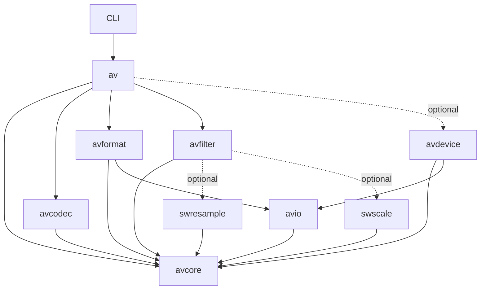

# FFmpeg to native Zig: port design

## Status and scope

Initialized on 2026-11-02. The first complete path, signed 16-bit PCM in WAV,
works: the `av` module ([build.zig](build.zig), rooted at
[zig/root.zig](zig/root.zig), documented in [zig/README.md](zig/README.md)) has
[PCM s16 kernels](zig/codec/pcm.zig), [audio](zig/core/audio.zig) and
[time](zig/core/time.zig) types, a bounded [WAV parser and known-length
writer](zig/format/wav.zig) and [file and pipe adapters](zig/io/file.zig), and
[zffprobe](zig/cli/probe.zig) is the first tool. The first WAV contract has named
fixtures with expected results ([zig/testing/fixtures](zig/testing/fixtures/README.md)),
and CI compares them with a pinned FFmpeg build
([zig/testing/reference](zig/testing/reference/README.md)). This standalone
repository tracks the port's own files. FFmpeg in `.references/ffmpeg` remains
the behavioral reference. Verification is Linux-only during development;
Windows and ARM wait for the platform milestone (TODO.md T62–T63). The second
path, AU with signed 16-bit big-endian PCM (T12), is verified too: its
[contract and 29 fixtures](zig/testing/fixtures/au/README.md), the [AU parser
and writer](zig/format/au.zig), and `zffprobe`, which chooses WAV or AU by
[content detection](zig/format/detect.zig). The synchronous
[conversion pipeline](#conversion-pipeline) (T13a, `av.convert`) and the
[`zffmpeg` command](#zffmpeg-command) (T13b) that converts and stream-copies
between WAV and AU (and since T21b Wave64) are verified, and the pipeline now runs on
[packets, frames and send/receive stages](#packets-frames-and-stages) (T14a),
with [decoded sample storage](#decoded-sample-storage) for every sample format
(T20a) and the [PCM encodings](#pcm-encodings) that decode into it (T20b);
WAV reads and writes all of them, plain or WAVE_FORMAT_EXTENSIBLE (T21a),
in RIFF, RF64/BW64 or Sony Wave64, past 4 GiB, and reads unknown-length input
behind an option (T21b), and reads, writes and carries its LIST/INFO and
`bext` tags through a [metadata dictionary](zig/core/metadata.zig) (T17b,
T21c). AU reads and writes every PCM encoding of FFmpeg's AU table and reads
unknown-length input behind an option (T22a). Codec and format registries
with FFmpeg's scored content probing (T16) and [AIFF and AIFF-C](#aiff-contract)
with every PCM encoding of FFmpeg's AIFF table (T22b) are verified, and so is
[raw PCM](#raw-pcm-contract) in FFmpeg's 14 raw formats, chosen by `-f` or by
FFmpeg's file-extension fallback (T22c), and [CAF](#caf-contract) is read
(T22d), which completes T22. [Sample format conversion](#sample-format-conversion)
between every sample format, with libswresample's dither, is verified (T23a),
and so are [channel layouts](#channel-layouts) in every container, 1 to 64
channels with FFmpeg's layouts (T23b), and [rematrixing](#rematrixing) as
libswresample mixes, through `zffmpeg`'s output `-ac` and `-ch_layout`
(T23c), which completes T23; [resampling](#resampling) as FFmpeg's
`aresample` does, through `zffmpeg`'s `-ar` (T24), and
[options](#options-and-numbers) in FFmpeg's syntax with an explicit
diagnostic sink (T17a) are verified too, and so is the audio
[filter graph](#filter-graph)'s core (T25a); and so are FFmpeg's expressions
and filtergraph text with `atrim` and `asetpts` (T25b), and graphs of several
inputs and outputs on libavfilter's scheduler (T25c), which completes the
audio filter graph (T25); and so is [FLAC](#flac-contract) with 16-bit
samples, demuxed, parsed and decoded as FFmpeg does it, in `zffprobe` and
as a `zffmpeg` input (T26a), with an MSB-first bit reader and FLAC's CRCs
(T18a) and FFmpeg's frame and stream hashes for comparison (T19b); and so
are FFmpeg's [rational arithmetic and timestamp helpers](zig/core/rational.zig)
(T15) and the [seek API](#seeking) with WAV and Wave64 seeking (T52a); and so
is complete FLAC decoding, 4 to 32 bits per sample with variable blocking,
metadata blocks and MD5 verification, and FLAC seeking (T26b); and so is
FFmpeg's [FLAC encoder and muxer](#flac-contract), packet for packet at
every compression level and option, as a `zffmpeg` output (T26c), with a
bit writer (T18b); and so is the [Ogg demuxer](#ogg-contract) with FFmpeg's
FLAC, Opus and Vorbis mappings, without decoding, on libavformat's
[generic layer](zig/format/demux.zig) (timestamps, the stream-info
read-ahead and seeking), in `zffprobe` and as a stream copy to framecrc,
seeking as FFmpeg does (T27a); and so is FFmpeg's Ogg muxer, with FLAC
encoded into Ogg by `zffmpeg` byte for byte as the ffmpeg program writes
it (T27b); and so are FFmpeg's float [FFT and MDCT](zig/codec/tx.zig)
(T27c), the LSB-first reader and VLC tables (T18c), and the [Vorbis
decoder](zig/codec/vorbis.zig), bit for bit FFmpeg's, with Ogg Vorbis and
Ogg FLAC decoded by `zffmpeg` as the ffmpeg program decodes them (T27d),
which completes T27; and so is the [Opus decoder](zig/codec/opusdec.zig)
for CELT frames (T28a), SILK frames (T28b), hybrid frames and multistream
packets (T28c), bit for bit FFmpeg's, with Ogg Opus decoded by `zffmpeg`
and RFC 8251's vectors decoded as FFmpeg decodes them, which completes T28;
and so is the [MP3 demuxer](zig/format/mp3.zig) with FFmpeg's mpegaudio
parser, ID3 tags and probe rounds, without decoding (T29a).

The goal is a native Zig multimedia library and tools, built incrementally from
FFmpeg's functionality. Use idiomatic Zig APIs and explicit resource ownership.
Full FFmpeg command-line, API, and ABI compatibility are separate milestones,
not assumptions of the first release. C compilation through Zig and libav*
bindings are useful reference/testing techniques, but do not count as ported
functionality.

Use [TODO.md](TODO.md) for the ordered implementation checklist and task status.
This document remains the architecture, acceptance criteria and feature ledger.
See [README.md](README.md#clone-the-reference-repositories) to clone both FFmpeg
and zigimg at the inspected revisions into ignored `.references/`. Their source
files and Git histories are not committed to this project or included as submodules.

Use [zigimg](https://github.com/zigimg/zigimg.git) as a Zig implementation reference.
The [pinned source analysis](doc/zigimg-reference.md) records verified I/O,
ownership, build and testing patterns, including the parts requiring adaptation.

## Document authority

| Document | Owns |
| --- | --- |
| This file | Architecture, supported behavior, resource rules and the capability ledger. |
| Fixture READMEs | Named inputs, expected results, error precedence and intentional differences for each contract. |
| [TODO.md](TODO.md) | Stable task IDs, dependencies, gates G0–G5, required coverage, evidence, platform policy and the not-planned list. |
| [notes.md](notes.md) | Revisable decisions, their reasons and the files that must change together. |
| [CLAUDE.md](CLAUDE.md) | Agent workflow and implementation guidance, subordinate to the behavioral contracts. |

TODO.md is authoritative for whether a task is done; a summary elsewhere adds
no evidence. Resolve conflicting behavior or policy before implementation and
update the affected contract, task, fixtures and notes in the same change.
Silence in one document does not authorize widening a subset or dropping a
check. Keep detailed task status in TODO.md instead of another checklist.

## Design goal: less machinery, clear behavior

Build the simplest Zig implementation of each supported multimedia operation.
Use FFmpeg to understand algorithms, file formats and observable behavior; choose
the Zig data model and control flow around the needs of the new implementation.
The unit of work is a capability such as decoding PCM, not translating a C file.

The main opportunities are fewer macro variants, fewer duplicated declarations,
smaller contexts and less manual cleanup. Codec mathematics, malformed-input
handling and timing remain real complexity that the implementation must express.
Zig enables simpler code; it does not establish correctness or speed by itself.

Apply these decisions throughout the port:

1. **Start with concrete code.** Write the first working algorithm as normal
   functions and structs. Share it when another supported variant exposes the
   same operation. Use a `comptime` parameter for the actual varying property.
2. **Use the standard library first.** Reuse allocators, collections, byte-order
   reads/writes, I/O and test facilities where their contracts fit. Keep
   multimedia-specific rescaling, buffering or bitstream behavior in small
   domain helpers; porting all of `libavutil` is unnecessary.
3. **Keep one implementation of each algorithm.** Specialize by sample type,
   bit depth or byte order where that removes duplication. Keep channel counts,
   dimensions and stream data at runtime unless measurement justifies otherwise.
   A second implementation needs a recorded purpose, a comparison oracle and a
   retention or retirement condition. T58's optimized alternatives retain the
   scalar implementation as their oracle. T24 ports one resampler, swresample's
   native algorithm, rather than preserving parallel legacy APIs.
4. **Represent valid states directly.** Use slices, optionals, enums, tagged
   unions and error unions. Give codecs their own small state and options types.
   Share a contract only after working implementations reveal what it needs.
5. **Make the common path direct.** A caller that knows it has WAV/PCM can call
   those implementations directly. Add discovery and dispatch for callers that
   need runtime selection, without routing every internal operation through it.
6. **Require abstractions to pay for themselves.** A helper should remove real
   duplication, enforce an invariant or isolate a dependency. Prefer a readable
   loop or `switch` when reflection or generated types add more concepts.

Acceptance includes maintainability: a new endian variant should reuse a tested
kernel; a new codec should have local state and a small registration change; an
option should have one typed default and one description of its constraints.
Track runtime cost, allocations, build time and binary size when these choices
affect them. Smaller source alone is not a sufficient success criterion.

### Supported scope and policy

The supported subset determines the parsing surface the project maintains.
Supporting every historical file is not a goal. G0 names accepted behavior and
explicit exclusions; widening either requires updated contracts, fixtures and
reference comparisons. FFmpeg accepting a file is evidence to examine, not an
instruction to relax a bound or add recovery. Keep intentional differences
narrow and testable. Failed experiments may be removed through a recorded scope
decision; their existence alone is no reason to retain them.

The [not-planned list](TODO.md#not-planned) is a scope decision. Adding an
external dependency or an excluded capability requires revising that decision
and its affected tasks, not treating it as incidental implementation work.
Build-time component selection (T55) must let consumers omit unused parsers
from the binary. This reduces exposure; it does not replace validation or an
application's process isolation and privilege separation for untrusted media.

Zig helps express bounds, errors and cleanup, but does not prove a codec safe
or correct. ReleaseFast does not supply the safe modes' runtime checks, and
Zig has no borrow checker. Explicit size checks, ownership tests and a bounded
fuzz entry are required before G5; T60 adds sustained campaigns. Neither a
passing unit suite nor a language choice establishes a security or performance
claim. Codec mathematics, timing and independent reference checks remain work
for every capability. The reasons for these choices live in
[notes.md](notes.md#port-design-policy).

## Inspected baseline

- FFmpeg reference commit: `5d5a38a7e46be296eab75982c0986054f731e19e`.
- Repository: [FFmpeg/FFmpeg](https://github.com/FFmpeg/FFmpeg.git), checked out
  locally at `.references/ffmpeg`.
- Commit subject: `avfilter/vf_scale_d3d12: add RGB formats and color space conversion`.
- [RELEASE](https://github.com/FFmpeg/FFmpeg/blob/5d5a38a7e46be296eab75982c0986054f731e19e/RELEASE): `8.0.git`; use the commit above as the precise reference.
- At the reference commit: 11,112 tracked files, including 3,511 C files, 1,283 headers, 236 `.S` files,
  and 189 `.asm` files. These are repository-wide counts, including tests/tools.
- Local compiler: Zig **0.17.0** on PATH, confirmed with `zig version` / `zig env`.
  Executable aliases and installation paths are machine-specific.

Use Zig 0.17.0 as the initial pinned toolchain. The official
[download index](https://ziglang.org/download/index.json) and
[download page](https://ziglang.org/download/) identify 0.17.0 as the stable
release at the time of analysis. Consult the
[versioned language reference](https://ziglang.org/documentation/0.17.0/)
and the installed standard library when implementing examples below. An exact
tested-version check belongs in the build/automation: `.zig-version` is a
version-manager convention and `.minimum_zig_version` declares a minimum, not
an exact pin. Do not rely on that metadata to enforce compiler compatibility.
Initially check for 0.17.0 explicitly; adopt another patch/release after validation.

## How the FFmpeg tree is organized

Counts below are tracked files at the reference commit under each directory, not
implementation sizes or estimates of porting effort. All C source paths in this
document are relative to `.references/ffmpeg/`; source links pin the upstream
revision and do not depend on the clone being present.

| Location | Files | Responsibilities and useful entry points |
| --- | ---: | --- |
| `libavutil/` | 464 | Foundation: `rational.h`, `mathematics.c`, `buffer.c`, `frame.c`, `pixdesc.c`, `samplefmt.c`, `channel_layout.c`, `opt.h`, `cpu.c`. |
| `libavcodec/` | 2,780 | Codec framework and implementations: `codec_internal.h`, `decode.c`, `encode.c`, `packet.c`, `get_bits.h`, `put_bits.h`, `vlc.c`, `allcodecs.c`. Large families already have directories such as `aac/`, `hevc/`, `opus/`, `vvc/`. |
| `libavformat/` | 735 | Containers, probing, mux/demux, seeking, protocols, I/O: `avformat.h`, `avio.h`, `aviobuf.c`, `demux.c`, `mux.c`, `allformats.c`, `protocols.c`. |
| `libavfilter/` | 821 | Graph execution, format negotiation, scheduling and individual `af_*`, `vf_*`, source/sink filters. |
| `libswresample/` | 51 | Audio conversion, rematrixing, delay and resampling. |
| `libswscale/` | 169 | Pixel conversion, colorspace handling and image scaling. |
| `libavdevice/` | 78 | Platform-specific audio/video capture and output. |
| `fftools/` | 57 | CLI tools; `ffmpeg_*.c` separates demux, decode, filtering, encode, mux and scheduling. |
| `tests/` | 5,714 | FATE definitions and reference output, API tests, checkasm and supporting tools. Many reference files are extensionless. |

The seven library boundaries are useful responsibility maps. They do not require
seven matching Zig libraries, identical context types or the same public API.
The C tree reflects decades of C build and ABI constraints: public headers, private headers,
macro-generated variants, large registration lists, and architecture-specific
directories. Preserve the behavior while reorganizing implementation by feature.

### Build graph and registration

The minimum library dependencies declared in [configure](https://github.com/FFmpeg/FFmpeg/blob/5d5a38a7e46be296eab75982c0986054f731e19e/configure) are:

| Consumer | Dependencies |
| --- | --- |
| `avcodec`, `avfilter`, `swresample`, `swscale` | `avutil` |
| `avformat` | `avcodec`, `avutil` |
| `avdevice` | `avformat`, `avcodec`, `avutil` |

Individual features introduce additional dependencies and external libraries;
this is not the complete configuration graph. For example, a filter can require
scaling or resampling.

Each library's `Makefile` describes public headers, unconditional objects and
`OBJS-$(CONFIG_...)` selections. Architecture subdirectories add optimized
implementations. [ffbuild/library.mak](https://github.com/FFmpeg/FFmpeg/blob/5d5a38a7e46be296eab75982c0986054f731e19e/ffbuild/library.mak) supplies common
library rules; FFmpeg's root [Makefile](https://github.com/FFmpeg/FFmpeg/blob/5d5a38a7e46be296eab75982c0986054f731e19e/Makefile) orchestrates its build.

`configure` resolves dependencies and writes configuration and component lists,
including `codec_list.c`, `parser_list.c`, `bsf_list.c`, `demuxer_list.c`,
`muxer_list.c`, `filter_list.c`, and `protocol_list.c`. These are generated
artifacts, not the authoritative feature inventory. Read `configure`, the
relevant Makefile, and implementations together when planning a component.

[allcodecs.c](https://github.com/FFmpeg/FFmpeg/blob/5d5a38a7e46be296eab75982c0986054f731e19e/libavcodec/allcodecs.c),
[allformats.c](https://github.com/FFmpeg/FFmpeg/blob/5d5a38a7e46be296eab75982c0986054f731e19e/libavformat/allformats.c), and
[allfilters.c](https://github.com/FFmpeg/FFmpeg/blob/5d5a38a7e46be296eab75982c0986054f731e19e/libavfilter/allfilters.c) consume those lists and expose iteration.
The Zig equivalent can start with a small explicit table. Keep its ordering
deterministic and define selection priority deliberately; a registry framework
is not a prerequisite for the first format or codec.

### Runtime contracts worth preserving

- `AVPacket` represents encoded data and timing; `AVFrame` represents decoded
  planes, layout, timing, and side data. Their storage can be reference counted.
- Decoder/encoder send-and-receive APIs express buffering, backpressure, delayed
  output and draining. One input does not imply one output.
- Rational time bases and explicit rounding are fundamental. Floating-point
  seconds cannot replace timestamp rescaling without changing behavior.
- `AVOptions` describes typed options using metadata and C field offsets. Zig
  can retain metadata while replacing offset-based mutation with typed access.
- Optimized DSP functions are selected behind common interfaces. A portable
  scalar implementation provides a reference for architecture-specific kernels.

## Proposed Zig layout

Use one package and one named library module, `av`, rooted at `zig/root.zig`.
Use ordinary file imports inside it. Directories organize responsibilities;
they do not each require a build module or installed library. The first path needs
core, I/O, PCM and WAV; a general graph engine, universal codec context, plugin
system and full feature dependency resolver can wait for concrete requirements.

The following is the **proposed first layout**. The entries marked `existing`,
plus `LICENSE` and the Linux CI workflow (`.github/workflows/ci.yml`), are
present; the rest are planned:

```text
build.zig                    # existing: one library module, artifacts and tests
build.zig.zon                # existing: package identity, dependencies, source/license paths
.zig-version                 # existing: tooling hint 0.17.0; build enforces version
zig/
  README.md                  # existing: setup, supported compiler and validation commands
  root.zig                   # existing: av: small public facade with direct feature access
  examples/
    io_patterns.zig          # existing: standalone, tested I/O usage
  core/                      # internal files in the av module
    time.zig                 # existing: time bases and FFmpeg-compatible rescaling
    audio.zig                # existing: layouts, sample/stream formats, borrowed samples
  io/                        # thin adapters over standard-library I/O
    file.zig                 # existing: file and pipe adapters for the WAV path
  codec/
    pcm.zig                  # existing: s16 kernels; grow a directory when needed
  format/
    wav.zig                  # existing: bounded parser and known-length writer
  cli/
    probe.zig                # existing: first tool, zffprobe
  testing/                   # native tests; FFmpeg tests stay in its clone
    fixtures.zig             # existing: typed fixture manifest and integrity tests
    reference/               # existing: FFmpeg reference build and comparison scripts
    fixtures/                # existing: tiny fixtures; README.md is their contract
```

Keep the shared core small. Add packet/frame ownership types when buffering is
needed, bit readers when a compressed format needs them, and shared RIFF code
when another RIFF consumer benefits. A PCM kernel taking slices does not need a
universal frame allocator or send/receive interface.

As coverage grows, introduce these areas when their first feature is ready:

| Area | Reason to introduce it |
| --- | --- |
| `core/buffer.zig`, `packet.zig`, `frame.zig` | Retained buffers, delayed output or shared audio/video storage. |
| `codec/<family>/` and local DSP files | A codec family needs several substantial algorithms; promote shared DSP only when reused. |
| `format/<family>/` | A container has enough parser, muxer and demuxer code to benefit from separation. |
| `filter/`, `scale/`, `resample/` | Working transforms; start with direct functions and build a graph when composition requires it. |
| `registry.zig`, `build/features.zig` | Selection and feature dependencies have outgrown a small explicit table. |
| `device/`, `compat/` | Actual platform integration or a requested compatibility target. |

Keep native sources under `zig/`. The project [.gitignore](.gitignore) explicitly
excludes `/.references/`, `/.zig-cache/` and `/zig-out/`. Reference clones are
research/test inputs, not vendored source, gitlinks or package dependencies.

Group files by format or codec family instead of copying thousands of C
basenames into a flat Zig directory. Create directories when implementing their
first feature; empty placeholders are unnecessary. Use `root.zig` to export a
small supported API, not every internal declaration.

### Dependency direction as the library grows



Here arrows point from consumer to dependency. `av` is the composition facade.
Names such as `avcore` and `avio` describe future responsibilities, not T01 build
modules. Initially these are ordinary file imports within `av`. Introduce a
separate named module when it enables a required consumer subset or a proven
dependency boundary; moving files between modules does not itself fix a cycle.

Moving packet, codec identifiers and stream parameters into `avcore` lets basic
container code avoid importing codec implementations. If a container needs a
codec parser, provide that dependency through an explicit parser interface or
an optional module import; do not create a reverse dependency from codecs to
containers. Keep probing/dispatch registries in the composition layer. Low-level
I/O should not know about formats or codecs.

### Core API and resource rules

1. Pass `std.mem.Allocator` explicitly where allocation happens. Make successful
   ownership transfers and cleanup on failure visible through `defer` and
   `errdefer`; no hidden process-wide allocator, global diagnostic sink or
   mutable registration state. Diagnostics are an explicit dependency (T17a).
2. Prefer caller-provided slices for kernels; add owned buffers where storage
   must outlive the call. Separate borrowed views from owned buffers. Document
   view invalidation on the next read/decode, retained references, and whether
   sharing is thread safe.
   Reference counting is justified for shared frame/packet storage, not every
   small object. Document that copying an owning Zig struct does not clone it.
   Use composition for any allocator-owning convenience wrapper rather than
   duplicating another type's layout and pointer-casting between the two.
3. Start with concrete audio/video views. When a common frame API is needed,
   use a tagged audio/video representation and explicit planes, strides,
   dimensions, sample counts and layouts. Preserve negative-stride semantics
   when supported; do not assume tightly packed images.
4. Define time bases, missing timestamps, rounding, overflow and discontinuities.
   Use checked/wider intermediates for rescaling. A restricted positive
   `TimeBase` can coexist with a more general rational type.
5. For buffering codecs, keep stream states explicit: need input, have output,
   drained, and seek/reset. Reserve errors for failures; never merge end of stream,
   truncation, unsupported features, malformed input, resource limits, I/O
   failures and cancellation into one result. Public media operations use
   domain error sets in error unions, rather than negative errno or `anyerror`.
6. Keep parsing independent of files. Use a single `*std.Io.Reader` WAV parser
   tested through `Reader.fixed(bytes)` before attaching file adapters. PCM
   kernels remain slice-based. Express seek support and cancellation explicitly.
7. Bound allocations, probe sizes, nesting, image dimensions and buffered data
   from untrusted inputs. Check arithmetic before indexing and allocating.
   Allocation failure must be injected at each allocation site before G5.
   Express ownership distinctions in types where possible; document and test
   lifetimes that the type system cannot enforce.

### Verified Zig 0.17 I/O choices

The following choices were checked against the installed `std/Io/Reader.zig`,
`Writer.zig`, `File.zig`, `process.zig`, and `testing.zig`, then compared with the
[pinned zigimg source](doc/zigimg-reference.md). The original
[I/O example](zig/examples/io_patterns.zig) makes the core patterns executable.

- Pass `std.Io` where OS operations need it. Pure parsing accepts Reader/Writer
  interfaces, memory adapters need no I/O context, and PCM kernels need only
  slices. Path helpers own opening/closing; borrowed-file helpers leave closing
  to the caller. State these lifetimes explicitly in public API comments.
- Read fixed-width fields with `readSliceAll` into a small local byte array,
  then `std.mem.readInt`. This works with tiny source buffers and truncated
  `Reader.fixed` input. A failed exact read may already have consumed part of
  the field, so treat truncation and I/O failure as terminal for that stream.
  `takeInt` / `takeArray` are alternatives only when their
  contiguous-buffer capacity preconditions are satisfied; `takeInt` uses encoded
  bit width divided by eight, not generally `@sizeOf(T)`.
- Decode fields explicitly; do not use `takeStruct`, `peekStruct`, their pointer
  variants or `writeStruct` for RIFF serialization. Copy needed metadata into
  small values. Reader-buffer slices expire on subsequent filling/rebasing.
- `Reader.Error` exposes `ReadFailed` and `EndOfStream`. At the format boundary,
  premature EOF becomes `Truncated`; reaching the declared container/data end
  is normal completion. Map read failures to I/O failure and preserve available
  adapter diagnostics, including cancellation. Do not silently convert failure
  to an empty stream or expose every internal error through `anyerror`.
- File operations take an I/O context: `std.Io.Dir.cwd().openFile(io, ...)`,
  paired with `file.close(io)`. `file.reader(io, buffer)` prefers positional
  reads and can fall back to streaming; `readerStreaming` selects streaming
  explicitly for pipes. Neither adapter makes an inherently sequential parser
  seekable. The initial parser requires no seek.
- Construct a file adapter in its final location before borrowing `.interface`.
  Keep the adapter and scratch buffer alive, and reuse the adapter across reads;
  rebuilding it can lose buffered read-ahead. Use `logicalPos()` or parser byte
  accounting when a consumed position is needed. At the file boundary, recover
  `.err` when generic I/O reports failure so cancellation/details survive.
- Write through `*std.Io.Writer`. Encode fixed-width fields into a small local
  array with `std.mem.writeInt`, then call `writeAll`. `Writer.writeInt`
  documents that the writer buffer must hold at least `@sizeOf(T)` bytes; the
  0.17.0 implementation does not need that, but project code should not rely
  on undocumented slack. Fixed memory writers report `WriteFailed`
  when output capacity runs out, possibly after writing a prefix. Flush buffered
  file/stdout output and report failures before success. Flush drains buffers;
  durable storage would require a separate synchronization policy.
  Flush at operation completion or encoder `finish`, rather than after each
  field. Closing a file does not check errors in an unflushed writer buffer.
- Use `std.testing.Reader` with `artificial_limit = .limited(1)` for short-read
  tests. This controls source fragmentation independently of OS buffering.
  Also test real temporary files with empty, tiny and larger adapter buffers,
  using `std.testing.io` and `std.testing.tmpDir` as in the standalone example.
  The parser is synchronous and blocking through `Reader`; resumable nonblocking
  parsing and an asynchronous scheduler are separate future requirements.
- CLI entry can use `main(init: std.process.Init)`: pass `init.io` and `init.gpa`
  to helpers; obtain arguments through `init.minimal.args`. Produce stdout with
  its writer, not `std.debug.print`. Return an exit status from a helper after
  cleanup/flush, then call `std.process.exit(status)` when needed. `cleanExit(io)`
  is success-only, not a general status-code API; process exit skips defers.

Use native I/O cancellation where available and map it explicitly; no new
cancellation framework is required for the first path. Prefer the pinned
library over old examples: `std.ArrayList(T)` starts at `.empty` and takes an
allocator on mutation/deinit in this toolchain.

## C-to-Zig decisions that affect correctness

Review the actual operation behind each C macro or cast before replacing it.
Its surrounding callers, buffer assumptions, format specification and tests are
part of the contract. Preprocessed C can help explain a difficult macro family;
it should be inspection material, not the source of generated Zig algorithms.

| Concern | Porting decision and required evidence |
| --- | --- |
| Integer arithmetic | Use `std.math.add/sub/mul` or overflow builtins for input-controlled sizes; map `error.Overflow` to a domain failure. Distinguish wrapping and saturating algorithms. Wrapping chunk sizes is never validation. Test extremes, clipping and intermediate widths. |
| Signed division and shifts | Choose the intended rounding (`@divTrunc`, `@divFloor`, etc.) and sign extension explicitly. Test negative operands and halfway cases; direct operator substitution can change results. |
| Float conversion and DSP | Define rounding, clipping, NaN/infinity handling and acceptable error. Keep strict floating-point behavior initially; reassociation or fused operations need separate validation. |
| Wire format versus host storage | Decode byte order and packed bits explicitly. Distinguish encoded bits, storage width and meaningful precision; test unaligned input and unusual widths such as 24-bit PCM. |
| C struct layout and casts | Use normal Zig types internally. Restrict `extern` layouts and pointer casts to genuine ABI boundaries. Do not cast an input byte slice to an in-memory header or assume a packed struct parses a file. |
| Buffer padding and alignment | FFmpeg paths may rely on padded input or alignment for fast reads. Start with bounded reads. If a later kernel needs padding/alignment, enforce it at a documented buffer boundary and test tails. |
| Ownership | State who frees storage, when a borrowed view expires, and whether retaining output copies or shares it. Test failure after partial initialization; Zig has no automatic destructor or borrow checker. |
| Metadata | Preserve supported channel order, sample layout, time bases and, later, pixel format, color range/matrix/transfer and side data. Equal bytes with different interpretation are not equivalent media. |
| Invalid input | Check externally controlled sizes, arithmetic, offsets and enum values explicitly. Parser errors must not depend on debug safety checks; `unreachable` is only for proven internal invariants. |

Validate untrusted headers into a small internal representation before entering
the kernel. This keeps checks at understandable boundaries while allowing the
kernel to work with established limits. Define limits on allocations, dimensions,
probe work and queued data. Surface a distinct resource-limit failure rather
than silently accepting partial output. A reusable library should let callers
set these limits; the CLI should supply documented defaults.

Reuse standard-library utilities only after checking their semantics against
the media operation. In particular, generic division or float conversion is not
a substitute for FFmpeg's timestamp rounding and sample conversion rules.
Correct an upstream undefined-behavior dependency through an explicit decision
and tests; reproducing undefined C behavior is not a compatibility objective.

### Streaming state, ownership and time

The contract in [avcodec.h](https://github.com/FFmpeg/FFmpeg/blob/5d5a38a7e46be296eab75982c0986054f731e19e/libavcodec/avcodec.h) is useful even with a different
Zig API. When buffering codecs are introduced, make these behaviors testable:

- A rejected input has not been consumed; its ownership remains with the caller.
  Successful submission specifies whether input is copied, retained or moved.
- Receiving output defines who owns it and how long its views remain valid.
  Multiple outputs per input and delayed output are supported where required.
- End of input enters **draining** and emits buffered results until **drained**.
  A seek/reset discards previous decoder state and starts a new stream segment;
  it is a different operation. Avoid one ambiguous `flush` method for both.
- Backpressure has a progress rule. Sending and receiving must not both wait
  indefinitely for the other; cancellation and resource-limit failures release
  retained resources. Bound queues before introducing worker threads.
- Track presentation time, decoding time and duration separately when needed.
  Represent missing timestamps explicitly; preserve valid negative timestamps.
  Derive PCM timing from integer sample counts and its sample-rate time base,
  rather than repeatedly rounding floating-point durations.
  Derive other timing from the supported container tables or codec rules. If a
  value cannot be derived, keep it missing (`null`); do not heuristically repair
  malformed timing or invent a duration. T15's explicit rounding, wrap handling
  and smoothing operate on known timing under a written contract.

These rules belong in stream adapters. A stateless PCM conversion kernel can
keep its simple slice-in/slice-out API. Start with synchronous execution through
injected I/O; introduce threading only after state and ownership are correct.

### Decoded sample storage

T20a's [core/samples.zig](zig/core/samples.zig) and `audio.SampleFormat`
describe how decoded samples are stored, separately from codec identity and
from what a container carries:

| Case | Behavior |
| --- | --- |
| Formats | FFmpeg's twelve storage formats and names: `u8`, `s16`, `s32`, `s64`, `flt`, `dbl` (packed: channels interleaved in one plane) and `u8p`, `s16p`, `s32p`, `s64p`, `fltp`, `dblp` (planar: one plane per channel). `dsd` is not supported. Silence is 0x80 for `u8`/`u8p` and zero otherwise. |
| Layout | `Layout.init(format, channels, samples, alignment)` gives `linesize` and `size` as `av_samples_get_buffer_size` does. `Alignment.sample_padding` is FFmpeg's `align = 0` (samples rounded up to 32); `.line = n` rounds each line up to the power of two `n`. Plane `i` starts at `i * linesize`. |
| Bounds | Zero channels or samples, and a line alignment that is not a power of two, are `InvalidArgument`; any buffer reaching 2^31 bytes (FFmpeg's `INT_MAX` check, in its order) is `SizeOverflow`. Counts are unsigned, so FFmpeg's negative inputs cannot be expressed. |
| Buffers | `Buffer` views a caller's bytes (`av_samples_fill_arrays`, `BufferTooSmall` if short); `setSilence` and `copy` (overlap allowed, as `av_samples_copy`) work on whole sample positions; `Buffer.alloc` returns an `Owned`, 64-byte aligned, silent buffer. |
| Users so far | The WAV and AU writers, `Frame` and the PCM stages handle packed `s16` only and reject or assert anything else until T20b and T21a/T22a. |

The oracle is FFmpeg itself: [samplefmt_vectors.c](zig/testing/reference/samplefmt_vectors.c)
calls the pinned `libavutil` and prints [the committed vectors](zig/testing/vectors/samplefmt.txt).

### PCM encodings

T20b's `pcm.Codec` ([codec/pcm.zig](zig/codec/pcm.zig)) names the encodings
FFmpeg calls `pcm_u8`, `pcm_s8`, `pcm_s16le`/`be`, `pcm_s24le`/`be`,
`pcm_s32le`/`be`, `pcm_s64le`/`be`, `pcm_f32le`/`be`, `pcm_f64le`/`be`,
`pcm_alaw` and `pcm_mulaw`, separately from storage and containers.

| Case | Behavior |
| --- | --- |
| Storage | Packed, as FFmpeg's decoders store it: u8 and s8 as `u8` (s8 offset by 128), s16, A-law and mu-law as `s16`, s24 shifted into the top 24 bits of `s32`, s32 as `s32`, s64 as `s64`, f32 and f64 as `flt` and `dbl` with every bit kept (NaN payloads included). |
| Encoding | The inverse; s24 keeps the top 24 bits of `s32`, A-law and mu-law quantize through FFmpeg's 16384-entry tables (index `(v + 32768) >> 2`), built at compile time by [codec/g711.zig](zig/codec/g711.zig). |
| API | `pcm.decode(codec, bytes, buffer, offset)` and `pcm.encode(codec, buffer, offset, frames, out)` over `samples.Buffer`; stored values are in the target's byte order, encoded ones in the codec's. `FormatMismatch`, `IncompleteFrame` and `OutputTooSmall` write nothing. Input may be at any address. |
| Not yet | Planar PCM codecs (only when a container needs them), unsigned 16/24/32-bit, DAUD, LXF, VIDC; the containers that carry the new encodings (T21a WAV, T22a AU, T22c raw). Since T23a the PCM stages and `Frame` take every codec and storage. |

The oracle is FFmpeg's `libavcodec`: [pcm_vectors.c](zig/testing/reference/pcm_vectors.c)
records SHA-256 digests of the pinned decoders' and encoders' output.

### Packets, frames and stages

T14a puts these rules into types ([core/packet.zig](zig/core/packet.zig),
[core/frame.zig](zig/core/frame.zig), [core/stage.zig](zig/core/stage.zig)):

| Case | Behavior |
| --- | --- |
| `Packet` | A view of encoded bytes with `time_base`, optional `pts`, `dts` and `duration`, `stream_index` and key/discard flags. It never owns `data`; the producer states how long the bytes live. |
| Audio `Frame` | A view of stored samples in any T20a sample format (since T23a; before it interleaved s16 only), packed or planar as the format lays them out, its `audio.Format` and optional `pts` in `1/sample_rate`. It never owns `data`. |
| Retention | `clone(gpa)` returns an `Owned` packet or frame that holds a copy and its allocator until `deinit`. Copying a view or an `Owned` value never clones; there is no reference counting until T14b. |
| Send | `.accepted` (the stage took the input, which must not be sent again) or `.full` (not consumed: the caller keeps it, and `receive` then returns an output). A failed `send` consumes nothing; the stage documents whether it stays usable. |
| Receive | `.output`, `.need_input` or `.drained`. A stage never answers `.full` and `.need_input` in the same state. Each stage states how long an output stays valid. |
| End of input and reset | `finishInput` starts draining once and is idempotent (FFmpeg answers a second flush with `AVERROR_EOF` on decoders); buffered outputs follow, then `.drained` on every call. `send` after it is `InputAfterEnd`. `reset` drops buffered input, output and timing state and accepts input again; it is not draining. |
| PCM stages | `pcm.Decoder` and `pcm.Encoder`: one packet per frame over caller storage, no allocation; outputs live until the next `send` or `reset`. The decoder rescales `pts` to `1/sample_rate` (nearest); the encoder emits key packets with `dts = pts` and the frame count as duration. Oversized input is `OutputTooSmall`, a mismatched frame format `FormatMismatch`; both leave the stage usable. |
| Pipeline | `av.convert` reads 4 KiB packets of whole frames, timestamped in frames since the start; copy writes them, transcoding passes them through the PCM stages, with `audioconvert.Converter` between them when the storage changes or the request dithers (T23a). |

### Channel layouts

T23b's first part ([core/channel_layout.zig](zig/core/channel_layout.zig))
is FFmpeg's `AVChannelLayout` without the ambisonic order:

| Case | Behavior |
| --- | --- |
| Channels | FFmpeg's ids (`FL` = 0 ... `TTR` = 44, `BIL`/`BIR` = 61/62, `UNSD` = 0x200, `UNK` = 0x300) with its short names and descriptions; unnamed ids print as `USR<id>`. |
| Layouts | `native` (a bit mask, channels in bit order), `custom` (an ordered list, labels optional, up to 64 channels) and `unspecified` (a count). The 42 named layouts in FFmpeg's order. |
| Parsing | `av_channel_layout_from_string`: a named layout, `N channels (list)` or a `+`-joined list (`NAME` or `NAME@label`, with FFmpeg's tokenizer: spaces, `\` escapes, quotes), canonicalized to native when the channels rise, unspecified when all are `UNK`; a C integer mask; `Nc` (a native default); `NC` or `N channels`. Ambisonic text is `UnsupportedLayout`. |
| Describing | `av_channel_layout_describe`: a named layout's name, `N channels (FL+FR@label+...)`, or `N channels`. |
| Streams | Since T23b part 2 `audio.Format` carries a layout. WAV, RF64 and Wave64 read and write 1 to 64 channels with FFmpeg's layout rules (riffdec.c, riffenc.c); AU (T23b part 3) reads and writes 1 to 64 channels too, its layout unspecified because its header holds only a count, as FFmpeg's; AIFF (part 4) as well, with the layout of a `CHAN` chunk before `SSND` and a `CHAN` written for a native layout of more than two channels ([format/mov_chan.zig](zig/format/mov_chan.zig), FFmpeg's `ff_mov_read_chan` and `ff_mov_write_chan`, equal to them on the 2516 vectors of [chan_vectors.c](zig/testing/reference/chan_vectors.c)); CAF (part 5) reads 1 to 64 channels with the layout of a `chan` chunk before `data`, through the same reader; raw PCM (part 6) takes any `-ch_layout` of at most 64 channels. Conversion takes FFmpeg's command-line guess: an unspecified layout becomes the default for its channel count when one is named (six channels become 5.1), for copy and transcode alike, so the output header records it; as in FFmpeg, an input `-ch_layout` turns the guess off (`Request.guess_layout`), and `-ac N` does not. |
| Not yet | Retyping beyond canonicalization; ambisonics. |

The oracle is [layout_vectors.c](zig/testing/reference/layout_vectors.c),
which prints the pinned libavutil's names, parses, descriptions, defaults
and comparisons.

### Sample format conversion

T23a converts between the twelve T20a sample formats as libswresample does
when only the format changes ([resample/audioconvert.zig](zig/resample/audioconvert.zig),
[resample/dither.zig](zig/resample/dither.zig)):

| Case | Behavior |
| --- | --- |
| Plain conversion | FFmpeg's `CONV_FUNC` table: integers shift (down arithmetically, u8 offset by 128); integer to float multiplies by an exact power of two; float to integer scales in the float's precision, rounds half to even and clips; float to float rounds to nearest even. Every result equals FFmpeg's, NaN and overflow included, where C is undefined, as x86-64 gives them. |
| Dither | `dither_method` (rectangular, triangular, triangular high-pass, and the noise-shaping lipshitz, f-, modified-e- and improved-e-weighted, shibata, low and high shibata), `dither_scale` and `output_sample_bits`: FFmpeg's internal format, its seeded noise sequence and noise buffer, wrapping integer addition, and the shaping filters in its float arithmetic, falling back to triangular high-pass when no filter is within 5% of the rate. No dither where FFmpeg's scale is 0 (to a float, or to an integer as wide). |
| Pipeline | As FFmpeg's command line: a dither only when the sample format changes, `output_sample_bits` 24 for a 24-bit encoder, and noise that follows FFmpeg's packet sizes for the input (one libswresample call per packet), not the port's. |
| API | `audioconvert.convert(dst, src, dst_offset, src_offset, count)` and `dither.Dither` (`init`, `setCalls`, `convert` with caller scratch) over `samples.Buffer`; `audioconvert.Converter` is a stage, dithered or not. Nothing allocates. |
| Not yet | Resampling (T24), rematrixing (T23c, [below](#rematrixing)), libswresample's SIMD kernels (FFmpeg's C paths are the reference), and more than 64 channels. |

The oracles are FFmpeg's `libswresample`: [sampleconv_vectors.c](zig/testing/reference/sampleconv_vectors.c)
and [dither_vectors.c](zig/testing/reference/dither_vectors.c) record its
conversions, and `compare.py` compares `zffmpeg`'s converted and dithered
outputs with FFmpeg's.

### Rematrixing

T23c mixes one channel layout into another as libswresample does. Its first
part, [resample/rematrix.zig](zig/resample/rematrix.zig), builds the matrix
(`swr_build_matrix2`):

| Case | Behavior |
| --- | --- |
| Layouts | Native and custom, of at most 64 channels. A layout with one channel in use, other than front center, mixes as mono, in its place; the stereo downmix pair alone mixes as stereo unless the other layout has downmix channels too. When the channels change, each layout needs a front channel, no channel past bit 63 and no lone half of a pair (front, side, back, front center pairs, top front, top back, top side, bottom front); an unspecified layout never mixes. Otherwise `UnsupportedLayout`. |
| Rules | Shared channels pass through; every other one goes to its nearest outputs by libswresample's rules, the ITU-R BS.2127-1 and IAMF ones for the height channels included, at the center, surround and LFE mix levels, or as Dolby or Dolby Pro Logic II matrixed stereo. |
| Scaling | The largest sum of an output channel's coefficients is brought down to `maxval` (1 for integer output, which libswresample's command-line path clips at; never for float output, whose `maxval` is `INT_MAX`), or to the absolute value of a negative rematrix volume, then a positive rematrix volume multiplies the matrix. |
| Options | libswresample's defaults: center and surround mix levels `C_30DB` and LFE 0, as its `float` options store them, so `(float)M_SQRT1_2`; rematrix volume 1. |
| Applying it | `rematrix.Remix` and `rematrix.convert` (part 2): `swr_convert` with a layout change and no resampling. The internal format is `swr_init`'s, which differs when the matrix mixes channels rather than copying or silencing them (s16 input to a wider output then goes through float); s16p mixes with each row's coefficients times 32768, rounded through `lrintf` with the error carried along the row, and clips when a row's sum passes 32768; floats and doubles mix in their own precision. The kernels are libswresample's (`copy`, `sum2`, its 5.1 and 7.1 to stereo ones, and the general sum, which for s16p uses unrounded-row coefficients and wraps), in its order of operations, then dither, if any, and the output conversion. |
| Pipeline | `av.convert`'s `Request.layout`, from zffmpeg's output `-ac`/`-ch_layout`: the converter stage remixes with the dither after the mix, its noise following FFmpeg's packet sizes; packets shrink when many channels would overflow the fixed buffers. A layout equal to the input's after libswresample's defaults (six unspecified channels into 5.1) mixes nothing and only names the output. |
| Not yet | Custom matrices, the mix-level options (`clev`, `slev`, `lfe_mix_level`, `rematrix_volume`, `rematrix_maxval`), `internal_sample_fmt`, and the matrix encodings on the command line (the library takes them). |

The oracle is [rematrix_vectors.c](zig/testing/reference/rematrix_vectors.c):
4833 matrices from the pinned `libswresample`, every pair of named layouts
for integer and float output, option sets on downmixes and custom layouts,
equal coefficient by coefficient, bit for bit; and
[remix_vectors.c](zig/testing/reference/remix_vectors.c): 1872 `swr_convert`
runs, 25 layout pairs between eight sample formats each way, dithered
outputs and 80 custom matrices whose s16 coefficients leave `int`, whose output bytes the port gives exactly (an FNV-1a hash of each);
and `compare.py` rematrixes every accepted fixture into six layouts with
FFmpeg and zffmpeg and compares the samples.

### Options and numbers

T17a's first part, [core/number.zig](zig/core/number.zig), is FFmpeg's
number syntax for options, as `av_strtod` and fftools' `parse_number` read
it:

| Case | Behavior |
| --- | --- |
| Numbers | C's `strtod` in the C locale (white space, a sign, decimal or hexadecimal floats, `inf`, `nan`), or `strtoul` in base 16 for a text starting with `0x` (so `0x1p3` is 1 and the prefix `p`); rounding to nearest as glibc's. |
| Suffixes | An SI prefix from `y` to `Y`, decimal, or binary with `i` (`44.1k` is 44100, `1Ki` 1024, `1E` 10^18), else `dB` (10^(x/20), through glibc's `exp2`, ported in `core/libm.zig`), then `B` (times 8). |
| Options | `parse_number`: the whole text a number, within the option's range, an integer for an integer option (NaN is not). zffmpeg's `-ar` and `-ac` take it; `-ar 0` keeps the input's rate, as FFmpeg's encoder then does. |
| Descriptors | Part 2, [core/options.zig](zig/core/options.zig): a component's options struct declares `option_specs`, FFmpeg's names (aliases too), help, ranges and named constants for its fields, checked at compile time (every field described, types, unique names, defaults in range). `set` takes text as `av_opt_set` does: the option's constants, `default`, `min`, `max`, `none` and `all`, or `av_strtod`'s number after white space is removed, within the range, integers rounded with ties to even; booleans by their words or a decimal. The resampler's options (`filter_size`, `phase_shift`, `linear_interp`, `exact_rational`, `cutoff` and `resample_cutoff`, `filter_type`, `kaiser_beta`) are the first. |
| Diagnostics | [core/diagnostics.zig](zig/core/diagnostics.zig): a `Sink` with FFmpeg's log levels, passed explicitly; a component with none reports nothing. It carries libswresample's dither fallback warning and the command line's "Guessed Channel Layout". The tools pass none: they print errors only (the project owner's choice). |
| Durations | `av_parse_time`'s durations (`[-][HH:]MM:SS[.m...]` or `[-]S+[.m...]`, then `s`, `ms` or `us`) as microseconds, for duration options (T25b: atrim's), equal on 47 texts; and `int64` options. |
| Expressions | Since T25b, a value that is not one of the option's constants is evaluated as FFmpeg's expression ([core/eval.zig](zig/core/eval.zig)) with the option's constants, `default`, `max`, `min`, `none` and `all` named, as `set_string_number` does; NaN is refused. |
| Not yet | Sizes, which no option takes yet; a `-loglevel`. |

The oracles are [number_vectors.c](zig/testing/reference/number_vectors.c):
107 texts through the pinned `av_strtod` and `parse_number`; and
[options_vectors.c](zig/testing/reference/options_vectors.c): 136 texts set
on libswresample's resampler options with `av_opt_set`.

### Resampling

T24 converts the sample rate as libswresample does with its defaults. Its
first part, [resample/resample.zig](zig/resample/resample.zig), is the
resampler:

| Case | Behavior |
| --- | --- |
| Filter | `build_filter`: a Kaiser-windowed sinc (β 9; cubic and Blackman-Nuttall too) of `ceil(32 / factor)` taps, even, with `factor` the ratio times the 0.97 cutoff, at most 1; 1024 phases, or the ratio's exact count when smaller (`exact_rational`); normalized to sum to one, in the internal format (s16p coefficients times 2^15 through `lrintf`, s32p 2^30, float, double), mirrored for an even phase count, with a last row for interpolation. |
| Kernels | `resample_common` and `resample_linear` (interpolating between phases by the fraction, libswresample's default) in each internal format's arithmetic, two accumulators for the common one, and `resample_one` for a one-tap filter; the position advances by `dst_incr / src_incr` in phases, from `av_reduce`. |
| Buffering | `swr_convert`'s input history: the first `filter_length + 1` samples are gathered and reflected before the stream (shorter inputs give no output at all, as in FFmpeg), the input is resampled as far as it reaches and the rest kept (seven samples held back, as on x86), and a flush reflects the last samples after it. `delay` is `swr_get_delay`. Any input chunking gives the same output. |
| Internal format | `swr_init`'s choice with a rate change: through float unless both sides together take 3 bytes or fewer a sample (u8 to u8 or s16), double for 64-bit input. |
| Exactness | Byte for byte FFmpeg's output, frame counts and delays included. The filter's `sin` and `cos` and the Bessel function's `exp` are glibc's, ported in `core/libm.zig` (notes.md "Floating-point library"); until T28a they were Zig's, which differ from glibc's in the last bit for about 3% of arguments, under a declared tolerance (1 unit for integer output, 2^-23 for float, 2^-50 for double) that the port no longer needs. |
| Pipeline | Part 2, [resample/swr.zig](zig/resample/swr.zig): a rate change runs as FFmpeg's `aresample` filter runs libswresample. The input is cut into FFmpeg's decoder frames, one `swr_convert` each with room for `n_in × ratio + 32` frames (more by the delay), then calls of 4096 without input while one fills its room, and flushing calls of 4096 at the end. The mix comes before or after the resampler by `resample_first`, then the dither, whose noise follows those calls, and the output format. `av.convert`'s `Request.sample_rate` (with `Request.gpa`, for the resampler's memory) asks for it; the output's frame count, which the known-length writers need first, comes from `resample.outputFrames`, the resampler's arithmetic without its samples. |
| Not yet | Timestamp compensation (`async`, `min_comp`), soxr. |

The oracle is [resample_vectors.c](zig/testing/reference/resample_vectors.c):
96 `swr_convert` runs over 12 rate pairs and 7 format pairs, stereo, and
inputs shorter than the filter, with their delays and full output.

### Filter graph

T25a, [filter/graph.zig](zig/filter/graph.zig) (`av.filter`), is
libavfilter's core for a linear chain of audio filters between a buffer
source and a buffer sink, with [filter/filters.zig](zig/filter/filters.zig)
(the filters) and [filter/formats.zig](zig/filter/formats.zig) (the format
lists):

| Case | Behavior |
| --- | --- |
| Text | `Graph.initText` (T25b, [filter/parse.zig](zig/filter/parse.zig)) takes filtergraph text as `avfilter_graph_parse_ptr` does with the source and sink created first: `av_get_token`'s escaping and quoting, an `sws_flags=...;` prefix (ignored, as audio has no scale filter), `name@instance=options` filters separated by `,`, options as `ff_filter_opt_parse` splits them (`key=value` by `:`, values without a key setting the filter's shorthand options in order until a key comes), filters named `Parsed_<name>_<n>`; all filters are created, then their options set (an unknown one failing after the rest), then initialized. Syntax errors give FFmpeg's messages; link labels and several chains are `UnsupportedSyntax` (T25c). |
| Several inputs and outputs | T25c: `Graph.initGraph` takes named sources and sinks and filtergraph text with link labels and several chains, linked as `avfilter_graph_parse_ptr` links them (labels searched forward, unlabelled outputs to the chain's next filter, `[in]` and `[out]` by default, open pads to the sources and sinks by name); `configure` refuses an unlinked pad; negotiation runs over every pad ([filter/negotiate.zig](zig/filter/negotiate.zig)). |
| Scheduler | T25c: libavfilter's activation, ported: each link's frame queue, its status as its source set it and as its destination acknowledged it, `frame_wanted_out` and `frame_blocked_in`; filters activated one at a time by priority (`ff_filter_graph_run_once`), those with `filter_frame` by `filter_activate_default`; `sendTo` as `av_buffersrc_add_frame`, `closeSource`, `receiveFrom` as `get_frame_internal`. The graph's queue limit (`avfilter_graph_set_max_buffered_frames`) is the backpressure: a frame past it fails (`QueueFull`), as FFmpeg's does. The chains of T25a and T25b run on it too. |
| Graph | `Graph.init` creates the source (`in`: one format, any of the 12 sample formats and any layout, and a time base, 1/rate by default), the chain's filters by name with their options, and the sink (`out`, with optional lists of sample formats, rates and layouts), linked in that order. `configure` is `avfilter_graph_config`, once. |
| Options | Set from text as `avfilter_init_dict` sets them: `av_opt_set`'s numbers and constants (T17a), sample formats as `set_string_fmt` reads them (a name, `none`, or `strtol`'s number), layouts by `av_channel_layout_from_string`, '|' lists with backslash escapes; numbers are FFmpeg expressions (T25b). libswresample options the port lacks are `UnsupportedOption`. |
| Negotiation | `query_formats`: each filter's lists, one list shared by the sides of a filter that keeps the format, every format, rate and channel count where it sets none; the merges along each link in FFmpeg's order (layouts, rates, formats), a generic layout list merging even when only checked, as FFmpeg's check does; an `aresample` converter (`auto_aresample_<n>`, with the graph's converter options) inserted where a merge fails, its lists merged with both sides at once, then the merges restart. Then `reduce_formats`, the sample format, rate and layout swaps (`ch_subst` and the layout score included), and `pick_formats`, the sample format chosen against the input's by `get_fmt_score` where a filter's input is decided. A list FFmpeg's checks refuse (empty, duplicated) and a link left with no rate or layout to pick fail as there. |
| Filters | `anull`; `aformat` (`sample_fmts`/`f`, `sample_rates`/`r`, `channel_layouts`/`cl`); `volume` with an expression (T25b) of its variables (`n`, `nb_channels`, `nb_consumed_samples` and `nb_samples`, which FFmpeg leaves NaN, `pts`, `sample_rate`, `startpts`, `startt`, `t`, `tb`, `volume`), evaluated when the links are configured or, with `eval=frame`, for each frame, NaN then being 0; `atrim` (`start`, `end`, `start_pts`, `end_pts`, `duration`, `start_sample`, `end_sample`), cutting frames and ending the graph's output at its end, as `atrim_filter_frame` does; `asetpts` with its expression of FFmpeg's variables (`RTCTIME` and `RTCSTART`, the clock, refused); since T25c ([filter/multi.zig](zig/filter/multi.zig)) `asplit`, `channelsplit` (`channel_layout`, `channels`), `channelmap` (`map` in its six forms, `channel_layout`), `pan` (its channel definitions, renormalized with `<`, through libswresample's matrix or, for pure gains, its channel mapping) and `amix` (`inputs`, `duration`, `dropout_transition`, `weights`, `normalize`: the first input's frame sizes, the other inputs' queues, the dropout renormalization); `precision` fixed (`(x * v + 128) >> 8` with clipping, silence for a gain under 1/512), float (the gain as a float) or double, `eval`, and the replay-gain options, which change nothing, frames carrying no replay gain; `aresample` with `sample_rate` and libswresample's `osr`, `osf`, `ochl`, `dither_method`, `dither_scale` and T24's resampler options. |
| Frames | `send` copies a frame in (an unspecified layout of the source's count takes the link's; another format is `FormatChange`; an empty frame is refused), `receive` pulls one out, `finishInput` ends the input and `receive` then drains. aresample runs as its `activate`: `filter_frame` per frame (one `swr_convert`, T24's resampler, or the conversion and mix without one at the same rate), `flush_frame` while a call fills its room and at the end, timestamps through `swr_next_pts` and `ROUNDED_DIV`; the converted links take the time base 1/rate, others keep their input's. |
| Not yet | other filters, a sink frame size, commands, the EOF timestamp (not in FFmpeg's public API), libswresample's timestamp compensation, matrix and mix options and soxr. |

T25c's oracle is [multigraph_vectors.c](zig/testing/reference/multigraph_vectors.c):
48 graphs of several sources and sinks, each run by a script of frames,
closes and reads, with every sink's frames, empty reads, ends and failing
steps; the port equals every one, byte for byte.

The oracle is [graph_vectors.c](zig/testing/reference/graph_vectors.c): 93
graphs built through libavfilter's public API, their configured chains
(converters, formats, rates, layouts, time bases) and their output frames,
or where FFmpeg refuses them; the port equals every one, resampled output
included, byte for byte.

## Modern Zig metaprogramming

Use compile-time programming to remove repetitive machinery and enforce real
contracts. Keep algorithm control flow and resource ownership easy to read.
Relevant features are documented in the
[Zig 0.17 language reference](https://ziglang.org/documentation/0.17.0/#comptime).

| FFmpeg mechanism / source | Simpler Zig expression |
| --- | --- |
| `DECODE`, `ENCODE`, token-pasted byte readers in `libavcodec/pcm.c` | Normal functions with typed slices and a `comptime` byte-order parameter; let the compiler type-check the implementation. |
| `BIT_DEPTH`, repeated inclusion, `FUNC*` in `libavcodec/bit_depth_template.c` | A generic kernel with explicit storage/coefficient types and bit depth; no generated symbol names or macro scope to reset. |
| `PCM_ENCODER_*`, `PCM_DECODER_*` registration layers | Explicit descriptors for supported variants; normal compile-time conditionals when build selection is needed. |
| `CONFIG_*`, selected object lists | A few `std.Build` options; add an explicit dependency catalog as actual features require it. |
| Public/private header declarations and implementation files | Zig files as namespaces, explicit imports and `pub` exports; one function definition. |
| Pointer plus length, nullable fields, numeric error codes | Slices, optionals, tagged unions and domain error sets. |
| Failure labels and repeated free calls | `defer` / `errdefer` next to resource acquisition; allocation-free kernels where possible. |
| `AVOption` type tags and field offsets | Normal options structs with defaults, plus explicit help/range/alias metadata only for introspection or CLI use. |
| Static VLC/transform tables | Auditable constants or bounded deterministic comptime generation, compared with reference vectors. |
| DSP function pointers | Portable scalar kernels, optional vectorized kernels, target-aware/runtime CPU selection. |

### Example: one PCM kernel, two byte orders

In [pcm.c](https://github.com/FFmpeg/FFmpeg/blob/5d5a38a7e46be296eab75982c0986054f731e19e/libavcodec/pcm.c), `DECODE` builds reader and integer names by token
pasting and mutates pointers supplied by its caller. A native Zig kernel can
express the signed 16-bit subset with one ordinary loop.
[zig/codec/pcm.zig](zig/codec/pcm.zig) implements `decodeS16` and `encodeS16`
with a `comptime` byte-order parameter. Its tests cover both byte orders, signed
extrema, invalid buffer sizes, unchanged output on failure, empty input, an
exhaustive round trip of every `i16`, and the generated writer-output fixtures.

The caller owns `output`; the returned slice borrows it. Input and output must
not overlap. Byte order is fixed per specialization; sample count and the loop
remain runtime values. Runtime format selection can dispatch once outside this
loop to `decodeS16(.little, ...)` or `decodeS16(.big, ...)`. No allocation,
reflection, function-name generation or `inline for` is needed here.

The stream adapter handles interleaving, channel alignment, timestamps and
partial reads; it can retain an incomplete sample between reads. This kernel
accepts only complete samples and reports truncation otherwise. Add 24-bit,
float or planar variants with explicit conversion rules as they become needed.
In particular, wire width and storage size differ for types such as `i24`; use
the encoded bit width when consuming bytes, and define alignment/scaling into
the destination sample representation explicitly.

### Dispatch and registration should grow with the implementation

Start with direct calls and a small explicit descriptor array. Prefer concrete
descriptor field types so the compiler checks function signatures through normal
assignment. A compile-time loop can reject duplicate names and invalid entries;
a generic registry type is optional. Use a tuple of implementation types only
when those types actually drive useful generated adapters or tables.

Validate uniqueness within the appropriate registry: encoder/decoder components
can share a codec identifier; identifiers and implementation names serve
different purposes. Enforce dependencies and capabilities as the descriptor
schema grows. Keep explicitly disabled implementations outside selected tuples
and emitted tables so their function addresses do not retain unused code.

For a handful of implementations, a tagged union and `switch` is sufficient.
Consider a vtable when callers need a common handle without depending on every
implementation's type/layout. Generate a small concrete-to-erased adapter only
when that interface is justified. Put indirect calls at the stream
boundary and keep sample/block loops specialized and directly callable.
Runtime input detection and probing still happen at runtime: a comptime registry
does not make a runtime codec choice a comptime value.

T16 follows this. [codec/registry.zig](zig/codec/registry.zig) (`av.codecs`)
holds one descriptor per codec, in `pcm.Codec`'s order (media type, FFmpeg's
name and long name, the intra-only, lossy and lossless properties) and the
decoder and encoder lists; `stage.check` validates at compile time that each
stage type keeps the send/receive signatures. [format/registry.zig](zig/format/registry.zig)
(`av.formats`) holds one entry per `Container`: FFmpeg's name and long name, the
demuxer's probe (none for a format without a content signature, which probing
never chooses) and the muxer's extensions, MIME type, default audio codec and
carried codecs; the tools resolve `-f` and output extensions through it.
Compile-time checks reject a missing or misordered entry, a duplicate name or
extension, and a muxer that does not carry its default codec. The parsers and
writers stay behind exhaustive switches on `Container`. `compare.py` checks
both tables against the reference build's `ffmpeg -codecs`, `-formats` and
`-h muxer=...`.

### Reflection and type generation in 0.17

The installed 0.17 standard library confirms that struct reflection exposes
`field_names` and `field_types`. Older recipes using
`@typeInfo(T).@"struct".fields` need updating. For example, typed option access
can use this pattern inside a generic function with a known options type:

```zig
inline for (@typeInfo(Options).@"struct".field_names) |name| {
    const Field = @FieldType(Options, name);
    // Dispatch supported Field types and access @field(options, name).
    _ = Field;
}
```

This second fragment is explanatory, not a complete parser. Reflection supplies
names and types; help text, range limits, units, enum aliases and compatibility
names must remain explicit metadata. Validate metadata against real fields at
compile time and report unsupported option types clearly.

When a type's shape needs to be generated at compile time, 0.17 provides
constructors such as `@Struct`, `@Union`, `@Enum`, `@Int`, and `@Tuple`. Avoid
older `@Type(...)` examples. Most port types can be ordinary structs/unions or types returned from
a `fn (... comptime ...) type`; generating every type adds little value.

Public library callers should be able to initialize a typed options struct
directly. Add reflection for repetitive CLI binding or introspection when needed;
do not make ordinary configuration pass through string-keyed dictionaries.

Use plain `for` for samples, pixels and packets. Reserve `inline for` for
heterogeneous types or compile-time fields that require it. Each specialized
parameter increases the set of possible instantiations: choose a few supported
formats and avoid generating the cross product of codecs, layouts, CPU targets
and entire pipelines. Large validated tables may be simpler as checked-in data
or build-generated assets than expensive comptime calculations.

Use `@Vector` only for measured kernels and retain scalar fallbacks. The target
architecture is known at compile time; CPU capabilities on the deployed machine
may need runtime selection. Baseline binaries must not execute instructions
that the selected target does not guarantee.

### Build-time versus compile-time work

Follow the current [Zig build system](https://ziglang.org/learn/build-system/):
`b.addModule` for exported modules, `b.createModule` for artifact roots,
`b.addExecutable` / `b.addLibrary` when artifacts are needed, and `b.addTest`
plus run steps for tests. Wire target and optimization settings explicitly.

T01 must make these build properties observable:

1. `standardTargetOptions` and `standardOptimizeOption` feed the single `av`
   module. The default install step depends on a real compile, e.g. `addLibrary`
   with `.root_module = av` followed by `installArtifact`; registering a module
   alone leaves `zig build` able to succeed without compiling anything.
2. `zig build test` depends on `addRunArtifact(addTest(...))`, so it executes
   tests. Aggregate the existing standalone I/O tests through a test root or
   separate run artifact; new media helpers are not required for this build
   task. Verify failure propagation with a temporary failing test and remove it
   before completion. Import implemented test files explicitly as they arrive.
3. Keep the default tests native to the selected runnable host. Cross-target
   compilation belongs in a separate step and does not supply native-run evidence.
4. Give the manifest a stable package name/version, toolchain-generated
   fingerprint and `minimum_zig_version = "0.17.0"`. Use an explicit `.paths`
   allowlist for build files, `zig/` and applicable license/attribution files.
   Avoid `""`, which includes the entire repository in the package. Dependencies
   start empty. A package name conveys no FFmpeg ABI compatibility claim.
5. Record the exact-version check, package/build setup and commands in
   `zig/README.md`. T01 also records licensing/provenance choices for each new
   file and updates the root README plus the current-state summaries in the
   plan, checklist and agent guidance.

The zigimg reference demonstrates explicit test imports and separate test-run
and test-build steps. Retain these distinctions: installing its test executable
does not define this project's library packaging. Keep zigimg as a source
reference, with no dependency in the native package.

Start with explicit imports and build only implemented features. Add feature
options when there is a useful choice to expose. When selection becomes complex,
let the build graph resolve dependencies, optional SDKs and generated inputs;
let module comptime code validate contracts and create typed tables. Keep one
authority for component selection; derive repetitive lists from it instead of
maintaining duplicate inventories. If a catalog eventually generates imports,
emit them through cached build steps. Invalid feature combinations should fail
with an actionable error instead of silently changing the selected features.
zigimg's typed encoder-options union and function-pointer descriptors are useful
examples once selection is needed. Test public format identity/lookup with
features disabled; do not assume positions in a filtered table are stable IDs.
For sequential probing, replay a bounded prefix instead of assuming that every
input can seek back to its start.

Keep the default native build independent of the reference FFmpeg build and its
C compiler. Reference comparisons are an explicit test step. Platform APIs may
need ABI bindings, but those bindings should stay in the relevant adapter rather
than pulling C codec implementations into the native processing path. Preserve
standard target/optimization options and a minimal reproducible configuration.

Keep host probing and system-library discovery out of the default build unless
each addition has a recorded decision here and in notes.md. T55 extends the
explicit component catalog; it must not introduce a configure-like shell layer
or a second inventory. Measure build time when changing selection machinery;
an unexplained slowdown of plain `zig build` is a defect to investigate.

Do not recursively scan sources to auto-register components. Do not read the
filesystem at language comptime. Use build-generated Zig/options files and
`@embedFile` for declared inputs. Do not copy all FFmpeg configuration switches
before the associated behavior exists.

## Porting order and acceptance criteria

Progress is measured by working, tested behavior, not by translated file counts.

| Phase | Deliverable | Completion evidence |
| --- | --- | --- |
| 0 — initialization | Repository guide, this design and TODO checklist. | Documentation complete; no native implementation claimed. |
| 1 — minimal foundation | Pin 0.17.0; package/build; explicit test roots; typed PCM kernel and the time/audio helpers the first path needs. | Build/format/unit checks; hand-checked sample vectors, bounds and relevant time rounding. A working kernel precedes a general codec interface. |
| 2 — first complete path | RIFF/WAV PCM s16le demux/decode and PCM encode/WAV mux; memory/file input; minimal zffprobe. | Metadata, samples and timing match the reference; reference decodes Zig's WAV; short-read/truncation/chunk/bounds and cleanup cases; unsupported variants reported clearly. |
| 3 — reuse proven by another path | Add a second supported variant or small container, then minimal zffmpeg conversion/stream-copy; extract common interfaces from working paths. | Shared kernels replace duplication; callers can still use direct APIs; documented runtime selection and ownership; drain/reset tests for paths that buffer. |
| 4 — next lossless slice | Select one deliverable, such as a defined FLAC decode subset. Scope image formats and transforms separately. | Independent vectors and selected FATE-equivalent regressions; exact lossless content and defined timing. |
| 5 — next compressed slice | Select one end-to-end path based on needs, such as MP3 demux/decode; scope AAC, H.264 and MP4/Matroska separately. | Document the chosen profiles, parser/demux dependencies, seek/error/drain behavior and reference comparisons. |
| 6 — optimization/platforms | SIMD, threading, native platform verification and broader CLI/API adapters. Hardware and devices stay on the not-planned list unless a separate scope decision adds them. | Scalar comparisons, benchmarks, CPU fallback checks, platform integration tests and explicit compatibility claims. |

[TODO.md](TODO.md#roadmap-to-a-nearly-complete-port) breaks phases 3–6 into
milestones 4–12 (T14–T65; T65 consolidates duplicated paths), with dependencies, upstream references and
completion criteria, and lists what is not planned.

Later slices start with native implementations and no external codec libraries.
Choose the dependency policy explicitly before a format requiring compression
support, such as PNG; a zlib binding must not silently count as a native port.

### First WAV contract

These are **chosen first-subset rules**, not claims about all valid WAV files or
FFmpeg's acceptance policy. T02 turned each row into named fixtures and expected
results in [zig/testing/fixtures/README.md](zig/testing/fixtures/README.md), the
canonical fixture contract, which also records the boundary decisions and the
error precedence. Defaults below are project policy and may be revised with
evidence.

| Case | Initial behavior |
| --- | --- |
| Container | Little-endian RIFF/WAVE, and since T21b RF64 and BW64 (64-bit sizes in a leading `ds64` chunk, the 32-bit fields 0xFFFFFFFF) and Sony Wave64 (GUID chunk IDs, 64-bit sizes counting the 24-byte chunk header, 8-byte padding; reported as the `w64` container). Reject RIFX as `UnsupportedFormat`, and the `riff_size` sentinels 0 and 0xFFFFFFFF of plain RIFF as `UnsupportedStreamingSize` unless the parser's `unknown_length` option (T21b) makes the extent the rest of the input. |
| `fmt ` | Since T21a: tag 1 PCM at 8, 16, 24, 32 or 64 bits (`pcm_u8`, `pcm_s16le`, `pcm_s24le`, `pcm_s32le`, `pcm_s64le`), tag 3 float at 32 or 64 bits, tag 6 A-law and tag 7 mu-law at 8 bits, in a 16-byte `fmt ` or an 18-byte one with `cbSize == 0`; or WAVE_FORMAT_EXTENSIBLE (0xFFFE, exactly 40 bytes, `cbSize == 22`) with a subformat of those tags in the KSDATAFORMAT, ambisonic or "broken" GUID family (FFmpeg's `parse_waveformatex`), valid bits 0 or all, and any channel mask, which gives FFmpeg's layout (T23b). 1 to 64 channels (`Limits.max_channels`, `LimitExceeded` above). A `fmt ` declaring fewer than 16 bytes is `InvalidFormat`; input ending inside it is `Truncated`; other complete variants are `UnsupportedFormat`. |
| Rate/alignment | Rate must be positive; default rate limit 192,000 Hz (above it: `LimitExceeded`). Require `block_align == channels * bits / 8` with checked arithmetic. Zero channels/rate or an inconsistent `block_align` are invalid. `byte_rate` is informational: decoding never uses it and FFmpeg does not validate it, so accept a mismatch and ignore the value. A `fact` chunk is skipped like an unknown chunk. |
| Ordering | Exactly one `fmt ` before exactly one `data`. Reject missing/duplicate required chunks within the declared RIFF extent. |
| Data length | Explicit length, divisible by block alignment. Zero means an empty stream, never read-to-EOF. Reject `0xFFFFFFFF` as unsupported streaming size, unless the `unknown_length` option (T21b, off by default) reads the data to the end of the input: whole frames, no frame count, and nothing after the data is read. |
| Bounds | Account for chunk headers, bodies and odd-size padding inside `riff_size + 8`. Never read beyond that extent. Known input size permits early truncation checks; otherwise detect it during consumption. A chunk (including `data`) whose declared size runs past the extent is `InvalidRiff`; so is an extent that leaves fewer than 8 bytes for a chunk header. A final odd-sized chunk whose pad byte lies outside the extent is complete; a pad byte inside the extent but missing from the input is `Truncated`, as is any input shorter than the extent. |
| Unknown chunks | Skip bounded contents and padding. Continue validation after `data` to the RIFF end so later duplicates/truncated chunks are detected. Ignore bytes outside the declared RIFF extent. |
| Completion | Header discovery is not full-file validation. Success requires consuming/validating the declared extent. Errors found after emitting audio are reported; callers must not assume atomic output. |
| Tags | Since T21c, opt-in: `LIST`/`INFO` and `bext` chunks of RIFF and RF64 streams, before or after `data`, read as FFmpeg's demuxer reads them and reported under its names and in its order (`wav.genericTags`), into a caller's `metadata.Dictionary`. Malformed tag content ends that list's tags without failing the stream; collecting never changes a verdict except through the retained-bytes limit and allocation failure. The rules are in the [fixture README](zig/testing/fixtures/README.md#decisions). |
| Resource defaults | At most 4,096 chunks and 1 MiB of retained non-audio bytes (headers and chunk contents the parser keeps in memory; since T21c the tag chunks read while collecting tags, `Limits.max_retained_bytes`); a 64 KiB streaming work buffer. Skipped chunk bodies and padding are bounded by the chunk-count limit and the RIFF extent, not by the byte limit, so large `LIST`, `id3 ` or `iXML` chunks remain readable. Data streams within RIFF's checked 32-bit length limits, without whole-file allocation. Expose configurable policy limits. |
| Output | Known frame count up front; the `fmt ` FFmpeg's `riffenc.c` chooses (plain 16-byte tag 1 for PCM, 18-byte for float, A-law and mu-law, WAVE_FORMAT_EXTENSIBLE above 48 kHz or above 16 bits except float), a `fact` chunk for every encoding but tag 1, since T21c an optional `bext` and a `LIST`/`INFO` chunk from the caller's tags as FFmpeg's writer chooses them, and exact RIFF/data sizes with the pad byte of odd data. Validate the total RIFF size, not just `data`; reject overflows and encodings WAV cannot carry before the header. No seeking or placeholder sizes. `finish` verifies the exact frame count and flushes. |

T07 includes sequential non-seekable input with known sizes and the ordering above.
It does not include unknown-length streaming WAV, which T21b adds behind an
option, or resumable nonblocking parsing. The conversion pipeline refuses
unknown-length input as `UnsupportedStreamingSize` before any output, because
both writers need the length up front; zffprobe and zffmpeg do not enable the
option.
Writer output targets memory and files/streams through the same Writer interface;
T07 supplies the I/O adapters used by T08. Under/overproduction relative to the
declared frame count is an error; a failed stream may contain partial output.

Use format errors such as `InvalidRiff`, `InvalidWave`, `InvalidFormat`,
`Truncated`, `UnsupportedFormat`, `UnsupportedStreamingSize`, and
`LimitExceeded`. Preserve `IoFailure`, `Canceled` (Zig's `std.Io.Cancelable`
spelling), and allocation failures at
the appropriate boundary. Successful completion is a normal result, not an EOF
error. The fixture README specifies the error precedence for inputs violating
several rules: the first violation in stream order wins.

`wavdec.c` accepts more than this subset: it handles duplicate `fmt ` chunks
permissively, treats zero/maximum data sizes as unknown-length cases, ignores
`riff_size` and stops at end of input, so it tolerates every bounds violation
above.
Since T21a our writer chooses the same `fmt ` as `riffenc.c` (extensible above
48 kHz or 16 bits), where it used to keep tag 1 at every rate; FFmpeg still
adds LIST/INFO tags, so compare samples and metadata with FFmpeg, not
byte-identical files. A decoded field match is the compatibility goal. The
parser stays stricter: FFmpeg rounds odd bit depths up, lets extensible valid
bits override the container size and more `fmt `
sizes, which are rejected here with named fixtures. Since T23b the layout is
FFmpeg's (a mask naming exactly the channels, else unspecified) and up to 64
channels are read, `Limits.max_channels`, where FFmpeg has no limit.

### AU contract

T12 adds a second container through the existing PCM kernels: known-length Sun
AU with signed 16-bit big-endian PCM (encoding 3); T22a widens it to every PCM
encoding of FFmpeg's AU table and to unknown-length input behind an option.
The canonical fixture
contract, with every rule, the error precedence and the differences from
FFmpeg, is [zig/testing/fixtures/au/README.md](zig/testing/fixtures/au/README.md).
In summary:

| Case | Behavior |
| --- | --- |
| Header | Six big-endian `u32` fields: `.snd`, data offset, data size, encoding, sample rate, channels. Input shorter than 24 bytes is `Truncated`; a wrong magic or a data offset below 24 is `InvalidAu`. |
| Annotation | The `offset − 24` bytes after the header are skipped and ignored, at most 1 MiB (`LimitExceeded`, configurable). |
| Data size | `0xffffffff` is `UnsupportedStreamingSize`, unless the `unknown_length` option (T22a) reads the data to the end of the input, in whole frames; sizes above `0x7fffffff`, which FFmpeg's signed read also rejects, are `LimitExceeded`; it must hold whole frames (`InvalidFormat`); 0 is an empty stream. |
| Encoding, rate, channels | Since T22a µ-law (1), s8 (2), s16/s24/s32 big-endian (3 to 5), f32/f64 big-endian (6, 7) and A-law (27); others, G.72x included, are `UnsupportedFormat`; rate 0 is `InvalidFormat`, above 192 kHz `LimitExceeded`; 0 channels `InvalidFormat`, more than 64 `LimitExceeded` (since T23b part 3 any count up to it, in an unspecified layout; FFmpeg reads more). |
| Data and trailing bytes | Input ending inside the data is `Truncated`; bytes after the data are ignored and never read. |
| Writer | One canonical 32-byte header (the 24 header bytes and 8 zero annotation bytes, as FFmpeg's AU muxer writes without metadata) with the codec's encoding and the known data size, checked before output; FFmpeg's muxer copies every writer-output fixture to the same bytes. |

The errors share the WAV contract's names where the meaning matches, plus
`InvalidAu` for a malformed AU header. Parser acceptance and automatic format
detection are observable separately: FFmpeg's content probe does not detect an
AU file whose data size is 0, although its parser reads it. Our detection
(T12c) checks only the `.snd` magic, so it detects that file; a stream without
the magic goes to the WAV parser instead ([detection rules](zig/testing/fixtures/au/README.md#content-detection)).

### AIFF contract

T22b adds AIFF and AIFF-C through the same PCM kernels: known-length files
with the PCM encodings of FFmpeg's AIFF table; T23b part 4 widens it to 64
channels with Apple's `CHAN` layout chunk. The canonical fixture contract,
with every rule, the error precedence and the differences from FFmpeg, is
[zig/testing/fixtures/aiff/README.md](zig/testing/fixtures/aiff/README.md). In
summary:

| Case | Behavior |
| --- | --- |
| Structure | One big-endian `FORM` chunk of type `AIFF` or `AIFC` holding chunks with pad bytes after odd sizes; its declared size bounds every chunk (`InvalidAiff`), and bytes after it are never read. Read sequentially, so `COMM` must precede `SSND` (`InvalidAiff`), which FFmpeg also needs on a pipe. |
| `CHAN` | Before `SSND`, FFmpeg's `ff_mov_read_chan` ([mov_chan.zig](zig/format/mov_chan.zig)): a layout tag, a bitmap or channel descriptions give the layout when their count is the stream's (before `COMM`, they give the count, which `COMM` must repeat); a malformed one is `InvalidFormat`. After `SSND` it is skipped, where FFmpeg reads a seekable file's. |
| `COMM` | Once; channels (0 `InvalidFormat`, above 64 `LimitExceeded`, another count than an earlier `CHAN`'s `InvalidFormat`), the frame count, the sample size and the 80-bit extended rate, converted with FFmpeg's exponent range and half-up rounding (0 or out of range `InvalidFormat`, above 192 kHz `LimitExceeded`). In AIFF-C version 1 with room for it, the compression type picks the codec, case-insensitively: `NONE` and `twos` by sample size, `raw `, `sowt`, `fl32`, `fl64`, `alaw`, `ulaw`, `in24`, `in32`; otherwise the sample size (8, 16, 24 or 32) does. Anything else is `UnsupportedFormat`. |
| `SSND` | Its data offset is skipped; the samples must be whole frames, exactly as many as `COMM` declares (`InvalidFormat`). |
| Other chunks | Skipped, `NAME`, `ANNO` and the other tag chunks included; at most 4096 chunk headers. |
| Writer | The header FFmpeg's AIFF muxer writes on seekable output without metadata: plain AIFF for s8 and s16/s24/s32 big-endian, AIFF-C (`FVER`, a 24-byte `COMM` with the compression type) for the others, a `CHAN` after `COMM` for a native layout of more than two channels, exact sizes up front and a pad byte after odd data; FFmpeg's muxer copies every writer-output fixture to the same bytes. |

The errors share the other contracts' names, plus `InvalidAiff` for a
malformed structure. FFmpeg's probe detects a file that starts with `FORM`, a
size of at least 4 and `AIFF` or `AIFC`; a smaller size, which FFmpeg's own
pipe output has, is detected by no demuxer and rejected when forced.

### CAF contract

T22d adds Apple Core Audio Format, read only: linear PCM (`lpcm`, signed
integers of 8 to 64 bits and floats of 32 or 64, in either byte order),
A-law and µ-law. The canonical fixture contract is
[zig/testing/fixtures/caf/README.md](zig/testing/fixtures/caf/README.md). In
summary:

| Case | Behavior |
| --- | --- |
| Structure | `caff`, version 1, then a 32-byte `desc` first (`InvalidCaf` otherwise), then chunks with signed 64-bit sizes to the end of the input, read sequentially; others are skipped, before and after `data`, except `pakt`, which FFmpeg trims samples by (`UnsupportedFormat`). |
| `desc` | The double sample rate truncated as FFmpeg's int conversion (below 1 `InvalidFormat`, above 192 kHz `LimitExceeded`); the codec from the format ID, flags and whole-byte sample size (`UnsupportedFormat` otherwise); 1 to 64 channels since T23b part 5 (0 `InvalidFormat`, more `LimitExceeded`); one frame per packet of the frame's bytes (`InvalidFormat`). |
| `data` | A skipped edit count, then whole frames (`InvalidFormat`). A size of -1 runs to the end of the input behind `unknown_length`, as for WAV and AU (`UnsupportedStreamingSize` without it). A second `data` is `InvalidCaf`. |
| `chan` | Since T23b part 5, before `data`, FFmpeg's `ff_mov_read_chan` ([mov_chan.zig](zig/format/mov_chan.zig)), as AIFF's `CHAN`; after `data` skipped, where FFmpeg reads a seekable file's. |
| Writing | None: FFmpeg's CAF muxer is not ported, so CAF is an input only. |

FFmpeg's probe detects `caff`, version 1 and a `desc` of size 32.

### FLAC contract

T26a adds native FLAC (`fLaC` and metadata blocks, then frames), read only,
as FFmpeg's FLAC demuxer, parser and decoder read it; T26b widens it to
every sample size, variable blocking, headerless input and the metadata
blocks. The canonical fixture contract is
[zig/testing/fixtures/flac/README.md](zig/testing/fixtures/flac/README.md),
and [flac.txt](zig/testing/vectors/flac.txt), printed by
[flac_vectors.c](zig/testing/reference/flac_vectors.c) from the pinned
libavformat and libavcodec, is the oracle for every fixture's stream, tags,
chapters, attached pictures, packets, decoded frames and decoding errors. In
summary:

| Case | Behavior |
| --- | --- |
| Metadata | `fLaC`, then blocks of a 1-byte type with the last-block flag and a 24-bit size. STREAMINFO (34 bytes) once (`InvalidFlac` otherwise), before every block but SEEKTABLE, CUESHEET and PICTURE, which FFmpeg also reads first. A cut block is `Truncated`. VORBIS_COMMENT gives the format tags as `ff_vorbis_comment` builds them (a repeated key joined with `;`, five keys renamed, entries without a key or value dropped; a malformed block is not an error) and a `WAVEFORMATEXTENSIBLE_CHANNEL_MASK` tag the layout when the mask's channel count equals STREAMINFO's (`ff_flac_set_channel_layout`; another count leaves STREAMINFO's layout); SEEKTABLE's points, CUESHEET's tracks (FFmpeg's chapters; fewer than 431 bytes, no tracks or a track without index points `InvalidFlac`) and PICTURE blocks (FFmpeg's attached pictures, a malformed or unknown one skipped) are kept in `flac.Info` when the caller passes an allocator. Others are skipped. Without `fLaC`, FFmpeg's headerless mode: the frames from the start, the time base from the first frame's rate code. |
| STREAMINFO | A maximum block size of at least 16 and 4 to 32 bits per sample (`InvalidFlac`, as FFmpeg's decoder refuses them); 1 to 8 channels, FFmpeg's layouts for them; a rate of 0 leaves the time base at FFmpeg's 1/90000 and the rate to the first frame; the 36-bit sample count is the duration when it and the rate are nonzero. |
| Packets | The input in 1024-byte reads through FFmpeg's FLAC parser: frame headers checked by their CRC-8 and scored by the CRC-16s and the frame or sample numbers between them, ten headers buffered before the first frame is returned; junk before a header is a packet of its own, and a frame the scoring rejects is dropped, as FFmpeg drops it. Timestamps and durations are libavformat's for a parsed raw stream; a variable-blocking frame's timestamp is its first sample's number. |
| Frames | Fixed or variable block sizes; constant, verbatim, fixed and LPC subframes at every sample size, the 33-bit side channel of 32-bit stereo in 64 bits; wasted bits, Rice and Rice2 residuals with escapes, independent channels and left/side, right/side and mid/side stereo; decoded bit for bit to packed s16 up to 16 bits and s32 above, each sample shifted to the top of its storage, as FFmpeg's decoder outputs them. A frame FFmpeg's decoder refuses (a bad header, reserved codes, another sample size, a residual that does not fit) is an error for that packet only (`InvalidData`), and what follows a frame in its packet is decoded again, as libavcodec feeds an audio decoder; the CRC-16 is not checked, FFmpeg's default. A frame with another channel count or rate changes the decoder's, as FFmpeg's follows such a change. |
| MD5 | FFmpeg never checks STREAMINFO's MD5. `flac.DecodedReader`'s `verify_md5` checks it, when set, against the decoded samples as the FLAC format defines the input (each sample signed little-endian in the fewest bytes holding its size), `Md5Mismatch` at `finish`. |
| Probe output | `format=flac`, `codec=flac`, `sample_fmt` `s16` or `s32`, the channels, FFmpeg's layout and the rate from STREAMINFO (or the first frame header), STREAMINFO's sample count (`N/A` when it has none or no rate), and the VORBIS_COMMENT tags. The frames are not read, as ffprobe does not decode them; pictures and chapters, which FFmpeg reports as a stream and chapters, are not printed. |
| Conversion | A FLAC input decodes in `av.convert` (and `zffmpeg`), which needs `Request.gpa` (`UnsupportedOperation` without it), as pcm_s16le or pcm_s32le, into every output a PCM input reaches: any encoder, layout and rate; its tags carry into a WAV output as FFmpeg's command carries them. Copy is `UnsupportedOperation` (a FLAC remux is not ported; FLAC output re-encodes, T26c). A packet the decoder refuses is reported to the diagnostic sink and skipped, as the ffmpeg program skips it. Because the output header holds STREAMINFO's sample count, rate and channels before the samples, decoding to another count fails with `FrameCountMismatch` (raw PCM output, with no header to hold the count, takes the decoded samples as FFmpeg's does, and the summary gives the decoded count), a mid-stream change with `UnsupportedFormat`, and a stream without a count writes only raw output (intentional differences: FFmpeg rewrites a seekable output's header and reconfigures its filters). Dither and resampler calls follow FFmpeg's frames, STREAMINFO's maximum block size each. |
| Seeking | `flac.Demuxer.initSeekable`, `seekFrame` and `seekFile` (T26b) seek as FFmpeg does without `-fflags fastseek`, which ignores SEEKTABLE: `ff_seek_frame_binary`, bounded by the packets returned so far (libavformat's generic index), runs `ff_gen_search`'s interpolation, bisection and linear steps over `flac_read_timestamp`, a fresh parser fed the raw reads from each probed position; the packets then come from the landing position with its timestamp. Byte seeks clamp to the frames' start and the last byte. Packets carry their byte positions (av_parser_parse2's offsets). An intentional difference: FFmpeg fails every seek in a file with a PICTURE, which it makes a second stream. |
| Encoder | `av.flacenc` (T26c) is FFmpeg's FLAC encoder (`libavcodec/flacenc.c`, `lpc.c`, `lls.c`, `flacdsp_lpc_template.c`), packet for packet: packed s16 input encodes as 16 bits per sample; s32 as 24 (the low 8 bits dropped) unless `bits_per_raw_sample` is above 24 and `strict` is `experimental`, then as 32, with the 33-bit side channel. 1 to 8 channels; any rate below 1048576, coded as FFmpeg codes it; compression levels 0 to 12 and every encoder option (`lpc_type`, `lpc_passes`, `lpc_coeff_precision`, the prediction and partition orders, `prediction_order_method`, `ch_mode`, `exact_rice_parameters`, `multi_dim_quant`) with FFmpeg's defaults and checks, which refuse what FFmpeg's `avcodec_open2` refuses (`InvalidOption`, `UnsupportedFormat`). The block size is the caller's `frame_size` (16 to 65535) or FFmpeg's choice from the level and rate; only the last frame may be shorter. The STREAMINFO before the first frame and the one the flush gives (sample count, frame sizes, the MD5 of the input) are FFmpeg's bytes. Floating-point LPC analysis runs FFmpeg's C path in the same order of double operations (the reference build has no x86 assembly), so the coefficients are identical; [flacenc.txt](zig/testing/vectors/flacenc.txt), printed by [flacenc_vectors.c](zig/testing/reference/flacenc_vectors.c) through libavcodec's public API, holds every packet's size and MD5 and both STREAMINFOs for generated signals at every level and option. |
| Writing | `av.flacmux.Writer` (T26c), a PCM writer as the other containers' with the encoder before it: FFmpeg's FLAC muxer writes `fLaC`, the encoder's first STREAMINFO, a VORBIS_COMMENT with the vendor `ffmpeg` (FFmpeg's under `-fflags +bitexact`) and the carried tags renamed to their VORBIS_COMMENT names (`ff_vorbiscomment_metadata_conv`), with `WAVEFORMATEXTENSIBLE_CHANNEL_MASK` for a native layout FLAC has not, 8192 bytes of padding, then the frames. The ffmpeg program opens the encoder with its first frame, whose sample count becomes the block size: the first packet's (a PCM input's, `ffmpegPacketFrames`), a FLAC input's first decoded frame, or the resampler's first output; the writer holds samples until it knows it, so a stream shorter than 16 samples fails at the end as FFmpeg's encoder refuses it (`UnsupportedFormat`), and an empty one gets the encoder's own block size and no frames. The encoder's storage is the one of s16 and s32 that libavfilter's `get_fmt_score` picks for the decoded samples, and its `bits_per_raw_sample` the source's (the PCM codec's bits, a FLAC input's), so a source above 24 bits encodes 32 bits under `strict experimental`. The final STREAMINFO replaces the first when the output can seek back (`Conversion.runTo` with a `seek.OutputSeeker`: zffmpeg's files), and stays as first written on standard output, as FFmpeg's muxer does on a pipe. Excluded: FLAC in other containers (FFmpeg's WAV can carry it), stream copy into FLAC, attached pictures, `-frame_size`. |

FFmpeg's probe scores `fLaC` with a plausible STREAMINFO 100, other `fLaC`
input 50, and a frame header at the start 13 (a winner FFmpeg accepts after
its probe retries, the same one).

### Ogg contract

T27a adds the Ogg demuxer, read only, as FFmpeg's `libavformat/oggdec.c`
reads it with the FLAC, Opus and Vorbis mappings (`oggparseflac.c`,
`oggparseopus.c`, `oggparsevorbis.c` with `libavcodec/vorbis_parser.c`),
without decoding. The fixtures are
[zig/testing/fixtures/ogg/](zig/testing/fixtures/ogg/README.md), written by
`generate.py`, and [ogg.txt](zig/testing/vectors/ogg.txt), printed by
[ogg_vectors.c](zig/testing/reference/ogg_vectors.c) from the pinned
libavformat, is the oracle for every fixture's streams and packets: codec,
rate, channels, time base, duration, start time, initial padding, seek
preroll, extradata and tags, then each packet's stream, bytes, pts, dts,
duration, flags, byte position and side data (skip samples, new extradata,
strings metadata). In summary:

| Case | Behavior |
| --- | --- |
| Pages | The capture pattern `OggS`, searched for up to 65307 bytes (FFmpeg's `MAX_PAGE_SIZE`); a 27-byte header, the segment table and the body; Ogg's CRC-32 checked, and a page with a wrong CRC, or of a stream structure version other than 0, skipped by searching again from after its capture pattern, as FFmpeg does. Packets are laced across segments and pages; a page that continues a packet whose start was lost is discarded up to the packet's end. |
| Streams | A BOS page before any data opens a logical stream; a new serial after data replaces the only stream when it carries the same codec (a chain, whose first packet has no timestamps) and is refused otherwise. A stream whose first packet matches no supported mapping is kept without a codec, and none of its packets is returned, as FFmpeg does. |
| Mappings | FLAC (`0x7F FLAC` version 1 and STREAMINFO, then VORBIS_COMMENT; frames through FFmpeg's FLAC parser for their headers), Opus (OpusHead, OpusTags; packet durations from the TOC byte, pre-skip and end trimming as skip-samples side data, a granule above 2^62 refused) and Vorbis (identification, comment and setup headers as extradata; durations from the block sizes and the setup header's mode table as `vorbis_parser.c` reads it; pages whose granule is 0 lose their timestamps). Chained headers become new-extradata and strings-metadata side data. |
| Timestamps | Each mapping's granule-to-timestamp rule, applied at the packet that ends a page, then libavformat's for the stream, as `ogg.txt` records them. |
| Errors | Opening fails where FFmpeg's does: `InvalidOgg` for its INVALIDDATA and UNKNOWN (a header it cannot parse), `Truncated` for the input ending before the headers; after opening, a refused page or packet ends reading with `InvalidOgg`, as FFmpeg's `av_read_frame` returns its error. |
| Probe output | `zffprobe` reports the first stream with a known codec (`ffprobe -select_streams a:0`): `format=ogg`, the codec, `sample_fmt` and `channel_layout` as ffprobe's opened decoder gives them (FLAC's storage and layout; Vorbis' `fltp` and `ff_vorbis_ch_layouts` since T27d, a stream whose headers FFmpeg's Vorbis decoder refuses being `InvalidVorbis`, status 2, as ffprobe cannot open it; Opus' `fltp` and its head's layout since T28a, an OpusHead FFmpeg's Opus decoder refuses being `InvalidOpus`, status 2), and the duration a file's scans give (`ogg_get_length` on a seekable input, else `estimate_timings`' bit-rate estimate), in the stream's `1/rate` time base; from a pipe, which cannot seek, no duration (`N/A`), as ffprobe gives none. Ogg's comments are stream tags and the format has none, so no tag lines. A file is read positionally, as only such a reader seeks back. |
| Conversion | Since T27d an Ogg input with one Vorbis or FLAC stream, and since T28a one Opus stream, decodes in `av.convert` (and `zffmpeg`) as the ffmpeg program decodes it (`format/oggdecode.zig`): the demuxer through libavformat's layer, FFmpeg's Vorbis, Opus or FLAC decoder, libavcodec's discarding of the samples a decoder or the demuxer skips (Opus' pre-skip from the decoder's `delay` at open, then the packets' skip-samples side data), into every output a PCM input reaches (Vorbis and Opus as packed float, FLAC as s16 or s32), byte for byte the ffmpeg program's `-bitexact` output (compare.py: 216 conversions of the fixtures, and FATE's 20 Vorbis decode tests as optional coverage). Opus decodes CELT frames (T28a), SILK frames (T28b, resampled to 48 kHz by libswresample's port as FFmpeg's decoder configures it, its delayed samples drained at the end), and hybrid frames and multistream packets (T28c, the streams evened out by FFmpeg's sync buffers). A demuxer error mid-stream fails the conversion (a late parse error stays a failure, as "CLI policy" says), where the ffmpeg program ends the input and exits 0. A regular file is decoded once ahead to count its samples, the count FFmpeg's muxers write at the end (a Vorbis stream's granule duration can be shorter than its decoded blocks); from a pipe there is no count, so only raw PCM, FLAC and Ogg outputs take it (`UnsupportedStreamingSize` otherwise, where FFmpeg rewrites a seekable output's header: an intentional difference). A packet the decoder refuses is skipped, and a decoding where more than two thirds of the decodes failed is `DecodeErrorRate` (the ffmpeg program's `-max_error_rate`), before any output from a file. Refused: several decodable streams (the program's choice is not ported), stream copy (T53), and an Ogg FLAC frame whose channel count, rate or sample storage differs from STREAMINFO's (`UnsupportedFormat`, as native FLAC refuses it; notes.md "FLAC conversion"). Into Ogg, the input stream's tags follow FFmpeg's `encoder` tag, less the keys the program drops on re-encoding. |
| Seeking | On a seekable input, through libavformat's generic layer ([demux.zig](zig/format/demux.zig)'s `Layer.seekFrame` and `seekFile`, `av_seek_frame` and `avformat_seek_file`): `ogg_read_seek` runs `ff_seek_frame_binary` over `ogg_read_timestamp` (the first timestamp of the stream's packets from a position, the streams reset before and after), bounded by the index of the keyframes returned so far (AVFMT_GENERIC_INDEX), with the streams reset after; when it finds nothing, `seek_frame_generic` reads forward from the last indexed packet (or the data's start) and seeks to the index entry. Byte seeks clamp to the data and the last byte, and the next read resets the streams (`io_repositioned`). `seekFile` aims early by the largest audio pre-roll (Opus's 3840 samples), not before the range's minimum nor the start time unless the target is, retries at the target when that fails, and then asks each stream's next packet to discard its pre-roll, or its initial padding on the stream's first packet, as skip-samples side data, unless the seek went to the stream's start. Every case of [seek_ogg.txt](zig/testing/vectors/seek_ogg.txt) (918 seeks, the next packet's timestamp, position, size, skip samples and, for FLAC, decoded samples) equals FFmpeg's. The search code (`ff_gen_search`, `ff_find_last_ts`, the index) is [seek.zig](zig/format/seek.zig)'s, which FLAC shares. |
| Writing | `av.oggmux` (T27b) is FFmpeg's Ogg muxer (`libavformat/oggenc.c`) for one or more FLAC, Opus and Vorbis streams as the ffmpeg program runs it under `-fflags +bitexact`: the header packets (FLAC's 51-byte mapping header from STREAMINFO and a VORBIS_COMMENT block; the OpusHead and OpusTags; Vorbis' identification and setup headers split from Xiph-laced or 16-bit-sized extradata, `avpriv_split_xiph_headers`, with the comment header rebuilt), each stream's tags with the format's under keys it lacks, renamed to their VORBIS_COMMENT names, under the vendor `ffmpeg`; serial numbers from FFmpeg's CRC of the headers seeded with the stream index (or `serial_offset`), the next free one on a clash; packets laced into pages of at most 255 segments, a data page ended after `page_duration` (1 second) or rather than continue a packet that fits the next one, pages waiting in a list ordered by their granule's time and written while their stream has another, the last of each stream marked end of stream; each page's granule the end of its last packet (Opus plus the initial padding). [oggmux.txt](zig/testing/vectors/oggmux.txt), printed by [oggmux_vectors.c](zig/testing/reference/oggmux_vectors.c) through the pinned libavformat, holds 28 cases of generated packets (headers, tags, page durations, serial offsets, packets larger than a page, empty packets, refused headers), every page and MD5 equal. `zffmpeg` writes FLAC into Ogg with `-f ogg`, `-f oga` and the `.ogg` and `.oga` extensions (FLAC is their default codec, as in the reference build without libvorbis): the FLAC encoder's first STREAMINFO as the stream's header, its frames as packets, the stream tag `encoder=Lavc flac` that the ffmpeg program sets under `-bitexact`, then the carried format tags; nothing is rewritten at the end, as FFmpeg's Ogg muxer ignores the encoder's final STREAMINFO, so a file and a pipe get the same bytes, the ffmpeg program's. `-f opus` (`.opus`) defaults to Opus, which no encoder here writes (`UnsupportedOperation`), and PCM in Ogg is `UnsupportedOperation`. Excluded: stream copy into Ogg (a packet-copy pipeline with the ffmpeg program's muxing timestamps, T53), several streams in one output, a new chain on new metadata (`ogg_check_new_metadata`), Theora, Speex and VP8, and the muxer options `-page_duration` and `-serial_offset` on zffmpeg's command line. |

### MP3 contract

T29a adds FFmpeg's MPEG audio demuxer, read only, as `libavformat/mp3dec.c`
reads it on libavformat's generic layer with the `mpegaudio` parser
(`libavcodec/mpegaudio_parser.c`, `mpegaudiodecheader.c`), the ID3v2 tag
`avformat_open_input` reads first (`id3v2.c`) and the ID3v1 tag at the end
(`id3v1.c`), without decoding (T29b and T29c decode). The fixtures are
[zig/testing/fixtures/mp3/](zig/testing/fixtures/mp3/README.md), written by
`generate.py`, and [mp3.txt](zig/testing/vectors/mp3.txt), printed by
[mp3_vectors.c](zig/testing/reference/mp3_vectors.c) from the pinned
libavformat, is the oracle for every fixture's streams, tags, chapters and
packets (ogg.txt's fields, with each stream's bit rate and ReplayGain, the
format's start time, duration and bit rate, and each packet's skip and
discard counts). In summary:

| Case | Behavior |
| --- | --- |
| Frames | MPEG-1, 2 and 2.5, Layers I to III: `ff_mpa_check_header` and `ff_mpegaudio_decode_header`'s frame size; free format (bit rate index 0) is no frame, as FFmpeg's header decoding gives it no size. The codec is mp1, mp2 or mp3 by layer, as the parser sets it. |
| Packets | 1024-byte reads (`MP3_PACKET_SIZE`, cut at the file's end) split into frames by FFmpeg's parser: `ff_combine_frame`, a header found byte by byte between frames, a header change resetting its count; at the end, a remainder starting with an ID3v1 or APE tag is dropped, any other is a last packet. Timestamps, durations and positions from the generic layer (`AVSTREAM_PARSE_FULL_RAW`) in the 1/14112000 time base. |
| Tags | The ID3v2 tags at the start (as many as follow each other; versions 2.2 to 2.4; unsynchronisation, extended headers, footers, the v2.4 size heuristic; text, TXXX, COMM, USLT and PRIV frames in every encoding, keys converted as FFmpeg converts them, dates merged), then, when they gave no tag, ID3v1 at the end of a seekable file. Compressed frames are skipped, as the reference build has no zlib, and encrypted ones. |
| Gapless and duration | The first frame's Xing or Info tag (frame and byte counts, TOC read and ignored, LAME's or libavformat's delays, the LAME CRC guarding the encoder tag and ReplayGain), VBRI, or an iTunSMPB comment: the start skip, the end's discard window and the duration as FFmpeg sets them; otherwise libavformat's estimate from the bit rate. The tag frame is not a packet. |
| Detection | `mp3_read_probe`'s scores, after `av_probe_input_format3` skips a leading ID3v2 tag, with `av_probe_input_buffer2`'s retries with twice the data while the best score is 25 or below, up to 1 MiB. |
| Excluded | APIC pictures and CHAP chapters (FFmpeg's attached-picture stream and chapters; the port has neither), MP3ADU, the `usetoc` option and fast seeking, decoding, the mp3 muxer. |

### Raw PCM contract

T22c adds FFmpeg's raw PCM formats: header-less interleaved samples, one
format per codec FFmpeg has one for (every PCM codec of the port but s64),
each named as its codec without `pcm_` (`s16le`, `alaw`, ...). The canonical
fixture contract is
[zig/testing/fixtures/raw/README.md](zig/testing/fixtures/raw/README.md). In
summary:

| Case | Behavior |
| --- | --- |
| Parameters | The caller gives the stream, as FFmpeg's raw demuxer options `-sample_rate` (default 44100) and `-ch_layout` (default `mono`; since T23b any layout FFmpeg parses, of at most 64 channels, `LimitExceeded` above). Rate 0 is `InvalidFormat`, above 192 kHz `LimitExceeded`. Given for an input whose format has a header, they are `UnusedOption`, a usage error. |
| Data | To the end of the input, or to a length the caller knows (a regular file's size); whole frames, else `Truncated`. With a length, the frame count is known before the first sample; without one (a pipe), it is counted while reading. An empty input is an empty stream. |
| Detection | No content probe recognizes raw PCM. A raw demuxer whose extension (`ub`, `sb`, `al`, `ul`, and `sw` for the native byte order's 16-bit format) matches the input's file name scores 50, FFmpeg's `AVPROBE_SCORE_EXTENSION`, below every content probe; the project owner chose this fallback, as FFmpeg has it. Standard input has no name. |
| Writer | The encoded frames and nothing else, as FFmpeg's raw muxers write; any whole frames without a declared count, or exactly a declared one. |

### Seeking

T52a's [seek API](zig/format/seek.zig) restates FFmpeg's `av_seek_frame`
and `avformat_seek_file` for a seekable source; WAV and Wave64 (RIFF,
RF64/BW64, Wave64) are its first containers (`wav.Parser.enableSeeking`,
`seekFrame`, `seekFile`), FLAC (T26b) its second and Ogg (T27a) its third
(see the [FLAC contract](#flac-contract) and the
[Ogg contract](#ogg-contract)). [seek.txt](zig/testing/vectors/seek.txt), printed by
[seek_vectors.c](zig/testing/reference/seek_vectors.c), is FFmpeg's result for
every case on every WAV fixture. In summary:

| Case | Behavior |
| --- | --- |
| Source | A `seek.Seeker` repositions the stream the parser reads (a file reader, or a fixed buffer) and gives its position and size; `enableSeeking` before `readHeader` records the data's absolute start and end. Detection's replay reader is not seekable, so a seeking parser reads its source directly. |
| Timestamps | Stream 0 takes the stream's 1/rate time base, stream -1 FFmpeg's `AV_TIME_BASE` (microseconds), converted as `seek_frame_internal` does; any other stream is `InvalidStream`. A negative timestamp is 0. The position is `ff_pcm_read_seek`'s: the timestamp times the byte rate (FFmpeg's, the block size times the rate), rounded to a whole frame up, or down with `backward`; the next timestamp is that position's. `any` changes nothing, every PCM frame being a keyframe. |
| Bytes | `byte` seeks to a byte position clamped to the data's start and the source's last byte, as `seek_frame_byte` does. Reads continue in whole frames from there, so a position inside a frame reads frames shifted from it, as FFmpeg's do, and a final partial frame is dropped. The next timestamp is unknown (`null`): FFmpeg restarts its count at 0. |
| `seekFile` | `avformat_seek_file` falls back on `av_seek_frame` toward the bound farther from the timestamp (backward for the ffmpeg program's `-ss`, whose range is open), and on failure seeks to that bound and back; a range not holding the timestamp is `InvalidRange`. PCM has no preroll or start-time adjustment. |
| Past the end | A target at or past the data's end positions at its end: the next read is the end of the stream, and `finish` still checks the chunks after the data. An intentional difference: when the target lies past the end of a file but within FFmpeg's I/O read-ahead window (64 KiB here, so for every small file), FFmpeg reads toward it, hits the end and falls back on its generic packet-index search, which fails a forward seek and lands a backward one at a packet it has read; farther targets succeed at the end, as here. Where FFmpeg's position arithmetic would overflow, the target is past the end too. |

### Conversion pipeline

T13a's [`av.convert`](zig/format/convert.zig) runs TODO.md T13's operation
matrix synchronously over a borrowed `*std.Io.Reader` and `*std.Io.Writer`:

| Case | Behavior |
| --- | --- |
| Request | An output container and a mode: `transcode` (decode, then encode as the output container's s16 codec, FFmpeg's default for its muxer: `pcm_s16le` for WAV and Wave64, `pcm_s16be` for AU and AIFF, a raw format's own codec) or `copy` (move the encoded data bytes unchanged). What the caller knows about the input (a forced format, its file name and length, raw PCM parameters) comes with it (`Request.input`, T22c). Copy needs an output container that carries the input codec: any WAV encoding into WAV or Wave64 (T21b), any AU encoding into AU (T22a), any AIFF encoding into AIFF (T22b), so A-law and mu-law copy between all three, the big-endian encodings between AU and AIFF, and u8 and s16le between WAV and AIFF (as AIFF-C `raw ` and `sowt`, the tags FFmpeg's muxer picks); a raw format carries its own codec only (T22c); any other copy is `UnsupportedOperation`. Since T23a transcoding converts any sample storage to the output codec's as libswresample does (`resample/audioconvert.zig`, lossy where FFmpeg's is), and `Request.codec` (zffmpeg's `-c:a`) picks an encoder the output carries instead of its default. `Request.dither` (zffmpeg's `-dither_method` and `-dither_scale`) dithers that conversion as FFmpeg's command line does (see [sample format conversion](#sample-format-conversion)); copy ignores it. The rate never changes; since T23b the layout takes FFmpeg's command-line guess (an unspecified layout becomes the default for its channel count when one is named), for copy too, and the output keeps what its header can record. |
| Before output | `Conversion.init` detects the input, reads its header, then checks the request and the output header (`Writer.check`: rate limit, data and RIFF sizes), and writes nothing. The first failure in that order wins, so a malformed input reports its parse error even when the request would also be rejected. An input of unknown length (raw PCM from a pipe, or WAV and AU with `unknown_length`) fails the output header check, `UnsupportedStreamingSize`, for every writer whose header holds the length; raw PCM output needs none, and its frame count is counted by `run`. |
| Output | `run` writes the writer's canonical header with the exact frame count, moves whole frames through a 4 KiB transfer buffer, calls the parser's `finish` (errors after the data fail the operation) and then the writer's `finish` (frame count, then flush). |
| Metadata | Since T21c, with `Request.tags`: the tags before a RIFF or RF64 input's `data` that FFmpeg's command carries by default (the first of each key, without the source-file keys, and when transcoding without the encoding keys) go into a RIFF or RF64 output's `LIST`/`INFO` chunk, as FFmpeg's writer chooses them; zffmpeg always asks for them. Other chunks, AU annotations, and tags after `data` are dropped; Wave64, AU and AIFF output carry no tags. Encoded media and timing (rate, layout, frame count) are preserved. |
| Failure | A failure after output started is still a failure; output is not atomic. The samples written before an input failure depend on transfer boundaries: an exact read the input cannot fill delivers nothing. |
| Resources | No allocation; fixed working memory whatever the length. Errors are `InitError` (detection and parser errors, writer header errors, `UnsupportedOperation`) and `RunError` (parser errors and `WriteFailed`). |

### CLI policy

Keep commands thin callers of library operations with a written input/output
matrix (T13, extended by T53). Validate unsupported format/codec combinations
and contradictory options before creating an output file or emitting media.
Do not silently substitute a supported operation for the requested one.

Changes to sample rate, channel layout, pixel format or timestamps must be
exposed as named options with documented defaults and tested rules. Automatic
filter negotiation follows those rules; it is not permission for a CLI to
invent a conversion or repair malformed timing. T17a checks supported option
strings against FFmpeg's accepted and rejected forms.

Preflight cannot discover every stream error. A late parse error, cancellation,
write error or final flush failure still fails the operation after partial
output; each command defines cleanup and overwrite behavior. Keep zffprobe's
stable report separate from T51's future FFprobe-compatible mode.

### Initial probe output

T09's `zffprobe` reports stable UTF-8 `key=value` lines, in this order:
`format`, `codec`, `sample_fmt`, `channels`, `channel_layout`, `sample_rate`,
`nb_samples`, `duration_num`, `duration_den`. Use `wav`, `w64` (Sony Wave64,
T21b), `au` (T12c), `aiff` (AIFF and AIFF-C, T22b), `caf` (T22d), `flac`
(T26a, with codec `flac` and the decoded `sample_fmt`; see the
[FLAC contract](#flac-contract)), `ogg` (T27a: the first stream with a
known codec, as `ffprobe -select_streams a:0` reports it; see the
[Ogg contract](#ogg-contract)) or a raw format's name
(`s16le`, `alaw`, ..., T22c), the stream's FFmpeg codec
name (`pcm_s16le`, `pcm_s24le`, `pcm_alaw`, ... for WAV since T21a;
`pcm_s16be`, `pcm_f32be`, ... for AU and AIFF), its
storage format as FFmpeg's `sample_fmt` (`s16`, `s32` for 24- and 32-bit,
`u8`, `s64`, `flt`, `dbl`), and the channel layout as ffprobe prints it
(since T23b): `unknown` when the container leaves it unspecified (a plain
WAV header, AU, AIFF and CAF so far), else FFmpeg's description (`stereo`,
`5.1`, `3 channels (FL+FR+USR20)`). Before T23b it printed `mono` or
`stereo` from the channel count. A stream no decoder reads (T27a's Vorbis
and Opus before their decoders, T27d and T28a) printed `sample_fmt=unknown`
and `channel_layout=unknown`, as ffprobe does without a decoder; MPEG
audio (T29a), which no decoder of the port or the reference build reads
yet, prints `sample_fmt=unknown` with the parser's layout.
`nb_samples` counts sample frames (samples per channel); duration is
exact and unreduced in the stream's `1/sample_rate` time base:
`duration_num = nb_samples` and `duration_den = sample_rate`, with no decimal
rounding or fraction reduction. A stream whose time base is not
`1/sample_rate` (MPEG audio's 1/14112000) prints its duration in that time
base, ffprobe's `duration_ts` over the time base's denominator, and
`nb_samples` rounded to the nearest sample frame. Empty data reports `duration_num=0` and the
stream's sample rate as `duration_den`. A frame count the library leaves unknown
(`unknown_length`, which zffprobe does not enable) prints `N/A` for the three
count fields, as ffprobe does. Emit the report only after validation.

Since T21c the nine lines are followed by one `tag:<key>=<value>` line per
tag, in the order and under the names ffprobe reports them (its format tags),
duplicates included; a stream without tags prints the nine lines alone. Keys
and values are written as stored, except that a backslash, line feed and
carriage return become `\\`, `\n` and `\r`, so each tag stays on one line.
Tag chunks count toward the retained-bytes limit (exit code 5).

The container is detected with FFmpeg's winner (T16, `zig/format/detect.zig`;
the project owner's choice): each registered demuxer's probe, ported from
FFmpeg's (`wav_probe`, `w64_probe`, `au_probe`, `aiff_probe`, CAF's `probe`, and since
T26a `flac_probe`), scores the
first 2048 bytes from 0 to 100, and since T22c a demuxer without a probe
whose extension matches the input's file name scores 50, as FFmpeg's
extension fallback (the raw PCM formats; the project owner's choice); the
highest nonzero score wins and a tie at the highest means none, as in
`format.c`. Standard input has no name. A stream no
demuxer recognizes is `UnknownFormat`, exit code 3, as FFmpeg's "Invalid data
found when processing input": among them input shorter than a probe needs
(33 bytes for WAV, 41 for Wave64, 24 for AU, 12 for AIFF, 20 for CAF), an AU file whose
data size is 0 and an AIFF file whose `FORM` size is below 4.
`-f <format>` forces the format, as `ffprobe -f` does, and the
forced WAV and Wave64 parsers accept only their own layout. `-sample_rate` and
`-ch_layout` give raw PCM's stream (T22c); a raw input's frame count comes
from a regular file's size or is counted from a pipe, so it is always
reported. The bytes probing
read are replayed to the chosen parser, so standard input loses none. A
malformed header of a detected or forced format is the parser's error, such
as `InvalidAu`, exit code 2. Before T16 the first 4 bytes chose the parser.

Exit codes: 0 success/help, 1 usage, 2 invalid/truncated media, 3 unsupported
media, 4 I/O failure, 5 resource/allocation limit, 6 cancellation. Diagnostics
go to stderr. Test both streams and status by running the executable separately;
unit tests must not write CLI output into Zig's test-runner protocol. This output
is our documented format; FFprobe-compatible output is a separate future mode.

### zffmpeg command

T13b's [`zffmpeg`](zig/cli/ffmpeg.zig) is a thin command over the
[conversion pipeline](#conversion-pipeline):

```text
zffmpeg [-y | -n] [-f <format>] [-sample_rate <rate> | -ar <rate>]
        [-ch_layout <layout> | -ac <channels>] -i <input | -> [-c copy|<encoder>]
        [-ar <rate>] [-ac <channels> | -ch_layout <layout>] [-f <format>] <output | ->
```

| Case | Behavior |
| --- | --- |
| Options | Exactly one `-i`. `-c copy` (or `-c:a copy`) asks for stream copy, `-c <encoder>` for that encoder (T23a); without `-c` the samples are transcoded to the output's default codec. `-f wav`, `-f w64` (Sony Wave64, since T21b), `-f au` or `-f aiff` (since T22b) names the output container, as does a raw PCM format's name (`-f s16le`, T22c). In FFmpeg an option before `-i` applies to the input: since T16 a `-f` there forces the input format (detection otherwise picks FFmpeg's winner, and an undetected input is `UnknownFormat`), since T22c the raw PCM options may go there, and any other option before `-i` is rejected rather than read as an output option. Nothing may follow the output. Unknown options are usage errors; an option given again replaces its value, as FFmpeg's last one wins (FFmpeg warns, zffmpeg does not), and only the last `-c` is looked up. |
| Encoder | `-c copy` stream-copies; `-c <encoder>` (`-c:a`), FFmpeg's encoder name such as `pcm_s24le`, transcodes to that codec, which the output must carry (status 3 otherwise); an unknown name is a usage error. Without `-c` the output's default codec is used, and the sample format converts as FFmpeg's does (T23a). |
| Dither | After `-i`, `-dither_method` (a libswresample method name, or FFmpeg's number for one, 0 for none) and `-dither_scale` (0 to 2147483647, default 1) dither the conversion as FFmpeg's would (T23a); `-c copy` ignores them, as FFmpeg does. A bad value is a usage error before any output (FFmpeg fails later, configuring its filter graph, and also takes option expressions); before `-i` they are a usage error, where FFmpeg takes them as input options and ignores them. |
| Output rate | After `-i`, `-ar <rate>` (T24, in FFmpeg's number syntax, `44.1k` included; 0 keeps the input's rate): the samples are resampled as FFmpeg's `aresample` does, byte for byte (port.md "Resampling"). With `-c copy` a rate change is `UnsupportedOperation`. |
| Output layout | After `-i`, `-ch_layout <layout>` or `-ac <channels>` (T23c): the samples are rematrixed into that layout as FFmpeg's libswresample mixes them, bit-exact (`-ac N` and a layout of a count alone take FFmpeg's default layout for the count, as its command line picks one for a PCM encoder), dithered after the mix when `-dither_method` asks. A layout libswresample cannot mix is `UnsupportedLayout` (status 3) before any output; with `-c copy` a layout change is `UnsupportedOperation`, where FFmpeg ignores the option. |
| FLAC output | Since T26c `-c:a flac` (the default for `-f flac` and `.flac`) encodes as the [FLAC contract](#flac-contract)'s Encoder and Writing rows say, byte for byte the ffmpeg program's with `-bitexact`, with FFmpeg's encoder options after `-i` in its syntax (`-compression_level`, `-lpc_type`, `-lpc_passes`, `-lpc_coeff_precision`, `-min_prediction_order`, `-max_prediction_order`, `-prediction_order_method`, `-min_partition_order`, `-max_partition_order`, `-ch_mode`, `-exact_rice_parameters`, `-multi_dim_quant`, `-strict`); a value outside an option's range is a usage error, and options FFmpeg's encoder refuses together (`InvalidOption`) status 1 before any output. A file gets the final STREAMINFO; standard output keeps the first. The tools print no warnings, so FFmpeg's about an unused option for another encoder has no counterpart. |
| Ogg input | Since T27d an Ogg input with one Vorbis or FLAC stream, and since T28 one Opus stream (CELT, SILK and hybrid frames, one or several streams), decodes into every output, as the [Ogg contract](#ogg-contract)'s Conversion row says, byte for byte the ffmpeg program's with `-bitexact`; from standard input only raw PCM, FLAC and Ogg outputs (no count up front for the others, status 3); `-c copy` is status 3 (`UnsupportedOperation`), and a decoding past the ffmpeg program's error rate is status 2 (`DecodeErrorRate`). |
| Ogg output | Since T27b `-f ogg`, `-f oga`, `.ogg` and `.oga` encode FLAC into Ogg (their default codec) as the [Ogg contract](#ogg-contract)'s Writing row says, byte for byte the ffmpeg program's with `-bitexact`, as files and on standard output, with the FLAC encoder options; `-f opus` and `.opus` ask for an Opus encoder and are status 3 (`UnsupportedOperation`), as PCM in any Ogg format is. |
| FLAC input | Since T26a a FLAC input (detected, or `-f flac`) is decoded and transcoded to any output a PCM s16 input reaches, as the [FLAC contract](#flac-contract)'s conversion row says; `-c copy` is status 3 (`UnsupportedOperation`), and a stream that decodes to another count than STREAMINFO's is status 2 (`FrameCountMismatch`) unless the output is raw PCM. Decoding errors are skipped silently, as the tools print no warnings (T17a). |
| Raw PCM input | Before `-i`, `-sample_rate` (or `-ar`) and `-ch_layout` (or `-ac`, which gives `NC`, a count alone, as FFmpeg's command line does) describe a raw input, FFmpeg's defaults 44100 Hz mono otherwise (T22c); for another input they are a usage error. `-sample_rate` takes FFmpeg's option expression (`8k`, `4000*2`), `-ar` its number syntax (`8k`); `-ar` wins over `-sample_rate` and `-ch_layout` over `-ac`, whatever their order, as FFmpeg sets them after parsing. A raw file's size gives its frame count; from standard input it is unknown, so only raw PCM output can be written. |
| Output container | `-f`, else the output name's extension as the muxers declare it: `.wav`, `.w64`, `.au`, `.aif`, `.aiff`, `.afc`, `.aifc`, and the raw formats' `.ub`, `.sb`, `.al`, `.ul` and `.sw`, without regard to case (as FFmpeg's `av_match_ext`).

 `-` (standard output) needs `-f`. An unknown `-f` value or extension is status 3. |
| Preflight | Before the output file is opened: the arguments, the input (opened, detected, header read), the operation matrix, the output header (`Writer.check`), a rate change's resampler and call buffers and, into FLAC from a PCM input, the first resampled output's block size, then the same-file check. A command rejected here leaves an existing output untouched and creates none. |
| Existing output | Refused (status 1, `PathAlreadyExists`) unless `-y`; `-n` makes the default explicit, and `-y -n` together is a usage error. The file is created exclusively, so there is no gap between a check and the creation. FFmpeg instead asks on an interactive terminal; zffmpeg never prompts. |
| Same file | An output that is the input file is refused (status 1), compared by file identity (`Stat.inode`), so `./in.wav` for `in.wav` and a standard input redirected from the output are caught. FFmpeg compares the names only. Without a device number, two files on different volumes with the same index also count as the same: a refusal, never a lost input. |
| Failure after creation | The output is closed and the failure is reported. A file this run created is removed; a path that existed and `-y` replaced (a file, a symbolic link's target, a pipe, a device) keeps what was written, as FFmpeg keeps its partial output, and is never unlinked. Only a regular file is seeked, so FLAC into a pipe or a device keeps its first STREAMINFO, as FFmpeg's muxer does. Standard output keeps whatever was already written; nothing buffered is flushed after a failure. |
| Diagnostics and statuses | `zffmpeg: <path>: <ErrorName>` on stderr, naming the input for read and media errors and the output for write errors (the file's own error, not `WriteFailed`). Statuses as zffprobe's: 0 success or help, 1 usage (including an existing output and the same file), 2 invalid media, 3 unsupported media or operation (`UnsupportedOperation`, an unknown format), 4 I/O, 5 resource limit (including `SizeOverflow`), 6 cancellation. |
| Cancellation | Mapped to status 6, but the command has no source of `Canceled` yet: nothing in the synchronous `Io` it runs on cancels it, and the tools install no signal handlers of their own. On POSIX SIGINT ends it by signal. A write to a closed pipe is status 4 (`zffmpeg: -: BrokenPipe`) on every platform: Zig 0.17's `std.Io.Threaded` installs a do-nothing SIGPIPE handler, so the write fails instead of the signal ending the process. |

### Source map for the first path

| Reference sources | Planned destination / behavior |
| --- | --- |
| `libavutil/rational.h`, `rational.c`, `mathematics.c` | `zig/core/time.zig`: required time bases/rescaling, rounding and missing timestamp behavior; extract broader rational arithmetic when needed. |
| `libavutil/buffer.c`, `frame.c`, `libavcodec/packet.c` | Ownership evidence for small typed views first; add shared storage and packet/frame types when retention is required. |
| `libavutil/intreadwrite.h`, `libavcodec/get_bits.h`, `put_bits.h` | Standard-library byte access plus checked boundaries; introduce bit readers/writers for the first format that needs them. |
| `libavutil/samplefmt.c`, `channel_layout.c` | `zig/core/audio.zig`: sample/layout descriptors needed for PCM; defer unimplemented layouts. |
| `libavcodec/pcm.c`, `pcm_tablegen.h` | `zig/codec/pcm.zig`: small PCM specializations; s16le first, add tables only for variants that need them. |
| `libavformat/riff.c`, `riffdec.c`, `wavdec.c`, `wavenc.c`, `pcm.c` | `zig/format/wav.zig`: bounded RIFF/WAV parsing/writing and timing; extract shared RIFF helpers with a second consumer. |
| `libavformat/aviobuf.c`, `avio.h` | Thin adapters over Zig I/O; document seeking and partial reads instead of reproducing URL protocols initially. |
| `fftools/ffprobe.c`, `doc/examples/decode_audio.c` | Reference output semantics and send/receive lifecycle for the first tool. |

## Verification strategy

Use three levels: unit vectors next to arithmetic/parsers, integration fixtures
through complete streams, and differential comparisons against an independently
built FFmpeg from the recorded commit. For a C reference built with Clang, record
the Clang version, target, optimization flags and enabled FFmpeg components as
well as the source revision. Save reference commands, executable/input hashes
and expected results so comparisons are reproducible. Clang is a reference-build
choice; the Zig implementation does not require translating Clang's output.

T03 established the Linux x86-64 reference recipe in
[zig/testing/reference](zig/testing/reference/README.md): `build-ffmpeg.sh`
builds the pinned `.references/ffmpeg` clone with Clang and a minimal LGPL
configuration (WAV/PCM, raw s16le output, file/pipe protocols and the filters
the `ffmpeg` program needs), and CI's `reference` job runs it in a pinned
GitHub-hosted Ubuntu image, recording the tool versions, configure command,
`config.log` and binary hashes. `compare.py` compares exact decoded samples and
normalized `ffprobe` fields, not whole output verbatim. Keep that recipe as the
only reference build; do not present an untested command as reproducible.

The reference FFmpeg [.forgejo workflow](https://github.com/FFmpeg/FFmpeg/blob/5d5a38a7e46be296eab75982c0986054f731e19e/.forgejo/workflows/test.yml) primarily uses
Linux runners and also executes Windows binaries through Wine. Its broad FATE
configuration enables GPL/nonfree components. This project instead uses a
dedicated minimal GitHub Actions [Linux workflow](.github/workflows/ci.yml),
which builds and tests the package in every mode and runs the reference
comparison. Development is verified on Linux only by decision (TODO.md
"Platform policy"): native Windows and ARM runs start in the platform milestone
(T62–T63), and code stays portable meanwhile (CLAUDE.md "Portable Zig code").
Neither Wine nor a cross-compile substitutes for a native run.

Use format specifications and independent hand-checked vectors alongside the
C reference. A mismatch needs investigation; agreeing with an upstream bug is
not the only possible acceptance decision. Record deliberate differences,
particularly stricter malformed-input handling and unsupported features.

- For PCM/integer/lossless paths, compare exact decoded samples/pixels, stream
  parameters and timestamps. Require deterministic packet boundaries only when
  the API/compatibility target promises them.
- For floating-point and lossy algorithms, define tolerances and quality metrics
  per feature. Encoded bytes need not match when multiple valid encodings exist.
- Validate files generated by Zig with the reference decoder. Self round trips
  can let encoder and decoder share the same defect.
- Exercise truncated inputs, oversized lengths, invalid headers, unknown chunks,
  short reads, EOF/draining, seek/reset and allocation failure cleanup. Add fuzz
  entry points when each parser is introduced.
- Compare SIMD against scalar kernels and benchmark realistic workloads before
  expanding architecture-specific code.
- Feed identical data in different chunk sizes, including one byte at a time;
  results must be independent of I/O chunk boundaries. Run non-seekable cases
  separately from seekable input and report which behaviors require seeking.
- Validate natively on Linux during development; Windows and ARM validation
  comes in the platform milestone (TODO.md T62–T63), once the code is more
  complete. Cross-compilation alone does not validate OS behavior, but CI
  compiles Windows and AArch64 targets to catch Linux-only APIs early.

Use Debug, ReleaseSafe and ReleaseFast for parser and size-check verification
before G5, including malformed inputs. Explicit checks must work when runtime
safety is disabled. Add compile checks for every supported generic specialization
and selected/disabled feature combination as those options appear. Lazy analysis
can otherwise leave an uninstantiated variant unchecked.

Add the first bounded fuzz entry in T06 with `std.testing.fuzz` and its
`std.testing.Smith` callback, using the API of the pinned compiler. Keep known
fixture regressions directly runnable; generated fuzz input must not replace
them. `zig build --fuzz` drives fuzzing through the test build when available for
the host/toolchain. A minimal bounded entry and smoke run belong with the parser;
sustained campaigns and corpus growth are later work. Unit-test stdout belongs
to the Zig test-runner protocol; test CLI output in separate process runs.

Performance work starts with a recorded scalar baseline: throughput, peak memory,
allocations and output equivalence on representative inputs. Reuse scratch
storage and batch work before introducing complicated dispatch or threading.
SIMD changes need tail, alignment and CPU fallback tests. Keep the scalar path
available as a correctness reference; claim improvements only from measurements.
T57 records comparisons with both the C-only oracle and a separate asm-enabled
FFmpeg benchmark build, including their configurations. A win against the C-only
oracle alone does not establish a win against optimized FFmpeg. T58 requires
both a measured gain and scalar equivalence (or a float tolerance declared
before the run); no kernel is called faster than FFmpeg without that evidence.

[tests/Makefile](https://github.com/FFmpeg/FFmpeg/blob/5d5a38a7e46be296eab75982c0986054f731e19e/tests/Makefile) distinguishes tests that need external samples;
[tests/fate/pcm.mak](https://github.com/FFmpeg/FFmpeg/blob/5d5a38a7e46be296eab75982c0986054f731e19e/tests/fate/pcm.mak) is a useful PCM coverage map.
FATE definitions/reference output are reusable evidence, but their C CLI commands
cannot all run unchanged against a partial port. Adapt relevant cases and keep
sample provenance/licensing; report missing prerequisites instead of claiming a
full FATE pass. [tests/checkasm](https://github.com/FFmpeg/FFmpeg/tree/5d5a38a7e46be296eab75982c0986054f731e19e/tests/checkasm) informs later DSP validation.
Required tiny local fixtures must fail when missing. Optional external corpora
may be skipped only with a visible summary; the zigimg reference's missing-file
skip policy must not hide gaps in this project's required contract tests.

The baseline commands are:

```text
zig version                         # must match the pinned version
zig fmt --check build.zig build.zig.zon zig/
zig build
zig build test
zig build test -Doptimize=ReleaseSafe
zig build test -Doptimize=ReleaseFast # required for implemented parser/size checks
```

[zig/README.md](zig/README.md) documents them and the Linux CI workflow runs
them, together with `zig build -Doptimize=ReleaseSafe`. `zig build test` runs
one test artifact for `av` plus one per registered example; if named modules are
later split, aggregate their test runs too. Explicitly import implemented test files:
Zig's lazy analysis does not automatically test
every `.zig` file in the tree. Add integration/differential/fuzz/benchmark steps
as their implementations become available.

## Feature completion workflow

For each capability, complete a small reviewable path:

1. Define the supported subset and its observable contract: inputs, output,
   errors, numerical rules, ownership and limits. List the upstream source,
   callers, feature dependencies and applicable test vectors.
2. Capture reference results and independent vectors before implementation.
   Include boundaries and malformed inputs, not only a typical media file.
3. Implement the portable algorithm using concrete types and the smallest API
   that fits. Keep parsing, numerical kernels and OS I/O separately testable.
4. Verify vectors, differential behavior, partial reads and resource cleanup.
   Validate generated media with the reference reader. Investigate differences.
5. Review the design: can a caller use it directly, is state local, are casts
   justified, and did each generic helper remove real repeated logic? Extract
   shared interfaces when the next implementation confirms the common contract.
6. Record support and limitations in the feature ledger. Optimize after a
   baseline exists; re-run the affected behavioral checks after optimization.

Keep compatibility claims separate:

| Surface | Initial policy |
| --- | --- |
| Media files and decoded content | Match the specified supported subset and documented numerical/timing rules. |
| Native Zig API | Small idiomatic API; may evolve while the first implementations establish its shape. |
| Command line | Document a supported subset; preserve important behavior deliberately, with output tests. |
| FFmpeg C API/ABI | Separate optional adapter after a concrete consumer requires it. |
| Malformed inputs | Reject safely and predictably; differences from FFmpeg's permissive recovery are explicit. |

## Provenance and feature tracking

Keep FFmpeg's [LICENSE.md](https://github.com/FFmpeg/FFmpeg/blob/5d5a38a7e46be296eab75982c0986054f731e19e/LICENSE.md), `COPYING.*`, authorship and per-file notices intact
inside its reference clone. Reference files are not committed to this project.
When adding derived native code, retain the applicable notices and license
materials with that code. A Zig translation does not itself change the provenance of derived
algorithms/code. T01 records the license of original new build/source files;
each later derived file records its upstream path/revision, applicable license
and retained attribution. Add the matching SPDX identifier where appropriate;
an SPDX line does not replace existing copyright/license notices. Check each
new file's provenance during task completion. Keep optional GPL and external
components explicit; consult each source notice before assigning its license.

For each implemented feature, add a ledger entry containing: source paths and
upstream commit, Zig destination, license provenance, supported subset,
dependencies, verification performed, known limitations and optimization status.
Use these statuses: **planned**, **implemented**, **verified**, **optimized**.
Only mark a feature verified after its acceptance evidence exists: work that
has passed TODO.md gates G2–G4 is implemented, and it becomes verified at G5.

| Feature | Status | Evidence / next action |
| --- | --- | --- |
| Project guidance and architecture | Implemented | `CLAUDE.md` (imported by `AGENTS.md`) and this file. |
| Standalone Zig I/O example | Verified | Original [source](zig/examples/io_patterns.zig); formatting and 6/6 tests per mode in Debug, ReleaseSafe and ReleaseFast on native Windows, Zig 0.17.0. A seventh test, for the file adapter's retained `.err`, was added later; all 7 tests passed per mode in [Linux CI run 41544372319](https://github.com/zxc-f/zffmpeg/actions/runs/41544372319), Zig 0.17.0, but have not been rerun on Windows. Individual fields only; no media parser, allocations or optimization claims. Provenance and reference evidence: [zigimg analysis](doc/zigimg-reference.md). |
| PCM encodings | Verified | `pcm.Codec`, `pcm.decode` and `pcm.encode` in [codec/pcm.zig](zig/codec/pcm.zig) and [codec/g711.zig](zig/codec/g711.zig) (T20b). `pcm.zig` original, `LGPL-2.1-or-later`, behavior from `libavcodec/pcm.c`; `g711.zig` derived from `libavcodec/pcm_tablegen.h` (© 2010 Reimar Döffinger, `LGPL-2.1-or-later`, from Sun's unrestricted `g711.c`). The [PCM encodings](#pcm-encodings) contract; all 32 decode and encode digests from the pinned `libavcodec` match (exhaustive for 8- and 16-bit inputs and for A-law/mu-law encoding, a 65536-sample stream otherwise), regenerated in CI's reference job. G5 on local Windows runs at `464de03`. Limitations: no container carries the new encodings yet (T21a, T22a, T22c); scalar. |
| PCM s16 kernels | Verified | [zig/codec/pcm.zig](zig/codec/pcm.zig), promoted from the former `zig/examples/pcm_s16.zig` example (T04). Original, `LGPL-2.1-or-later`; behavior follows `libavcodec/pcm.c`. Exhaustive `i16` round trip and fixture cross-check passed in [run 41553566007](https://github.com/zxc-f/zffmpeg/actions/runs/41553566007). Scalar only. |
| Linux CI | Implemented | [Workflow](.github/workflows/ci.yml) on `ubuntu-24.04`. The `linux` job requires `zig version` 0.17.0, checks `zig fmt` on `build.zig`, `build.zig.zon` and `zig/`, that the fixtures are current and that every example is registered, runs `zig build` in Debug and ReleaseSafe and `zig build test` (unit tests and `zffprobe` process runs) in Debug, ReleaseSafe and ReleaseFast, and cross-compiles for x86_64-windows-gnu, aarch64-linux-musl and aarch64-macos without running. The `reference` job builds the pinned FFmpeg and runs the comparison (see the FFmpeg reference row). First example-only pass: [run 41544372319](https://github.com/zxc-f/zffmpeg/actions/runs/41544372319); first build/test pass: [run 41548960006](https://github.com/zxc-f/zffmpeg/actions/runs/41548960006); both jobs: [run 41557971301](https://github.com/zxc-f/zffmpeg/actions/runs/41557971301). Windows and ARM runs wait for TODO.md T62–T63. |
| Zig toolchain/build/package | Verified | [build.zig](build.zig) (exact Zig 0.17.0 check, `av` module, `libzffmpeg.a`, test step for `av` and each example), [build.zig.zon](build.zig.zon) (toolchain-generated fingerprint, `.paths` allowlist, no dependencies), [zig/README.md](zig/README.md). Original `LGPL-2.1-or-later` files. `zig build` passed in Debug and ReleaseSafe and `zig build test` passed 9/9 in Debug, ReleaseSafe and ReleaseFast in [run 41548960006](https://github.com/zxc-f/zffmpeg/actions/runs/41548960006); failure propagation shown in [run 41548611661](https://github.com/zxc-f/zffmpeg/actions/runs/41548611661). Linux only; no C build dependency. |
| Audio and time types | Verified | [zig/core/audio.zig](zig/core/audio.zig) and [zig/core/time.zig](zig/core/time.zig) (T05). Original, `LGPL-2.1-or-later`; rescaling follows `av_rescale_q_rnd` except for overflow and INT64_MIN (see [notes.md](notes.md)). Verified in [run 41553566007](https://github.com/zxc-f/zffmpeg/actions/runs/41553566007) against oracle-derived vectors. T10 compared the WAV path's time base and duration with FFmpeg; `rescale` has no direct FFmpeg differential. |
| WAV fixture contract | Verified | [zig/testing/fixtures](zig/testing/fixtures/README.md): 52 fixtures generated independently of the Zig code by `generate.py` (original, `LGPL-2.1-or-later`), with expected results, boundary decisions and error precedence; integrity-tested by [fixtures.zig](zig/testing/fixtures.zig) in [run 41550661260](https://github.com/zxc-f/zffmpeg/actions/runs/41550661260). The parser (T06) and FFmpeg (T10) agree with every expected result. |
| WAV + PCM encodings | Verified | [zig/format/wav.zig](zig/format/wav.zig) (bounded parser, `probe`, `decodeToRaw`, known-length `Writer`; T06, T08, T21a, T21b) and [zig/io/file.zig](zig/io/file.zig) (file and pipe adapters; T07). Original, `LGPL-2.1-or-later`; behavior follows `libavformat/wavdec.c`, `wavenc.c`, `w64.c`, `riffdec.c` and `riffenc.c` at the pinned commit, with the stricter [first WAV contract](#first-wav-contract). Supported: little-endian RIFF/WAVE with every WAV PCM encoding (u8, s16, s24, s32, s64, f32, f64, A-law, mu-law; T21a, verified at `2cf3a3f` on local Windows runs), plain or WAVE_FORMAT_EXTENSIBLE, the writer choosing FFmpeg's header; RF64/BW64 and Sony Wave64 read and written with 64-bit sizes past 4 GiB, and unknown-length input read to the end behind `Limits.unknown_length` (T21b, verified at `8373e6b` on local Windows runs, 109 fixtures and 22 Zig-written files against FFmpeg, and FFmpeg-written Wave64 read back); LIST/INFO and `bext` tags read, written and carried as FFmpeg does, through `av.metadata` (T21c, verified at `f494ee7` on local Windows runs, 121 fixtures, ffprobe's tags and FFmpeg's own conversions); 1 to 64 channels with FFmpeg's layouts (T23b part 2: a mask naming exactly the channels, else unspecified; the writer's extensible header and mask as `riffenc.c`) up to 192 kHz, sequential input without seeking, no allocation unless tags are collected. All 121 fixtures (129 since T23b) pass from memory, one-byte reads and files in Debug, ReleaseSafe and ReleaseFast, and FFmpeg decodes the same samples for every accepted fixture, including the writer-output files ([reference results](zig/testing/reference/README.md#results); the s16 path first in [run 41557971301](https://github.com/zxc-f/zffmpeg/actions/runs/41557971301)). Limitations: no RIFX, `ds64` size tables, unknown-length output, odd bit depths, more than 64 channels, Wave64 tags or other LIST types; tags after `data` are not carried; no seeking or resumable parsing; sustained fuzzing not run. Scalar; not optimized. |
| zffprobe | Verified | [zig/cli/probe.zig](zig/cli/probe.zig) (T09, T12c) with [zig/format/detect.zig](zig/format/detect.zig) and [replay.zig](zig/format/replay.zig) (since T16; `prefix.zig` before). Original, `LGPL-2.1-or-later`. Prints the [probe output](#initial-probe-output) for one WAV or AU file or standard input, with exit codes 0–6; the container is detected from the first 4 bytes, which are replayed to the parser, so pipes lose nothing; since T16 by FFmpeg's scored probes over the first 2048 bytes, with `-f` to force it. 24 process runs (15 WAV, 9 AU) check stdout, stderr and the status in Debug, ReleaseSafe and ReleaseFast, and the reference comparison runs it on all 81 fixtures, as files and through pipes ([run 41660265753](https://github.com/zxc-f/zffmpeg/actions/runs/41660265753) at `3bbdcf9`; WAV first in [run 41557971301](https://github.com/zxc-f/zffmpeg/actions/runs/41557971301)). Our own output format, not ffprobe's. |
| FFmpeg reference comparison | Verified | [zig/testing/reference](zig/testing/reference/README.md) (T03, T10, T19a, T12): Clang build of the pinned commit with a minimal LGPL configuration (WAV and AU demuxers, s16le and s16be decoders), cached in CI, and `compare.py`. WAV: accepted 12/12 identical in samples and compared metadata, rejected 40/40 with the contract's `zffprobe` status. AU: accepted 9/9 (FFmpeg forced with `-f au`, detection recorded separately), rejected 20/20. FFmpeg reads 9/9 files written by the Zig write driver; `zffprobe` through a pipe equals the file result 81/81; nothing listed as not implemented. Intentional differences recorded. [run 41660265753](https://github.com/zxc-f/zffmpeg/actions/runs/41660265753). T13b adds `zffmpeg`'s output: 63/63 read as expected and 21/21 cross-codec copies rejected before output, first run locally on Windows at `4433337` with the same configuration built by MSYS2 clang. |
| AU fixture contract | Verified | [AU contract and 29 fixtures](zig/testing/fixtures/au/README.md), T12a: 9 accepted and 20 rejected, with parser acceptance separate from content detection. Reference-only G5 at `d41c5a4`, [run 41579247329](https://github.com/zxc-f/zffmpeg/actions/runs/41579247329), before AU Zig code existed; full evidence stays in TODO.md. This does not verify the parser, writer or probe. |
| AU + PCM encodings | Verified | [zig/format/au.zig](zig/format/au.zig), exported by `av.au`, and [write driver](zig/testing/write_driver.zig). Original, `LGPL-2.1-or-later`; behavior follows `libavformat/au.c` and `libavcodec/pcm.c` at the pinned revision. Every PCM encoding of FFmpeg's AU table since T22a (µ-law, s8, s16/s24/s32 big-endian, f32/f64 big-endian, A-law; verified at `2e68534` on local Windows runs, 38 fixtures, FFmpeg's AU muxer byte-identical), and unknown-length input behind `Limits.unknown_length`; 1 to 64 channels in an unspecified layout since T23b part 3 (41 fixtures), mono/stereo before it, through the shared PCM kernels; sequential input without seeking, no allocation. T12b's G5 at `043c3c3` ([run 41580174746](https://github.com/zxc-f/zffmpeg/actions/runs/41580174746)): all 29 AU fixtures pass from memory, one-byte reads and files in Debug, ReleaseSafe and ReleaseFast, and FFmpeg reads the 4 AU files the Zig writer produced, byte-identical to the writer-output fixtures; full evidence in TODO.md. Limitations: no G.722/G.726 (T31c), annotation metadata or unknown-length output; sustained fuzzing not run. Scalar; not optimized. `zffprobe` reports AU since T12c ([run 41660265753](https://github.com/zxc-f/zffmpeg/actions/runs/41660265753)). |
| AIFF + PCM encodings | Verified | [zig/format/aiff.zig](zig/format/aiff.zig), exported by `av.aiff`, with its [contract and 57 fixtures](zig/testing/fixtures/aiff/README.md) (T22b, T23b part 4). Original, `LGPL-2.1-or-later`; behavior follows `libavformat/aiffdec.c`, `aiffenc.c` and `aiff.c` at the pinned revision, with the stricter [AIFF contract](#aiff-contract). AIFF and AIFF-C with every PCM type of FFmpeg's table (s8, s16/s24/s32 big-endian, `raw `, `sowt`, `fl32`, `fl64`, `alaw`, `ulaw`, `in24`, `in32`), the 80-bit rate converted as FFmpeg does, mono/stereo, and since T23b part 4 1 to 64 channels with the `CHAN` layout both ways ([format/mov_chan.zig](zig/format/mov_chan.zig)), sequential, no allocation; the writer's header is FFmpeg's, byte for byte. G5 on local Windows runs at `791bd7f` and `c829e01`: all 44 fixtures pass from memory and one-byte reads in Debug, ReleaseSafe and ReleaseFast; FFmpeg decodes every accepted fixture and every Zig-written AIFF file the same, copies every writer-output fixture to identical bytes, and its own conversions into AU and AIFF equal zffmpeg's. Limitations: no compressed AIFF-C, odd sample sizes, AIFF tags, unknown length or `SSND` before `COMM`; sustained fuzzing not run. Scalar; not optimized. |
| CAF | Verified | [zig/format/caf.zig](zig/format/caf.zig), exported by `av.caf`, with its [contract and 58 fixtures](zig/testing/fixtures/caf/README.md) (T22d, T23b part 5). Original, `LGPL-2.1-or-later`; behavior follows `libavformat/cafdec.c`, `caf.c` and `isom.h`, with the stricter [CAF contract](#caf-contract). Linear PCM (signed 8 to 64 bits, f32, f64, both byte orders), A-law and µ-law, read sequentially; unknown-length data behind `Limits.unknown_length`. G5 on local Windows runs at `bbec9d6`: all 47 fixtures pass from memory and one-byte reads in every mode, and FFmpeg reads every accepted fixture and every zffmpeg conversion from them the same. Since T23b part 5 1 to 64 channels with the `chan` layout before `data` ([format/mov_chan.zig](zig/format/mov_chan.zig)). Limitations: read only (no CAF muxer), no packet tables, compressed formats or tags; sustained fuzzing not run. Scalar; not optimized. |
| Raw PCM | Verified |
 [zig/format/raw.zig](zig/format/raw.zig), exported by `av.raw`, with its [contract and 25 fixtures](zig/testing/fixtures/raw/README.md) (T22c, T23b part 6). Original, `LGPL-2.1-or-later`; behavior follows `libavformat/pcmdec.c`, `pcmenc.c`, `pcm.c` and `format.c`. FFmpeg's raw formats for every PCM codec but s64, read with FFmpeg's `-sample_rate`/`-ch_layout` and written unchanged; the frame count from a file's size or counted; detection by FFmpeg's extension fallback (the project owner's choice). G5 on local Windows runs at `3b94b6d`: FFmpeg reads every accepted fixture the same, detects every named copy alike, copies every writer output unchanged, and its own A-law encoding equals zffmpeg's. Since T23b part 6 any `-ch_layout` of at most 64 channels. Limitations: no MIME hint, no placeholder headers for pipe input; sustained fuzzing not run. Scalar; not optimized. |
| Seeking | Verified | [format/seek.zig](zig/format/seek.zig) (`av.seek`) and `wav.Parser.seekFrame`/`seekFile` in [format/wav.zig](zig/format/wav.zig), T52a. Original, `LGPL-2.1-or-later`; behavior from `libavformat/seek.c`, `wavdec.c` (`wav_read_seek`) and `pcm.c` (`ff_pcm_read_seek`). The [seeking](#seeking) contract: timestamp, default-stream, byte and range seeks on WAV and Wave64, with FFmpeg's positions, timestamps and first decoded samples on 3548 seeks of every accepted WAV fixture, 722 past the data's end where FFmpeg's read-ahead and packet index answer (an understood difference). G5 on local Linux runs; evidence in TODO.md. FLAC seeks since T26b (2692 seeks equal to FFmpeg's), and Ogg since T27a through libavformat's generic layer (918 seeks, with the skip samples `avformat_seek_file` asks for, equal to FFmpeg's); the binary search and the generic index are one implementation in seek.zig. Limitations: WAV, Wave64, FLAC and Ogg only (AU, AIFF, CAF and the rest seek in their own subtasks), no seeking through detection's replay reader, no `-ss` in zffmpeg (T53), no accurate seeking (T52b). |
| Rational arithmetic and timestamps | Verified | [core/rational.zig](zig/core/rational.zig) (`av.rational`), T15. Original, `LGPL-2.1-or-later`; behavior from `libavutil/rational.c`, `mathematics.c` and `common.h`. FFmpeg's `AVRational` arithmetic with reduction and `av_d2q`, `av_rescale_rnd` with its roundings and `INT64_MIN` results, comparison across time bases, `av_compare_mod` for wrapping timestamps, `av_rescale_delta`'s audio smoothing and `av_add_stable`, equal to the pinned libavutil on 55299 vectors up to the `int64_t` extremes in every build mode. G5 on local Linux runs; evidence in TODO.md. Limitations: `time.rescale` remains the checked API (see notes.md); per-stream wrap detection is T52c's. |
| FLAC | Verified | [format/flac.zig](zig/format/flac.zig) (`av.flac`: the demuxer and `DecodedReader`), [codec/flac.zig](zig/codec/flac.zig), [codec/flac_parser.zig](zig/codec/flac_parser.zig) and [codec/flacdec.zig](zig/codec/flacdec.zig), T26a. Original, `LGPL-2.1-or-later`; behavior from `libavformat/flacdec.c`, `rawdec.c`, `demux.c`, `libavcodec/flac.c`, `flac_parser.c`, `parser.c`, `flacdec.c`, `flacdsp.c` and `decode.c`. The [FLAC contract](#flac-contract) and its [31 fixtures](zig/testing/fixtures/flac/README.md) (26 from generate.py's own FLAC writer, 5 from FFmpeg's encoder): every packet, decoded frame and decoding error equal to the pinned libavformat's and libavcodec's ([flac.txt](zig/testing/vectors/flac.txt)), damaged input included; accepted fixtures decode to the samples they encode; zffprobe equals ffprobe and zffmpeg's WAV equals the ffmpeg program's byte for byte on every fixture both accept, one understood difference aside. G5 on local Linux runs; evidence in TODO.md. Since T26b: every sample size from 4 to 32 bits (the 33-bit side channel), variable blocking, headerless input, mid-stream changes in the decoder, VORBIS_COMMENT tags, SEEKTABLE, CUESHEET and PICTURE blocks as data, MD5 verification on request and FFmpeg's seeking, now over 56 fixtures with tags, chapters and pictures in [flac.txt](zig/testing/vectors/flac.txt) and 2692 seeks in [seek_flac.txt](zig/testing/vectors/seek_flac.txt); the optional FATE FLAC cases (17) decode as FFmpeg decodes them. Limitations: pictures and chapters not a stream or chapters (no multi-stream model), no fast seeking by SEEKTABLE (FFmpeg's `-fflags fastseek`). |
| FLAC encoder and muxer | Verified | [codec/flacenc.zig](zig/codec/flacenc.zig) (`av.flacenc`), [codec/lpc.zig](zig/codec/lpc.zig) and [format/flacmux.zig](zig/format/flacmux.zig) (`av.flacmux`), T26c. Translated from `libavcodec/flacenc.c`, `flacdsp_lpc_template.c`, `lpc.c`, `lpc_functions.h` and `libavutil/lls.c` (their copyright lines kept), with `x86/lpc_init.c`'s summation order; the muxer original, from `libavformat/flacenc.c`, `flacenc_header.c` and `vorbiscomment.c`. The encoder equals the pinned libavcodec's packet for packet on [flacenc.txt](zig/testing/vectors/flacenc.txt) (84 cases of generated signals: every level, LPC type, order method and option, 16, 24 and 32 bits, the 33-bit side channel, sample rate codes and refusals), and zffmpeg's files and piped output equal the ffmpeg program's on 300 encodings of 12 inputs and the 10 FATE FLAC encoder tests, FFmpeg decoding them to the encoder's input. G5 on local Linux runs; evidence in TODO.md. Limitations: x86-64's autocorrelation order only (FFmpeg's C path on other architectures can round differently), no FLAC in other containers, no stream copy into FLAC, no attached pictures; not optimized. |
| Ogg demuxer | Verified | [format/ogg.zig](zig/format/ogg.zig) (`av.ogg`: pages, packets, chains and the FLAC, Opus and Vorbis mappings with `vorbis_parser.c`), [format/vorbiscomment.zig](zig/format/vorbiscomment.zig) and [format/demux.zig](zig/format/demux.zig) (libavformat's generic layer: `compute_pkt_fields`, the stream-info read-ahead, `estimate_timings`, the generic index and seeking), T27a. Original, `LGPL-2.1-or-later`; behavior from `libavformat/oggdec.c`, `oggparseflac.c`, `oggparseopus.c`, `oggparsevorbis.c`, `demux.c`, `seek.c`, `metadata.c`, `vorbiscomment.c` and `libavcodec/vorbis_parser.c`, `flac_parser.c`. The [Ogg contract](#ogg-contract) and its [20 fixtures](zig/testing/fixtures/ogg/README.md) from generate.py: every stream's parameters and tags and every packet's bytes, timestamps, duration, flags, position and side data equal the pinned libavformat's ([ogg.txt](zig/testing/vectors/ogg.txt)), damaged and refused input included; zffprobe equals ffprobe and the framecrc stream copy equals the ffmpeg program's `-c copy` on every fixture (20/20); 918 seeks equal FFmpeg's ([seek_ogg.txt](zig/testing/vectors/seek_ogg.txt)). G5 on local Linux runs; evidence in TODO.md. Limitations: decoding is the Vorbis and Opus decoders' rows (T27d, T28a); other mappings (Theora, Speex, OGM, ...) are streams without a codec; attached pictures and OGM chapters dropped; not optimized. The muxer is the next row (T27b). |
| Ogg muxer | Verified | [format/oggmux.zig](zig/format/oggmux.zig) (`av.oggmux`), the Ogg sink of [format/flacmux.zig](zig/format/flacmux.zig) and the Vorbis comment writer in [format/vorbiscomment.zig](zig/format/vorbiscomment.zig), T27b. Original, `LGPL-2.1-or-later`; behavior from `libavformat/oggenc.c`, `vorbiscomment.c`, `metadata.c`, `mux.c`, `libavcodec/xiph.c` and `fftools/ffmpeg_mux_init.c` (`set_encoder_id`). The [Ogg contract](#ogg-contract)'s Writing row: FLAC, Opus and Vorbis streams under `-fflags +bitexact`, every page and MD5 of the 28 cases of [oggmux.txt](zig/testing/vectors/oggmux.txt) equal to the pinned libavformat's; zffmpeg's FLAC in Ogg byte for byte the ffmpeg program's (`-bitexact`) on 144 outputs, files and pipes, `.ogg` and `.oga`, which FFmpeg decodes as the same conversion to FLAC. G5 on local Linux runs; evidence in TODO.md. Limitations: no stream copy into Ogg (T53), one stream per zffmpeg output, no Opus or Vorbis encoder, no chaining on new metadata, no `-page_duration` or `-serial_offset` on the command line; not optimized. |
| MP3 demuxer | Verified | [format/mp3.zig](zig/format/mp3.zig) (`av.mp3`) with [codec/mpegaudio.zig](zig/codec/mpegaudio.zig), [format/id3v2.zig](zig/format/id3v2.zig), [format/id3v1.zig](zig/format/id3v1.zig), [format/avlanguage.zig](zig/format/avlanguage.zig), demux.zig's full-raw parsing and gapless side data and detect.zig's probe rounds, T29a. Derived from `libavformat/mp3dec.c`, `id3v2.c`, `id3v1.c`, `avlanguage.c`, `replaygain.c`, `demux.c`, `format.c` and `libavcodec/mpegaudiodecheader.c`, `mpegaudio_parser.c`, `parser.c` (their copyright lines kept). The [MP3 contract](#mp3-contract) and its [42 fixtures](zig/testing/fixtures/mp3/README.md) from generate.py: every opened fixture's streams, tags, timing and packets equal the pinned libavformat's ([mp3.txt](zig/testing/vectors/mp3.txt)), 2106 seeks equal FFmpeg's ([seek_mp3.txt](zig/testing/vectors/seek_mp3.txt)), zffprobe equals ffprobe and the framecrc stream copy the ffmpeg program's on 42/42 (compared with `-copyts`, the program's own timestamps being T53's; one copy differs, recorded: `mp3_apic_chap`'s attached-picture stream); detection equals FFmpeg's on every fixture. G5 on local Linux runs; evidence in TODO.md. Limitations: no decoding (T29b, T29c), so no conversion from MP3; APIC pictures and CHAP chapters not modeled; ID3v2 tags above 64 MiB refused; MP3ADU, `usetoc` and fast seeking not ported; no muxer. |
| Float FFT and MDCT | Verified | [codec/tx.zig](zig/codec/tx.zig) (`av.tx`), T27c. Derived from `libavutil/tx_template.c` and `tx.c` (their copyright lines kept): the split-radix FFT codelets (2 to 131072 points) with the split-radix permutation, the out-of-place `fft` wrapper, and `mdct_fwd`/`mdct_inv` with `ff_tx_mdct_gen_exp`, as the reference's C build computes them. Every one of the 138 cases of [tx.txt](zig/testing/vectors/tx.txt) (FFT both ways, MDCT 4 to 16384 both ways at four scales) equals `av_tx_init`'s output bit for bit, and float64 evaluations of the definitions are met within a declared relative RMS error of 4 float epsilons. G5 on local Linux runs; evidence in TODO.md. Limitations: power-of-two lengths only (the PFA codelets for 3, 5, 7, 9 and 15 wait for AAC and Opus), single precision only; not optimized. |
| LSB-first reader and VLC tables | Verified | `bits.LsbReader` in [codec/bits.zig](zig/codec/bits.zig) and [codec/vlc.zig](zig/codec/vlc.zig) (`av.vlc`), T18c. The reader restates `get_bits.h` under BITSTREAM_READER_LE (zeros past the end, the count stopping 8 bits on); the tables are derived from `libavcodec/vlc.c` (`ff_vlc_init_sparse`, `build_table`; its copyright lines kept) with `get_vlc2`'s lookup. All 678 tables of [vlc.txt](zig/testing/vectors/vlc.txt) (complete and incomplete codes, MSB-first and LE, refused codes) equal libavcodec's entry for entry; decoding is checked by round trips and by the Vorbis decoder against libavcodec. G5 on local Linux runs; evidence in TODO.md. Limitations: lookup for the LSB-first reader only (the MSB-first lookup comes with its first consumer); multi-symbol and RL tables not ported. |
| Vorbis decoder | Verified | [codec/vorbis.zig](zig/codec/vorbis.zig) with [vorbis_data.zig](zig/codec/vorbis_data.zig) and [xiph.zig](zig/codec/xiph.zig) (`av.vorbis`), and [format/oggdecode.zig](zig/format/oggdecode.zig) (`av.oggdecode`), T27d. Derived from `libavcodec/vorbisdec.c`, `vorbis.c`, `vorbis_data.c`, `vorbisdsp.c` and `libavutil/float_dsp.c` (their copyright lines kept); `decode.c`'s discarding and `ffmpeg_dec.c`'s error rate restated. Headers (codebooks, floors 0 and 1, residues 0 to 2, mappings, modes) and audio packets as the reference's C code computes them: the 57 frames of [vorbis.txt](zig/testing/vectors/vorbis.txt) (four FFmpeg-encoded fixtures) bit for bit, FATE's 20 Vorbis decode tests (optional, 8658 frames, mono to 6 channels, floor 0, chains) equal through zffmpeg, and 72 conversions of the Ogg fixtures byte for byte the ffmpeg program's. zffprobe reports Vorbis as ffprobe does and refuses what FFmpeg's decoder refuses. G5 on local Linux runs; evidence in TODO.md. Limitations: no Vorbis encoder; one decodable stream per input; a seekable input is decoded twice (the count ahead); not optimized. |
| Bit reader and CRCs | Verified | [codec/bits.zig](zig/codec/bits.zig) (`av.bits`), T18a. Original, `LGPL-2.1-or-later`; behavior from `libavcodec/get_bits.h`, `golomb.h`, `unary.h` and `libavutil/crc.c`. An MSB-first reader over a slice with FFmpeg's checked reader's over-read rules (zeros past the end, the count saturating 8 bits past it) in every optimize mode, unary and FLAC's Rice codes as FFmpeg's uncached reader decodes them, and FLAC's CRC-8 and CRC-16 from `std.hash.crc`. Every width at every offset checked against a bit-by-bit reference. Since T18b (with T26c), `BitWriter`: FFmpeg's `PutBitContext` as the FLAC encoder uses it, 0 to 64 bits a write, signed writes, FLAC's Rice code and a zero-padded flush, round-tripped through the reader at every width and offset; a write past the slice is dropped and flagged. Limitations: no LSB-first reader or VLC tables (T18c). |
| Frame and stream hashes | Verified | [format/framehash.zig](zig/format/framehash.zig) (`av.framehash`) and the [hash driver](zig/testing/hash_driver.zig), T19b. Original, `LGPL-2.1-or-later`; text from `libavformat/framecrcenc.c`, `framehash.c` and `hashenc.c`. FFmpeg's framecrc (Adler-32 from 0), framemd5 and streamhash text for one audio stream, `-fflags +bitexact`; `compare.py` sets it beside the ffmpeg program's for every FLAC fixture (copy and decode, all three) and every accepted WAV, AU, AIFF and CAF stream (streamhash). G5 on local Linux runs; evidence in TODO.md. Limitations: not a zffmpeg output yet; PCM packet sizes not modeled, so PCM compares by stream hash. |
| Codec and format registries | Verified | [codec/registry.zig](zig/codec/registry.zig) (`av.codecs`) and [format/registry.zig](zig/format/registry.zig) (`av.formats`), with the probes in each format file and [detect.zig](zig/format/detect.zig) (T16). Original, `LGPL-2.1-or-later`; names and properties from `codec_desc.c`, `allcodecs.c`, `allformats.c` and the format descriptors, scoring from `format.c`. Codec descriptors, decoder and encoder lists with compile-time stage-signature checks, and per-format probes and muxer facts, validated at compile time; FFmpeg's scored probing, winner and tie rule, over 2048 replayed bytes and, since T29a, FFmpeg's further rounds of up to 1 MiB and its ID3v2 skip. G5 on local Windows runs at `42a6cf5` and `c829e01`: FFmpeg's probe winner on 203/203 fixtures, and the registry dump equal to the reference build's `ffmpeg -codecs`, `-formats` and `-h muxer=...`. Since T26a a codec is `codecs.Codec`, PCM or FLAC (the FLAC decoder, demuxer and probe registered, and since T26c its encoder and muxer, a muxer's default codec and carried codecs being `codecs.Codec`), and a probing demuxer may have extensions (their hints raised by an ID3v2 tag longer than the buffer since T29a). Limitations: parsers and writers dispatch by exhaustive switches; FFmpeg's hash muxers are not registered formats. |
| Metadata dictionary | Verified | [core/metadata.zig](zig/core/metadata.zig), exported as `av.metadata` (T17b). Original, `LGPL-2.1-or-later`; behavior follows `libavutil/dict.c`. Ordered tags with owned storage, ASCII case-insensitive keys and the `av_dict_set` duplicate policies the port uses, in FFmpeg's entry order (checked against the reference `libavutil`); a failed change leaves it unchanged, and every allocation failure is tested. G5 on local Windows runs at `205e13b`. Limitations: no `AV_DICT_APPEND`, suffix matching or string parsing until a consumer needs them. |
| Decoded sample storage | Verified | [core/samples.zig](zig/core/samples.zig) and `audio.SampleFormat` (T20a). Original, `LGPL-2.1-or-later`; the rules follow `libavutil/samplefmt.c`. The [decoded sample storage](#decoded-sample-storage) contract; 12 format and 3516 buffer vectors printed by the pinned `libavutil` ([generator](zig/testing/reference/samplefmt_vectors.c), checked in CI's reference job) all match, and allocation passes leak checks and failure injection. G5 on local Windows runs at `38020b8`. Limitations: no `dsd`; nothing decodes into these formats until T20b. |
| Packets, frames and stages | Verified | [core/packet.zig](zig/core/packet.zig), [core/frame.zig](zig/core/frame.zig), [core/stage.zig](zig/core/stage.zig), `pcm.Decoder`/`pcm.Encoder` in [codec/pcm.zig](zig/codec/pcm.zig) and the test-only [DelayStage](zig/testing/delay_stage.zig) (T14a). Original, `LGPL-2.1-or-later`; the contract follows `libavcodec/avcodec.h`, the fields `packet.h` and `frame.h`. The [packets, frames and stages](#packets-frames-and-stages) contract; every row of TODO.md T14a's table has a test, and the allocating paths (clones, the test stage) pass leak checks and allocation-failure injection at every site. G5 on local Windows runs at `bc8d19e`. Limitations: one interleaved s16 plane, no reference counting or pools (T14b), no side data. |
| Channel layouts | Verified | [core/channel_layout.zig](zig/core/channel_layout.zig) (`av.channel_layout`), T23b part 1. Original, `LGPL-2.1-or-later`; behavior and tables from `libavutil/channel_layout.c` and `.h`, `opt.c` and `avstring.c`. The [channel layouts](#channel-layouts) contract: names, parsing, descriptions, defaults and comparison equal to FFmpeg's on 662 vectors; ambisonics excluded. Every container carries 1 to 64 channels with the layout FFmpeg reads and writes (T23b parts 2 to 6: WAV masks, AU and raw counts or `-ch_layout`, Apple's `chan` in AIFF and CAF through [format/mov_chan.zig](zig/format/mov_chan.zig), checked on 2516 vectors), and zffmpeg applies FFmpeg's layout guess. G5 on local Linux runs at `a30a804`; evidence in TODO.md. |
| Sample format conversion and dither | Verified | [resample/audioconvert.zig](zig/resample/audioconvert.zig) (`av.audioconvert`) and [resample/dither.zig](zig/resample/dither.zig) (`av.dither`), T23a. `audioconvert.zig` original, `LGPL-2.1-or-later`, behavior from `libswresample/audioconvert.c` and `swresample.c`; `dither.zig` derived (the noise-shaping coefficients from `noise_shaping_data.c`), behavior from `dither.c`, `dither_template.c` and `swresample.c`. The [sample format conversion](#sample-format-conversion) contract: every pair of the twelve sample formats, packed or planar, and every dither method, bit-exact on the pinned libswresample's 232 conversion and 133 dither vectors; `zffmpeg` output equal to FFmpeg's own conversion, dithered or not. Scalar only. G5 on local Windows runs (details in TODO.md T23a). |
| Rematrixing | Verified | [resample/rematrix.zig](zig/resample/rematrix.zig) (`av` exports it through `convert`'s `Request.layout`), T23c. Original, `LGPL-2.1-or-later`; the mix rules of `libswresample/rematrix.c` and `rematrix_template.c` restated. The [rematrixing](#rematrixing) contract: `swr_build_matrix2`'s matrix (4833 vectors) and `swr_convert`'s mix in libswresample's internal formats and kernels (1872 vectors, 80 of them with custom matrices whose coefficients leave `int`), bit-exact, dithered after the mix; zffmpeg's output `-ac`/`-ch_layout`. G5 on local Linux runs at `6c795bc`; evidence in TODO.md. Limitations: no custom matrices or mix-level options on the command line; no resampling (T24). |
| Resampling | Verified | [resample/resample.zig](zig/resample/resample.zig) and [resample/swr.zig](zig/resample/swr.zig), through `convert`'s `Request.sample_rate`, T24. Derived (`LGPL-2.1-or-later`; the Bessel I0 coefficients copied from `libavutil/mathematics.c`), following `libswresample/resample.c`, `resample_template.c`, `swresample.c` and `libavfilter/af_aresample.c`. The [resampling](#resampling) contract: libswresample's filter, kernels and buffering with its defaults, in its internal formats, as `aresample` calls it, with dither and rematrix; frame counts, delays and samples exact (glibc's `sin`, `cos` and `exp` ported since T28a, replacing the declared tolerance). G5 on local Linux runs; evidence in TODO.md. Limitations: no timestamp compensation, no soxr, the default options only on the command line. |
| Several inputs and outputs | Verified | [filter/graph.zig](zig/filter/graph.zig) (`initGraph`, the scheduler), [filter/negotiate.zig](zig/filter/negotiate.zig) and [filter/multi.zig](zig/filter/multi.zig), T25c. Original, `LGPL-2.1-or-later`; behavior from `libavfilter/avfilter.c`, `avfiltergraph.c`, `filters.h`, `framequeue.c`, `buffersrc.c`, `buffersink.c`, `graphparser.c`, `split.c`, `af_channelsplit.c`, `af_channelmap.c`, `af_pan.c`, `af_amix.c`. The [filter graph](#filter-graph) contract: libavfilter's scheduler and queue limit, labelled multi-chain graphs, five filters (48 multi-graph vectors byte for byte). G5 on local Linux runs; evidence in TODO.md. Limitations: no sink frame size, no commands, frames copied rather than shared between branches; no CLI use yet (T53b). |
| Expressions and filtergraph text | Verified | [core/eval.zig](zig/core/eval.zig) (`av.eval`), [filter/parse.zig](zig/filter/parse.zig) and `Graph.initText`, with expressions in [options](#options-and-numbers), `volume`'s variables, `atrim` and `asetpts`, T25b. Original, `LGPL-2.1-or-later`; behavior from `libavutil/eval.c`, `sfc64.h`, `parseutils.c`, `avstring.c`, `opt.c`, `libavfilter/graphparser.c`, `trim.c`, `setpts.c`. The [filter graph](#filter-graph) contract: 200 expression vectors bit for bit (the C library's functions are glibc's, ported in `core/libm.zig` since T28a; before, Zig's within 2^-50 relative), 47 durations, 178 graphs with FFmpeg's syntax error messages. G5 on local Linux runs; evidence in TODO.md. Limitations: no `time()` or clock variables, no link labels or several chains (T25c), `av_opt_set`'s own value messages not reproduced. |
| Opus decoder | Verified | [codec/opusdec.zig](zig/codec/opusdec.zig) (`av.opusdec`) with [codec/celt.zig](zig/codec/celt.zig), [celt_tab.zig](zig/codec/celt_tab.zig), [silk.zig](zig/codec/silk.zig), [silk_tab.zig](zig/codec/silk_tab.zig), [opus_rc.zig](zig/codec/opus_rc.zig), [opus.zig](zig/codec/opus.zig) and [float_dsp.zig](zig/codec/float_dsp.zig), T28a to T28c. Derived from `libavcodec/opus/dec.c`, `parse.c`, `rc.c`, `dec_celt.c`, `celt.c`, `pvq.c`, `dsp.c`, `silk.c`, `tab.c` and `libavutil/float_dsp.c` (their copyright lines kept). FFmpeg's OpusHead parsing (families 0, 1 and 255; channel maps, copies, silence, gain), packets of codes 0 to 3 and multistream, CELT frames, and SILK frames with dec.c's resampling (libswresample's port at `filter_size` 16, the initial silence, flushes on a mode or rate change, the delayed samples drained at the end) and CELT redundancy frames with their fades, hybrid frames (CELT from band 17 over the resampled SILK, its samples past them held back) and the streams' sync buffers, the range decoder reading past a frame into the packet as FFmpeg's does (notes.md "Opus" lists the FFmpeg behaviors kept), as the reference's C code computes them: the range decoder (108 cases), packet parsing (2000), CELT (960 generated frames) and SILK (960 generated superframes) state and samples, the Ogg Opus fixtures (244 frames, [opus.txt](zig/testing/vectors/opus.txt), hybrid, 5.1 and family 255 streams included) and their 1620 seeks bit for bit, 243 conversions equal to the ffmpeg program's, and RFC 8251's 12 vectors (optional, 24 decodings, stereo and mono) equal to FFmpeg's decoding, with opus_compare and the final ranges reported. zffprobe reports Opus as ffprobe does. G5 on local Linux runs; evidence in TODO.md. Limitations: mapping family 2 (ambisonics); an output channel FFmpeg leaves unwritten is silence; no Opus encoder; not optimized. |
| Opus test vector harness | Implemented | [testing/opus_compare.zig](zig/testing/opus_compare.zig) (`BSD-3-Clause`, from libopus 1.5.2's `src/opus_compare.c`, Xiph's notice kept) and [testing/opus_vector_driver.zig](zig/testing/opus_vector_driver.zig), T28a: RFC 6716's quality check and `opus_demo`'s final range check, run by compare.py over the optional RFC 8251 corpus (`opus_vectors_sync.sh`). Not part of `av`. |
| C library math | Implemented | [core/libm.zig](zig/core/libm.zig) and [core/libm/](zig/core/libm/), T28a. Derived from the GNU C Library 2.44 (`LGPL-2.1-or-later`; sinh, cosh and tanh from CORE-MATH, `MIT`): `exp2f`, `sinf`, `cosf` and fifteen double functions as the reference platform's glibc computes them, its FMA variants' fused operations included (notes.md "Floating-point library"), so the resampler, dither, `dB`, Vorbis, the transforms' tables, expressions and CELT equal FFmpeg's bit for bit. Checked against the installed glibc exhaustively for the float functions and on 32 to 64 million samples per double function; [libm.txt](zig/testing/vectors/libm.txt) by [libm_vectors.c](zig/testing/reference/libm_vectors.c). Limitations: x86-64 with FMA and glibc 2.44 is the reference (2.39 differs for sin, cos and tan past 1e8 and for sinh, cosh and tanh); only the functions FFmpeg's ported paths call. |
| Audio filter graph core | Verified | [filter/graph.zig](zig/filter/graph.zig), [filter/filters.zig](zig/filter/filters.zig) and [filter/formats.zig](zig/filter/formats.zig) (`av.filter`), T25a. Original, `LGPL-2.1-or-later`; behavior from `libavfilter/avfiltergraph.c`, `formats.c`, `avfilter.c`, `buffersrc.c`, `buffersink.c`, `audio.c`, `af_anull.c`, `af_aformat.c`, `af_volume.c`, `af_aresample.c`. The [filter graph](#filter-graph) contract: a linear chain of anull, aformat, volume and aresample negotiated as FFmpeg negotiates it, converters included, and run with FFmpeg's frames and timestamps (93 graph vectors). G5 on local Linux runs; evidence in TODO.md. Limitations: no graph syntax or expressions (T25b), one input and one output, no CLI use yet. |
| Options and diagnostics | Verified | [core/number.zig](zig/core/number.zig), [core/options.zig](zig/core/options.zig) and [core/diagnostics.zig](zig/core/diagnostics.zig) (`av.number`, `av.options`, `av.diagnostics`), T17a. Original, `LGPL-2.1-or-later`; behavior from `libavutil/eval.c`, `opt.c`, `log.h` and fftools' `parse_number`. The [options](#options-and-numbers) contract: FFmpeg's number syntax (214 vectors) and `av_opt_set`'s setting (136 vectors) through compile-time option specs; an explicit sink at FFmpeg's levels, which the tools do not use. G5 on local Linux runs; evidence in TODO.md. Limitations: no expressions (T25b), durations or sizes; no `-loglevel`. |
| Conversion pipeline | Verified | [zig/format/convert.zig](zig/format/convert.zig), exported as `av.convert` (T13a), with `readData`, `writeData` and `Writer.check` in `wav.zig` and `au.zig`. Original, `LGPL-2.1-or-later`. The [conversion pipeline](#conversion-pipeline) contract: transcode in all four WAV/AU cells, copy within one codec, every check before output, late failures reported, no allocation. G5 on local Windows runs at `988e826` (details in TODO.md T13a). FFmpeg reads its output through T13b. |
| zffmpeg | Verified | [zig/cli/ffmpeg.zig](zig/cli/ffmpeg.zig) (T13b) with [zig/cli/status.zig](zig/cli/status.zig), shared with zffprobe. Original, `LGPL-2.1-or-later`; `fftools/ffmpeg_opt.c` read for the `-y`/`-n` and same-file behavior. The [zffmpeg command](#zffmpeg-command) contract over `av.convert`. 36 process runs in `build.zig` and the prepared-file cases in [zffmpeg_cases.zig](zig/testing/zffmpeg_cases.zig) pass in Debug, ReleaseSafe and ReleaseFast, and FFmpeg reads all 63 actual outputs (21 accepted fixtures, 3 cells each) with the expected samples and stream; G5 on local Windows runs at `4433337` (details in TODO.md T13b). Limitations: no cancellation source; the write-only standard-input read failure is a POSIX-only case; no other options. |

The first complete path, WAV with signed 16-bit PCM, is verified on Linux.
AU with signed 16-bit PCM, including `zffprobe` detection, is verified as well
(T12), and so are the conversion pipeline and the `zffmpeg` command (T13)
the packet, frame and stage types (T14a), decoded sample storage (T20a) and
the PCM encodings (T20b), and WAV carries all of them (T21a), as do AU (T22a),
AIFF (T22b) and raw PCM (T22c), and CAF reads them (T22d), behind the codec
and format registries (T16); transcoding converts between their sample
formats, dithered or not (T23a).

Other codecs and containers are planned.


The authoritative next action is in [TODO.md](TODO.md). Let the first working
path determine which shared infrastructure is necessary.

## Recorded design decisions

These decisions came from earlier design reviews. They were checked against the
reference sources, the installed Zig 0.17 standard library and the official
language/build documentation; review suggestions are not themselves evidence.

- Adopted: build-only T01 with a real default compile/test run, one initial
  module, explicit package paths/version check, fixture contract, dependency
  semantics, known-length writing, early fuzz entry, named build modes and
  concrete reference/platform evidence. The WAV limits and CLI schema above
  are project design choices.
- Toolchain and package: keep the exact tested compiler policy rather than
  silently accepting later releases based only on a minimum version declaration.
  Normal init templates have explicit package paths; minimal generated manifests
  can use `.paths = .{""}`. Set the allowlist deliberately in either case.
- Standard-library facts (0.17.0): `Writer.writeInt` documents a writer-buffer
  capacity of at least `@sizeOf(T)` although its implementation encodes into a
  local array and calls `writeAll`; project field writers do the latter
  explicitly. `Reader.takeInt` requires buffer capacity for the encoded bit
  width; fixed-reader exhaustion returns `EndOfStream`. Flush is not durable
  synchronization. `cleanExit` is success-only and a no-op in Debug builds.
- Reference CI: FFmpeg's workflow has Wine coverage but no native Windows
  runner, so it supplies no native Windows evidence for this project.
- Adopted on 2026-11-03: development is verified on Linux x86-64 only. Windows,
  ARM and macOS verification moves to TODO.md T62–T63, when the code is more
  complete; new code follows CLAUDE.md "Portable Zig code" so that those runs
  find little to fix, and CI keeps compile-only Windows and AArch64 builds as a
  guard.
- Not adopted: a mandatory T07 split into a custom incremental state machine,
  or indiscriminate license tagging. Known-size sequential input uses the same
  blocking Reader parser; nonblocking resumability remains a separate capability.
