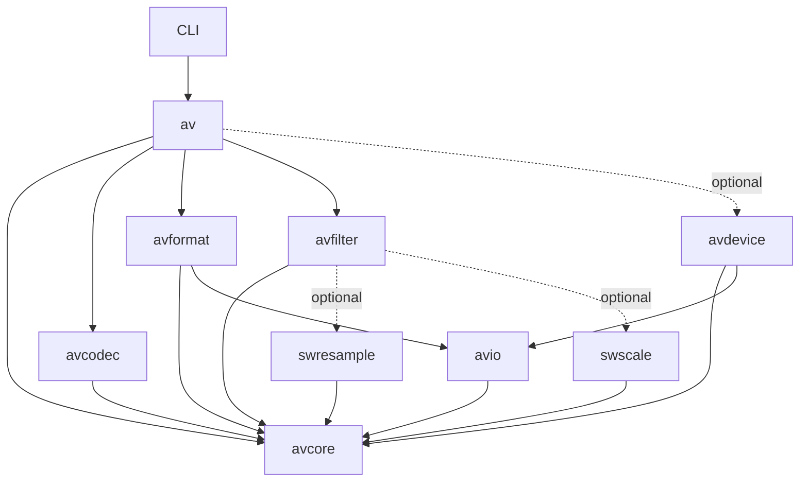

# FFmpeg to native Zig: port design

## Status and scope

Initialized on 2026-11-02. The first complete path, signed 16-bit PCM in WAV,
works: the `av` module ([build.zig](build.zig), rooted at
[zig/root.zig](zig/root.zig), documented in [zig/README.md](zig/README.md)) has
[PCM s16 kernels](zig/codec/pcm.zig), [audio](zig/core/audio.zig) and
[time](zig/core/time.zig) types, a bounded [WAV parser and known-length
writer](zig/format/wav.zig) and [file and pipe adapters](zig/io/file.zig), and
[zffprobe](zig/cli/probe.zig) is the first tool. The first WAV contract has named
fixtures with expected results ([zig/testing/fixtures](zig/testing/fixtures/README.md)),
and CI compares them with a pinned FFmpeg build
([zig/testing/reference](zig/testing/reference/README.md)). This standalone
repository tracks the port's own files. FFmpeg in `.references/ffmpeg` remains
the behavioral reference. Verification is Linux-only during development;
Windows and ARM wait for the platform milestone (TODO.md T62–T63). The second
path, AU with signed 16-bit big-endian PCM (T12), is verified too: its
[contract and 29 fixtures](zig/testing/fixtures/au/README.md), the [AU parser
and writer](zig/format/au.zig), and `zffprobe`, which chooses WAV or AU by
[content detection](zig/format/detect.zig). The synchronous
[conversion pipeline](#conversion-pipeline) (T13a, `av.convert`) and the
[`zffmpeg` command](#zffmpeg-command) (T13b) that converts and stream-copies
between WAV and AU (and since T21b Wave64) are verified, and the pipeline now runs on
[packets, frames and send/receive stages](#packets-frames-and-stages) (T14a),
with [decoded sample storage](#decoded-sample-storage) for every sample format
(T20a) and the [PCM encodings](#pcm-encodings) that decode into it (T20b);
WAV reads and writes all of them, plain or WAVE_FORMAT_EXTENSIBLE (T21a),
in RIFF, RF64/BW64 or Sony Wave64, past 4 GiB, and reads unknown-length input
behind an option (T21b). The metadata dictionary with WAV metadata (T17b,
T21c) is next.

The goal is a native Zig multimedia library and tools, built incrementally from
FFmpeg's functionality. Use idiomatic Zig APIs and explicit resource ownership.
Full FFmpeg command-line, API, and ABI compatibility are separate milestones,
not assumptions of the first release. C compilation through Zig and libav*
bindings are useful reference/testing techniques, but do not count as ported
functionality.

Use [TODO.md](TODO.md) for the ordered implementation checklist and task status.
This document remains the architecture, acceptance criteria and feature ledger.
See [README.md](README.md#clone-the-reference-repositories) to clone both FFmpeg
and zigimg at the inspected revisions into ignored `.references/`. Their source
files and Git histories are not committed to this project or included as submodules.

Use [zigimg](https://github.com/zigimg/zigimg.git) as a Zig implementation reference.
The [pinned source analysis](doc/zigimg-reference.md) records verified I/O,
ownership, build and testing patterns, including the parts requiring adaptation.

## Document authority

| Document | Owns |
| --- | --- |
| This file | Architecture, supported behavior, resource rules and the capability ledger. |
| Fixture READMEs | Named inputs, expected results, error precedence and intentional differences for each contract. |
| [TODO.md](TODO.md) | Stable task IDs, dependencies, gates G0–G5, required coverage, evidence, platform policy and the not-planned list. |
| [notes.md](notes.md) | Revisable decisions, their reasons and the files that must change together. |
| [CLAUDE.md](CLAUDE.md) | Agent workflow and implementation guidance, subordinate to the behavioral contracts. |

TODO.md is authoritative for whether a task is done; a summary elsewhere adds
no evidence. Resolve conflicting behavior or policy before implementation and
update the affected contract, task, fixtures and notes in the same change.
Silence in one document does not authorize widening a subset or dropping a
check. Keep detailed task status in TODO.md instead of another checklist.

## Design goal: less machinery, clear behavior

Build the simplest Zig implementation of each supported multimedia operation.
Use FFmpeg to understand algorithms, file formats and observable behavior; choose
the Zig data model and control flow around the needs of the new implementation.
The unit of work is a capability such as decoding PCM, not translating a C file.

The main opportunities are fewer macro variants, fewer duplicated declarations,
smaller contexts and less manual cleanup. Codec mathematics, malformed-input
handling and timing remain real complexity that the implementation must express.
Zig enables simpler code; it does not establish correctness or speed by itself.

Apply these decisions throughout the port:

1. **Start with concrete code.** Write the first working algorithm as normal
   functions and structs. Share it when another supported variant exposes the
   same operation. Use a `comptime` parameter for the actual varying property.
2. **Use the standard library first.** Reuse allocators, collections, byte-order
   reads/writes, I/O and test facilities where their contracts fit. Keep
   multimedia-specific rescaling, buffering or bitstream behavior in small
   domain helpers; porting all of `libavutil` is unnecessary.
3. **Keep one implementation of each algorithm.** Specialize by sample type,
   bit depth or byte order where that removes duplication. Keep channel counts,
   dimensions and stream data at runtime unless measurement justifies otherwise.
   A second implementation needs a recorded purpose, a comparison oracle and a
   retention or retirement condition. T58's optimized alternatives retain the
   scalar implementation as their oracle. T24 ports one resampler, swresample's
   native algorithm, rather than preserving parallel legacy APIs.
4. **Represent valid states directly.** Use slices, optionals, enums, tagged
   unions and error unions. Give codecs their own small state and options types.
   Share a contract only after working implementations reveal what it needs.
5. **Make the common path direct.** A caller that knows it has WAV/PCM can call
   those implementations directly. Add discovery and dispatch for callers that
   need runtime selection, without routing every internal operation through it.
6. **Require abstractions to pay for themselves.** A helper should remove real
   duplication, enforce an invariant or isolate a dependency. Prefer a readable
   loop or `switch` when reflection or generated types add more concepts.

Acceptance includes maintainability: a new endian variant should reuse a tested
kernel; a new codec should have local state and a small registration change; an
option should have one typed default and one description of its constraints.
Track runtime cost, allocations, build time and binary size when these choices
affect them. Smaller source alone is not a sufficient success criterion.

### Supported scope and policy

The supported subset determines the parsing surface the project maintains.
Supporting every historical file is not a goal. G0 names accepted behavior and
explicit exclusions; widening either requires updated contracts, fixtures and
reference comparisons. FFmpeg accepting a file is evidence to examine, not an
instruction to relax a bound or add recovery. Keep intentional differences
narrow and testable. Failed experiments may be removed through a recorded scope
decision; their existence alone is no reason to retain them.

The [not-planned list](TODO.md#not-planned) is a scope decision. Adding an
external dependency or an excluded capability requires revising that decision
and its affected tasks, not treating it as incidental implementation work.
Build-time component selection (T55) must let consumers omit unused parsers
from the binary. This reduces exposure; it does not replace validation or an
application's process isolation and privilege separation for untrusted media.

Zig helps express bounds, errors and cleanup, but does not prove a codec safe
or correct. ReleaseFast does not supply the safe modes' runtime checks, and
Zig has no borrow checker. Explicit size checks, ownership tests and a bounded
fuzz entry are required before G5; T60 adds sustained campaigns. Neither a
passing unit suite nor a language choice establishes a security or performance
claim. Codec mathematics, timing and independent reference checks remain work
for every capability. The reasons for these choices live in
[notes.md](notes.md#port-design-policy).

## Inspected baseline

- FFmpeg reference commit: `5d5a38a7e46be296eab75982c0986054f731e19e`.
- Repository: [FFmpeg/FFmpeg](https://github.com/FFmpeg/FFmpeg.git), checked out
  locally at `.references/ffmpeg`.
- Commit subject: `avfilter/vf_scale_d3d12: add RGB formats and color space conversion`.
- [RELEASE](https://github.com/FFmpeg/FFmpeg/blob/5d5a38a7e46be296eab75982c0986054f731e19e/RELEASE): `8.0.git`; use the commit above as the precise reference.
- At the reference commit: 11,112 tracked files, including 3,511 C files, 1,283 headers, 236 `.S` files,
  and 189 `.asm` files. These are repository-wide counts, including tests/tools.
- Local compiler: Zig **0.17.0** on PATH, confirmed with `zig version` / `zig env`.
  Executable aliases and installation paths are machine-specific.

Use Zig 0.17.0 as the initial pinned toolchain. The official
[download index](https://ziglang.org/download/index.json) and
[download page](https://ziglang.org/download/) identify 0.17.0 as the stable
release at the time of analysis. Consult the
[versioned language reference](https://ziglang.org/documentation/0.17.0/)
and the installed standard library when implementing examples below. An exact
tested-version check belongs in the build/automation: `.zig-version` is a
version-manager convention and `.minimum_zig_version` declares a minimum, not
an exact pin. Do not rely on that metadata to enforce compiler compatibility.
Initially check for 0.17.0 explicitly; adopt another patch/release after validation.

## How the FFmpeg tree is organized

Counts below are tracked files at the reference commit under each directory, not
implementation sizes or estimates of porting effort. All C source paths in this
document are relative to `.references/ffmpeg/`; source links pin the upstream
revision and do not depend on the clone being present.

| Location | Files | Responsibilities and useful entry points |
| --- | ---: | --- |
| `libavutil/` | 464 | Foundation: `rational.h`, `mathematics.c`, `buffer.c`, `frame.c`, `pixdesc.c`, `samplefmt.c`, `channel_layout.c`, `opt.h`, `cpu.c`. |
| `libavcodec/` | 2,780 | Codec framework and implementations: `codec_internal.h`, `decode.c`, `encode.c`, `packet.c`, `get_bits.h`, `put_bits.h`, `vlc.c`, `allcodecs.c`. Large families already have directories such as `aac/`, `hevc/`, `opus/`, `vvc/`. |
| `libavformat/` | 735 | Containers, probing, mux/demux, seeking, protocols, I/O: `avformat.h`, `avio.h`, `aviobuf.c`, `demux.c`, `mux.c`, `allformats.c`, `protocols.c`. |
| `libavfilter/` | 821 | Graph execution, format negotiation, scheduling and individual `af_*`, `vf_*`, source/sink filters. |
| `libswresample/` | 51 | Audio conversion, rematrixing, delay and resampling. |
| `libswscale/` | 169 | Pixel conversion, colorspace handling and image scaling. |
| `libavdevice/` | 78 | Platform-specific audio/video capture and output. |
| `fftools/` | 57 | CLI tools; `ffmpeg_*.c` separates demux, decode, filtering, encode, mux and scheduling. |
| `tests/` | 5,714 | FATE definitions and reference output, API tests, checkasm and supporting tools. Many reference files are extensionless. |

The seven library boundaries are useful responsibility maps. They do not require
seven matching Zig libraries, identical context types or the same public API.
The C tree reflects decades of C build and ABI constraints: public headers, private headers,
macro-generated variants, large registration lists, and architecture-specific
directories. Preserve the behavior while reorganizing implementation by feature.

### Build graph and registration

The minimum library dependencies declared in [configure](https://github.com/FFmpeg/FFmpeg/blob/5d5a38a7e46be296eab75982c0986054f731e19e/configure) are:

| Consumer | Dependencies |
| --- | --- |
| `avcodec`, `avfilter`, `swresample`, `swscale` | `avutil` |
| `avformat` | `avcodec`, `avutil` |
| `avdevice` | `avformat`, `avcodec`, `avutil` |

Individual features introduce additional dependencies and external libraries;
this is not the complete configuration graph. For example, a filter can require
scaling or resampling.

Each library's `Makefile` describes public headers, unconditional objects and
`OBJS-$(CONFIG_...)` selections. Architecture subdirectories add optimized
implementations. [ffbuild/library.mak](https://github.com/FFmpeg/FFmpeg/blob/5d5a38a7e46be296eab75982c0986054f731e19e/ffbuild/library.mak) supplies common
library rules; FFmpeg's root [Makefile](https://github.com/FFmpeg/FFmpeg/blob/5d5a38a7e46be296eab75982c0986054f731e19e/Makefile) orchestrates its build.

`configure` resolves dependencies and writes configuration and component lists,
including `codec_list.c`, `parser_list.c`, `bsf_list.c`, `demuxer_list.c`,
`muxer_list.c`, `filter_list.c`, and `protocol_list.c`. These are generated
artifacts, not the authoritative feature inventory. Read `configure`, the
relevant Makefile, and implementations together when planning a component.

[allcodecs.c](https://github.com/FFmpeg/FFmpeg/blob/5d5a38a7e46be296eab75982c0986054f731e19e/libavcodec/allcodecs.c),
[allformats.c](https://github.com/FFmpeg/FFmpeg/blob/5d5a38a7e46be296eab75982c0986054f731e19e/libavformat/allformats.c), and
[allfilters.c](https://github.com/FFmpeg/FFmpeg/blob/5d5a38a7e46be296eab75982c0986054f731e19e/libavfilter/allfilters.c) consume those lists and expose iteration.
The Zig equivalent can start with a small explicit table. Keep its ordering
deterministic and define selection priority deliberately; a registry framework
is not a prerequisite for the first format or codec.

### Runtime contracts worth preserving

- `AVPacket` represents encoded data and timing; `AVFrame` represents decoded
  planes, layout, timing, and side data. Their storage can be reference counted.
- Decoder/encoder send-and-receive APIs express buffering, backpressure, delayed
  output and draining. One input does not imply one output.
- Rational time bases and explicit rounding are fundamental. Floating-point
  seconds cannot replace timestamp rescaling without changing behavior.
- `AVOptions` describes typed options using metadata and C field offsets. Zig
  can retain metadata while replacing offset-based mutation with typed access.
- Optimized DSP functions are selected behind common interfaces. A portable
  scalar implementation provides a reference for architecture-specific kernels.

## Proposed Zig layout

Use one package and one named library module, `av`, rooted at `zig/root.zig`.
Use ordinary file imports inside it. Directories organize responsibilities;
they do not each require a build module or installed library. The first path needs
core, I/O, PCM and WAV; a general graph engine, universal codec context, plugin
system and full feature dependency resolver can wait for concrete requirements.

The following is the **proposed first layout**. The entries marked `existing`,
plus `LICENSE` and the Linux CI workflow (`.github/workflows/ci.yml`), are
present; the rest are planned:

```text
build.zig                    # existing: one library module, artifacts and tests
build.zig.zon                # existing: package identity, dependencies, source/license paths
.zig-version                 # existing: tooling hint 0.17.0; build enforces version
zig/
  README.md                  # existing: setup, supported compiler and validation commands
  root.zig                   # existing: av: small public facade with direct feature access
  examples/
    io_patterns.zig          # existing: standalone, tested I/O usage
  core/                      # internal files in the av module
    time.zig                 # existing: time bases and FFmpeg-compatible rescaling
    audio.zig                # existing: layouts, sample/stream formats, borrowed samples
  io/                        # thin adapters over standard-library I/O
    file.zig                 # existing: file and pipe adapters for the WAV path
  codec/
    pcm.zig                  # existing: s16 kernels; grow a directory when needed
  format/
    wav.zig                  # existing: bounded parser and known-length writer
  cli/
    probe.zig                # existing: first tool, zffprobe
  testing/                   # native tests; FFmpeg tests stay in its clone
    fixtures.zig             # existing: typed fixture manifest and integrity tests
    reference/               # existing: FFmpeg reference build and comparison scripts
    fixtures/                # existing: tiny fixtures; README.md is their contract
```

Keep the shared core small. Add packet/frame ownership types when buffering is
needed, bit readers when a compressed format needs them, and shared RIFF code
when another RIFF consumer benefits. A PCM kernel taking slices does not need a
universal frame allocator or send/receive interface.

As coverage grows, introduce these areas when their first feature is ready:

| Area | Reason to introduce it |
| --- | --- |
| `core/buffer.zig`, `packet.zig`, `frame.zig` | Retained buffers, delayed output or shared audio/video storage. |
| `codec/<family>/` and local DSP files | A codec family needs several substantial algorithms; promote shared DSP only when reused. |
| `format/<family>/` | A container has enough parser, muxer and demuxer code to benefit from separation. |
| `filter/`, `scale/`, `resample/` | Working transforms; start with direct functions and build a graph when composition requires it. |
| `registry.zig`, `build/features.zig` | Selection and feature dependencies have outgrown a small explicit table. |
| `device/`, `compat/` | Actual platform integration or a requested compatibility target. |

Keep native sources under `zig/`. The project [.gitignore](.gitignore) explicitly
excludes `/.references/`, `/.zig-cache/` and `/zig-out/`. Reference clones are
research/test inputs, not vendored source, gitlinks or package dependencies.

Group files by format or codec family instead of copying thousands of C
basenames into a flat Zig directory. Create directories when implementing their
first feature; empty placeholders are unnecessary. Use `root.zig` to export a
small supported API, not every internal declaration.

### Dependency direction as the library grows



Here arrows point from consumer to dependency. `av` is the composition facade.
Names such as `avcore` and `avio` describe future responsibilities, not T01 build
modules. Initially these are ordinary file imports within `av`. Introduce a
separate named module when it enables a required consumer subset or a proven
dependency boundary; moving files between modules does not itself fix a cycle.

Moving packet, codec identifiers and stream parameters into `avcore` lets basic
container code avoid importing codec implementations. If a container needs a
codec parser, provide that dependency through an explicit parser interface or
an optional module import; do not create a reverse dependency from codecs to
containers. Keep probing/dispatch registries in the composition layer. Low-level
I/O should not know about formats or codecs.

### Core API and resource rules

1. Pass `std.mem.Allocator` explicitly where allocation happens. Make successful
   ownership transfers and cleanup on failure visible through `defer` and
   `errdefer`; no hidden process-wide allocator, global diagnostic sink or
   mutable registration state. Diagnostics are an explicit dependency (T17a).
2. Prefer caller-provided slices for kernels; add owned buffers where storage
   must outlive the call. Separate borrowed views from owned buffers. Document
   view invalidation on the next read/decode, retained references, and whether
   sharing is thread safe.
   Reference counting is justified for shared frame/packet storage, not every
   small object. Document that copying an owning Zig struct does not clone it.
   Use composition for any allocator-owning convenience wrapper rather than
   duplicating another type's layout and pointer-casting between the two.
3. Start with concrete audio/video views. When a common frame API is needed,
   use a tagged audio/video representation and explicit planes, strides,
   dimensions, sample counts and layouts. Preserve negative-stride semantics
   when supported; do not assume tightly packed images.
4. Define time bases, missing timestamps, rounding, overflow and discontinuities.
   Use checked/wider intermediates for rescaling. A restricted positive
   `TimeBase` can coexist with a more general rational type.
5. For buffering codecs, keep stream states explicit: need input, have output,
   drained, and seek/reset. Reserve errors for failures; never merge end of stream,
   truncation, unsupported features, malformed input, resource limits, I/O
   failures and cancellation into one result. Public media operations use
   domain error sets in error unions, rather than negative errno or `anyerror`.
6. Keep parsing independent of files. Use a single `*std.Io.Reader` WAV parser
   tested through `Reader.fixed(bytes)` before attaching file adapters. PCM
   kernels remain slice-based. Express seek support and cancellation explicitly.
7. Bound allocations, probe sizes, nesting, image dimensions and buffered data
   from untrusted inputs. Check arithmetic before indexing and allocating.
   Allocation failure must be injected at each allocation site before G5.
   Express ownership distinctions in types where possible; document and test
   lifetimes that the type system cannot enforce.

### Verified Zig 0.17 I/O choices

The following choices were checked against the installed `std/Io/Reader.zig`,
`Writer.zig`, `File.zig`, `process.zig`, and `testing.zig`, then compared with the
[pinned zigimg source](doc/zigimg-reference.md). The original
[I/O example](zig/examples/io_patterns.zig) makes the core patterns executable.

- Pass `std.Io` where OS operations need it. Pure parsing accepts Reader/Writer
  interfaces, memory adapters need no I/O context, and PCM kernels need only
  slices. Path helpers own opening/closing; borrowed-file helpers leave closing
  to the caller. State these lifetimes explicitly in public API comments.
- Read fixed-width fields with `readSliceAll` into a small local byte array,
  then `std.mem.readInt`. This works with tiny source buffers and truncated
  `Reader.fixed` input. A failed exact read may already have consumed part of
  the field, so treat truncation and I/O failure as terminal for that stream.
  `takeInt` / `takeArray` are alternatives only when their
  contiguous-buffer capacity preconditions are satisfied; `takeInt` uses encoded
  bit width divided by eight, not generally `@sizeOf(T)`.
- Decode fields explicitly; do not use `takeStruct`, `peekStruct`, their pointer
  variants or `writeStruct` for RIFF serialization. Copy needed metadata into
  small values. Reader-buffer slices expire on subsequent filling/rebasing.
- `Reader.Error` exposes `ReadFailed` and `EndOfStream`. At the format boundary,
  premature EOF becomes `Truncated`; reaching the declared container/data end
  is normal completion. Map read failures to I/O failure and preserve available
  adapter diagnostics, including cancellation. Do not silently convert failure
  to an empty stream or expose every internal error through `anyerror`.
- File operations take an I/O context: `std.Io.Dir.cwd().openFile(io, ...)`,
  paired with `file.close(io)`. `file.reader(io, buffer)` prefers positional
  reads and can fall back to streaming; `readerStreaming` selects streaming
  explicitly for pipes. Neither adapter makes an inherently sequential parser
  seekable. The initial parser requires no seek.
- Construct a file adapter in its final location before borrowing `.interface`.
  Keep the adapter and scratch buffer alive, and reuse the adapter across reads;
  rebuilding it can lose buffered read-ahead. Use `logicalPos()` or parser byte
  accounting when a consumed position is needed. At the file boundary, recover
  `.err` when generic I/O reports failure so cancellation/details survive.
- Write through `*std.Io.Writer`. Encode fixed-width fields into a small local
  array with `std.mem.writeInt`, then call `writeAll`. `Writer.writeInt`
  documents that the writer buffer must hold at least `@sizeOf(T)` bytes; the
  0.17.0 implementation does not need that, but project code should not rely
  on undocumented slack. Fixed memory writers report `WriteFailed`
  when output capacity runs out, possibly after writing a prefix. Flush buffered
  file/stdout output and report failures before success. Flush drains buffers;
  durable storage would require a separate synchronization policy.
  Flush at operation completion or encoder `finish`, rather than after each
  field. Closing a file does not check errors in an unflushed writer buffer.
- Use `std.testing.Reader` with `artificial_limit = .limited(1)` for short-read
  tests. This controls source fragmentation independently of OS buffering.
  Also test real temporary files with empty, tiny and larger adapter buffers,
  using `std.testing.io` and `std.testing.tmpDir` as in the standalone example.
  The parser is synchronous and blocking through `Reader`; resumable nonblocking
  parsing and an asynchronous scheduler are separate future requirements.
- CLI entry can use `main(init: std.process.Init)`: pass `init.io` and `init.gpa`
  to helpers; obtain arguments through `init.minimal.args`. Produce stdout with
  its writer, not `std.debug.print`. Return an exit status from a helper after
  cleanup/flush, then call `std.process.exit(status)` when needed. `cleanExit(io)`
  is success-only, not a general status-code API; process exit skips defers.

Use native I/O cancellation where available and map it explicitly; no new
cancellation framework is required for the first path. Prefer the pinned
library over old examples: `std.ArrayList(T)` starts at `.empty` and takes an
allocator on mutation/deinit in this toolchain.

## C-to-Zig decisions that affect correctness

Review the actual operation behind each C macro or cast before replacing it.
Its surrounding callers, buffer assumptions, format specification and tests are
part of the contract. Preprocessed C can help explain a difficult macro family;
it should be inspection material, not the source of generated Zig algorithms.

| Concern | Porting decision and required evidence |
| --- | --- |
| Integer arithmetic | Use `std.math.add/sub/mul` or overflow builtins for input-controlled sizes; map `error.Overflow` to a domain failure. Distinguish wrapping and saturating algorithms. Wrapping chunk sizes is never validation. Test extremes, clipping and intermediate widths. |
| Signed division and shifts | Choose the intended rounding (`@divTrunc`, `@divFloor`, etc.) and sign extension explicitly. Test negative operands and halfway cases; direct operator substitution can change results. |
| Float conversion and DSP | Define rounding, clipping, NaN/infinity handling and acceptable error. Keep strict floating-point behavior initially; reassociation or fused operations need separate validation. |
| Wire format versus host storage | Decode byte order and packed bits explicitly. Distinguish encoded bits, storage width and meaningful precision; test unaligned input and unusual widths such as 24-bit PCM. |
| C struct layout and casts | Use normal Zig types internally. Restrict `extern` layouts and pointer casts to genuine ABI boundaries. Do not cast an input byte slice to an in-memory header or assume a packed struct parses a file. |
| Buffer padding and alignment | FFmpeg paths may rely on padded input or alignment for fast reads. Start with bounded reads. If a later kernel needs padding/alignment, enforce it at a documented buffer boundary and test tails. |
| Ownership | State who frees storage, when a borrowed view expires, and whether retaining output copies or shares it. Test failure after partial initialization; Zig has no automatic destructor or borrow checker. |
| Metadata | Preserve supported channel order, sample layout, time bases and, later, pixel format, color range/matrix/transfer and side data. Equal bytes with different interpretation are not equivalent media. |
| Invalid input | Check externally controlled sizes, arithmetic, offsets and enum values explicitly. Parser errors must not depend on debug safety checks; `unreachable` is only for proven internal invariants. |

Validate untrusted headers into a small internal representation before entering
the kernel. This keeps checks at understandable boundaries while allowing the
kernel to work with established limits. Define limits on allocations, dimensions,
probe work and queued data. Surface a distinct resource-limit failure rather
than silently accepting partial output. A reusable library should let callers
set these limits; the CLI should supply documented defaults.

Reuse standard-library utilities only after checking their semantics against
the media operation. In particular, generic division or float conversion is not
a substitute for FFmpeg's timestamp rounding and sample conversion rules.
Correct an upstream undefined-behavior dependency through an explicit decision
and tests; reproducing undefined C behavior is not a compatibility objective.

### Streaming state, ownership and time

The contract in [avcodec.h](https://github.com/FFmpeg/FFmpeg/blob/5d5a38a7e46be296eab75982c0986054f731e19e/libavcodec/avcodec.h) is useful even with a different
Zig API. When buffering codecs are introduced, make these behaviors testable:

- A rejected input has not been consumed; its ownership remains with the caller.
  Successful submission specifies whether input is copied, retained or moved.
- Receiving output defines who owns it and how long its views remain valid.
  Multiple outputs per input and delayed output are supported where required.
- End of input enters **draining** and emits buffered results until **drained**.
  A seek/reset discards previous decoder state and starts a new stream segment;
  it is a different operation. Avoid one ambiguous `flush` method for both.
- Backpressure has a progress rule. Sending and receiving must not both wait
  indefinitely for the other; cancellation and resource-limit failures release
  retained resources. Bound queues before introducing worker threads.
- Track presentation time, decoding time and duration separately when needed.
  Represent missing timestamps explicitly; preserve valid negative timestamps.
  Derive PCM timing from integer sample counts and its sample-rate time base,
  rather than repeatedly rounding floating-point durations.
  Derive other timing from the supported container tables or codec rules. If a
  value cannot be derived, keep it missing (`null`); do not heuristically repair
  malformed timing or invent a duration. T15's explicit rounding, wrap handling
  and smoothing operate on known timing under a written contract.

These rules belong in stream adapters. A stateless PCM conversion kernel can
keep its simple slice-in/slice-out API. Start with synchronous execution through
injected I/O; introduce threading only after state and ownership are correct.

### Decoded sample storage

T20a's [core/samples.zig](zig/core/samples.zig) and `audio.SampleFormat`
describe how decoded samples are stored, separately from codec identity and
from what a container carries:

| Case | Behavior |
| --- | --- |
| Formats | FFmpeg's twelve storage formats and names: `u8`, `s16`, `s32`, `s64`, `flt`, `dbl` (packed: channels interleaved in one plane) and `u8p`, `s16p`, `s32p`, `s64p`, `fltp`, `dblp` (planar: one plane per channel). `dsd` is not supported. Silence is 0x80 for `u8`/`u8p` and zero otherwise. |
| Layout | `Layout.init(format, channels, samples, alignment)` gives `linesize` and `size` as `av_samples_get_buffer_size` does. `Alignment.sample_padding` is FFmpeg's `align = 0` (samples rounded up to 32); `.line = n` rounds each line up to the power of two `n`. Plane `i` starts at `i * linesize`. |
| Bounds | Zero channels or samples, and a line alignment that is not a power of two, are `InvalidArgument`; any buffer reaching 2^31 bytes (FFmpeg's `INT_MAX` check, in its order) is `SizeOverflow`. Counts are unsigned, so FFmpeg's negative inputs cannot be expressed. |
| Buffers | `Buffer` views a caller's bytes (`av_samples_fill_arrays`, `BufferTooSmall` if short); `setSilence` and `copy` (overlap allowed, as `av_samples_copy`) work on whole sample positions; `Buffer.alloc` returns an `Owned`, 64-byte aligned, silent buffer. |
| Users so far | The WAV and AU writers, `Frame` and the PCM stages handle packed `s16` only and reject or assert anything else until T20b and T21a/T22a. |

The oracle is FFmpeg itself: [samplefmt_vectors.c](zig/testing/reference/samplefmt_vectors.c)
calls the pinned `libavutil` and prints [the committed vectors](zig/testing/vectors/samplefmt.txt).

### PCM encodings

T20b's `pcm.Codec` ([codec/pcm.zig](zig/codec/pcm.zig)) names the encodings
FFmpeg calls `pcm_u8`, `pcm_s8`, `pcm_s16le`/`be`, `pcm_s24le`/`be`,
`pcm_s32le`/`be`, `pcm_s64le`/`be`, `pcm_f32le`/`be`, `pcm_f64le`/`be`,
`pcm_alaw` and `pcm_mulaw`, separately from storage and containers.

| Case | Behavior |
| --- | --- |
| Storage | Packed, as FFmpeg's decoders store it: u8 and s8 as `u8` (s8 offset by 128), s16, A-law and mu-law as `s16`, s24 shifted into the top 24 bits of `s32`, s32 as `s32`, s64 as `s64`, f32 and f64 as `flt` and `dbl` with every bit kept (NaN payloads included). |
| Encoding | The inverse; s24 keeps the top 24 bits of `s32`, A-law and mu-law quantize through FFmpeg's 16384-entry tables (index `(v + 32768) >> 2`), built at compile time by [codec/g711.zig](zig/codec/g711.zig). |
| API | `pcm.decode(codec, bytes, buffer, offset)` and `pcm.encode(codec, buffer, offset, frames, out)` over `samples.Buffer`; stored values are in the target's byte order, encoded ones in the codec's. `FormatMismatch`, `IncompleteFrame` and `OutputTooSmall` write nothing. Input may be at any address. |
| Not yet | Planar PCM codecs (only when a container needs them), unsigned 16/24/32-bit, DAUD, LXF, VIDC; the containers that carry the new encodings (T21a WAV, T22a AU, T22c raw). The PCM stages and `Frame` stay s16. |

The oracle is FFmpeg's `libavcodec`: [pcm_vectors.c](zig/testing/reference/pcm_vectors.c)
records SHA-256 digests of the pinned decoders' and encoders' output.

### Packets, frames and stages

T14a puts these rules into types ([core/packet.zig](zig/core/packet.zig),
[core/frame.zig](zig/core/frame.zig), [core/stage.zig](zig/core/stage.zig)):

| Case | Behavior |
| --- | --- |
| `Packet` | A view of encoded bytes with `time_base`, optional `pts`, `dts` and `duration`, `stream_index` and key/discard flags. It never owns `data`; the producer states how long the bytes live. |
| Audio `Frame` | A view of interleaved signed 16-bit samples (one plane; planar storage arrives with T20a), its `audio.Format` and optional `pts` in `1/sample_rate`. It never owns `samples`. |
| Retention | `clone(gpa)` returns an `Owned` packet or frame that holds a copy and its allocator until `deinit`. Copying a view or an `Owned` value never clones; there is no reference counting until T14b. |
| Send | `.accepted` (the stage took the input, which must not be sent again) or `.full` (not consumed: the caller keeps it, and `receive` then returns an output). A failed `send` consumes nothing; the stage documents whether it stays usable. |
| Receive | `.output`, `.need_input` or `.drained`. A stage never answers `.full` and `.need_input` in the same state. Each stage states how long an output stays valid. |
| End of input and reset | `finishInput` starts draining once and is idempotent (FFmpeg answers a second flush with `AVERROR_EOF` on decoders); buffered outputs follow, then `.drained` on every call. `send` after it is `InputAfterEnd`. `reset` drops buffered input, output and timing state and accepts input again; it is not draining. |
| PCM stages | `pcm.Decoder` and `pcm.Encoder`: one packet per frame over caller storage, no allocation; outputs live until the next `send` or `reset`. The decoder rescales `pts` to `1/sample_rate` (nearest); the encoder emits key packets with `dts = pts` and the frame count as duration. Oversized input is `OutputTooSmall`, a mismatched frame format `FormatMismatch`; both leave the stage usable. |
| Pipeline | `av.convert` reads 4 KiB packets of whole frames, timestamped in frames since the start; copy writes them, transcoding passes them through the PCM stages. |

## Modern Zig metaprogramming

Use compile-time programming to remove repetitive machinery and enforce real
contracts. Keep algorithm control flow and resource ownership easy to read.
Relevant features are documented in the
[Zig 0.17 language reference](https://ziglang.org/documentation/0.17.0/#comptime).

| FFmpeg mechanism / source | Simpler Zig expression |
| --- | --- |
| `DECODE`, `ENCODE`, token-pasted byte readers in `libavcodec/pcm.c` | Normal functions with typed slices and a `comptime` byte-order parameter; let the compiler type-check the implementation. |
| `BIT_DEPTH`, repeated inclusion, `FUNC*` in `libavcodec/bit_depth_template.c` | A generic kernel with explicit storage/coefficient types and bit depth; no generated symbol names or macro scope to reset. |
| `PCM_ENCODER_*`, `PCM_DECODER_*` registration layers | Explicit descriptors for supported variants; normal compile-time conditionals when build selection is needed. |
| `CONFIG_*`, selected object lists | A few `std.Build` options; add an explicit dependency catalog as actual features require it. |
| Public/private header declarations and implementation files | Zig files as namespaces, explicit imports and `pub` exports; one function definition. |
| Pointer plus length, nullable fields, numeric error codes | Slices, optionals, tagged unions and domain error sets. |
| Failure labels and repeated free calls | `defer` / `errdefer` next to resource acquisition; allocation-free kernels where possible. |
| `AVOption` type tags and field offsets | Normal options structs with defaults, plus explicit help/range/alias metadata only for introspection or CLI use. |
| Static VLC/transform tables | Auditable constants or bounded deterministic comptime generation, compared with reference vectors. |
| DSP function pointers | Portable scalar kernels, optional vectorized kernels, target-aware/runtime CPU selection. |

### Example: one PCM kernel, two byte orders

In [pcm.c](https://github.com/FFmpeg/FFmpeg/blob/5d5a38a7e46be296eab75982c0986054f731e19e/libavcodec/pcm.c), `DECODE` builds reader and integer names by token
pasting and mutates pointers supplied by its caller. A native Zig kernel can
express the signed 16-bit subset with one ordinary loop.
[zig/codec/pcm.zig](zig/codec/pcm.zig) implements `decodeS16` and `encodeS16`
with a `comptime` byte-order parameter. Its tests cover both byte orders, signed
extrema, invalid buffer sizes, unchanged output on failure, empty input, an
exhaustive round trip of every `i16`, and the generated writer-output fixtures.

The caller owns `output`; the returned slice borrows it. Input and output must
not overlap. Byte order is fixed per specialization; sample count and the loop
remain runtime values. Runtime format selection can dispatch once outside this
loop to `decodeS16(.little, ...)` or `decodeS16(.big, ...)`. No allocation,
reflection, function-name generation or `inline for` is needed here.

The stream adapter handles interleaving, channel alignment, timestamps and
partial reads; it can retain an incomplete sample between reads. This kernel
accepts only complete samples and reports truncation otherwise. Add 24-bit,
float or planar variants with explicit conversion rules as they become needed.
In particular, wire width and storage size differ for types such as `i24`; use
the encoded bit width when consuming bytes, and define alignment/scaling into
the destination sample representation explicitly.

### Dispatch and registration should grow with the implementation

Start with direct calls and a small explicit descriptor array. Prefer concrete
descriptor field types so the compiler checks function signatures through normal
assignment. A compile-time loop can reject duplicate names and invalid entries;
a generic registry type is optional. Use a tuple of implementation types only
when those types actually drive useful generated adapters or tables.

Validate uniqueness within the appropriate registry: encoder/decoder components
can share a codec identifier; identifiers and implementation names serve
different purposes. Enforce dependencies and capabilities as the descriptor
schema grows. Keep explicitly disabled implementations outside selected tuples
and emitted tables so their function addresses do not retain unused code.

For a handful of implementations, a tagged union and `switch` is sufficient.
Consider a vtable when callers need a common handle without depending on every
implementation's type/layout. Generate a small concrete-to-erased adapter only
when that interface is justified. Put indirect calls at the stream
boundary and keep sample/block loops specialized and directly callable.
Runtime input detection and probing still happen at runtime: a comptime registry
does not make a runtime codec choice a comptime value.

### Reflection and type generation in 0.17

The installed 0.17 standard library confirms that struct reflection exposes
`field_names` and `field_types`. Older recipes using
`@typeInfo(T).@"struct".fields` need updating. For example, typed option access
can use this pattern inside a generic function with a known options type:

```zig
inline for (@typeInfo(Options).@"struct".field_names) |name| {
    const Field = @FieldType(Options, name);
    // Dispatch supported Field types and access @field(options, name).
    _ = Field;
}
```

This second fragment is explanatory, not a complete parser. Reflection supplies
names and types; help text, range limits, units, enum aliases and compatibility
names must remain explicit metadata. Validate metadata against real fields at
compile time and report unsupported option types clearly.

When a type's shape needs to be generated at compile time, 0.17 provides
constructors such as `@Struct`, `@Union`, `@Enum`, `@Int`, and `@Tuple`. Avoid
older `@Type(...)` examples. Most port types can be ordinary structs/unions or types returned from
a `fn (... comptime ...) type`; generating every type adds little value.

Public library callers should be able to initialize a typed options struct
directly. Add reflection for repetitive CLI binding or introspection when needed;
do not make ordinary configuration pass through string-keyed dictionaries.

Use plain `for` for samples, pixels and packets. Reserve `inline for` for
heterogeneous types or compile-time fields that require it. Each specialized
parameter increases the set of possible instantiations: choose a few supported
formats and avoid generating the cross product of codecs, layouts, CPU targets
and entire pipelines. Large validated tables may be simpler as checked-in data
or build-generated assets than expensive comptime calculations.

Use `@Vector` only for measured kernels and retain scalar fallbacks. The target
architecture is known at compile time; CPU capabilities on the deployed machine
may need runtime selection. Baseline binaries must not execute instructions
that the selected target does not guarantee.

### Build-time versus compile-time work

Follow the current [Zig build system](https://ziglang.org/learn/build-system/):
`b.addModule` for exported modules, `b.createModule` for artifact roots,
`b.addExecutable` / `b.addLibrary` when artifacts are needed, and `b.addTest`
plus run steps for tests. Wire target and optimization settings explicitly.

T01 must make these build properties observable:

1. `standardTargetOptions` and `standardOptimizeOption` feed the single `av`
   module. The default install step depends on a real compile, e.g. `addLibrary`
   with `.root_module = av` followed by `installArtifact`; registering a module
   alone leaves `zig build` able to succeed without compiling anything.
2. `zig build test` depends on `addRunArtifact(addTest(...))`, so it executes
   tests. Aggregate the existing standalone I/O tests through a test root or
   separate run artifact; new media helpers are not required for this build
   task. Verify failure propagation with a temporary failing test and remove it
   before completion. Import implemented test files explicitly as they arrive.
3. Keep the default tests native to the selected runnable host. Cross-target
   compilation belongs in a separate step and does not supply native-run evidence.
4. Give the manifest a stable package name/version, toolchain-generated
   fingerprint and `minimum_zig_version = "0.17.0"`. Use an explicit `.paths`
   allowlist for build files, `zig/` and applicable license/attribution files.
   Avoid `""`, which includes the entire repository in the package. Dependencies
   start empty. A package name conveys no FFmpeg ABI compatibility claim.
5. Record the exact-version check, package/build setup and commands in
   `zig/README.md`. T01 also records licensing/provenance choices for each new
   file and updates the root README plus the current-state summaries in the
   plan, checklist and agent guidance.

The zigimg reference demonstrates explicit test imports and separate test-run
and test-build steps. Retain these distinctions: installing its test executable
does not define this project's library packaging. Keep zigimg as a source
reference, with no dependency in the native package.

Start with explicit imports and build only implemented features. Add feature
options when there is a useful choice to expose. When selection becomes complex,
let the build graph resolve dependencies, optional SDKs and generated inputs;
let module comptime code validate contracts and create typed tables. Keep one
authority for component selection; derive repetitive lists from it instead of
maintaining duplicate inventories. If a catalog eventually generates imports,
emit them through cached build steps. Invalid feature combinations should fail
with an actionable error instead of silently changing the selected features.
zigimg's typed encoder-options union and function-pointer descriptors are useful
examples once selection is needed. Test public format identity/lookup with
features disabled; do not assume positions in a filtered table are stable IDs.
For sequential probing, replay a bounded prefix instead of assuming that every
input can seek back to its start.

Keep the default native build independent of the reference FFmpeg build and its
C compiler. Reference comparisons are an explicit test step. Platform APIs may
need ABI bindings, but those bindings should stay in the relevant adapter rather
than pulling C codec implementations into the native processing path. Preserve
standard target/optimization options and a minimal reproducible configuration.

Keep host probing and system-library discovery out of the default build unless
each addition has a recorded decision here and in notes.md. T55 extends the
explicit component catalog; it must not introduce a configure-like shell layer
or a second inventory. Measure build time when changing selection machinery;
an unexplained slowdown of plain `zig build` is a defect to investigate.

Do not recursively scan sources to auto-register components. Do not read the
filesystem at language comptime. Use build-generated Zig/options files and
`@embedFile` for declared inputs. Do not copy all FFmpeg configuration switches
before the associated behavior exists.

## Porting order and acceptance criteria

Progress is measured by working, tested behavior, not by translated file counts.

| Phase | Deliverable | Completion evidence |
| --- | --- | --- |
| 0 — initialization | Repository guide, this design and TODO checklist. | Documentation complete; no native implementation claimed. |
| 1 — minimal foundation | Pin 0.17.0; package/build; explicit test roots; typed PCM kernel and the time/audio helpers the first path needs. | Build/format/unit checks; hand-checked sample vectors, bounds and relevant time rounding. A working kernel precedes a general codec interface. |
| 2 — first complete path | RIFF/WAV PCM s16le demux/decode and PCM encode/WAV mux; memory/file input; minimal zffprobe. | Metadata, samples and timing match the reference; reference decodes Zig's WAV; short-read/truncation/chunk/bounds and cleanup cases; unsupported variants reported clearly. |
| 3 — reuse proven by another path | Add a second supported variant or small container, then minimal zffmpeg conversion/stream-copy; extract common interfaces from working paths. | Shared kernels replace duplication; callers can still use direct APIs; documented runtime selection and ownership; drain/reset tests for paths that buffer. |
| 4 — next lossless slice | Select one deliverable, such as a defined FLAC decode subset. Scope image formats and transforms separately. | Independent vectors and selected FATE-equivalent regressions; exact lossless content and defined timing. |
| 5 — next compressed slice | Select one end-to-end path based on needs, such as MP3 demux/decode; scope AAC, H.264 and MP4/Matroska separately. | Document the chosen profiles, parser/demux dependencies, seek/error/drain behavior and reference comparisons. |
| 6 — optimization/platforms | SIMD, threading, native platform verification and broader CLI/API adapters. Hardware and devices stay on the not-planned list unless a separate scope decision adds them. | Scalar comparisons, benchmarks, CPU fallback checks, platform integration tests and explicit compatibility claims. |

[TODO.md](TODO.md#roadmap-to-a-nearly-complete-port) breaks phases 3–6 into
milestones 4–12 (T14–T64), with dependencies, upstream references and
completion criteria, and lists what is not planned.

Later slices start with native implementations and no external codec libraries.
Choose the dependency policy explicitly before a format requiring compression
support, such as PNG; a zlib binding must not silently count as a native port.

### First WAV contract

These are **chosen first-subset rules**, not claims about all valid WAV files or
FFmpeg's acceptance policy. T02 turned each row into named fixtures and expected
results in [zig/testing/fixtures/README.md](zig/testing/fixtures/README.md), the
canonical fixture contract, which also records the boundary decisions and the
error precedence. Defaults below are project policy and may be revised with
evidence.

| Case | Initial behavior |
| --- | --- |
| Container | Little-endian RIFF/WAVE, and since T21b RF64 and BW64 (64-bit sizes in a leading `ds64` chunk, the 32-bit fields 0xFFFFFFFF) and Sony Wave64 (GUID chunk IDs, 64-bit sizes counting the 24-byte chunk header, 8-byte padding; reported as the `w64` container). Reject RIFX as `UnsupportedFormat`, and the `riff_size` sentinels 0 and 0xFFFFFFFF of plain RIFF as `UnsupportedStreamingSize` unless the parser's `unknown_length` option (T21b) makes the extent the rest of the input. |
| `fmt ` | Since T21a: tag 1 PCM at 8, 16, 24, 32 or 64 bits (`pcm_u8`, `pcm_s16le`, `pcm_s24le`, `pcm_s32le`, `pcm_s64le`), tag 3 float at 32 or 64 bits, tag 6 A-law and tag 7 mu-law at 8 bits, in a 16-byte `fmt ` or an 18-byte one with `cbSize == 0`; or WAVE_FORMAT_EXTENSIBLE (0xFFFE, exactly 40 bytes, `cbSize == 22`) with a KSDATAFORMAT subformat of those tags, valid bits 0 or all, and a channel mask of 0 or the layout's. Mono or stereo. A `fmt ` declaring fewer than 16 bytes is `InvalidFormat`; input ending inside it is `Truncated`; other complete variants are `UnsupportedFormat`. |
| Rate/alignment | Rate must be positive; default rate limit 192,000 Hz (above it: `LimitExceeded`). Require `block_align == channels * bits / 8` with checked arithmetic. Zero channels/rate or an inconsistent `block_align` are invalid. `byte_rate` is informational: decoding never uses it and FFmpeg does not validate it, so accept a mismatch and ignore the value. A `fact` chunk is skipped like an unknown chunk. |
| Ordering | Exactly one `fmt ` before exactly one `data`. Reject missing/duplicate required chunks within the declared RIFF extent. |
| Data length | Explicit length, divisible by block alignment. Zero means an empty stream, never read-to-EOF. Reject `0xFFFFFFFF` as unsupported streaming size, unless the `unknown_length` option (T21b, off by default) reads the data to the end of the input: whole frames, no frame count, and nothing after the data is read. |
| Bounds | Account for chunk headers, bodies and odd-size padding inside `riff_size + 8`. Never read beyond that extent. Known input size permits early truncation checks; otherwise detect it during consumption. A chunk (including `data`) whose declared size runs past the extent is `InvalidRiff`; so is an extent that leaves fewer than 8 bytes for a chunk header. A final odd-sized chunk whose pad byte lies outside the extent is complete; a pad byte inside the extent but missing from the input is `Truncated`, as is any input shorter than the extent. |
| Unknown chunks | Skip bounded contents and padding. Continue validation after `data` to the RIFF end so later duplicates/truncated chunks are detected. Ignore bytes outside the declared RIFF extent. |
| Completion | Header discovery is not full-file validation. Success requires consuming/validating the declared extent. Errors found after emitting audio are reported; callers must not assume atomic output. |
| Tags | Since T21c, opt-in: `LIST`/`INFO` and `bext` chunks of RIFF and RF64 streams, before or after `data`, read as FFmpeg's demuxer reads them and reported under its names and in its order (`wav.genericTags`), into a caller's `metadata.Dictionary`. Malformed tag content ends that list's tags without failing the stream; collecting never changes a verdict except through the retained-bytes limit and allocation failure. The rules are in the [fixture README](zig/testing/fixtures/README.md#decisions). |
| Resource defaults | At most 4,096 chunks and 1 MiB of retained non-audio bytes (headers and chunk contents the parser keeps in memory; since T21c the tag chunks read while collecting tags, `Limits.max_retained_bytes`); a 64 KiB streaming work buffer. Skipped chunk bodies and padding are bounded by the chunk-count limit and the RIFF extent, not by the byte limit, so large `LIST`, `id3 ` or `iXML` chunks remain readable. Data streams within RIFF's checked 32-bit length limits, without whole-file allocation. Expose configurable policy limits. |
| Output | Known frame count up front; the `fmt ` FFmpeg's `riffenc.c` chooses (plain 16-byte tag 1 for PCM, 18-byte for float, A-law and mu-law, WAVE_FORMAT_EXTENSIBLE above 48 kHz or above 16 bits except float), a `fact` chunk for every encoding but tag 1, and exact RIFF/data sizes with the pad byte of odd data. Validate the total RIFF size, not just `data`; reject overflows and encodings WAV cannot carry before the header. No seeking or placeholder sizes. `finish` verifies the exact frame count and flushes. |

T07 includes sequential non-seekable input with known sizes and the ordering above.
It does not include unknown-length streaming WAV, which T21b adds behind an
option, or resumable nonblocking parsing. The conversion pipeline refuses
unknown-length input as `UnsupportedStreamingSize` before any output, because
both writers need the length up front; zffprobe and zffmpeg do not enable the
option.
Writer output targets memory and files/streams through the same Writer interface;
T07 supplies the I/O adapters used by T08. Under/overproduction relative to the
declared frame count is an error; a failed stream may contain partial output.

Use format errors such as `InvalidRiff`, `InvalidWave`, `InvalidFormat`,
`Truncated`, `UnsupportedFormat`, `UnsupportedStreamingSize`, and
`LimitExceeded`. Preserve `IoFailure`, `Canceled` (Zig's `std.Io.Cancelable`
spelling), and allocation failures at
the appropriate boundary. Successful completion is a normal result, not an EOF
error. The fixture README specifies the error precedence for inputs violating
several rules: the first violation in stream order wins.

`wavdec.c` accepts more than this subset: it handles duplicate `fmt ` chunks
permissively, treats zero/maximum data sizes as unknown-length cases, ignores
`riff_size` and stops at end of input, so it tolerates every bounds violation
above.
Since T21a our writer chooses the same `fmt ` as `riffenc.c` (extensible above
48 kHz or 16 bits), where it used to keep tag 1 at every rate; FFmpeg still
adds LIST/INFO tags, so compare samples and metadata with FFmpeg, not
byte-identical files. A decoded field match is the compatibility goal. The
parser stays stricter: FFmpeg rounds odd bit depths up, lets extensible valid
bits override the container size, accepts any channel mask and more `fmt `
sizes, which are rejected here with named fixtures.

### AU contract

T12 adds a second container through the existing PCM kernels: known-length Sun
AU with signed 16-bit big-endian PCM (encoding 3). The canonical fixture
contract, with every rule, the error precedence and the differences from
FFmpeg, is [zig/testing/fixtures/au/README.md](zig/testing/fixtures/au/README.md).
In summary:

| Case | Behavior |
| --- | --- |
| Header | Six big-endian `u32` fields: `.snd`, data offset, data size, encoding, sample rate, channels. Input shorter than 24 bytes is `Truncated`; a wrong magic or a data offset below 24 is `InvalidAu`. |
| Annotation | The `offset − 24` bytes after the header are skipped and ignored, at most 1 MiB (`LimitExceeded`, configurable). |
| Data size | Known length only: `0xffffffff` is `UnsupportedStreamingSize`; sizes above `0x7fffffff`, which FFmpeg's signed read also rejects, are `LimitExceeded`; it must hold whole frames (`InvalidFormat`); 0 is an empty stream. |
| Encoding, rate, channels | Encoding 3 only (`UnsupportedFormat`); rate 0 is `InvalidFormat`, above 192 kHz `LimitExceeded`; 0 channels `InvalidFormat`, more than 2 `UnsupportedFormat`. |
| Data and trailing bytes | Input ending inside the data is `Truncated`; bytes after the data are ignored and never read. |
| Writer | One canonical 32-byte header (the 24 header bytes and 8 zero annotation bytes, as FFmpeg's AU muxer writes without metadata) with the known data size, checked before output. |

The errors share the WAV contract's names where the meaning matches, plus
`InvalidAu` for a malformed AU header. Parser acceptance and automatic format
detection are observable separately: FFmpeg's content probe does not detect an
AU file whose data size is 0, although its parser reads it. Our detection
(T12c) checks only the `.snd` magic, so it detects that file; a stream without
the magic goes to the WAV parser instead ([detection rules](zig/testing/fixtures/au/README.md#content-detection)).

### Conversion pipeline

T13a's [`av.convert`](zig/format/convert.zig) runs TODO.md T13's operation
matrix synchronously over a borrowed `*std.Io.Reader` and `*std.Io.Writer`:

| Case | Behavior |
| --- | --- |
| Request | An output container and a mode: `transcode` (decode, then encode as the output container's s16 codec, `pcm_s16le` for WAV and Wave64 or `pcm_s16be` for AU) or `copy` (move the encoded data bytes unchanged). Copy needs an output container that carries the input codec: any WAV encoding into WAV or Wave64 (T21b), `pcm_s16be` into AU (until T22a); copy between AU and the WAV family is `UnsupportedOperation`. Transcoding needs samples stored as s16 (`pcm_s16le`, `pcm_s16be`, A-law, mu-law); other storage needs sample-format conversion (T23a) and is `UnsupportedOperation`. Rate and layout never change. |
| Before output | `Conversion.init` detects the input, reads its header, then checks the request and the output header (`Writer.check`: rate limit, data and RIFF sizes), and writes nothing. The first failure in that order wins, so a malformed input reports its parse error even when the request would also be rejected. |
| Output | `run` writes the writer's canonical header with the exact frame count, moves whole frames through a 4 KiB transfer buffer, calls the parser's `finish` (errors after the data fail the operation) and then the writer's `finish` (frame count, then flush). |
| Metadata | Not carried: WAV chunks other than `fmt ` and `data`, and AU annotations, are dropped by both modes. Encoded media and timing (rate, layout, frame count) are preserved. |
| Failure | A failure after output started is still a failure; output is not atomic. The samples written before an input failure depend on transfer boundaries: an exact read the input cannot fill delivers nothing. |
| Resources | No allocation; fixed working memory whatever the length. Errors are `InitError` (detection and parser errors, writer header errors, `UnsupportedOperation`) and `RunError` (parser errors and `WriteFailed`). |

### CLI policy

Keep commands thin callers of library operations with a written input/output
matrix (T13, extended by T53). Validate unsupported format/codec combinations
and contradictory options before creating an output file or emitting media.
Do not silently substitute a supported operation for the requested one.

Changes to sample rate, channel layout, pixel format or timestamps must be
exposed as named options with documented defaults and tested rules. Automatic
filter negotiation follows those rules; it is not permission for a CLI to
invent a conversion or repair malformed timing. T17a checks supported option
strings against FFmpeg's accepted and rejected forms.

Preflight cannot discover every stream error. A late parse error, cancellation,
write error or final flush failure still fails the operation after partial
output; each command defines cleanup and overwrite behavior. Keep zffprobe's
stable report separate from T51's future FFprobe-compatible mode.

### Initial probe output

T09's `zffprobe` reports stable UTF-8 `key=value` lines, in this order:
`format`, `codec`, `sample_fmt`, `channels`, `channel_layout`, `sample_rate`,
`nb_samples`, `duration_num`, `duration_den`. Use `wav`, `w64` (Sony Wave64,
T21b) or `au` (T12c), the stream's FFmpeg codec name (`pcm_s16le`,
`pcm_s24le`, `pcm_alaw`, ... for WAV since T21a; `pcm_s16be` for AU), its
storage format as FFmpeg's `sample_fmt` (`s16`, `s32` for 24- and 32-bit,
`u8`, `s64`, `flt`, `dbl`), and `mono`/`stereo` as canonical strings.
`nb_samples` counts sample frames (samples per channel); duration is
exact and unreduced in the stream's `1/sample_rate` time base:
`duration_num = nb_samples` and `duration_den = sample_rate`, with no decimal
rounding or fraction reduction. Empty data reports `duration_num=0` and the
stream's sample rate as `duration_den`. A frame count the library leaves unknown
(`unknown_length`, which zffprobe does not enable) prints `N/A` for the three
count fields, as ffprobe does. Emit the report only after validation.

Since T21c the nine lines are followed by one `tag:<key>=<value>` line per
tag, in the order and under the names ffprobe reports them (its format tags),
duplicates included; a stream without tags prints the nine lines alone. Keys
and values are written as stored, except that a backslash, line feed and
carriage return become `\\`, `\n` and `\r`, so each tag stays on one line.
Tag chunks count toward the retained-bytes limit (exit code 5).

The container is detected from content, not the file name (T12c,
`zig/format/detect.zig`): a stream that starts with `.snd` is AU, and anything
else goes to the WAV parser, so WAV reports and errors are unchanged and a file
of neither kind reports `InvalidRiff`; a stream that starts with `riff` is
reported as Wave64, which the WAV parser reads (T21b). Detection reads at
most 4 bytes and hands them to the chosen parser, so standard input loses no
bytes. A malformed AU header is `InvalidAu`, exit code 2.

Exit codes: 0 success/help, 1 usage, 2 invalid/truncated media, 3 unsupported
media, 4 I/O failure, 5 resource/allocation limit, 6 cancellation. Diagnostics
go to stderr. Test both streams and status by running the executable separately;
unit tests must not write CLI output into Zig's test-runner protocol. This output
is our documented format; FFprobe-compatible output is a separate future mode.

### zffmpeg command

T13b's [`zffmpeg`](zig/cli/ffmpeg.zig) is a thin command over the
[conversion pipeline](#conversion-pipeline):

```text
zffmpeg [-y | -n] -i <input | -> [-c copy] [-f wav|w64|au] <output | ->
```

| Case | Behavior |
| --- | --- |
| Options | Exactly one `-i`. `-c copy` (or `-c:a copy`) asks for stream copy; any other codec value is a usage error, and without `-c` the samples are transcoded. `-f wav`, `-f w64` (Sony Wave64, since T21b) or `-f au` names the output container. `-f` and `-c` must follow `-i`: in FFmpeg an option before `-i` applies to the input, which is not supported, so it is rejected rather than read as an output option. Nothing may follow the output. Repeated or unknown options are usage errors. |
| Output container | `-f`, else the output name's extension, `.wav`, `.w64` or `.au` without regard to case (as FFmpeg's `av_match_ext`). `-` (standard output) needs `-f`. An unknown `-f` value or extension is status 3. |
| Preflight | Before the output file is opened: the arguments, the input (opened, detected, header read), the operation matrix, the output header (`Writer.check`), then the same-file check. A command rejected here leaves an existing output untouched and creates none. |
| Existing output | Refused (status 1, `PathAlreadyExists`) unless `-y`; `-n` makes the default explicit, and `-y -n` together is a usage error. The file is created exclusively, so there is no gap between a check and the creation. FFmpeg instead asks on an interactive terminal; zffmpeg never prompts. |
| Same file | An output that is the input file is refused (status 1), compared by file identity (`Stat.inode`), so `./in.wav` for `in.wav` and a standard input redirected from the output are caught. FFmpeg compares the names only. Without a device number, two files on different volumes with the same index also count as the same: a refusal, never a lost input. |
| Failure after creation | The output file is closed and removed, and the failure is reported. With `-y` the earlier content was already replaced, so it is gone either way. Standard output keeps whatever was already written; nothing buffered is flushed after a failure. |
| Diagnostics and statuses | `zffmpeg: <path>: <ErrorName>` on stderr, naming the input for read and media errors and the output for write errors (the file's own error, not `WriteFailed`). Statuses as zffprobe's: 0 success or help, 1 usage (including an existing output and the same file), 2 invalid media, 3 unsupported media or operation (`UnsupportedOperation`, an unknown format), 4 I/O, 5 resource limit (including `SizeOverflow`), 6 cancellation. |
| Cancellation | Mapped to status 6, but the command has no source of `Canceled` yet: nothing in the synchronous `Io` it runs on cancels it, and the tools install no signal handlers. On POSIX, SIGINT or SIGPIPE ends it by signal; on Windows a write to a closed pipe is status 4. |

### Source map for the first path

| Reference sources | Planned destination / behavior |
| --- | --- |
| `libavutil/rational.h`, `rational.c`, `mathematics.c` | `zig/core/time.zig`: required time bases/rescaling, rounding and missing timestamp behavior; extract broader rational arithmetic when needed. |
| `libavutil/buffer.c`, `frame.c`, `libavcodec/packet.c` | Ownership evidence for small typed views first; add shared storage and packet/frame types when retention is required. |
| `libavutil/intreadwrite.h`, `libavcodec/get_bits.h`, `put_bits.h` | Standard-library byte access plus checked boundaries; introduce bit readers/writers for the first format that needs them. |
| `libavutil/samplefmt.c`, `channel_layout.c` | `zig/core/audio.zig`: sample/layout descriptors needed for PCM; defer unimplemented layouts. |
| `libavcodec/pcm.c`, `pcm_tablegen.h` | `zig/codec/pcm.zig`: small PCM specializations; s16le first, add tables only for variants that need them. |
| `libavformat/riff.c`, `riffdec.c`, `wavdec.c`, `wavenc.c`, `pcm.c` | `zig/format/wav.zig`: bounded RIFF/WAV parsing/writing and timing; extract shared RIFF helpers with a second consumer. |
| `libavformat/aviobuf.c`, `avio.h` | Thin adapters over Zig I/O; document seeking and partial reads instead of reproducing URL protocols initially. |
| `fftools/ffprobe.c`, `doc/examples/decode_audio.c` | Reference output semantics and send/receive lifecycle for the first tool. |

## Verification strategy

Use three levels: unit vectors next to arithmetic/parsers, integration fixtures
through complete streams, and differential comparisons against an independently
built FFmpeg from the recorded commit. For a C reference built with Clang, record
the Clang version, target, optimization flags and enabled FFmpeg components as
well as the source revision. Save reference commands, executable/input hashes
and expected results so comparisons are reproducible. Clang is a reference-build
choice; the Zig implementation does not require translating Clang's output.

T03 established the Linux x86-64 reference recipe in
[zig/testing/reference](zig/testing/reference/README.md): `build-ffmpeg.sh`
builds the pinned `.references/ffmpeg` clone with Clang and a minimal LGPL
configuration (WAV/PCM, raw s16le output, file/pipe protocols and the filters
the `ffmpeg` program needs), and CI's `reference` job runs it in a pinned
GitHub-hosted Ubuntu image, recording the tool versions, configure command,
`config.log` and binary hashes. `compare.py` compares exact decoded samples and
normalized `ffprobe` fields, not whole output verbatim. Keep that recipe as the
only reference build; do not present an untested command as reproducible.

The reference FFmpeg [.forgejo workflow](https://github.com/FFmpeg/FFmpeg/blob/5d5a38a7e46be296eab75982c0986054f731e19e/.forgejo/workflows/test.yml) primarily uses
Linux runners and also executes Windows binaries through Wine. Its broad FATE
configuration enables GPL/nonfree components. This project instead uses a
dedicated minimal GitHub Actions [Linux workflow](.github/workflows/ci.yml),
which builds and tests the package in every mode and runs the reference
comparison. Development is verified on Linux only by decision (TODO.md
"Platform policy"): native Windows and ARM runs start in the platform milestone
(T62–T63), and code stays portable meanwhile (CLAUDE.md "Portable Zig code").
Neither Wine nor a cross-compile substitutes for a native run.

Use format specifications and independent hand-checked vectors alongside the
C reference. A mismatch needs investigation; agreeing with an upstream bug is
not the only possible acceptance decision. Record deliberate differences,
particularly stricter malformed-input handling and unsupported features.

- For PCM/integer/lossless paths, compare exact decoded samples/pixels, stream
  parameters and timestamps. Require deterministic packet boundaries only when
  the API/compatibility target promises them.
- For floating-point and lossy algorithms, define tolerances and quality metrics
  per feature. Encoded bytes need not match when multiple valid encodings exist.
- Validate files generated by Zig with the reference decoder. Self round trips
  can let encoder and decoder share the same defect.
- Exercise truncated inputs, oversized lengths, invalid headers, unknown chunks,
  short reads, EOF/draining, seek/reset and allocation failure cleanup. Add fuzz
  entry points when each parser is introduced.
- Compare SIMD against scalar kernels and benchmark realistic workloads before
  expanding architecture-specific code.
- Feed identical data in different chunk sizes, including one byte at a time;
  results must be independent of I/O chunk boundaries. Run non-seekable cases
  separately from seekable input and report which behaviors require seeking.
- Validate natively on Linux during development; Windows and ARM validation
  comes in the platform milestone (TODO.md T62–T63), once the code is more
  complete. Cross-compilation alone does not validate OS behavior, but CI
  compiles Windows and AArch64 targets to catch Linux-only APIs early.

Use Debug, ReleaseSafe and ReleaseFast for parser and size-check verification
before G5, including malformed inputs. Explicit checks must work when runtime
safety is disabled. Add compile checks for every supported generic specialization
and selected/disabled feature combination as those options appear. Lazy analysis
can otherwise leave an uninstantiated variant unchecked.

Add the first bounded fuzz entry in T06 with `std.testing.fuzz` and its
`std.testing.Smith` callback, using the API of the pinned compiler. Keep known
fixture regressions directly runnable; generated fuzz input must not replace
them. `zig build --fuzz` drives fuzzing through the test build when available for
the host/toolchain. A minimal bounded entry and smoke run belong with the parser;
sustained campaigns and corpus growth are later work. Unit-test stdout belongs
to the Zig test-runner protocol; test CLI output in separate process runs.

Performance work starts with a recorded scalar baseline: throughput, peak memory,
allocations and output equivalence on representative inputs. Reuse scratch
storage and batch work before introducing complicated dispatch or threading.
SIMD changes need tail, alignment and CPU fallback tests. Keep the scalar path
available as a correctness reference; claim improvements only from measurements.
T57 records comparisons with both the C-only oracle and a separate asm-enabled
FFmpeg benchmark build, including their configurations. A win against the C-only
oracle alone does not establish a win against optimized FFmpeg. T58 requires
both a measured gain and scalar equivalence (or a float tolerance declared
before the run); no kernel is called faster than FFmpeg without that evidence.

[tests/Makefile](https://github.com/FFmpeg/FFmpeg/blob/5d5a38a7e46be296eab75982c0986054f731e19e/tests/Makefile) distinguishes tests that need external samples;
[tests/fate/pcm.mak](https://github.com/FFmpeg/FFmpeg/blob/5d5a38a7e46be296eab75982c0986054f731e19e/tests/fate/pcm.mak) is a useful PCM coverage map.
FATE definitions/reference output are reusable evidence, but their C CLI commands
cannot all run unchanged against a partial port. Adapt relevant cases and keep
sample provenance/licensing; report missing prerequisites instead of claiming a
full FATE pass. [tests/checkasm](https://github.com/FFmpeg/FFmpeg/tree/5d5a38a7e46be296eab75982c0986054f731e19e/tests/checkasm) informs later DSP validation.
Required tiny local fixtures must fail when missing. Optional external corpora
may be skipped only with a visible summary; the zigimg reference's missing-file
skip policy must not hide gaps in this project's required contract tests.

The baseline commands are:

```text
zig version                         # must match the pinned version
zig fmt --check build.zig build.zig.zon zig/
zig build
zig build test
zig build test -Doptimize=ReleaseSafe
zig build test -Doptimize=ReleaseFast # required for implemented parser/size checks
```

[zig/README.md](zig/README.md) documents them and the Linux CI workflow runs
them, together with `zig build -Doptimize=ReleaseSafe`. `zig build test` runs
one test artifact for `av` plus one per registered example; if named modules are
later split, aggregate their test runs too. Explicitly import implemented test files:
Zig's lazy analysis does not automatically test
every `.zig` file in the tree. Add integration/differential/fuzz/benchmark steps
as their implementations become available.

## Feature completion workflow

For each capability, complete a small reviewable path:

1. Define the supported subset and its observable contract: inputs, output,
   errors, numerical rules, ownership and limits. List the upstream source,
   callers, feature dependencies and applicable test vectors.
2. Capture reference results and independent vectors before implementation.
   Include boundaries and malformed inputs, not only a typical media file.
3. Implement the portable algorithm using concrete types and the smallest API
   that fits. Keep parsing, numerical kernels and OS I/O separately testable.
4. Verify vectors, differential behavior, partial reads and resource cleanup.
   Validate generated media with the reference reader. Investigate differences.
5. Review the design: can a caller use it directly, is state local, are casts
   justified, and did each generic helper remove real repeated logic? Extract
   shared interfaces when the next implementation confirms the common contract.
6. Record support and limitations in the feature ledger. Optimize after a
   baseline exists; re-run the affected behavioral checks after optimization.

Keep compatibility claims separate:

| Surface | Initial policy |
| --- | --- |
| Media files and decoded content | Match the specified supported subset and documented numerical/timing rules. |
| Native Zig API | Small idiomatic API; may evolve while the first implementations establish its shape. |
| Command line | Document a supported subset; preserve important behavior deliberately, with output tests. |
| FFmpeg C API/ABI | Separate optional adapter after a concrete consumer requires it. |
| Malformed inputs | Reject safely and predictably; differences from FFmpeg's permissive recovery are explicit. |

## Provenance and feature tracking

Keep FFmpeg's [LICENSE.md](https://github.com/FFmpeg/FFmpeg/blob/5d5a38a7e46be296eab75982c0986054f731e19e/LICENSE.md), `COPYING.*`, authorship and per-file notices intact
inside its reference clone. Reference files are not committed to this project.
When adding derived native code, retain the applicable notices and license
materials with that code. A Zig translation does not itself change the provenance of derived
algorithms/code. T01 records the license of original new build/source files;
each later derived file records its upstream path/revision, applicable license
and retained attribution. Add the matching SPDX identifier where appropriate;
an SPDX line does not replace existing copyright/license notices. Check each
new file's provenance during task completion. Keep optional GPL and external
components explicit; consult each source notice before assigning its license.

For each implemented feature, add a ledger entry containing: source paths and
upstream commit, Zig destination, license provenance, supported subset,
dependencies, verification performed, known limitations and optimization status.
Use these statuses: **planned**, **implemented**, **verified**, **optimized**.
Only mark a feature verified after its acceptance evidence exists: work that
has passed TODO.md gates G2–G4 is implemented, and it becomes verified at G5.

| Feature | Status | Evidence / next action |
| --- | --- | --- |
| Project guidance and architecture | Implemented | `CLAUDE.md` (imported by `AGENTS.md`) and this file. |
| Standalone Zig I/O example | Verified | Original [source](zig/examples/io_patterns.zig); formatting and 6/6 tests per mode in Debug, ReleaseSafe and ReleaseFast on native Windows, Zig 0.17.0. A seventh test, for the file adapter's retained `.err`, was added later; all 7 tests passed per mode in [Linux CI run 41544372319](https://github.com/zxc-f/zffmpeg/actions/runs/41544372319), Zig 0.17.0, but have not been rerun on Windows. Individual fields only; no media parser, allocations or optimization claims. Provenance and reference evidence: [zigimg analysis](doc/zigimg-reference.md). |
| PCM encodings | Verified | `pcm.Codec`, `pcm.decode` and `pcm.encode` in [codec/pcm.zig](zig/codec/pcm.zig) and [codec/g711.zig](zig/codec/g711.zig) (T20b). `pcm.zig` original, `LGPL-2.1-or-later`, behavior from `libavcodec/pcm.c`; `g711.zig` derived from `libavcodec/pcm_tablegen.h` (© 2010 Reimar Döffinger, `LGPL-2.1-or-later`, from Sun's unrestricted `g711.c`). The [PCM encodings](#pcm-encodings) contract; all 32 decode and encode digests from the pinned `libavcodec` match (exhaustive for 8- and 16-bit inputs and for A-law/mu-law encoding, a 65536-sample stream otherwise), regenerated in CI's reference job. G5 on local Windows runs at `464de03`. Limitations: no container carries the new encodings yet (T21a, T22a, T22c); scalar. |
| PCM s16 kernels | Verified | [zig/codec/pcm.zig](zig/codec/pcm.zig), promoted from the former `zig/examples/pcm_s16.zig` example (T04). Original, `LGPL-2.1-or-later`; behavior follows `libavcodec/pcm.c`. Exhaustive `i16` round trip and fixture cross-check passed in [run 41553566007](https://github.com/zxc-f/zffmpeg/actions/runs/41553566007). Scalar only. |
| Linux CI | Implemented | [Workflow](.github/workflows/ci.yml) on `ubuntu-24.04`. The `linux` job requires `zig version` 0.17.0, checks `zig fmt` on `build.zig`, `build.zig.zon` and `zig/`, that the fixtures are current and that every example is registered, runs `zig build` in Debug and ReleaseSafe and `zig build test` (unit tests and `zffprobe` process runs) in Debug, ReleaseSafe and ReleaseFast, and cross-compiles for x86_64-windows-gnu, aarch64-linux-musl and aarch64-macos without running. The `reference` job builds the pinned FFmpeg and runs the comparison (see the FFmpeg reference row). First example-only pass: [run 41544372319](https://github.com/zxc-f/zffmpeg/actions/runs/41544372319); first build/test pass: [run 41548960006](https://github.com/zxc-f/zffmpeg/actions/runs/41548960006); both jobs: [run 41557971301](https://github.com/zxc-f/zffmpeg/actions/runs/41557971301). Windows and ARM runs wait for TODO.md T62–T63. |
| Zig toolchain/build/package | Verified | [build.zig](build.zig) (exact Zig 0.17.0 check, `av` module, `libzffmpeg.a`, test step for `av` and each example), [build.zig.zon](build.zig.zon) (toolchain-generated fingerprint, `.paths` allowlist, no dependencies), [zig/README.md](zig/README.md). Original `LGPL-2.1-or-later` files. `zig build` passed in Debug and ReleaseSafe and `zig build test` passed 9/9 in Debug, ReleaseSafe and ReleaseFast in [run 41548960006](https://github.com/zxc-f/zffmpeg/actions/runs/41548960006); failure propagation shown in [run 41548611661](https://github.com/zxc-f/zffmpeg/actions/runs/41548611661). Linux only; no C build dependency. |
| Audio and time types | Verified | [zig/core/audio.zig](zig/core/audio.zig) and [zig/core/time.zig](zig/core/time.zig) (T05). Original, `LGPL-2.1-or-later`; rescaling follows `av_rescale_q_rnd` except for overflow and INT64_MIN (see [notes.md](notes.md)). Verified in [run 41553566007](https://github.com/zxc-f/zffmpeg/actions/runs/41553566007) against oracle-derived vectors. T10 compared the WAV path's time base and duration with FFmpeg; `rescale` has no direct FFmpeg differential. |
| WAV fixture contract | Verified | [zig/testing/fixtures](zig/testing/fixtures/README.md): 52 fixtures generated independently of the Zig code by `generate.py` (original, `LGPL-2.1-or-later`), with expected results, boundary decisions and error precedence; integrity-tested by [fixtures.zig](zig/testing/fixtures.zig) in [run 41550661260](https://github.com/zxc-f/zffmpeg/actions/runs/41550661260). The parser (T06) and FFmpeg (T10) agree with every expected result. |
| WAV + PCM encodings | Verified | [zig/format/wav.zig](zig/format/wav.zig) (bounded parser, `probe`, `decodeToRaw`, known-length `Writer`; T06, T08, T21a, T21b) and [zig/io/file.zig](zig/io/file.zig) (file and pipe adapters; T07). Original, `LGPL-2.1-or-later`; behavior follows `libavformat/wavdec.c`, `wavenc.c`, `w64.c`, `riffdec.c` and `riffenc.c` at the pinned commit, with the stricter [first WAV contract](#first-wav-contract). Supported: little-endian RIFF/WAVE with every WAV PCM encoding (u8, s16, s24, s32, s64, f32, f64, A-law, mu-law; T21a, verified at `2cf3a3f` on local Windows runs), plain or WAVE_FORMAT_EXTENSIBLE, the writer choosing FFmpeg's header; RF64/BW64 and Sony Wave64 read and written with 64-bit sizes past 4 GiB, and unknown-length input read to the end behind `Limits.unknown_length` (T21b, verified at `8373e6b` on local Windows runs, 109 fixtures and 22 Zig-written files against FFmpeg, and FFmpeg-written Wave64 read back); mono or stereo up to 192 kHz, sequential input without seeking, no allocation. All 109 fixtures pass from memory, one-byte reads and files in Debug, ReleaseSafe and ReleaseFast, and FFmpeg decodes the same samples for every accepted fixture, including the writer-output files ([reference results](zig/testing/reference/README.md#results); the s16 path first in [run 41557971301](https://github.com/zxc-f/zffmpeg/actions/runs/41557971301)). Limitations: no RIFX, `ds64` size tables, unknown-length output, odd bit depths, layouts beyond mono and stereo (T23b) or metadata (T21c); no seeking or resumable parsing; sustained fuzzing not run. Scalar; not optimized. |
| zffprobe | Verified | [zig/cli/probe.zig](zig/cli/probe.zig) (T09, T12c) with [zig/format/detect.zig](zig/format/detect.zig) and [prefix.zig](zig/format/prefix.zig). Original, `LGPL-2.1-or-later`. Prints the [probe output](#initial-probe-output) for one WAV or AU file or standard input, with exit codes 0–6; the container is detected from the first 4 bytes, which are replayed to the parser, so pipes lose nothing. 24 process runs (15 WAV, 9 AU) check stdout, stderr and the status in Debug, ReleaseSafe and ReleaseFast, and the reference comparison runs it on all 81 fixtures, as files and through pipes ([run 41660265753](https://github.com/zxc-f/zffmpeg/actions/runs/41660265753) at `3bbdcf9`; WAV first in [run 41557971301](https://github.com/zxc-f/zffmpeg/actions/runs/41557971301)). Our own output format, not ffprobe's; no scored probing yet (T16). |
| FFmpeg reference comparison | Verified | [zig/testing/reference](zig/testing/reference/README.md) (T03, T10, T19a, T12): Clang build of the pinned commit with a minimal LGPL configuration (WAV and AU demuxers, s16le and s16be decoders), cached in CI, and `compare.py`. WAV: accepted 12/12 identical in samples and compared metadata, rejected 40/40 with the contract's `zffprobe` status. AU: accepted 9/9 (FFmpeg forced with `-f au`, detection recorded separately), rejected 20/20. FFmpeg reads 9/9 files written by the Zig write driver; `zffprobe` through a pipe equals the file result 81/81; nothing listed as not implemented. Intentional differences recorded. [run 41660265753](https://github.com/zxc-f/zffmpeg/actions/runs/41660265753). T13b adds `zffmpeg`'s output: 63/63 read as expected and 21/21 cross-codec copies rejected before output, first run locally on Windows at `4433337` with the same configuration built by MSYS2 clang. |
| AU fixture contract | Verified | [AU contract and 29 fixtures](zig/testing/fixtures/au/README.md), T12a: 9 accepted and 20 rejected, with parser acceptance separate from content detection. Reference-only G5 at `d41c5a4`, [run 41579247329](https://github.com/zxc-f/zffmpeg/actions/runs/41579247329), before AU Zig code existed; full evidence stays in TODO.md. This does not verify the parser, writer or probe. |
| AU + PCM s16be | Verified | [zig/format/au.zig](zig/format/au.zig), exported by `av.au`, and [write driver](zig/testing/write_driver.zig). Original, `LGPL-2.1-or-later`; behavior follows `libavformat/au.c` and `libavcodec/pcm.c` at the pinned revision. Known-length encoding 3, mono/stereo, through the existing PCM kernels; sequential input without seeking, no allocation. T12b's G5 at `043c3c3` ([run 41580174746](https://github.com/zxc-f/zffmpeg/actions/runs/41580174746)): all 29 AU fixtures pass from memory, one-byte reads and files in Debug, ReleaseSafe and ReleaseFast, and FFmpeg reads the 4 AU files the Zig writer produced, byte-identical to the writer-output fixtures; full evidence in TODO.md. Limitations: no unknown-length data, other encodings or metadata; sustained fuzzing not run. Scalar; not optimized. `zffprobe` reports AU since T12c ([run 41660265753](https://github.com/zxc-f/zffmpeg/actions/runs/41660265753)). |
| Decoded sample storage | Verified | [core/samples.zig](zig/core/samples.zig) and `audio.SampleFormat` (T20a). Original, `LGPL-2.1-or-later`; the rules follow `libavutil/samplefmt.c`. The [decoded sample storage](#decoded-sample-storage) contract; 12 format and 3516 buffer vectors printed by the pinned `libavutil` ([generator](zig/testing/reference/samplefmt_vectors.c), checked in CI's reference job) all match, and allocation passes leak checks and failure injection. G5 on local Windows runs at `38020b8`. Limitations: no `dsd`; nothing decodes into these formats until T20b. |
| Packets, frames and stages | Verified | [core/packet.zig](zig/core/packet.zig), [core/frame.zig](zig/core/frame.zig), [core/stage.zig](zig/core/stage.zig), `pcm.Decoder`/`pcm.Encoder` in [codec/pcm.zig](zig/codec/pcm.zig) and the test-only [DelayStage](zig/testing/delay_stage.zig) (T14a). Original, `LGPL-2.1-or-later`; the contract follows `libavcodec/avcodec.h`, the fields `packet.h` and `frame.h`. The [packets, frames and stages](#packets-frames-and-stages) contract; every row of TODO.md T14a's table has a test, and the allocating paths (clones, the test stage) pass leak checks and allocation-failure injection at every site. G5 on local Windows runs at `bc8d19e`. Limitations: one interleaved s16 plane, no reference counting or pools (T14b), no side data. |
| Conversion pipeline | Verified | [zig/format/convert.zig](zig/format/convert.zig), exported as `av.convert` (T13a), with `readData`, `writeData` and `Writer.check` in `wav.zig` and `au.zig`. Original, `LGPL-2.1-or-later`. The [conversion pipeline](#conversion-pipeline) contract: transcode in all four WAV/AU cells, copy within one codec, every check before output, late failures reported, no allocation. G5 on local Windows runs at `988e826` (details in TODO.md T13a). FFmpeg reads its output through T13b. |
| zffmpeg | Verified | [zig/cli/ffmpeg.zig](zig/cli/ffmpeg.zig) (T13b) with [zig/cli/status.zig](zig/cli/status.zig), shared with zffprobe. Original, `LGPL-2.1-or-later`; `fftools/ffmpeg_opt.c` read for the `-y`/`-n` and same-file behavior. The [zffmpeg command](#zffmpeg-command) contract over `av.convert`. 36 process runs in `build.zig` and the prepared-file cases in [zffmpeg_cases.zig](zig/testing/zffmpeg_cases.zig) pass in Debug, ReleaseSafe and ReleaseFast, and FFmpeg reads all 63 actual outputs (21 accepted fixtures, 3 cells each) with the expected samples and stream; G5 on local Windows runs at `4433337` (details in TODO.md T13b). Limitations: no cancellation source; the write-only standard-input read failure is a POSIX-only case; no other options. |

The first complete path, WAV with signed 16-bit PCM, is verified on Linux.
AU with signed 16-bit PCM, including `zffprobe` detection, is verified as well
(T12), and so are the conversion pipeline and the `zffmpeg` command (T13)
the packet, frame and stage types (T14a), decoded sample storage (T20a) and
the PCM encodings (T20b), and WAV carries all of them (T21a). Other codecs and
containers are planned.

The authoritative next action is in [TODO.md](TODO.md). Let the first working
path determine which shared infrastructure is necessary.

## Recorded design decisions

These decisions came from earlier design reviews. They were checked against the
reference sources, the installed Zig 0.17 standard library and the official
language/build documentation; review suggestions are not themselves evidence.

- Adopted: build-only T01 with a real default compile/test run, one initial
  module, explicit package paths/version check, fixture contract, dependency
  semantics, known-length writing, early fuzz entry, named build modes and
  concrete reference/platform evidence. The WAV limits and CLI schema above
  are project design choices.
- Toolchain and package: keep the exact tested compiler policy rather than
  silently accepting later releases based only on a minimum version declaration.
  Normal init templates have explicit package paths; minimal generated manifests
  can use `.paths = .{""}`. Set the allowlist deliberately in either case.
- Standard-library facts (0.17.0): `Writer.writeInt` documents a writer-buffer
  capacity of at least `@sizeOf(T)` although its implementation encodes into a
  local array and calls `writeAll`; project field writers do the latter
  explicitly. `Reader.takeInt` requires buffer capacity for the encoded bit
  width; fixed-reader exhaustion returns `EndOfStream`. Flush is not durable
  synchronization. `cleanExit` is success-only and a no-op in Debug builds.
- Reference CI: FFmpeg's workflow has Wine coverage but no native Windows
  runner, so it supplies no native Windows evidence for this project.
- Adopted on 2026-11-03: development is verified on Linux x86-64 only. Windows,
  ARM and macOS verification moves to TODO.md T62–T63, when the code is more
  complete; new code follows CLAUDE.md "Portable Zig code" so that those runs
  find little to fix, and CI keeps compile-only Windows and AArch64 builds as a
  guard.
- Not adopted: a mandatory T07 split into a custom incremental state machine,
  or indiscriminate license tagging. Known-size sequential input uses the same
  blocking Reader parser; nonblocking resumability remains a separate capability.
